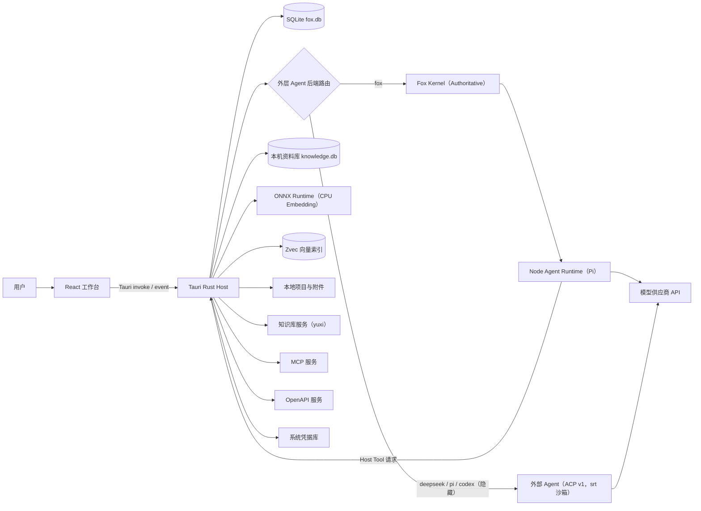
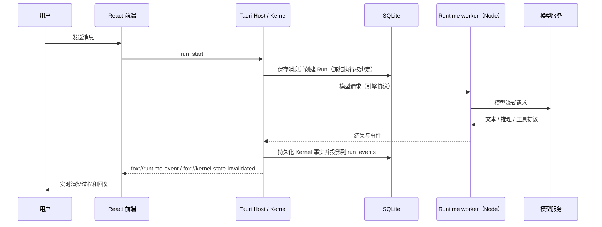

# 系统概览

> 状态：生效 
> 适用版本：Fox `0.1.x` 
> 维护范围：系统组件、主要数据流与运行边界 
> 最后更新：2026-10-25

## 一句话架构

Fox 由 React 前端、Tauri/Rust Host、SQLite、Fox 自己的 Kernel 加 Node Agent Runtime、经 ACP v1 接入的外部 Agent（dsh / pi，Codex 已实现但隐藏）、本机资料库（SQLite + ONNX + Zvec）和可选的远程知识库服务组成。Rust Host 是系统权限、持久化和运行协调的中心：每个会话创建时冻结一个外层 Agent 后端（`conversations.agent_backend`），之后 start / cancel / approve / resume 都先按它路由。

本页只给全景，细节以 `docs/02-架构/` 为准：[总体架构](../02-架构/总体架构.md)、[Agent Runtime 架构](../02-架构/Agent运行时架构.md)、[Tauri 后端架构](../02-架构/Tauri后端架构.md)。

## 组件关系

## 主要组件

| 组件 | 技术 | 责任 | 代码入口 |
| --- | --- | --- | --- |
| 桌面前端 | React 19、TypeScript、Vite | 页面、交互、流式事件归并、设置页（7 个入口） | `apps/desktop/src` |
| 桌面 Host | Tauri 2、Rust | Command / Event、数据库、权限、文件、进程生命周期、启动降级 | `apps/desktop/src-tauri/src/lib.rs` |
| 外层 Agent 后端 | Rust crate | 会话后端路由、ACP 客户端、外部 Agent 启动与沙箱、原生权限、凭据保存 / 删除规则 | `crates/fox-agent-backend`，Host 胶水 `apps/desktop/src-tauri/src/external_backend.rs`、`commands/agent_backend_routing.rs` |
| Kernel | Rust crate | Fox 会话的执行决策核（Authoritative 默认） | `crates/fox-agent-kernel`，Host 侧 `apps/desktop/src-tauri/src/runtime_host/kernel_*` |
| 引擎协议 | Rust + JS | Kernel 与模型引擎 worker 之间的协议 | `crates/fox-engine-protocol`、`packages/fox-engine-protocol` |
| Agent Runtime | Node.js、Pi | 模型循环、Prompt 组装、Typed Context、Execution Profile、工具请求、Kernel worker | `services/agent-runtime` |
| 产品数据库 | SQLite、rusqlite | 会话、消息、Run、事件、工作图、记忆、专家、扩展和设置的事实源（schema v97） | `apps/desktop/src-tauri/src/database` |
| 本机资料库 | 独立 SQLite、ONNX Runtime、Zvec | 资料库与分块事实、CPU 向量、向量检索，RRF 混合召回 | `apps/desktop/src-tauri/src/local_knowledge*.rs`、`vector_store.rs` |
| 知识库适配 | Rust `yuxi` 模块 | 远程身份、Agent、知识库、文档、图谱和远程 Run | `apps/desktop/src-tauri/src/yuxi` |
| 扩展系统 | Skills、MCP、OpenAPI、Hooks | 在能力清单、凭据隔离、健康检查和审批策略下扩展能力 | `skills.rs`、`mcp.rs`、`mcp_openapi.rs`、`lifecycle_hooks.rs` |
| 专家与调度 | Expert Package、Workflow、Team、Digital Colleague | 冻结能力、恢复阶段、编排 Child Run 和持久 Trigger | `expert_*.rs`、`digital_colleagues.rs` |

## 会话路由

| `agent_backend` | 执行方式 | 状态 |
| --- | --- | --- |
| `fox` | 先按 Agent 的 `runtime_type` 分流：`pi` 走本地 Kernel / Runtime；`yuxi` 走远程知识库 Agent | 默认 |
| `deepseek` | `ExternalBackendHost` 启动 dsh，ACP v1 | 内置，实验 |
| `pi` | `ExternalBackendHost` 启动 pi-acp + pi，ACP v1 | 内置 |
| `codex` | 同上（codex-acp） | 已实现，隐藏；新建会被拒（`agent_backend_hidden`） |

新会话的后端优先级：`FOX_EXTERNAL_BACKENDS`（只能强制关闭）> 设置 → Agent →「外部 Agent」→「新会话使用的 Agent」> Fox。Fox 会话内部的执行权：已冻结的 Run 绑定 > `FOX_KERNEL_MODE` > Authoritative（`apps/desktop/src-tauri/src/runtime_host/kernel_authority.rs::select`）；`legacy` 只用于调试和兼容旧 Run。

## Fox 会话数据流（Kernel / Authoritative）

工具提议由 Host 校验后执行；前端状态由 SQLite 快照、事件去重和运行恢复共同保证最终一致，不依赖一次监听。

## 外部 Agent 会话数据流

Host 从 Fox 管理的运行时目录启动外部 Agent（不用 `npx`），只传白名单环境变量，在 srt 沙箱里运行；经 ACP v1 建立会话后，Agent 的消息、工具和审批请求被映射成同一 `fox://runtime-event`，写入同一 SQLite 会话。审批经 ACP `session/request_permission` 由 Host 作答。外部会话必须绑定项目才能开始运行，不支持 resume。

## Agent 工作闭环（Fox 会话）

简单问答不进入这条状态机。复杂工作由 Host 创建并推进权威状态；模型自由文本、工具返回和 Child completed 都不能直接把 Task 或 Goal 标记为完成。

## 工具执行边界（Fox 会话）

- 工具必须同时出现在 Runtime 能力清单和 Host 协议中，并被当前 Execution Profile 允许。
- 附件、写文件、程序执行、知识库和 MCP 都回到 Host 执行，Host 校验工具目录、冻结 Profile、会话身份、项目边界、参数和审批策略。
- 生产构建中没有经过验证的命令后端，任意 Shell 保持拒绝（`tool.sandbox_unavailable`）；固定能力工具经 `tool_host::run_contained_program` 启动，有环境变量白名单、进程回收和资源上限，但没有文件或网络隔离。
- 失败、未知或冲突状态默认拒绝。

事实源：`services/agent-runtime/src/runtime-contract.mjs`、`apps/desktop/src-tauri/src/runtime_host/protocol.rs`、`apps/desktop/src-tauri/src/tool_host.rs`、`apps/desktop/src-tauri/src/tool_guard.rs`、`apps/desktop/src-tauri/src/process_jobs.rs`。

## 数据所有权

| 数据 | 事实源 | 补充存储 |
| --- | --- | --- |
| 会话、消息、Run、工具调用、会话后端 | `fox.db` | `runtime-sessions/` 保存 Runtime 恢复检查点；外部 Agent 的原生会话只用于执行 |
| 项目和授权 | `fox.db` | 本地文件系统提供实际内容；「新项目权限」存前端 localStorage |
| 模型供应商与协议 | `fox.db`（含 v97 `protocol_profiles`） | API Key 存系统凭据库（服务名 `com.fox.agent.model`），按 base URL 共享 |
| 附件 | `<data>/attachments` | SQLite 保存元数据和关联 |
| 远程知识库文档 | 知识库服务 | `<data>/cache/knowledge-preview` 缓存预览 |
| 本机资料库 | `knowledge.db`、原文件、Zvec | Zvec 索引是可从分块和模型重建的派生数据 |
| Skills 与扩展源 | 数据目录、`fox.db`、凭据库 | Host 保管凭据并执行调用 |
| 外部 Agent 登录信息 | Fox 管理的私有 HOME | 可从真实 HOME 按白名单导入 |
| 迁移前备份 | `<data>/backups` | 保留最新 5 份 |

## 启动与恢复

`apps/desktop/src-tauri/src/lib.rs` 的 setup 依次：

1. 确定数据目录（`FOX_DATA_DIR` 优先）。
2. 应用待恢复的备份。
3. 打开 `fox.db`：有待执行迁移时先备份；迁移后写入内置 Agent 和内置专家，并修复缺失的 Agent 行（`repair_missing_agent_references`）。
4. 修复中断的 Run，启动 Kernel 状态发布。
5. 创建 Runtime Session、附件、Skills 目录；Office 初始化。
6. 构造 RuntimeHost，恢复 Graph 评审等待项，启动数字同事调度器，后台恢复远程 Run。
7. 构造 `ExternalBackendHost`，执行外部 Agent 启动期恢复，并把上次遗留的外部活动 Run 标为中断。
8. 解析本机资料库根目录并打开（不可写时降级）。
9. 恢复预览缓存（失败只记日志，使用时再报错）和 Kernel Run。
10. 创建窗口。

主库打不开、迁移失败等无法降级的错误交给 `apps/desktop/src-tauri/src/startup_failure.rs`：记 `fox.startup error setup_failed` 日志，Windows 上弹出「Fox 无法启动」对话框（写明路径、原因、数据库未被删除、备份目录），然后退出。非 Windows 只有日志。

退出时依次关闭 Kernel 状态发布、RuntimeHost、MCP 连接和外部 Agent 进程。详见 [Tauri 后端架构 · 启动生命周期](../02-架构/Tauri后端架构.md)。

## 部署形态

Fox 以 Windows 桌面安装包交付（`pnpm tauri:build:windows`，NSIS）。Vite 构建产物嵌入 Tauri 应用，Agent Runtime 作为 Sidecar 打包。外部 Agent 从 Fox 管理的运行时目录启动。知识库服务、模型和 MCP 可以是本机或远程服务，不随安装包部署。代码签名、自动更新和 SBOM 尚未配置（见[当前状态与核验基线](当前状态与核验基线.md)）。

## 关联文档

- [仓库结构](仓库结构.md)
- [能力矩阵](能力矩阵.md)
- [总体架构](../02-架构/总体架构.md)
- [Tauri 后端架构](../02-架构/Tauri后端架构.md)
- [Agent Runtime 架构](../02-架构/Agent运行时架构.md)
- [数据架构](../02-架构/数据架构.md)
- [Agent 安全与可信执行](Agent安全与可信执行.md)
