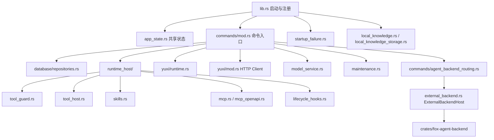

# Tauri 后端架构

> 状态：生效 
> 适用版本：Fox 0.1.x 
> 维护范围：Tauri Command、AppState、Repository、Host Service 和系统资源 
> 最后更新：2026-10-25

> 复核状态（2026-10-25）：已对照 `main@c8a42a9` 复核正文。核对范围：`apps/desktop/src-tauri/src/lib.rs` 启动与退出流程、`startup_failure.rs`、`database/repositories.rs`（`Database::open`）、`local_knowledge.rs` / `local_knowledge_storage.rs` 的启动降级、`maintenance.rs` 预览缓存启动恢复、`runtime_host/kernel_run_lock.rs`、`external_backend.rs`、`tauri.conf.json` 的 CSP。「测试依据」只核对了文件和测试名存在，没有逐条复核断言内容。

## 定位

Tauri 后端是 Fox 的可信 Host：它连接 WebView、SQLite、文件系统、系统凭据库、Fox 会话的 Kernel 与 Node Agent Runtime、外部 Agent（ACP）进程、知识库服务和 MCP。所有具有本地副作用的能力必须经过此层。

结论：
- 启动时能就地降级的问题（Kernel 锁目录、本机资料库存储、预览缓存、缺失的 `agents` 行）不再中止启动；其余 setup 错误统一交给 `startup_failure.rs`，记录日志、在 Windows 上弹出「Fox 无法启动」并以退出码 1 结束，不再进入 tauri 的 `panic!`。
- 外层 Agent 后端的 Host 胶水在 `apps/desktop/src-tauri/src/commands/agent_backend_routing.rs` 和 `apps/desktop/src-tauri/src/external_backend.rs`，决策与规则在 `crates/fox-agent-backend`，见 [Agent Runtime 架构 · 外层 Agent 后端](Agent运行时架构.md#外层-agent-后端四-agent)。

## 模块结构

## 启动生命周期

`lib.rs::run` 在 tauri `setup` 钩子里用一个内层闭包执行全部初始化，顺序如下（以代码为准）：

1. 确定数据目录：`FOX_DATA_DIR` 优先，否则 Tauri `app_data_dir`；设置了 `FOX_DATA_DIR` 时 WebView 数据也隔离到 `<data>/webviews/<窗口 label>`。
2. `maintenance::apply_pending_restore` 应用待恢复的备份。
3. `Database::open_with_migration_backup` 打开 `<data>/fox.db`：有待执行迁移时先在 `<data>/backups/` 做一致性备份（保留最新 5 份，`database/migration_backup.rs`），备份失败则不打开、不迁移。`Database::open` 内依次执行迁移、写入数据根 UUID、`seed_builtin_agents`、`seed_bundled_experts`、`seed_expert_avatars`，最后 `repair_missing_agent_references`（见下文「启动降级」）。
4. `repair_interrupted_runs`、`audit_interrupted_tasks`；启动 `KernelStatePublisher`。
5. 创建 `runtime-sessions/`、`attachments/`、`skills/`；Office 初始化与内置 Office Skills 安装。
6. 构造 `RuntimeHost`，恢复 Shadow 观察、Graph 节点评审 / 取消 / 待验收；启动数字同事调度器；`YuxiRuntimeHost` 后台恢复远程 Run。
7. 构造 `ExternalBackendHost`（无论 `FOX_EXTERNAL_BACKENDS` 取值）：执行外部启动的启动期恢复（`fox_agent_backend::external_launch::recover_at_startup`），并把上个进程遗留的外部会话活动 Run 标为中断（`interrupt_external_runs_left_active`）。
8. 解析本机资料库根目录（`local_knowledge_storage::resolve_startup_root`）并 `LocalKnowledgeStore::open_for_startup_root`；没有启动问题时才写入默认的 Fox 使用指南。
9. 注册 `AppState`；`maintenance::recover_knowledge_preview_cache_at_startup`（不会失败）；`recover_kernel_runs_detached`。
10. 按需创建隔离窗口；Windows 安装窗口缩放处理。

应用退出时依次关闭 `KernelStatePublisher`、`runtime_host.shutdown()`、`mcp::shutdown_connections()` 和 `ExternalBackendHost::shutdown_blocking()`，避免遗留 Sidecar、stdio MCP 或外部 Agent 子进程。

`AppState` 持有可共享的数据库句柄、Runtime Host、知识库客户端、远程 Runtime、模型客户端、本机资料库、数据路径，以及下载/预览任务的取消注册表和锁。AppState 管理基础设施引用，不应成为新的业务数据事实源。

## 启动降级与失败报告

| 问题 | 处理 | 代码 |
| --- | --- | --- |
| 本机资料库根目录不可写、是文件，或配置的路径无法解析（如 Windows 拒绝写入的 ACL） | 不中止启动。已配置路径时保持该路径并以降级状态打开（只读或空），`degradedReason` 为「知识库路径不可写：<路径>」；只有未配置路径时才用默认 `<data>/local-knowledge`。打开成功后还会写探测文件 `.fox-write-probe`，写不进也降级。日志：`configured_storage_unresolvable` / `startup_storage_unwritable` | `local_knowledge_storage.rs`（`resolve_startup_root`、`StartupRoot`）、`local_knowledge.rs`（`open_for_startup_root`、`open_degraded`、`startup_issue`） |
| 预览缓存目录 `<data>/cache/knowledge-preview` 是文件或不可用 | 启动只重置租约并尝试清理，失败记 `fox.knowledge_preview warn startup_recovery_deferred`；真正使用缓存时才返回带路径的错误（如 `knowledge.preview_cache_dir_invalid`「预览缓存目录：<路径> 应为目录但是文件」） | `maintenance.rs`（`recover_knowledge_preview_cache_at_startup`）、`commands/mod.rs` |
| Kernel 锁目录 `runtime-sessions/kernel-run-locks` 是文件 | 不在启动时检查；获取 Run 锁时返回带路径的错误 | `runtime_host/kernel_run_lock.rs`、`data_paths.rs`（`ensure_directory`） |
| `agents` 行在 Fox 之外被删除（如 `sqlite3` 命令行，外键默认关闭） | 迁移的外键检查放过父表为 `agents` 的孤立行；内置库专家行按随包目录重建；其余引用由 `repair_missing_agent_references` 修复。详见[数据架构 · 启动修复缺失的 Agent 行](数据架构.md#启动修复缺失的-agent-行) | `database/migrations.rs`、`database/repositories.rs`、`database/repositories/bundled_capabilities.rs` |
| 主库打不开、迁移失败、迁移前备份失败或其他 setup 错误 | 不降级（整个应用依赖主库）。错误交给 `startup_failure`：数据库错误用 `database_open_message`（数据库路径、原因、「数据库文件没有被删除」、自动备份目录 `<data>/backups`），其他错误由 `setup_failure_message` 附上数据目录；`report` 记录 `fox.startup error setup_failed`，Windows 上用 `MessageBoxW` 弹出标题为「Fox 无法启动」的对话框，然后 `std::process::exit(1)` | `startup_failure.rs`、`lib.rs` |

非 Windows 平台没有对话框，只有标准错误输出里的日志行。

## 命令层规则

- Tauri Command 只做参数校验、编排和 `ApiResponse<T>` 转换。
- 业务持久化放入 Repository；外部 HTTP 放入专用 Client。
- 长任务通过异步命令或脱离请求的 Runtime 任务执行。
- 前端不能传入任意存储路径绕过受管目录。
- 错误必须保留稳定错误码或可识别上下文，避免只返回“失败”。

命令分组详见 `04-技术参考/Tauri命令与事件.md`。

## 并发与锁

- SQLite 使用 WAL、5 秒 busy timeout，并通过 `Database` 封装访问。
- Kernel 的不同会话及模型请求没有应用自设的同时运行数量上限；`FOX_KERNEL_RUN_CAPACITY`、`FOX_KERNEL_CHILD_RUN_CAPACITY`、`FOX_KERNEL_MODEL_REQUEST_CAPACITY` 不再生效。Host 仍按 Run 身份防重复启动，单会话状态和事件按 `seq` 去重。Legacy 保留单 Worker 顺序执行。
- 工具执行与同一文件写入仍遵守各自的锁、权限、审批及版本检查；这类等待不能显示成并发容量排队。单次运行的时长、重试和防重复工具调用边界不因去限额而放宽。
- 本机资源不足或模型服务限流时，运行按既有错误与有界重试路径结束或报告；Host 不增加隐藏容量队列，也不无限重试。
- 扩展连接池按 source 串行请求，复用 stdio 进程或 HTTP MCP Session；配置变化使旧连接失效。
- 知识预览以 `cache_key` 获取异步互斥锁，避免同一原件重复下载。
- 下载与预览使用取消注册表；完成路径必须注销操作。

## 文件与路径边界

- 项目文件访问先 canonicalize，并验证目标位于授权根目录内。
- 附件只能从 Fox 管理的 `attachments` 根读取。
- 预览缓存路径由 Host 根据哈希生成，前端只传缓存键。
- 备份恢复校验相对路径、大小和清单，使用待恢复目录在重启时应用。

## 失败恢复

| 故障 | 当前处理 |
|---|---|
| 上次运行中断 | 启动时修复 Run，远端 Runtime 恢复轮询；外部 Agent 会话的活动 Run 由 `ExternalBackendHost` 标为中断（`agent_backend_host_restarted`） |
| Sidecar 不可用 | Runtime diagnostics 给出脚本/依赖/进程状态 |
| 下载中断 | `.part` 文件与操作注册表清理，支持取消 |
| 缓存残留 | 启动重置租约，按 LRU 和容量清理；缓存目录异常时推迟到使用时报错 |
| 资料库存储不可写 | 降级打开并在设置「资料库」页提示，见上文 |
| 主库无法打开 / 迁移失败 | 「Fox 无法启动」报告后退出，不删除数据库 |
| 数据恢复失败 | 保留回滚副本，阻止部分覆盖 |

## 安全注意

Host 是安全边界而不是简单代理。写文件、编辑、命令和 MCP 调用在执行前均需策略判断或用户审批；远程内容视为不可信。`tauri.conf.json` 的 `app.security` 已同时配置 `csp` 与 `devCsp`（完整策略字符串，含 `default-src 'self'`、`object-src 'none'`、显式 `connect-src`/`worker-src`），不再是「无 CSP」状态；仍需补充浏览器端策略回归。详见[安全架构](安全架构.md)。

## 测试依据

- `database/migrations.rs` 与 `repositories.rs` 内建数据库测试。
- `maintenance.rs` 覆盖缓存、备份、恢复和回滚。
- `runtime_host/mod.rs` 覆盖协议、依赖检测、附件与事件处理。
- `startup_failure.rs`：`unreadable_database_reports_chinese_message_with_path`、`setup_failure_message_names_data_dir_once`。
- `database/repositories/bundled_capabilities.rs` 中 `missing_agent_row_tests`：删除本机 / 内置库专家行后的启动、非 `agents` 外键违规的可读错误。
- `maintenance.rs`：`preview_cache_file_in_place_of_directory_does_not_fail_startup`；`local_knowledge_storage.rs` / `local_knowledge.rs`：配置路径无法解析或不可写时的降级用例（其中 unix 权限用例只在非 Windows 下编译，CI 为 Windows，未实际运行过）。
- `mcp.rs` 与 `mcp_openapi.rs` 使用假 stdio Server 和本地 HTTP Server 验证持久连接、Session/SSE、OpenAPI list/call/schema/timeout；`lifecycle_hooks.rs` 验证声明式动作与审计。

## 关键代码

`apps/desktop/src-tauri/src/lib.rs`、`app_state.rs`、`startup_failure.rs`、`commands/mod.rs`、`commands/agent_backend_routing.rs`、`external_backend.rs`、`runtime_host/mod.rs`、`maintenance.rs`、`local_knowledge_storage.rs`、`data_paths.rs`。

领域边界分别见[对话系统架构](对话系统架构.md)、[Agent Runtime 架构](Agent运行时架构.md)、[项目与权限架构](项目与权限架构.md)、[知识库集成架构](知识库集成架构.md)和[数据架构](数据架构.md)。
