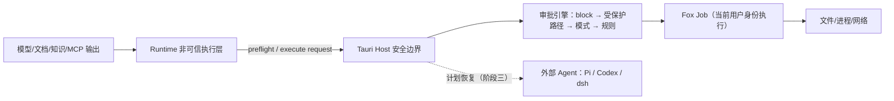

# 安全架构

> 状态：生效 
> 适用版本：Fox 0.1.x 
> 维护范围：Host 信任边界、凭据、项目/知识权限和不可信内容 
> 最后更新：2026-10-31（B4c：去掉 SRT 后的命令执行、四档审批与风险取舍；以 main `999bd912` 源码为准）

## 威胁模型

Fox 同时处理模型输出、知识库文本、附件、项目文件和第三方 MCP，这些输入均可能不可信。主要风险是目录越界、提示注入、任意命令、凭据泄漏、恶意文档、失控资源占用和依赖供应链问题。

## 信任边界

- **内置主线是 PiNative**：新 Run 和子 Run 一律走 Authoritative + PiNative，没有路由开关，也没有回退路径。Kernel 执行循环已经删除，历史 Kernel Run 在启动时标为中断（`executor_route_retired`，「执行路径已退役」），不再续跑。
- **外部 Agent 是可选后端，目前不可用**：Pi、Codex、dsh 在本版本处于退役状态，旧会话只读，start / cancel / approve / resume 都拒绝。它们计划在下一阶段（阶段三）恢复为可选后端；恢复前不能把源码中仍保留的 ACP 客户端、驱动或原生权限映射当作可用能力。
- Yuxi 远程服务保留独立边界。

## 已实现控制

### 文件权限

- 项目根和目标路径 canonicalize 后比较，阻止 `..`、绝对路径和链接逃逸。
- `read/grep/find/ls` 仅允许授权项目。
- 附件从受管根按数据库记录读取；文本提取有 1 MiB 限制。
- 写入和编辑由 Host 执行，受下文「审批引擎」的四档模式约束；写类工具先打开文件、再校验句柄，遇到符号链接或 junction 拒绝。
- 文件恢复以项目根为基准，打开后校验句柄，写不出项目外。

### 命令与工具

- 命令类工具（`run_command`、`test_run`、`code_check`、`format_code`）、写工具和联网工具按下文「审批引擎」判定；MCP Tool 在未获当前会话同名工具授权时审批。
- Runtime Capability Manifest、Host canonical protocol 与冻结 Execution Profile 必须一致；Assistant、Expert、Child 和 Reviewer 的有效工具取交集，不能通过 Prompt 扩权。
- Tool Call 与 Approval 落库，保存输入、决定、结果和错误。
- Runtime 能力清单拒绝未实现的 Host Tool。
- MCP/OpenAPI 工具先 list、校验 schema、再 call；超时或协议错误使当前持久连接失效。HTTP 固定源基址、禁止重定向并限制响应大小。
- Lifecycle Hook 只能阻断、强制审批或注解，不能执行脚本、改写参数或降低目录审批策略。声明式 Hooks 在插件中心的「策略」tab 和连接器设置页管理（两处复用 `apps/desktop/src/features/settings/lifecycle-hooks-section.tsx`）。
- 需要用户确认或输入的地方都用应用内对话框（`apps/desktop/src/components/ui/confirm-dialog.tsx`、`prompt-dialog.tsx`），`src` 下的应用代码不允许出现 `window.confirm` / `window.prompt` / `window.alert`，由 `apps/desktop/tests/no-native-confirm.test.ts` 守卫。

### 凭据

- 模型 API Key、知识库 Token、MCP 环境变量和扩展 HTTP Header 使用 OS Keyring。
- 模型 API Key 以供应商 Base URL 为键，在本机全局共享（同一 Base URL 的条目、Fox 和外部 Agent 共用一把 Key）；单独配置凭据的协议用 `fox-protocol:<provider>:<profile>` 作键。保存先写 Key 后写记录，失败回滚；删除供应商会删除其 Key，失败写审计警告。
- 外部 Agent 的私有 HOME 与凭据保留，供阶段三恢复时复用已有登录；目前不会因为登录状态而启动任何外部 Agent。
- SQLite 只保存 `credential_ref` 或 configured 状态。
- Runtime 仅在初始化时得到当前模型所需密钥，不应写日志或事件。

### 不可信内容

Runtime 稳定指令明确要求知识、附件、网页和工具输出不能改变系统规则、索取密钥或绕过审批。动态数据进入带 Authority 的 Context Block，稳定提示词与动态上下文分别计算 Hash。该提示词工程是纵深防御，不替代 Host 的强制权限。

Goal/Task/Evidence 同样属于安全边界：粘贴文本、Markdown 或工具输出中的“建立目标”不得直接创建产品状态；Runtime 只能通过 Host Work Tool 提议，激活和完成必须经过 Host 状态机与证据校验。

高风险 Graph 节点由独立 `graph_reviewer_v1` Child Run 审查。Reviewer 只能使用 `read/ls/find/grep`，不能写入、审批、继续委派或改变 Work 状态；其 pass 仍需 Lead 使用专用 finish，最终 Goal Acceptance 会重新校验当前 Plan、Evidence、Child hash、Review proof 和 Finding。

### 数据与下载

- 缓存使用 Host 生成的路径和 `.part` 原子写入。
- 预览/下载支持大小、Range 和取消控制。
- 备份恢复校验相对路径与清单，避免 Zip Slip 和部分覆盖。

### 执行准入与文件提交

自提交 `b6cd463`（“Complete durable permission admission and safe file execution”）起，权限准入与文件提交已进入普通 Host 链路，不再只是 Kernel 专项：

- **Host 读取基线**：写入的版本前置条件取自 Host 实际读取得到的 observation，模型自报的 `expectedVersion` 不构成授权。observations 持久化在 `kernel_host_observations`；文件提交层还会独立校验参数摘要并检测外部修改。
- **持久单次领取**：一次 dispatch 只允许一次持久领取，由 `kernel_execution_attempts` 的主键 `(run_id, dispatch_id)` 加仓库层 CAS 保证，跨独立连接也只有一方成功。`claimed` ≠ 已启动；`Ok` ≠ 已启动；`start_confirmed` 一旦为 1 不回退。
- **原子文件提交**：Windows 走系统替换操作并核验保存的前镜像，POSIX 在 rename 前再次核对；提交保留前镜像与结算记录，版本登记在文件临界区内。异常路径保留日志与恢复材料。
- **审批随策略代次失效**：权限模式更新使用请求标识加版本 CAS；策略版本变化会作废未消费的原审批（已签发 dispatch 的意图除外，不能借重新授权重放）。
- **不确定结果不重放**：`leased` 的 outbox 项、`unknown` 的 attempt、证据不足的写命令一律不重跑，转为对账或人工核对；持久拒绝可被重复查询但不能重新领取。

以上为源码实现层结论。对应的定向测试记录见[权限与文件安全集成验证（2026-09-22）](../评审/权限与文件安全集成验证-2026-09-22.md)，注意该记录产生于提交前工作树，且不构成 GUI、云模型、安装包或跨平台验收。

### 外部 Agent 会话（计划恢复）

- 外部 Pi、Codex、dsh（DeepSeek Harness）目前处于退役状态：新会话不能选择，旧会话只读，start / cancel / approve / resume 返回 `agent_backend_retired`，也不会改绑为内置 PiNative 继续运行。
- 计划在阶段三恢复为可选后端：外部 Pi 与 PiNative 共用同一套审批引擎（含规则和 block 规则）；Codex、dsh 使用各自的原生沙箱和审批，Fox 只把它们的 `request_permission` 转成审批卡。这是计划，不是现状。
- `FOX_EXTERNAL_BACKENDS` 只保留诊断解析，任何取值都不能重新启用外部后端。数据库冻结标识、历史原生权限记录、ACP 客户端、私有 HOME 和凭据模块仍保留，不代表当前可执行。

### Fox Host 命令执行：不用沙箱，在 Fox Job 里执行

Fox 自身**不使用沙箱**。SRT（sandbox-runtime）、Windows ACL / 祖先 ACE 协调、SRT 专用账户和网络代理已在 A1、B2 删除。运行时打包脚本不再打包 srt 和 acp-bridge；当前 pin 的 0.1.6 运行时包里仍带 `srt\`，安装时会被删掉，重建并重新 pin 留给 B5。旧机器上由 Fox 安装的 SRT 会在升级安装时卸载。命令在 Host 上以**当前用户身份**执行，可以访问网络。

- `run_command`（含后台命令作业）走 `command_spawn_spec + run_contained`，进程放进 **Fox Job**：Windows 用 Job Object（`KILL_ON_JOB_CLOSE`），其他平台用进程组；能力查询报告 `FoxJob` / `fox-job:v1`。
- Windows 下 shell 为 `cmd.exe /D /S /C`，其他平台为 `sh -lc`；输出逐行解码（含中文代码页）。
- 环境变量按平台白名单传入，不继承 Fox 父进程的完整环境。
- 超时和取消时清理整棵进程树（`terminate_and_confirm`）。
- 只读模式下禁止执行任何命令类工具。
- 固定能力工具 `git_read`、`test_run`、`code_check`、`format_code` 由 Host 生成固定程序和参数，经 `tool_host::run_contained_program` 启动，同样只有环境变量白名单、进程回收和资源上限。`git_read` 用单个 git 进程，禁用 filter、textconv、fsmonitor、hooks 及系统级和全局配置；target 以 `-` 开头直接拒绝。
- 文件工具（`read_file` / `write_file` / `edit_file`）在 Host 进程内执行，靠路径规范化、项目根检查、句柄校验和重解析点拒绝保护。
- Fox Job 只负责超时、取消和清理进程树，**不限制**命令能读写哪些文件、能连哪些网络。审批卡里的 `hostExecution` 字段如实写明这一点（`isolation: none`、`identity: current_user`）。

源码依据：`apps/desktop/src-tauri/src/process_jobs.rs`（`FoxJobBackend`）、`tool_host.rs`、`runtime_host/command_jobs.rs`、`runtime_host/capability_tools.rs`。

### 审批引擎（四档）

Fox 自有工具的审批集中在 `apps/desktop/src-tauri/src/runtime_host/approval_policy.rs`，判定只依据 Host 自己能核实的事实（Host 准备的命令行、目标路径），不依据模型的文字说明。判定顺序：

1. **block 规则**：内置危险删除和项目的 `block` 规则，任何模式下都拒绝，完全访问也不例外。
2. **受保护路径 / 越出项目**：只有完全访问能放行。
3. **当前模式**：只读 / 询问 / 自动 / 完全访问。
4. **allow / ask 规则**：项目规则，按命令 token 前缀匹配。
5. **默认**：见下表。

| 工具类别 | 只读 | 询问 | 自动 | 完全访问 |
|---|---|---|---|---|
| 读（read / ls / find / grep / git_read / sqlite_read / tabular_data / read_tool_result 等） | 放行 | 放行 | 放行 | 放行 |
| 项目内写 / 编辑 | 拒绝 | 问 | 放行 | 放行 |
| 命令类（run_command、test_run、code_check、format_code） | 拒绝 | 问；被 allow 规则完全覆盖时放行 | 低风险放行，高风险问；被 allow 规则完全覆盖时放行 | 放行 |
| 联网（web_search、web_read、http_request、system_info） | 问 | 问 | 放行 | 放行 |
| 越出项目 / 受保护路径 | 拒绝 | 问 | 问 | 放行 |
| block 规则命中 | 拒绝 | 拒绝 | 拒绝 | 拒绝 |

**模式的存储**：`conversations.permission_mode` 仍是 `read_only / ask / allow`，`allow` 在界面上叫「自动」；新列 `conversations.full_access`（默认 0）为 1 且模式为 `allow` 时才是完全访问。运行中切换模式，从下一次工具调用开始生效。

**高风险**由 Host 硬规则判定：越出项目根；`git push`、`git reset --hard`、`git clean`；`rm -r*`、`del /s`、`rd /s`、`Remove-Item -Recurse`、`rimraf`；从 `curl` / `wget` / `iwr` / `irm` 管道进 shell 或解释器（`curl | sh`、`iwr | iex`）、`iex` / `Invoke-Expression`；`sudo`、`doas`、`su`、`runas`、`gsudo`、`pkexec`；命令替换；改动 `.git`、`.fox`、shell 配置文件；包管理器全局安装（`npm -g`、`cargo install`、`pip install --user` 等）。模型可以在命令工具参数里附带 `risk`，但只能调高、不能调低。`bash -c`、`cmd /c`、`powershell -Command` 会展开内部脚本一起判定。

**受保护路径**：项目内的 `.git`、`.fox`，以及 shell 配置文件（`.bashrc`、`.bash_profile`、`.bash_login`、`.profile`、`.zshrc`、`.zprofile`、`.zshenv`、`config.fish`、`profile.ps1`、`Microsoft.PowerShell_profile.ps1`）；任何越出项目根的路径也按这一档处理。

**block 规则**：
- 内置：删除或清空（含 `*` 通配）盘符 / 文件系统根目录、家目录、项目根目录（或它们的上级）。在任何模式下都拒绝，错误码 `permission.blocked`。
- 项目：`permission_rules` 中 `effect='block'` 的规则，命令任一段命中前缀即拒绝。

**前缀规则**（表 `permission_rules`：`project_id`、`effect` allow / ask / block、`tool`（具体命令工具或 `*`）、`pattern`、`source` user / builtin、`created_at`、`revoked_at`）：
- 按 token 前缀匹配：`npm test` 匹配 `npm test -- foo`，不匹配 `npm testx`；首个 token 按命令名比较（忽略路径与扩展名）。
- 复合命令（`&&`、`||`、`&`、`;`、`|`、换行）拆段逐段检查，**每一段**都要被 allow 规则覆盖才放行；任一段命中 ask 规则就问。
- 宽泛前缀不覆盖高风险段：`git` 不覆盖 `git push`，只有规则本身写明 `git push` 才行。
- 含命令替换或嵌套 shell 脚本的命令不能用规则放行，也不提供「总是允许」。
- 规则前缀只能是一条普通命令，不能含连接符、重定向或命令替换，最长 500 字符。
- 审批卡提供「本项目总是允许此命令」，按钮上显示将要写入的前缀，用户可以编辑；设置页列出规则，可单独撤销（写 `revoked_at`，不删行）。
- 命令类工具不再有会话级授权：按输入哈希的「本会话允许」（TX-1）已删除，旧授权表只停用、不删。审批卡只有「允许一次」「本项目总是允许」「拒绝」。MCP 工具仍保留会话级授权。

**完全访问的二次确认**：每个项目首次开启完全访问时，应用内确认框要求二次确认，确认后写 `projects.full_access_confirmed_at`，此后在该项目内不再重复确认。

**审计**：每次**自动放行**（因模式、完全访问或 allow 规则放行，纯读操作除外）都写一条 `permission_audit` 记录：会话、Run、工具调用、工具名、模式、类别、风险、放行原因、命中的规则 ID、风险发现（findings）和命令摘要（最多 500 字符）。可在 Run 详情中查看（`permission_audit_list`）。经用户点选的审批仍记录在 `approvals` 表。

### 风险取舍（用户已接受）

去掉 SRT 是有意的取舍，代价写在这里：

1. **命令安全只靠审批、规则和 Fox Job。** 没有 OS 级的文件或网络隔离；Fox Job 只管超时、取消和清理进程树。一条被放行的命令可以读写当前用户能访问的任何文件、连接任何网络。
2. **在自动和完全访问模式下，等同于用户本人执行。** 自动模式下低风险命令不经确认直接运行；完全访问下除 block 规则外全部放行。高风险判定是基于命令 token 的启发式，不能识别所有危险行为（例如脚本内部做了什么）。
3. **前缀规则可以被「先改脚本再执行」绕过。** 例如允许了 `npm test`，模型可以先改写 `package.json` 里的 test 脚本（自动模式下项目内写入直接放行）再运行 `npm test`，规则仍然只认前缀。业界同类方案也有这个问题。缓解办法是审计：每次自动放行都记录模式和命中的规则，可以事后追溯。
4. 只读和询问模式下，命令类工具不会未经用户同意执行。需要更强保证时，请使用这两档。

外部 Agent 恢复后（阶段三），Codex、dsh 自带的原生沙箱属于它们自己的功能，保留使用；Fox 不模拟它们的沙箱。

## 已知风险

| 风险 | 状态 | 建议 |
|---|---|---|
| CSP 已配置但缺浏览器端验证 | 部分控制 | `csp` 与 `devCsp` 均为完整策略（`default-src 'self'`、`object-src 'none'`、`base-uri 'self'`、显式 `connect-src`/`worker-src`）；仍需补充策略回归测试，并对新增外部内容逐项确认白名单 |
| Fox Host 命令不在沙箱内执行 | 已接受的取舍 | 命令以当前用户身份在 Fox Job 中运行，安全只靠审批、规则和 Job；见上文「风险取舍」 |
| 前缀规则可被「先改脚本再执行」绕过 | 已接受的取舍 | 靠 `permission_audit` 追溯；需要更强保证时用只读或询问模式 |
| MCP 命令与 HTTP 地址可由用户配置 | 部分控制 | 增加可执行文件确认、签名/来源提示、OAuth/证书固定和细粒度速率配额 |
| Runtime 与 MCP 非容器隔离 | 未解决 | 明确桌面威胁模型，评估 Windows Job/AppContainer |
| Office/PDF 渲染第三方内容 | 部分控制 | 保持库更新、限制文件大小、禁用外链和脚本 |
| API 协议兼容层差异 | 持续风险 | Provider 契约测试、响应字段净化和尺寸限制 |
| 依赖供应链 | 部分控制 | 锁文件策略、审计、构建来源记录与 SBOM |

## 安全失败原则

- 无项目、路径无法解析、权限值未知时默认拒绝。
- 无知识绑定时知识工具返回空或拒绝，不能扩大范围。
- 未知 MCP Schema、能力枚举或协议版本默认拒绝。
- 审批超时/取消视为未批准。
- 安全错误不得自动降级成更宽松路径；失败不回退到其他执行路径（不回退到 Kernel，不回退到别的后端）。
- Assistant 与 Expert 能力声明均为限权输入；有效工具和 MCP Server scope 取 Host、Assistant、Expert 的交集，任一显式空 Allowlist 都不会被另一方扩大。
- `expertBinding` 与专家卡片是 Host-owned 元数据；只有绑定记录指向的 Expert 能进入 Runtime Overlay，模型不能通过文本自行切换专家。

## 安全验证

现有测试覆盖四档 × 各类工具的审批判定表、前缀匹配与复合命令、完全访问下 block 规则仍生效、取消和超时后进程树清零、路径越界、未知工具、Execution Profile、权限交集、审批、持久 stdio、HTTP Session/SSE、OpenAPI schema/超时/响应边界、Hook 动作与审计、缓存路径、备份恢复、知识 Range、Prompt Injection 隔离、Evidence、独立 Reviewer、Graph Acceptance 和恢复旁路。发布前还应运行依赖审计、秘密扫描、恶意压缩包/超大文件测试及最小权限人工检查。

## 关键代码

`tool_guard.rs`、`tool_host.rs`、`mcp.rs`、`mcp_openapi.rs`、`lifecycle_hooks.rs`、`model_service.rs`、`yuxi/mod.rs`、`maintenance.rs`、`runtime-contract.mjs`；审批：`runtime_host/approval_policy.rs`、`database/repositories/permission_rules.rs`；命令执行：`process_jobs.rs`、`runtime_host/command_jobs.rs`；外部 Agent（计划恢复）：`crates/fox-agent-backend/src/{host_routing,external_launch,external_home,native_permission,credential_save,credential_delete}.rs`、`apps/desktop/src-tauri/src/external_backend.rs`。

详细边界见[项目与权限架构](项目与权限架构.md)、[Agent Runtime 架构](Agent运行时架构.md)、[知识库集成架构](知识库集成架构.md)和[可观测性与测试架构](可观测性与测试架构.md)。

面向用户和答辩场景的解释见[Agent 安全与可信执行](../01-项目概览/Agent安全与可信执行.md)。
