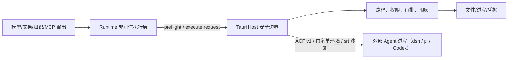

# 安全架构

> 状态：生效 
> 适用版本：Fox 0.1.x 
> 维护范围：Host 信任边界、凭据、项目/知识权限和不可信内容 
> 最后更新：2026-10-25

## 威胁模型

Fox 同时处理模型输出、知识库文本、附件、项目文件和第三方 MCP，这些输入均可能不可信。主要风险是目录越界、提示注入、任意命令、凭据泄漏、恶意文档、失控资源占用和依赖供应链问题。

## 信任边界

会话的执行者分两类：Fox 会话（Kernel / Authoritative 默认，Legacy 仅调试和旧 Run）由本文下面的 Host 控制约束；外部 Agent 会话（DeepSeek Harness、pi，以及已实现但暂时隐藏的 Codex）由 Agent 自己执行工具，Fox 负责启动环境、沙箱、审批作答和审计，见下文[外部 Agent 会话](#外部-agent-会话)。

## 已实现控制

### 文件权限

- 项目根和目标路径 canonicalize 后比较，阻止 `..`、绝对路径和链接逃逸。
- `read/grep/find/ls` 仅允许授权项目。
- 附件从受管根按数据库记录读取；文本提取有 1 MiB 限制。
- 写入和编辑由 Host 执行并受项目 `read_only/ask/allow` 策略约束。

### 命令与工具

- `run_command` 和 MCP Tool 默认总是审批。
- Runtime Capability Manifest、Host canonical protocol 与冻结 Execution Profile 必须一致；Assistant、Expert、Child 和 Reviewer 的有效工具取交集，不能通过 Prompt 扩权。
- Tool Call 与 Approval 落库，保存输入、决定、结果和错误。
- Runtime 能力清单拒绝未实现的 Host Tool。
- MCP/OpenAPI 工具先 list、校验 schema、再 call；超时或协议错误使当前持久连接失效。HTTP 固定源基址、禁止重定向并限制响应大小。
- Lifecycle Hook 只能阻断、强制审批或注解，不能执行脚本、改写参数或降低目录审批策略。声明式 Hooks 在插件中心的「策略」tab 和连接器设置页管理（两处复用 `apps/desktop/src/features/settings/lifecycle-hooks-section.tsx`）。
- 需要用户确认或输入的地方都用应用内对话框（`apps/desktop/src/components/ui/confirm-dialog.tsx`、`prompt-dialog.tsx`），`src` 下的应用代码不允许出现 `window.confirm` / `window.prompt` / `window.alert`，由 `apps/desktop/tests/no-native-confirm.test.ts` 守卫。

### 凭据

- 模型 API Key、知识库 Token、MCP 环境变量和扩展 HTTP Header 使用 OS Keyring。
- 模型 API Key 以供应商 Base URL 为键，在本机全局共享（同一 Base URL 的条目、Fox 和外部 Agent 共用一把 Key）；单独配置凭据的协议用 `fox-protocol:<provider>:<profile>` 作键。保存先写 Key 后写记录，失败回滚；删除供应商会删除其 Key，失败写审计警告。
- 外部 Agent 的登录文件放在 Fox 管理的私有 HOME，只按白名单、经用户确认从真实 HOME 导入，审计只记名字。
- SQLite 只保存 `credential_ref` 或 configured 状态。
- Runtime 仅在初始化时得到当前模型所需密钥，不应写日志或事件。

### 不可信内容

Runtime 稳定指令明确要求知识、附件、网页和工具输出不能改变系统规则、索取密钥或绕过审批。动态数据进入带 Authority 的 Context Block，稳定提示词与动态上下文分别计算 Hash。该提示词工程是纵深防御，不替代 Host 的强制权限。

Goal/Task/Evidence 同样属于安全边界：粘贴文本、Markdown 或工具输出中的“建立目标”不得直接创建产品状态；Runtime 只能通过 Host Work Tool 提议，激活和完成必须经过 Host 状态机与证据校验。

高风险 Graph 节点由独立 `graph_reviewer_v1` Child Run 审查。Reviewer 只能使用 `read/ls/find/grep`，不能写入、审批、继续委派或改变 Work 状态；其 pass 仍需 Lead 使用专用 finish，最终 Goal Acceptance 会重新校验当前 Plan、Evidence、Child hash、Review proof 和 Finding。

### 数据与下载

- 缓存使用 Host 生成的路径和 `.part` 原子写入。
- 预览/下载支持大小、Range 和取消控制。
- 备份恢复校验相对路径与清单，避免 Zip Slip 和部分覆盖。

### 执行准入与文件提交

自提交 `b6cd463`（“Complete durable permission admission and safe file execution”）起，权限准入与文件提交已进入普通 Host 链路，不再只是 Kernel 专项：

- **Host 读取基线**：写入的版本前置条件取自 Host 实际读取得到的 observation，模型自报的 `expectedVersion` 不构成授权。observations 持久化在 `kernel_host_observations`；文件提交层还会独立校验参数摘要并检测外部修改。
- **持久单次领取**：一次 dispatch 只允许一次持久领取，由 `kernel_execution_attempts` 的主键 `(run_id, dispatch_id)` 加仓库层 CAS 保证，跨独立连接也只有一方成功。`claimed` ≠ 已启动；`Ok` ≠ 已启动；`start_confirmed` 一旦为 1 不回退。
- **原子文件提交**：Windows 走系统替换操作并核验保存的前镜像，POSIX 在 rename 前再次核对；提交保留前镜像与结算记录，版本登记在文件临界区内。异常路径保留日志与恢复材料。
- **审批随策略代次失效**：权限模式更新使用请求标识加版本 CAS；策略版本变化会作废未消费的原审批（已签发 dispatch 的意图除外，不能借重新授权重放）。
- **不确定结果不重放**：`leased` 的 outbox 项、`unknown` 的 attempt、证据不足的写命令一律不重跑，转为对账或人工核对；持久拒绝可被重复查询但不能重新领取。

以上为源码实现层结论。对应的定向测试记录见[权限与文件安全集成验证（2026-09-22）](../评审/权限与文件安全集成验证-2026-09-22.md)，注意该记录产生于提交前工作树，且不构成 GUI、云模型、安装包或跨平台验收。

### 外部 Agent 会话

- 会话创建时冻结外层后端；四个 Host 入口按冻结值路由，错投、读库失败、后端被管理员关闭都拒绝，不会把外部会话交给 Fox 运行时（`crates/fox-agent-backend/src/host_routing.rs`）。
- `FOX_EXTERNAL_BACKENDS` 只能强制关闭外部后端；关闭后已有外部会话只读。
- Codex 已实现但暂时隐藏：新会话不能选（`agent_backend_hidden`），已有 Codex 会话照常运行，隐藏开关是 `AgentBackend::HIDDEN`。
- 外部后端只从 Fox 管理的运行时目录启动，不经 `npx`；进程只继承白名单环境变量；默认 `sandboxed`，由 srt 强制文件 / 网络边界（Windows 另有私有目录布局、ACP bridge 和祖先 ACE，见 `crates/fox-agent-backend/docs/sandbox.md`）。
- 权限按各 Agent 的原生选项显示（`native_permission.rs`）。完全访问是独立开关：只在创建会话时授予并审计，会话中只能撤销；`FOX_EXTERNAL_FULL_ACCESS_FORBIDDEN=1` 时不可用。
- 外部 Agent 发起的审批经 ACP `session/request_permission` 到 Host；审批没有超时，答复不伪造“原生已确认”（ACP 无回执时停在“答复已写出”）。
- 各后端的审批覆盖、沙箱范围、取消能力、可观测性按实测声明，证据见 `crates/fox-agent-backend/docs/` 下的 `pi.md`、`deepseek.md`、`codex.md`。

### Fox Host 命令执行隔离边界（尚未完成；2026-10-25 已对照 `main@c8a42a9` 复核）

以下针对 Fox 会话里由 Tauri Host 执行的命令，不涉及上文外部 Agent 的 srt 沙箱。2026-09-22 的结论经复核仍然成立，另补充能力工具一条。

- Fox Host 的命令执行路径**没有**接入操作系统沙箱、受限用户、ACL 或防火墙规则。
- 生产环境没有经过验证的命令后端，因此**任意 Shell 启动保持拒绝**；状态查询、输出读取和取消保留。依据：生产证明 `process_jobs::HostVerifiedBackend::availability()` 固定返回 `Unavailable(NoVerifiedBackend)`，`process_jobs::authorize_execution()` 只读它；`tool_host.rs` 执行 `run_command` 前调用 `authorize_execution()`，失败返回 `tool.sandbox_unavailable`；后台命令作业（`runtime_host/command_jobs.rs`）同样传入 `HostVerifiedBackend`。
- 测试中的可用后端 `AvailableInTests` 和入口 `execute_command_with_test_backend` 都是 `#[cfg(test)]`，发布构建中不存在；生产证明没有全局开关或环境变量可以改变。
- 固定能力工具 `git_read`、`test_run`、`code_check`、`format_code` **不经过**上述门禁：它们由 `runtime_host/capability_tools.rs` 生成固定的程序和参数（不经 Shell），通过 `tool_host::run_contained_program` 启动（环境变量白名单、Windows Job Object / Unix 进程组、有界输出、执行预算与取消检查）。这同样**不是**文件或网络隔离；这些工具各自的审批策略本次未复核。
- 进程回收、环境变量过滤和持久回执**不能**替代文件与网络隔离。
- 计划：内部自动命令的推广需要单独完成真实隔离后端验收；交互式终端不在当前范围。

源码依据：`apps/desktop/src-tauri/src/process_jobs.rs`（生产证明与测试后端）、`apps/desktop/src-tauri/src/tool_host.rs`（`execute_command_with_test_backend`、`run_contained_program` 与测试 `synchronous_host_commands_require_a_verified_backend`）、`apps/desktop/src-tauri/src/runtime_host/command_jobs.rs`、`apps/desktop/src-tauri/src/runtime_host/capability_tools.rs`。

## 已知风险

| 风险 | 状态 | 建议 |
|---|---|---|
| CSP 已配置但缺浏览器端验证 | 部分控制 | `csp` 与 `devCsp` 均为完整策略（`default-src 'self'`、`object-src 'none'`、`base-uri 'self'`、显式 `connect-src`/`worker-src`）；仍需补充策略回归测试，并对新增外部内容逐项确认白名单 |
| Fox Host 命令无操作系统级隔离后端 | 未解决 | Fox Host 命令路径没有沙箱、受限用户、ACL 和防火墙规则；无验证后端的任意 Shell 持续拒绝，固定能力工具只有进程回收和资源限制，见上文「Fox Host 命令执行隔离边界」。外部 Agent 会话另有 srt 沙箱 |
| MCP 命令与 HTTP 地址可由用户配置 | 部分控制 | 增加可执行文件确认、签名/来源提示、OAuth/证书固定和细粒度速率配额 |
| Runtime 与 MCP 非容器隔离 | 未解决 | 明确桌面威胁模型，评估 Windows Job/AppContainer |
| Office/PDF 渲染第三方内容 | 部分控制 | 保持库更新、限制文件大小、禁用外链和脚本 |
| API 协议兼容层差异 | 持续风险 | Provider 契约测试、响应字段净化和尺寸限制 |
| 依赖供应链 | 部分控制 | 锁文件策略、审计、构建来源记录与 SBOM |

## 安全失败原则

- 无项目、路径无法解析、权限值未知时默认拒绝。
- 无知识绑定时知识工具返回空或拒绝，不能扩大范围。
- 未知 MCP Schema、能力枚举或协议版本默认拒绝。
- 审批超时/取消视为未批准。
- 安全错误不得自动降级成更宽松路径。
- Assistant 与 Expert 能力声明均为限权输入；有效工具和 MCP Server scope 取 Host、Assistant、Expert 的交集，任一显式空 Allowlist 都不会被另一方扩大。
- `expertBinding` 与专家卡片是 Host-owned 元数据；只有绑定记录指向的 Expert 能进入 Runtime Overlay，模型不能通过文本自行切换专家。

## 安全验证

现有测试覆盖路径越界、未知工具、Execution Profile、权限交集、审批、持久 stdio、HTTP Session/SSE、OpenAPI schema/超时/响应边界、Hook 动作与审计、缓存路径、备份恢复、知识 Range、Prompt Injection 隔离、Evidence、独立 Reviewer、Graph Acceptance 和恢复旁路。发布前还应运行依赖审计、秘密扫描、恶意压缩包/超大文件测试及最小权限人工检查。

## 关键代码

`tool_guard.rs`、`tool_host.rs`、`mcp.rs`、`mcp_openapi.rs`、`lifecycle_hooks.rs`、`model_service.rs`、`yuxi/mod.rs`、`maintenance.rs`、`runtime-contract.mjs`；外部 Agent：`crates/fox-agent-backend/src/{host_routing,external_launch,sandbox,native_permission,credential_save,credential_delete}.rs`、`apps/desktop/src-tauri/src/external_backend.rs`。

详细边界见[项目与权限架构](项目与权限架构.md)、[Agent Runtime 架构](Agent运行时架构.md)、[知识库集成架构](知识库集成架构.md)和[可观测性与测试架构](可观测性与测试架构.md)。

面向用户和答辩场景的解释见[Agent 安全与可信执行](../01-项目概览/Agent安全与可信执行.md)。
