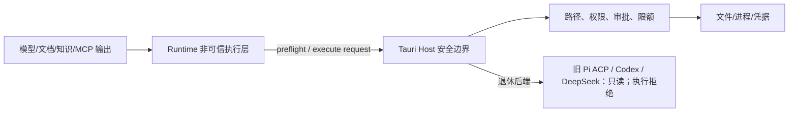

# 安全架构

> 状态：生效 
> 适用版本：Fox 0.1.x 
> 维护范围：Host 信任边界、凭据、项目/知识权限和不可信内容 
> 最后更新：2026-10-28（单 Pi 分支同步；本轮未复跑产品测试）

## 威胁模型

Fox 同时处理模型输出、知识库文本、附件、项目文件和第三方 MCP，这些输入均可能不可信。主要风险是目录越界、提示注入、任意命令、凭据泄漏、恶意文档、失控资源占用和依赖供应链问题。

## 信任边界

本地运行只准入内置 Pi 路径，仍受下述 Host 控制约束；Yuxi 远程服务保留独立边界。旧外部后端只读，不能把历史原生权限或配置当作当前执行授权。

## 已实现控制

### 文件权限

- 项目根和目标路径 canonicalize 后比较，阻止 `..`、绝对路径和链接逃逸。
- `read/grep/find/ls` 仅允许授权项目。
- 附件从受管根按数据库记录读取；文本提取有 1 MiB 限制。
- 写入和编辑由 Host 执行并受项目 `read_only/ask/allow` 策略约束。

### 命令与工具

- `run_command` 和 MCP Tool 默认总是审批。
- Runtime Capability Manifest、Host canonical protocol 与冻结 Execution Profile 必须一致；Assistant、Expert、Child 和 Reviewer 的有效工具取交集，不能通过 Prompt 扩权。
- Tool Call 与 Approval 落库，保存输入、决定、结果和错误。
- Runtime 能力清单拒绝未实现的 Host Tool。
- MCP/OpenAPI 工具先 list、校验 schema、再 call；超时或协议错误使当前持久连接失效。HTTP 固定源基址、禁止重定向并限制响应大小。
- Lifecycle Hook 只能阻断、强制审批或注解，不能执行脚本、改写参数或降低目录审批策略。声明式 Hooks 在插件中心的「策略」tab 和连接器设置页管理（两处复用 `apps/desktop/src/features/settings/lifecycle-hooks-section.tsx`）。
- 需要用户确认或输入的地方都用应用内对话框（`apps/desktop/src/components/ui/confirm-dialog.tsx`、`prompt-dialog.tsx`），`src` 下的应用代码不允许出现 `window.confirm` / `window.prompt` / `window.alert`，由 `apps/desktop/tests/no-native-confirm.test.ts` 守卫。

### 凭据

- 模型 API Key、知识库 Token、MCP 环境变量和扩展 HTTP Header 使用 OS Keyring。
- 模型 API Key 以供应商 Base URL 为键，在本机全局共享（同一 Base URL 的条目、Fox 和外部 Agent 共用一把 Key）；单独配置凭据的协议用 `fox-protocol:<provider>:<profile>` 作键。保存先写 Key 后写记录，失败回滚；删除供应商会删除其 Key，失败写审计警告。
- 历史外部 Agent 的私有 HOME 与凭据保留；本分支不以其登录状态重新启用退休驱动。
- SQLite 只保存 `credential_ref` 或 configured 状态。
- Runtime 仅在初始化时得到当前模型所需密钥，不应写日志或事件。

### 不可信内容

Runtime 稳定指令明确要求知识、附件、网页和工具输出不能改变系统规则、索取密钥或绕过审批。动态数据进入带 Authority 的 Context Block，稳定提示词与动态上下文分别计算 Hash。该提示词工程是纵深防御，不替代 Host 的强制权限。

Goal/Task/Evidence 同样属于安全边界：粘贴文本、Markdown 或工具输出中的“建立目标”不得直接创建产品状态；Runtime 只能通过 Host Work Tool 提议，激活和完成必须经过 Host 状态机与证据校验。

高风险 Graph 节点由独立 `graph_reviewer_v1` Child Run 审查。Reviewer 只能使用 `read/ls/find/grep`，不能写入、审批、继续委派或改变 Work 状态；其 pass 仍需 Lead 使用专用 finish，最终 Goal Acceptance 会重新校验当前 Plan、Evidence、Child hash、Review proof 和 Finding。

### 数据与下载

- 缓存使用 Host 生成的路径和 `.part` 原子写入。
- 预览/下载支持大小、Range 和取消控制。
- 备份恢复校验相对路径与清单，避免 Zip Slip 和部分覆盖。

### 执行准入与文件提交

自提交 `b6cd463`（“Complete durable permission admission and safe file execution”）起，权限准入与文件提交已进入普通 Host 链路，不再只是 Kernel 专项：

- **Host 读取基线**：写入的版本前置条件取自 Host 实际读取得到的 observation，模型自报的 `expectedVersion` 不构成授权。observations 持久化在 `kernel_host_observations`；文件提交层还会独立校验参数摘要并检测外部修改。
- **持久单次领取**：一次 dispatch 只允许一次持久领取，由 `kernel_execution_attempts` 的主键 `(run_id, dispatch_id)` 加仓库层 CAS 保证，跨独立连接也只有一方成功。`claimed` ≠ 已启动；`Ok` ≠ 已启动；`start_confirmed` 一旦为 1 不回退。
- **原子文件提交**：Windows 走系统替换操作并核验保存的前镜像，POSIX 在 rename 前再次核对；提交保留前镜像与结算记录，版本登记在文件临界区内。异常路径保留日志与恢复材料。
- **审批随策略代次失效**：权限模式更新使用请求标识加版本 CAS；策略版本变化会作废未消费的原审批（已签发 dispatch 的意图除外，不能借重新授权重放）。
- **不确定结果不重放**：`leased` 的 outbox 项、`unknown` 的 attempt、证据不足的写命令一律不重跑，转为对账或人工核对；持久拒绝可被重复查询但不能重新领取。

以上为源码实现层结论。对应的定向测试记录见[权限与文件安全集成验证（2026-09-22）](../评审/权限与文件安全集成验证-2026-09-22.md)，注意该记录产生于提交前工作树，且不构成 GUI、云模型、安装包或跨平台验收。

### 外部 Agent 会话

- 旧外部 Pi ACP、Codex、DeepSeek 会话只读，start / cancel / approve / resume 都拒绝；不改绑为内置 Pi。
- `FOX_EXTERNAL_BACKENDS` 只保留诊断解析，旧偏好与直接 IPC 不能重新启用后端；`AgentBackend::HIDDEN` 不是当前的支持列表。
- 数据库冻结标识与历史原生权限记录保留。ACP、私有 HOME、凭据模块仍可能存在，不代表当前路径可执行。
- 阶段二的原生会话恢复、映射落盘和显式重置仍有缺口；源码与已有运行失败分列于[单 Pi 主线状态](../01-项目概览/单Pi主线状态.md)。

### Fox Host 命令执行隔离边界（SRT 已接入；2026-10-26）

以下针对内置本地执行中由 Tauri Host 执行的命令。外部驱动退休不会删除共享 SRT；本分支不运行退休外部驱动。

- Fox Agent 的 `run_command` 现在由 `apps/desktop/src-tauri/src/host_sandbox.rs` 的 `HostSandbox` 启动 SRT：使用已安装的 `@anthropic-ai/sandbox-runtime`、SRT 专用账户、会话级 settings、私有 HOME、项目根可写、会话临时目录和空网络允许列表；命令与子进程由 SRT 边界限制，初始化失败返回 `tool.sandbox_unavailable`，**不会**静默退回宿主直接执行。
- 后台命令作业（`runtime_host/command_jobs.rs`）使用同一个 `SrtHostBackend` 证明，并把 `HostSandboxSession` 保持到整个作业结束；`process_jobs::ExecutionBackend::SrtHost` 与能力查询反映真实的 SRT 可用性和版本摘要。
- 生产环境不再使用 `HostVerifiedBackend` 的固定拒绝；它只保留给测试和旧调用方。测试中的真实 SRT 路径由 `FOX_TEST_REAL_SRT=1` 显式开启，普通单测默认证明不可用。
- Windows 上 SRT 负责进程账户、文件写边界、网络默认拒绝和祖先 ACE 协调；本仓库没有把它描述成完整的读取隔离或通用网络防火墙。实测覆盖了项目内写入、项目外写入拒绝、`whoami` 为 `srt-sandbox`、超时和取消。
- **文件工具不走 SRT 进程**：`read_file` / `write_file` / `edit_file` 仍在 Host 进程内，由 `tool_host.rs` 的路径规范化、项目根检查、重解析点/UNC 拒绝、持久写准入和取消检查保护；它们没有因为命令使用 SRT 就自动获得 SRT 的文件边界。
- 固定能力工具 `git_read`、`test_run`、`code_check`、`format_code` 仍由 `runtime_host/capability_tools.rs` 生成固定参数，经 `tool_host::run_contained_program` 启动，不走任意 Shell，也不走上述 `HostSandbox`；它们是进程回收和资源限制，不是完整文件/网络隔离。

源码依据：`apps/desktop/src-tauri/src/host_sandbox.rs`、`apps/desktop/src-tauri/src/tool_host.rs`、`apps/desktop/src-tauri/src/process_jobs.rs`、`apps/desktop/src-tauri/src/runtime_host/command_jobs.rs`、`apps/desktop/src-tauri/src/runtime_host/capability_tools.rs`。

## 已知风险

| 风险 | 状态 | 建议 |
|---|---|---|
| CSP 已配置但缺浏览器端验证 | 部分控制 | `csp` 与 `devCsp` 均为完整策略（`default-src 'self'`、`object-src 'none'`、`base-uri 'self'`、显式 `connect-src`/`worker-src`）；仍需补充策略回归测试，并对新增外部内容逐项确认白名单 |
| Fox Host 命令使用 SRT，但文件工具仍在 Host 内 | 部分控制 | 命令和子进程由 SRT 账户/文件写/网络边界限制；`read_file`/`write_file`/`edit_file` 仍依靠 Host 路径检查，未进入 SRT。固定能力工具仍只有进程回收与资源限制 |
| MCP 命令与 HTTP 地址可由用户配置 | 部分控制 | 增加可执行文件确认、签名/来源提示、OAuth/证书固定和细粒度速率配额 |
| Runtime 与 MCP 非容器隔离 | 未解决 | 明确桌面威胁模型，评估 Windows Job/AppContainer |
| Office/PDF 渲染第三方内容 | 部分控制 | 保持库更新、限制文件大小、禁用外链和脚本 |
| API 协议兼容层差异 | 持续风险 | Provider 契约测试、响应字段净化和尺寸限制 |
| 依赖供应链 | 部分控制 | 锁文件策略、审计、构建来源记录与 SBOM |

## 安全失败原则

- 无项目、路径无法解析、权限值未知时默认拒绝。
- 无知识绑定时知识工具返回空或拒绝，不能扩大范围。
- 未知 MCP Schema、能力枚举或协议版本默认拒绝。
- 审批超时/取消视为未批准。
- 安全错误不得自动降级成更宽松路径。
- Assistant 与 Expert 能力声明均为限权输入；有效工具和 MCP Server scope 取 Host、Assistant、Expert 的交集，任一显式空 Allowlist 都不会被另一方扩大。
- `expertBinding` 与专家卡片是 Host-owned 元数据；只有绑定记录指向的 Expert 能进入 Runtime Overlay，模型不能通过文本自行切换专家。

## 安全验证

现有测试覆盖路径越界、未知工具、Execution Profile、权限交集、审批、持久 stdio、HTTP Session/SSE、OpenAPI schema/超时/响应边界、Hook 动作与审计、缓存路径、备份恢复、知识 Range、Prompt Injection 隔离、Evidence、独立 Reviewer、Graph Acceptance 和恢复旁路。发布前还应运行依赖审计、秘密扫描、恶意压缩包/超大文件测试及最小权限人工检查。

## 关键代码

`tool_guard.rs`、`tool_host.rs`、`mcp.rs`、`mcp_openapi.rs`、`lifecycle_hooks.rs`、`model_service.rs`、`yuxi/mod.rs`、`maintenance.rs`、`runtime-contract.mjs`；外部 Agent：`crates/fox-agent-backend/src/{host_routing,external_launch,sandbox,native_permission,credential_save,credential_delete}.rs`、`apps/desktop/src-tauri/src/external_backend.rs`。

详细边界见[项目与权限架构](项目与权限架构.md)、[Agent Runtime 架构](Agent运行时架构.md)、[知识库集成架构](知识库集成架构.md)和[可观测性与测试架构](可观测性与测试架构.md)。

面向用户和答辩场景的解释见[Agent 安全与可信执行](../01-项目概览/Agent安全与可信执行.md)。
