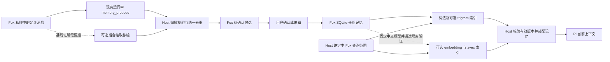

# Fox 开源复用调研与选型

日期：2026-10-28  
状态：源码调研与接入建议，尚未安装或接入候选依赖。  
Fox 当前 main 基线、已合入能力与验收状态统一见[并行开发方案](../05-开发指南/Fox联系人多Agent并行开发方案-20261028.md)。联系人实体、固定私聊和已读游标尚未实现；已有 Pi 会话基础不能记作联系人功能完成。上游调研版本见文末固定提交表，包含 StaffDeck 与 Knowe。

评审修订采用做法 A：M1 私聊只召回本 Fox 的私有记忆，旧 global 偏好可由用户勾选后一次性复制，不提供共享。P0 先做 scope 表重建和归属治理；开源抽取及向量增强留到 P1。引入抽取或索引也不自动开放共享/项目记忆。

本方案延续[Fox 联系人改造方案](Fox联系人改造方案与Pi衔接-20261028.md)：每只 Fox 有稳定身份、固定私聊、独立记忆和工作空间，Pi 承担模型循环。选型原则是先复用 Fox 已有实现，再采用独立开源库。Fox 仍需补身份、权限和产品接口，并处理当前两条执行路径在持久会话、重试与压缩控制上的差异；不能把单 Pi 引擎误写成只有界面适配工作。

运行时复用与删除边界见[单路径运行时收敛方案](../05-开发指南/Fox单路径运行时收敛方案-20261028.md)。该提案继续使用已锁定的 Pi 1.4.0 和现有 stdio JSONL，先验证 SDK 公共接口能否承接 Host 的顺序屏障与恢复；不以新引擎、新通信框架或 fork Pi 作为实施前提。

**P0 不新增记忆库依赖。P1 优先改善中文检索，顺序为中文二元切词、trigram FTS、固定中文模型的向量召回。** 抽取先测 Fox 现有运行中提议通道；只有漏抽证据支持时，才向 Node sidecar 或 Rust 移植 octop 的提示词、解析和重试逻辑。LangMem 仅作设计参考，不引入 Python 运行时。各项增强独立验证，不阻塞 M1/M2，也不引入第二个产品记忆事实库。

对应的人员分工、接口与集成顺序见[多 Agent 并行开发方案](../05-开发指南/Fox联系人多Agent并行开发方案-20261028.md)。本次只改文档，没有启动产品实现。

## 一 先复用 Fox 已有能力

| 能力 | 当前已有基础 | 本次处理 |
| --- | --- | --- |
| 模型循环与会话 | 运行时清单固定 `@earendil-works/pi-*` 为 `1.4.0`；Legacy 使用持久原生会话，Kernel 使用内存会话和 Host 控制的 Pi 循环 | 继续复用 Pi；Kernel 原生会话接线仍待补齐。让 Pi 承担更多能力的收缩建议见主方案，不另引入 Agent harness |
| 身份与能力模板 | 专家、头像、能力包、版本快照、资源绑定 | 专家继续作为模板，新增具体 Fox 身份及固定私聊关系 |
| 记忆治理 | 候选、确认、编辑、禁用、删除、冲突、召回审计；数据库 CHECK、前端 MemoryScope、工具 scope schema 仍为三值 | P0 的 v100 重建及六处仓储核心改动之外，还需前端/API/工具契约与所有治理入口的归属接线；旧偏好只作可选复制 |
| 运行中记忆提议 | 模型调用 `memory_propose`，Host 要求规范键和证据摘录，进入 `propose_memory_for_run` | 先量中文样例的漏抽、误抽和重复候选，再决定是否增加后台抽取 |
| 事实存储 | Cargo 声明 `rusqlite 0.32`，锁定 `0.32.1`；SQLite 已有聊天 FTS5 | 身份、私聊、确认后的记忆和审计仍存 Fox 数据库 |
| 向量检索 | 知识库已有 `VectorStore`/zvec；受 Cargo feature 控制，当前默认特性包含 zvec；记忆未接入 | P1 验证当前候选构建的特性与部署，再扩展记忆索引，不把知识库能力写成记忆已支持 |
| 本地 embedding | ORT/ONNX、tokenizer、模型包校验；知识库已推荐 `bge-small-zh-v1.5`、512 维，固定 revision 与资源哈希；另有 multilingual-e5-small、384 维 | 优先复用已有中文候选，记录实际选用和加载的模型后测记忆召回；推荐配置不等于用户已安装或记忆已接入 |
| 事件合并 | Kernel 快照按 run 和序号合并；Runtime 事件去重；工作事件按对话记录序号 | 复用已有实现；补 M2 代次隔离及联系人侧栏的多私聊状态汇总 |
| 文件权限 | Host 路径规范化、工具准入与沙箱 | 工作空间只补归属和目录管理，不另写沙箱 |
| 定时与触发 | 数字同事的任务持久化、到期领取、补跑、去重、重叠控制 | 第二批给任务增加 Fox 归属；按需补 cron 表达式解析 |

源码入口：[运行时依赖](../../services/agent-runtime/package.json)、[桌面依赖](../../apps/desktop/src-tauri/Cargo.toml)、[记忆仓储](../../apps/desktop/src-tauri/src/database/repositories/memory.rs)、[向量抽象](../../apps/desktop/src-tauri/src/vector_store.rs)、[本地 embedding](../../apps/desktop/src-tauri/src/local_embedding.rs)、[推荐模型与资源](../../apps/desktop/src-tauri/src/local_knowledge_vector.rs)、[数字同事仓储](../../apps/desktop/src-tauri/src/database/repositories/digital_colleagues.rs)。

### 中文切词先于候选数量上限

`memory_score` 用 `!character.is_alphanumeric()` 切词，连续汉字不会被拆开。它仍可命中完整查询片段、记忆正文的包含关系，以及标点分隔的词段，但中文改写容易漏召回。`preference`、`identity` 即使命中数为 0 也进入排序，最终仍受条数和字符预算限制，不能据此称为全部注入。先解决相关性，再处理规模截断。

P1 按以下顺序使用同一中文数据集比较，每步保留当前实现作基线：

1. **中文二元切词。** 对连续中文片段生成相邻二字词，保留英文、数字及原有精确匹配；验证两字查询、同义改写、混合文本与否定。二元切词是否足够由漏召回、误召回和延迟决定。
2. **FTS5 trigram。** 现有聊天 FTS 使用 `unicode61`，它不提供中文分词，不能直接代表中文 FTS 的效果。隔离验证记忆专用 trigram 索引；少于 3 个 Unicode 字符的 `MATCH` 查询转词法路径，不能返回空结果后算作检索成功。当前锁定的 `libsqlite3-sys 0.30.1` 捆绑 SQLite 3.46.0；源码具备 trigram 支持，实际候选构建仍须验证。参见 [SQLite trigram 说明](https://sqlite.org/fts5.html#the_trigram_tokenizer)与[现有迁移](../../apps/desktop/src-tauri/src/database/migrations.rs)。
3. **复用已推荐中文模型验证向量召回。** 知识库已推荐 `bge-small-zh-v1.5`，revision 为 `75c43b069aac4d136ba6bc1122f995fedcfd2781`、512 维，代码含模型和 tokenizer 资源校验值；另有 `multilingual-e5-small`、384 维候选。优先使用已有 BGE 中文配置，记录实际加载的版本、文件哈希、tokenizer、许可证和维度，再与前两步比较。`local_embedding.rs` 的通用 384 维清单测试不是推荐模型定义，不能据此说没有中文模型。推荐已存在，记忆检索效果仍待实测。所有者隔离门槛见下节。

当前召回还有 `updated_at DESC LIMIT 500` 截断。中文基础质量之后，用同 Fox 超过 500 条私有条目且相关项较旧的数据验证候选选择；旧普通对话另测公共记忆较多的情况。检索不得先截断 500 条，再声称 FTS 或向量已解决旧条目漏召回。公共记忆仍不进入新私聊。

### 向量阶段先验证查询内隔离

Fox 的 `VectorStore::SearchRequest` 只有向量与 `top_k`，按 `generation_id` 搜索，没有所有者条件。但已锁定的 **zvec-rust 0.6.0 提供 `SearchQuery::set_filter` 和 `SearchQueryBuilder::filter`**，并通过 FFI 传给底层查询；包内还有精确字符串过滤测试。因此，源码层面的缺口在 Fox 的请求、schema 与写入映射，不是 Rust 绑定没有过滤接口。[0.6.0 查询源码](https://docs.rs/crate/zvec-rust/0.6.0/source/src/query.rs)、[字符串过滤测试](https://docs.rs/crate/zvec-rust/0.6.0/source/tests/string_filter_test.rs)。本轮只读源码，未运行该测试。

优先验证索引内的 `companion_id` 字段及 Host 构造的必需过滤条件：混入更高分的其他 Fox 条目，以较小 top-k 搜索，证明返回范围和授权集合内的召回数量均正确；同时检查缺失字段、伪造条件、重建与 Windows 构建。过滤失败必须报错，不能退回全库查询。若当前部署无法满足，再比较按 Fox 分集合；以 1/10/50 只 Fox 测构建、打开、校验、清理与内存成本，不默认每只 Fox 一个索引。索引分区 ID 与 Pi `context_generation` 分开管理。

## 二 同类项目的具体借鉴点

本次 OpenBot 指 `regnull/openbot`，即长期 Agent 项目。

| 项目 | 已核对的代码与行为 | Fox 如何使用 | 许可证与接入判断 |
| --- | --- | --- | --- |
| OpenClaw | 稳定主会话键、独立 live session、会话路由；重置保留主会话历史与长期记忆 | 参考固定入口与上下文分代；按需复用它采用的独立库 | MIT；不引入完整 Gateway、插件和会话存储 |
| OpenBot | Actor、BotProfile、Thread、Inbox、Run 分层；每个 Bot 串行处理，整体并发限流；记忆直接调用 LangMem | 参考身份与运行分层、按 Bot 隔离命名空间、后台抽取合批 | MIT；全量接入会带来 Python、FastAPI、SQLAlchemy、LangGraph 等整套服务 |
| Octop | Agent 工作空间与执行根目录分开；记忆拆成独立 `octop-memory` 包 | 参考稳定 ID 的目录归属；需要后台抽取时移植独立抽取逻辑 | MIT；不搬入完整运行系统或 Python 运行时 |
| QwenPaw | 每 Agent 延迟创建 Workspace、并发启动去重、配置 generation、防止较旧热重载覆盖新配置 | 将这些规则用于 Fox 工作空间和配置应用 | Apache-2.0；实现与 Python Workspace 管理器耦合，适合参考规则 |
| Kun | 联系人入口、固定聊天映射、记忆所有者与查询前作用域过滤 | 仅参考交互与不变量，独立编写 Fox 验收用例；不移植测试代码或实现结构 | 当前为 PolyForm Noncommercial；列为源码可见参考，不列为默认可复用开源依赖 |
| LobeHub | Agent 与 Topic 的组织、归档、复制和转交 | 参考资料面板与对话组织；Fox 首版仍采用一个固定私聊 | 当前为 LobeHub Community License，含额外商业授权条件；不列为直接复制代码首选 |
| StaffDeck | 数字员工、SOP 版本和运行状态、能力范围、分层知识检索、可替换记忆接口 | 重点参考可执行工作规范、资源授权与知识来源展示；不替换 Pi | 主项目 AGPL-3.0；`harness-engine/` 单独 MIT，不能据此把上层业务代码当成 MIT |
| Knowe | 联系人和项目群聊、项目内 DM、完成事件与 outbox、版本化 UI 投影 | 事件投影仅借鉴乱序和重复用例，复用 Fox 已有合并函数；协作结构供后续参考 | MIT；完整 Electron/Python 应用不作为 Fox 的内嵌运行时；项目内 DM 共享规则不适用于 Fox 私聊 |

### OpenClaw 与 OpenBot

OpenClaw 的稳定主会话键是 `agent:<agentId>:main`。Fox 可采用相同的分层原则：`companion_id` 与固定私聊保持稳定，重置只更换 Pi 上下文代次。不要将显示名称、专家模板 ID 或临时 Pi ID 作为联系人身份。[主会话契约](https://github.com/openclaw/openclaw/blob/55e14fa6df24c951df0427d9e83eb250a4776039/docs/concepts/main-session.md)、[路由代码](https://github.com/openclaw/openclaw/blob/55e14fa6df24c951df0427d9e83eb250a4776039/src/routing/session-key.ts)。

OpenBot 将长期记忆放在 `("bots", bot_id, "memories")`，消息索引放在 `("threads", thread_id, "messages")`，并按 Bot 与 Thread 合批抽取。它调用 LangMem 的管理、搜索和存储管理工具。这说明 Fox 可以用现成库补算法，同时保留自己的身份和治理。**不能直接接入 OpenBot 的自动写入工具**，因为 Fox 首版仍要求候选确认。[数据模型](https://github.com/regnull/openbot/blob/3c9d2d2d745acff983af2dbd8aa6e29ed8039302/backend/openbot/db/models.py)、[Actor 调度](https://github.com/regnull/openbot/blob/3c9d2d2d745acff983af2dbd8aa6e29ed8039302/backend/openbot/runtime/actors.py)、[记忆适配](https://github.com/regnull/openbot/blob/3c9d2d2d745acff983af2dbd8aa6e29ed8039302/backend/openbot/runtime/memory.py)。

### 工作空间与授权范围

Octop 区分工作目录和执行根目录；QwenPaw 对同一 Agent 的并发启动去重，对不同 Agent 允许并行准备。Fox 应复用这些规则，但目录创建与授权继续走本机 Host。Octop 所读代码还包含不可写根目录退回宿主根目录的辅助逻辑，**该回退不适用于 Fox**；Fox 应返回明确错误，不扩大权限。[Octop 目录逻辑](https://github.com/TencentCloud/Octop/blob/890111b7879665840414ca28ab168b05b0db0921/src/octop/infra/agents/workspace/dir.py)、[QwenPaw 生命周期](https://github.com/agentscope-ai/QwenPaw/blob/199e9558b76eecfcecb9546134c695fd4acd926e/src/qwenpaw/app/multi_agent_manager.py)。

Kun 的记忆代码在 FTS 排名、候选数量限制和内容读取之前加入所有者条件。Fox 只提炼该不变量并独立编写验收用例；本计划不移植 Kun 的测试代码或实现结构。[作用域实现](https://github.com/KunAgent/Kun/blob/194b95ec33de28f337e118e1630383d1bd492583/kun/src/memory/agent-memory-scope.ts)、[Kun 许可证](https://github.com/KunAgent/Kun/blob/194b95ec33de28f337e118e1630383d1bd492583/LICENSE)、[LobeHub 许可证](https://github.com/lobehub/lobehub/blob/6264c6864a4937cd3fc4cb320b6977ea957b4f97/LICENSE)。

### StaffDeck 的重点是工作规范与治理

核对项目为 `OpenBMB/StaffDeck`，固定提交 `fcc28c003ef188e6d0a11596d44fdfb3723b275b`。它采用 Python/FastAPI 后端和 React/TypeScript 前端，业务层已拆出 `staffdeck_harness` 模块。仓内另含 `@deepseek-ai/dsh-root` 引擎代码。因此，对 Fox 最有价值的是业务契约和工作方式，完整接入会与已选 Pi、Host 及产品数据库重叠。[后端依赖](https://github.com/OpenBMB/StaffDeck/blob/fcc28c003ef188e6d0a11596d44fdfb3723b275b/backend/pyproject.toml)、[引擎包](https://github.com/OpenBMB/StaffDeck/blob/fcc28c003ef188e6d0a11596d44fdfb3723b275b/harness-engine/package.json)。

| 值得采用的内容 | 源码依据 | 对 Fox 的具体用途 |
| --- | --- | --- |
| SOP 与版本分开管理 | 内容修订测试要求新版本高于已有历史，并保留旧快照；编辑内容不能隐式改变归档状态和资源绑定 | 专家模板、SOP 和个人配置分别版本化；修改规范不改变正在执行的能力快照 |
| 等待输入和外部任务是显式状态 | `SopRuntime.after_execution` 遇到 `waiting_external_task` 保留当前节点；`sync_awaiting_input_from_step_result` 保存步骤、缺失字段和问题摘要 | Fox 资料面板可以说明该 Fox 当前按什么流程工作；恢复任务时接回原节点，不把工具已接单视为任务完成 |
| 能力绑定按 SOP 与节点隔离 | 组合和测试保留各 SOP 的 provider、配置、摘要与绑定；不能把某 SOP 的专属授权提升为通用授权 | 为未来“同一 Fox 执行不同工作规范”保留运行快照和窄授权；不因共享一个工具 ID 而共享全部配置或权限 |
| 先定位文档，再定位章节和原文 | `KnowledgeService._search` 分别选择文档、bucket、展开章节、加载原文块；返回路径追踪与引用 | 对长报告和制度文档增加可解释检索，保留文档、章节、原文来源；这是资料库增强，不是长期偏好记忆 |
| 记忆 provider 与 Host 分开 | `MemoryCall` 传身份和操作；`ProviderMemoryFacade` 校验身份和来源，多个 provider 需明确绑定 | 支持 Fox 的薄适配方向；模型调用和外部库不能持有任意产品库权限或自行选择所有者 |

源码和测试入口：[内容修订测试](https://github.com/OpenBMB/StaffDeck/blob/fcc28c003ef188e6d0a11596d44fdfb3723b275b/backend/tests/test_sop_content_revisions.py)、[SOP 生命周期](https://github.com/OpenBMB/StaffDeck/blob/fcc28c003ef188e6d0a11596d44fdfb3723b275b/backend/src/staffdeck_harness/sop/lifecycle.py)、[SOP 能力隔离测试](https://github.com/OpenBMB/StaffDeck/blob/fcc28c003ef188e6d0a11596d44fdfb3723b275b/backend/tests_harness/test_sop_capability_isolation.py)、[知识检索](https://github.com/OpenBMB/StaffDeck/blob/fcc28c003ef188e6d0a11596d44fdfb3723b275b/backend/app/knowledge/service.py)、[引用整理](https://github.com/OpenBMB/StaffDeck/blob/fcc28c003ef188e6d0a11596d44fdfb3723b275b/backend/app/knowledge/citations.py)、[记忆契约](https://github.com/OpenBMB/StaffDeck/blob/fcc28c003ef188e6d0a11596d44fdfb3723b275b/backend/src/staffdeck_harness/contracts/memory.py)、[记忆 Host](https://github.com/OpenBMB/StaffDeck/blob/fcc28c003ef188e6d0a11596d44fdfb3723b275b/backend/src/staffdeck_harness/memory.py)。这些是源码与测试定义的行为，本轮没有执行上游测试。

**StaffDeck 默认记忆实现不替换本方案的候选抽取选择。** 所核对的 `MemoryService.recall` 忽略 `query` 和 `limit`，返回上下文记忆；`capture_turn` 根据模型结果直接更新或删除 keyed memory。它不是可直接替换 zvec 的语义检索库，也不满足 Fox 首版“先候选、后确认”的写入规则。可以借鉴接口分层，不能直接接默认 capture 流程。[默认记忆服务](https://github.com/OpenBMB/StaffDeck/blob/fcc28c003ef188e6d0a11596d44fdfb3723b275b/backend/app/memory/service.py)。

主项目使用 [AGPL-3.0](https://github.com/OpenBMB/StaffDeck/blob/fcc28c003ef188e6d0a11596d44fdfb3723b275b/LICENSE)。这不是禁止商业使用，但直接纳入代码前需按具体组合与分发方式确认许可义务。本计划先采用设计规则和独立验收要求，不安排复制其业务模块。仓内 [`harness-engine/LICENSE`](https://github.com/OpenBMB/StaffDeck/blob/fcc28c003ef188e6d0a11596d44fdfb3723b275b/harness-engine/LICENSE) 单列 MIT，不覆盖 `backend/app` 或 `backend/src/staffdeck_harness`；也不因该子目录可复用而改变 Fox 的 Pi 路线。

### Knowe 的重点是联系人协作和可靠结果展示

核对项目为 `HirezmingD/Knowe-agent-groupchat`，固定提交 `23411a014d3ab2f04defbd6221b25f2db932708f`。项目为 MIT；前端是 Electron/React，后端是 Python，通过本机 WebSocket 通信。它与 Fox 的联系人、项目、私聊组织有相近部分，但工作重心在项目群聊。[技术概览](https://github.com/HirezmingD/Knowe-agent-groupchat/blob/23411a014d3ab2f04defbd6221b25f2db932708f/TECH.zh-CN.md)、[包清单](https://github.com/HirezmingD/Knowe-agent-groupchat/blob/23411a014d3ab2f04defbd6221b25f2db932708f/package.json)、[许可证](https://github.com/HirezmingD/Knowe-agent-groupchat/blob/23411a014d3ab2f04defbd6221b25f2db932708f/LICENSE)。

| 内容 | 已核对实现 | 采用方式与范围 |
| --- | --- | --- |
| 联系人与资料页 | `ContactsView` 从既有会话和成员状态派生列表，进入聊天调用现有入口；有头像、资料和权限说明 | 参考“身份资料可查看、聊天入口稳定”的组织方式；Fox 复用自己的组件与 Host API，不整页替换 |
| 完成消息的乱序处理 | `completionProjection.ts` 先比较版本，再比较同版本来源优先级；重复或较旧投影不能覆盖新内容 | 只借鉴乱序、重复和冲突测试场景；Fox 已有相应合并与去重，不再摘取投影函数 |
| 完成结果与通知分开持久化 | `SQLiteCompletionStore` 保存结果和 projection outbox；`CompletionProjector` 分别生成报告、UI、协调者、记忆等投影，并有重放处理 | 参考崩溃恢复与幂等通知；先与 Fox 已有事件和交付实现对照，补缺口，不增加第二套任务事实库 |
| 停止、等待和完成分开 | `CompletionStatus` 区分 SUCCEEDED、PARTIAL、WAITING、BLOCKED、FAILED 等；没有明确结果的 Runtime 停止不推断为成功 | 复用状态区分与异常用例；Fox 状态仍由 Host 持久记录决定 |
| 项目记忆有摘要和历史层次 | `memory_manager.py` 管理项目上下文、活动分段、摘要和平台记忆 | 作为项目记忆可追溯性的参考；不替代每只 Fox 的私有候选治理，也不接管 Pi 上下文压缩 |

源码入口：[联系人组件](https://github.com/HirezmingD/Knowe-agent-groupchat/blob/23411a014d3ab2f04defbd6221b25f2db932708f/src/components/ContactsView.tsx)、[投影纯函数](https://github.com/HirezmingD/Knowe-agent-groupchat/blob/23411a014d3ab2f04defbd6221b25f2db932708f/src/store/completionProjection.ts)、[乱序与重复事件测试](https://github.com/HirezmingD/Knowe-agent-groupchat/blob/23411a014d3ab2f04defbd6221b25f2db932708f/src/store/completionProjection.test.ts)、[完成记录与 outbox](https://github.com/HirezmingD/Knowe-agent-groupchat/blob/23411a014d3ab2f04defbd6221b25f2db932708f/backend/knowe_harness/completion.py)、[投影与重放](https://github.com/HirezmingD/Knowe-agent-groupchat/blob/23411a014d3ab2f04defbd6221b25f2db932708f/backend/knowe_harness/projections.py)、[记忆管理](https://github.com/HirezmingD/Knowe-agent-groupchat/blob/23411a014d3ab2f04defbd6221b25f2db932708f/backend/memory_manager.py)。

Fox 已有三个对应入口：[`mergeKernelSnapshot`](../../apps/desktop/src/features/conversations/model/kernel-snapshot.ts) 按运行 ID 和事件序号合并，避免慢加载回滚事实；[`runtime-event-reducer.ts`](../../apps/desktop/src/features/conversations/model/runtime-event-reducer.ts) 对适用事件按 run/seq 去重并丢弃较旧序号；[`use-desktop-conversation.ts`](../../apps/desktop/src/features/conversations/hooks/use-desktop-conversation.ts) 按对话保存工作事件序号。继续复用这些实现，Knowe 只补充测试场景参考。

联系人改造需要补的是 M2 的上下文代次隔离，以及把多个私聊的摘要、未读和工作状态汇总到侧栏联系人行。这两项仍由 Fox 的身份与事件契约实现，Knowe 的投影函数不提供这些能力。测试覆盖跨代次旧事件、同版本冲突与重复回放，模型正文不能修改 Host 的任务状态。

**Knowe 的项目内 DM 不等于 Fox 私聊。** 官方文档明确：`dm:project:member` 的内容会进入所属项目记忆，协调者可使用；平台入口 Zinnia 的独立私聊不属于项目。源码也把 DM 路由到项目 Engine，并在项目空间中排队更新记忆。Fox 已确定每只 Fox 有独立私有记忆，因此只参考联系人入口，不采用项目内 DM 自动共享规则。[DM 边界](https://github.com/HirezmingD/Knowe-agent-groupchat/blob/23411a014d3ab2f04defbd6221b25f2db932708f/docs/EN/40-03-DM-Memory-and-Permission-Boundaries.md)、[DM 路由与项目记忆调用](https://github.com/HirezmingD/Knowe-agent-groupchat/blob/23411a014d3ab2f04defbd6221b25f2db932708f/backend/engine.py)。

另一个不能按名称迁入的字段是 `verified_delivery`：其代码对 SUCCEEDED 和 PARTIAL 返回真，语义偏向已提交的交付结果，不能当作 Fox 的业务验收通过。完整 `knowe_harness` 依赖 Knowe 的任务模型、SQLite 仓储与 Python 运行时，当前没有把它作为独立通用包直接接入的依据。

### 这两项调研对原选型的调整

| 优先级 | 调整 | 开发归属 |
| --- | --- | --- |
| 首版/M2 | 复用 Fox 事件合并；Knowe 只提供乱序与重复测试场景参考。首版补联系人汇总，M2 补上下文代次隔离 | C0 冻结事件契约，C5 接联系人汇总，C1 接代次，C7A/C7B 验证 |
| 首版 | 增加私聊内容不得自动进入项目记忆的反例；补“收到外部任务回执仍未完成”的状态用例 | C1/C3，C7A；C5 展示真实状态 |
| 首版后 | 参考 StaffDeck，把可版本化工作规范与已冻结能力快照衔接；评估中断恢复和缺失信息表单 | C0 与后续 SOP 工作包，不在首版新增完整流程编辑器 |
| 资料库增强 | 对长文档验证文档、章节、原文的分层路由与可追踪引用 | 现有知识库负责人；与私人记忆分开排期 |
| 后续协作 | 对照 Knowe 的结果 outbox 和状态投影，补 Fox 现有交付链的实际缺口 | 现有 Host/交付负责人，先审差异，再分配实现 |

这两项调研不改变 P1 的中文检索优先级，也不构成引入后台抽取的理由。P0 不因调研增加第二套引擎、向量库、任务数据库或群聊范围。

## 三 P1 先测现有提议，按需移植抽取逻辑

### 运行中提议是抽取基线

Fox 已有模型运行中调用 `memory_propose` 的通道。Host 要求 `canonicalKey`、`content`、`evidenceExcerpt`，再交给 `propose_memory_for_run`。P1 先用第五节中文样例测期望候选的漏抽率、不应记录内容的误抽率、重复率与调用成本；固定模型版本和配置，逐项保存输入、期望与实际候选。没有这份结果，不默认增加后台调用。[Host 提议入口](../../apps/desktop/src-tauri/src/runtime_host/mod.rs)、[候选写入](../../apps/desktop/src-tauri/src/database/repositories/memory.rs)。

当前同规范键去重查询只比较 confirmed/enabled/未删除条目，不能防止两个相同待确认候选。无论是否增加后台通道，都需要按下面的规则验证重试和并发。

### 后台抽取的条件方案

只有基线漏抽超过事先记录的接受阈值，才评估移植 `octop-memory 1.0.2` 的提示词、JSON 解析、来源校验与一次重试。原包为 MIT、Python 3.12+，标注 Alpha；Fox 当前分发链提供 Node sidecar，没有随包 Python。采用 Node 或 Rust 的小范围移植，复用 Fox 模型调用，不为该步骤新增 Python 运行时或另一套记忆服务。[依赖与版本](https://github.com/TencentCloud/octop-memory/blob/ed11d5413246f7ab76f29e814a70e6afe32a022a/pyproject.toml)、[许可证](https://github.com/TencentCloud/octop-memory/blob/ed11d5413246f7ab76f29e814a70e6afe32a022a/LICENSE)、[抽取实现](https://github.com/TencentCloud/octop-memory/blob/ed11d5413246f7ab76f29e814a70e6afe32a022a/src/octop_memory/pipeline/extractor/__init__.py)。

移植约束：

1. `CandidateExtractor.extract` 自身不持久化。**禁止调用 `extract_session`**：它默认 `persist=True`，会经 `memory.add_candidates` 写入自己的存储。也不接 `MemoryRuntime.extract`、原 bridge 或 promotion；`promote=false` 不代表没有写入。[运行入口](https://github.com/TencentCloud/octop-memory/blob/ed11d5413246f7ab76f29e814a70e6afe32a022a/src/octop_memory/application/runtime.py)、[bridge 方法](https://github.com/TencentCloud/octop-memory/blob/ed11d5413246f7ab76f29e814a70e6afe32a022a/src/octop_memory/adapters/bridge/handlers.py)。
2. 上游要求 `response_format="json"`。适配层通过 Fox 已有供应商能力选择 JSON 模式；不支持时使用受约束的文本输出、严格 JSON/schema 与来源校验，并只做一次预算内修复重试。仍失败则记录抽取失败并停止，不把任意文本当候选，不静默换供应商。
3. 只读取 Host 授权的消息和已确认记忆，沿用模型配置、预算、取消和超时机制。不能自行发现凭据、扫描所有 Fox 历史或另启 Agent 主循环。保留来源校验和失败/空结果的区别，不能只搬提示词而丢掉这些约束。
4. 保存固定上游提交、MIT 归属、移植差异及兼容用例；不浮动追随主分支。Windows 验证关注既有 sidecar/Host 的取消、退出和包增量，不安排 Python 分发工程。

### 两条通道共用 Host 去重

- Host 按 `companion_id + conversation_id + 证据消息 ID/版本集合 + 规范化 canonical_key` 生成来源键，消息集合按固定顺序归一化。键不包含通道名称、重试次数或运行 ID，避免同一证据经两条通道产生两个身份。证据范围须由 Host 校验，不能只信模型填报。
- 写入同一事务中比较 `candidate`（待确认）、`conflict`、`confirmed` 条目；Fox 数据库状态不叫 pending。相同来源键且规范化内容相同，返回已有候选并补来源审计；内容不同，保留修订或冲突，不能只按键吞掉更正。跨批次范围重叠但键不同的同内容提议，按所有者、规范键和证据重叠继续合并，不只依赖精确范围命中。
- 已拒绝或已删除提议保留处理标记，同一证据重放不自动复活。新的用户更正有新证据版本，可进入现有冲突与确认流程。用户确认、编辑和删除仍由 Fox 决定。

具体键编码、唯一约束和审计字段由 C8 与 C3 在实现前冻结，不能把现有 confirmed 去重宣称为已满足双通道幂等。

### LangMem 只作设计参考

所核对的 `create_memory_manager` 核心不持有 store，可参考“输入消息与已有记忆，输出结构化变化”的分层。它的 Python、LangChain、LangGraph、trustcall 依赖不进入 Fox，也不安排第二套对照实现。`create_memory_store_manager` 和直接写库的 memory tools 不接入。[核心实现](https://github.com/langchain-ai/langmem/blob/48e3c11f5bb527282c7d5339c6a87a0b35abccfc/src/langmem/knowledge/extraction.py)、[依赖](https://github.com/langchain-ai/langmem/blob/48e3c11f5bb527282c7d5339c6a87a0b35abccfc/pyproject.toml)、[许可证](https://github.com/langchain-ai/langmem/blob/48e3c11f5bb527282c7d5339c6a87a0b35abccfc/LICENSE)。

### 其余候选的取舍

| 候选 | 源码结论 | 本次决定 |
| --- | --- | --- |
| Mem0 TypeScript OSS | Apache-2.0，Node 接口；公开 `Memory.add` 默认推断后写库，`infer:false` 仍调用 `createMemory`。所核对接口没有可直接采用的候选预览入口 | 暂不用于首版抽取。可在上游提供独立提案接口后复评，不能把 `infer:false` 当 dry-run |
| Mem0 的 `memory` 向量提供者 | 当前使用 `better-sqlite3` 持久化，默认写 `~/.mem0/vector_store.db`；查询读取向量后再过滤和计算距离 | 不因名字误判成进程内缓存；会增加另一套存储及 Node 原生模块打包问题，当前不采用 |
| Letta Code | Apache-2.0，TypeScript；自带运行框架、记忆文件系统和管理。原生 Windows 自动 reflection 默认关闭 | 参考记忆文件隔离；不替换已经选定的 Pi 与 Host |
| Memobase | Apache-2.0；用户画像与事件记忆服务，使用 FastAPI、Postgres/pgvector、Redis；官方 Compose 指定 Linux amd64 | 当前不采用。桌面首版不为记忆引入一套服务端基础设施和第二套画像事实 |
| sqlite-vec | MIT/Apache-2.0，C 实现，有 Rust 绑定和分区列；支持 Windows，上游提示 pre-v1 可能有破坏变更 | 作为 zvec 不满足隔离或部署要求时的备选，不默认新增 |

对应代码：[Mem0 写入路径](https://github.com/mem0ai/mem0/blob/26cdefb46600c0fa5953c4b5ee5003c125539fc4/mem0-ts/src/oss/src/memory/index.ts)、[Mem0 SQLite 提供者](https://github.com/mem0ai/mem0/blob/26cdefb46600c0fa5953c4b5ee5003c125539fc4/mem0-ts/src/oss/src/vector_stores/memory.ts)、[Mem0 包与许可声明](https://github.com/mem0ai/mem0/blob/26cdefb46600c0fa5953c4b5ee5003c125539fc4/mem0-ts/package.json)、[Letta 隔离代码](https://github.com/letta-ai/letta-code/blob/9a6b55b48c62bbacde0fb6dafee5fd450ee7b41e/src/memory-confinement.ts)、[Letta 范围与 Windows 限制](https://github.com/letta-ai/letta-code/blob/9a6b55b48c62bbacde0fb6dafee5fd450ee7b41e/README.md)、[Memobase 服务依赖](https://github.com/memodb-io/memobase/blob/358c16bbc6d687937d79bc2f984a11c3be8da901/src/server/docker-compose.yml)、[sqlite-vec Rust 绑定](https://github.com/asg017/sqlite-vec/blob/04d28bd21773981e2d266bbf6aa4efbd011eb4f6/bindings/rust/Cargo.toml.tmpl)、[分区测试](https://github.com/asg017/sqlite-vec/blob/04d28bd21773981e2d266bbf6aa4efbd011eb4f6/tests/test-partition-keys.py)。

## 四 P0 边界与 P1 接入数据流

P0/M1 的路径是：模型提案 → Host 强制本 Fox 私有归属 → 用户确认 → Fox SQLite → 仅本 Fox 的词法召回。global/agent/project 不进入私聊；旧普通对话保持原规则。创建时可勾选旧 global identity/preference，复制为新的私有条目并记录源 ID、版本与快照，副本以后独立变化。M0 表重建与验证见并行方案。

P0 的具体接线点是 `runtime_host/mod.rs::execute_memory_operation`：其中 `memory_propose` 当前缺省 scope 为 `agent`，Legacy 与 Kernel gateway 均调用该共享操作。C0 接入 C3 的可信会话解析结果，对固定私聊强制 fox 归属，同时修仓储的 propose/recall。`host-tools.mjs` 的 scope schema、前端 `MemoryScope`、手工治理请求和面板也需配套；只改默认字符串或这六处后端位置不能完成端到端隔离。工具 schema 当前没有 `scope_key` 或 `companion_id`，接入时继续由 Host 决定所有者，不给模型新增目标所有者参数。

下图保留现有运行中提议；后台抽取与索引均须独立验证后才启用。Fox 权威数据与可重建索引分开，抽取逻辑不拥有身份、作用域或确认权限。

P1 按实际启用项冻结以下接口，具体类型由集成人员落定；未采用后台抽取或向量时，不为其新增接口。它们不属于 P0A 必需接口：

| 接口 | 输入与输出 | 明确边界 |
| --- | --- | --- |
| 可选后台抽取 | 允许使用的消息、已确认记忆、预算与取消信号 → 结构化候选 | 无产品库写权限；模型不能指定 `companion_id` 或扩大 scope；与现有提议共用 Host 来源键、冲突与确认流程 |
| 记忆索引 | 已确认条目增量、删除标记；已授权分区与查询向量 → 条目 ID、版本、分值 | 是可重建派生数据；不决定确认状态，不扩大作用域 |

具体规则：

- Host 从固定私聊解析 `companion_id`，强制 `scope='fox'`、`scope_key=companion_id`。抽取、手工创建、搜索、按 ID 读取、编辑和删除都服从同一规则；模型不能把候选转到 global 或 project。
- Fox 私聊只查询本 Fox 分区；旧普通/项目对话使用其原有范围，两者分别测试。Host 管理索引 generation/集合映射，模型不能自选分区；向量查询内部过滤或直接查授权集合，不做查询后所有者裁剪。未来共享另提设计。
- 运行中提议、后台抽取和重试共用第三节去重规则，覆盖待确认候选及重叠消息范围。模型结果不自动成为长期事实。
- 确认、禁用和删除先更新 SQLite。索引同步失败可重试；搜索后仍校验命中 ID 的有效版本和启用状态，防止旧索引返回已删除内容。这是在已授权分区内检查有效性，不是搜索全部 Fox 后做权限裁剪。
- 抽取或向量服务不可用时，聊天仍可运行，明确报告记忆服务状态；可使用已确认且作用域正确的词法召回。不得静默调用其他云服务。
- Pi 的压缩和重置与长期记忆分开。新上下文可召回允许的长期记忆，不重新注入全部历史，不从原生 JSONL 擅自抽取其他 Fox 的内容。

## 五 P1 隔离验证

M1 数据闭环完成后，C8 先登记固定中文样例、接受阈值、模型与候选版本，分别量检索和运行中提议基线。检索按二元切词、trigram、中文向量顺序推进；后台抽取仅在漏抽基线证明需要后验证。验证包不连接用户数据库，不改产品依赖锁文件，其完成与否不影响 M1/M2 发布判定。

| 检查项 | 必须交付的结果 |
| --- | --- |
| 中文样例与原基线 | 偏好、身份、事实更正、否定、引文、临时请求、重复消息、中英混排、同义改写及 1/2/3 字短查询；分开记录应提议内容和应召回条目，不用偏好兜底掩盖事实漏召回 |
| 检索顺序 | 原词法 → 中文二元切词 → trigram → 固定中文模型向量；同一数据集记录 recall@k、误召回、延迟与资源成本。短查询回退有结果和延迟证据，不直接拿 unicode61 代表中文 FTS |
| 现有提议基线 | 逐例记录运行中 memory_propose 的漏抽、误抽、重复率与模型成本；先登记阈值，再据结果决定是否启动后台抽取 |
| 可选后台抽取 | 仅在需要时比较移植前后质量；JSON 模式与文本降级、来源校验、预算内一次重试、超时和取消均覆盖；检查目录和数据库，证明没有自建记忆库或自动确认 |
| 候选治理 | 两通道同源、不同批次重叠、并发重试、同键更正、已拒绝/删除重放分别验证；未确认不召回，不能只与 confirmed 条目去重 |
| 身份隔离 | 同模板两只 Fox 不互读；global/agent/project 不进入私聊；模型不能扩大 scope；旧偏好只在勾选的目标中形成独立副本 |
| 向量隔离门槛 | 先实测 0.6.0 查询内所有者过滤：其他 Fox 高分条目不能泄漏或挤占本 Fox 的小 top-k；缺失所有者、过滤失败不得转全库查询；删除、禁用、版本变更和索引重建有效 |
| 数量上限与分区成本 | 中文质量之后测本 Fox 超过 500 条且相关项较旧；普通对话公共条目另测。只有过滤路线不满足时比较 1/10/50 Fox 独立集合的构建、清理、内存及延迟 |
| 成本与分发 | 记录模型包与增量依赖、许可证、模型调用量/token、离线行为、Windows 启动/取消/退出及包体积；不增加 Python 运行时 |
| 取舍结果 | 分别决定检索方案与是否需要后台抽取，允许结论为维持现有提议；没有收益证据不增加依赖，也不扩成自建完整记忆引擎 |

向量阶段先用既有 zvec；只有出现明确不满足项，才比较 sqlite-vec。所有者隔离、候选确认和删除失效是必过项；质量阈值在比较前登记，性能按同一数据集记录。这里是待执行清单，本轮没有中文召回、抽取或向量隔离的实测结果。

## 六 主动任务的复用选择

首版沿用数字同事的 interval 计划和持久任务执行。若第二批需要 cron 表达式与时区，验证 **croner-rust，crate 名为 `croner`，固定 `=4.0.2`**。已核对 `v4.0.2` 提交 `24c9bbb02dbcb498a8bbf31a33f1e6416e75ac83`，许可证为 MIT。它支持 `chrono`，命名时区可用 `chrono-tz`；Fox 已依赖 chrono 0.4。直接在 Rust Host 解析并计算下一次到期时间，不增加 JavaScript 桥接或 Node 调度。[固定版本依赖](https://github.com/Hexagon/croner-rust/blob/24c9bbb02dbcb498a8bbf31a33f1e6416e75ac83/Cargo.toml)、[README 与时区规则](https://github.com/Hexagon/croner-rust/blob/24c9bbb02dbcb498a8bbf31a33f1e6416e75ac83/README.md)、[MIT 许可证](https://github.com/Hexagon/croner-rust/blob/24c9bbb02dbcb498a8bbf31a33f1e6416e75ac83/LICENSE.md)。

README 仍提示接口可能变化，保留精确版本和锁文件。验证固定时刻与间隔表达式在夏令时缺失/重复时段的差异，持久化准确的到期时刻，覆盖重启、漏跑和连续计算。到期领取、去重、预算、暂停、归档和结果回传继续由 Host 管理；库只计算时间。不需要 cron 时不新增依赖。本轮未安装或运行该库。

## 七 上游版本与证据范围

固定提交用于后续复查，不等于已选发布版本。加入产品前还需锁定包版本、依赖树、完整许可证和分发文件。

| 仓库 | 本次核对提交 | 主要证据 |
| --- | --- | --- |
| `openclaw/openclaw` | `55e14fa6df24c951df0427d9e83eb250a4776039` | 主会话文档、路由和 cron 代码、[MIT 许可](https://github.com/openclaw/openclaw/blob/55e14fa6df24c951df0427d9e83eb250a4776039/LICENSE) |
| `regnull/openbot` | `3c9d2d2d745acff983af2dbd8aa6e29ed8039302` | 数据模型、Actor、LangMem 适配、依赖、[MIT 许可](https://github.com/regnull/openbot/blob/3c9d2d2d745acff983af2dbd8aa6e29ed8039302/LICENSE) |
| `TencentCloud/Octop` | `890111b7879665840414ca28ab168b05b0db0921` | Agent API、工作空间与调度源码、[MIT 许可](https://github.com/TencentCloud/Octop/blob/890111b7879665840414ca28ab168b05b0db0921/LICENSE) |
| `TencentCloud/octop-memory` | `ed11d5413246f7ab76f29e814a70e6afe32a022a` | 抽取、runtime、bridge、存储与依赖、MIT 许可 |
| `agentscope-ai/QwenPaw` | `199e9558b76eecfcecb9546134c695fd4acd926e` | Workspace 管理器、[Apache-2.0 许可](https://github.com/agentscope-ai/QwenPaw/blob/199e9558b76eecfcecb9546134c695fd4acd926e/LICENSE) |
| `KunAgent/Kun` | `194b95ec33de28f337e118e1630383d1bd492583` | 私聊入口、记忆作用域、PolyForm Noncommercial 许可 |
| `lobehub/lobehub` | `6264c6864a4937cd3fc4cb320b6977ea957b4f97` | Topic 文档、Community License；仅交互参考 |
| `langchain-ai/langmem` | `48e3c11f5bb527282c7d5339c6a87a0b35abccfc` | 无 store 的抽取核心、依赖、MIT 许可 |
| `mem0ai/mem0` | `26cdefb46600c0fa5953c4b5ee5003c125539fc4` | TS OSS 写入与 SQLite 提供者、Apache-2.0 声明 |
| `letta-ai/letta-code` | `9a6b55b48c62bbacde0fb6dafee5fd450ee7b41e` | 记忆隔离源码、平台说明、[Apache-2.0 许可](https://github.com/letta-ai/letta-code/blob/9a6b55b48c62bbacde0fb6dafee5fd450ee7b41e/LICENSE) |
| `memodb-io/memobase` | `358c16bbc6d687937d79bc2f984a11c3be8da901` | 服务依赖、数据模型、[Apache-2.0 许可](https://github.com/memodb-io/memobase/blob/358c16bbc6d687937d79bc2f984a11c3be8da901/LICENSE) |
| `asg017/sqlite-vec` | `04d28bd21773981e2d266bbf6aa4efbd011eb4f6` | Rust 绑定、构建与分区测试、MIT/Apache-2.0 许可 |
| `Hexagon/croner-rust` | `24c9bbb02dbcb498a8bbf31a33f1e6416e75ac83` | `v4.0.2` 标签、Cargo.toml、README 时区规则与 MIT 许可；替代 JavaScript 版候选 |
| `zvec-ai/zvec-rust` 发布包 | `0.6.0`，与 Fox Cargo.lock 一致 | 本机 Cargo 缓存的 `query.rs` 过滤接口与 `string_filter_test.rs`；仅源码核对，未执行底层测试 |
| `OpenBMB/StaffDeck` | `fcc28c003ef188e6d0a11596d44fdfb3723b275b` | SOP 生命周期与测试、记忆 Host/默认服务、知识检索；根 AGPL-3.0，`harness-engine/` 单独 MIT |
| `HirezmingD/Knowe-agent-groupchat` | `23411a014d3ab2f04defbd6221b25f2db932708f` | 联系人、DM 边界、完成/outbox/投影、纯函数与测试、项目记忆、MIT 许可 |

证据包含前轮固定提交调研与分次复查。上轮核对 octop 抽取器、zvec-rust 0.6.0 发布包、croner-rust v4.0.2 与 SQLite trigram 文档；本轮按并行方案所记 main 基线复查执行路径、联系人缺口、记忆全链路、事件投影、调度、依赖锁定和推荐模型。上游固定提交的结论保留为历史源码快照，未重新查全部上游，也不声称它们是今天的最新版本。当前编辑没有执行候选库安装、Windows 打包、真实模型对比或业务验收；既有 Pi 验收记录单列在并行方案，不能将方案或接口存在写成已经接通。
