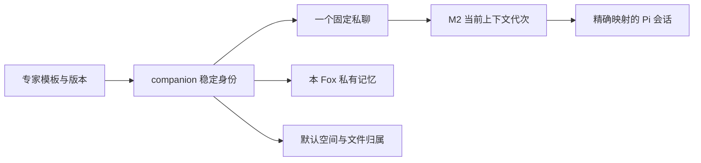

# Fox 联系人改造方案与 Pi 衔接

日期：2026-10-28  
状态：联系人功能尚未实施；Legacy/Pi 原生会话、重置和代次基础已合入 main，Kernel 尚未接入同一原生持久会话路径。采用做法 A，M1 只做私有记忆。

本文保存产品与数据约束。提交基线、文件归属、迁移草案和证据状态集中在[多 Agent 并行开发方案](../05-开发指南/Fox联系人多Agent并行开发方案-20261028.md)；开源候选见[复用调研](Fox开源复用调研与选型-20261028.md)。以下联系人数据模型和功能规则均为待建目标，不表示已有界面或数据库字段。本轮只维护文档。

运行时的新提案见[单路径运行时收敛方案](../05-开发指南/Fox单路径运行时收敛方案-20261028.md)：以 Legacy/Pi 原生会话为基础，保留多会话并发、只读工具并行和 Host 恢复保障。当前默认路径未变；采用该提案后，M2/G2 改为统一正式路径验收，不再另排旧 Kernel Worker 的原生会话实现。联系人产品与数据约束不随运行时收敛改变。

## 一 产品定义与交付范围

每只 Fox 是一个长期稳定的联系人，有名字、头像、职责、固定私聊、私有记忆和默认工作空间。专家库继续管理模板、能力包和版本；从同一模板创建的两只 Fox 各自保存私人数据。模板更新不覆盖个人配置。

界面称为 Fox；内部身份用 `companion_id` 和 `companion_profiles`。现有 `agent_id`、`expert_id`、`agent_backend='fox'`、内置 `fox-general` 保留各自含义，不充当联系人 ID，不批量改名。新增记忆作用域 `fox` 只是分类值。

| 阶段 | 交付 | 发布条件 |
| --- | --- | --- |
| M1 Fox 数据闭环 | 创建、固定私聊、私有记忆、可选旧偏好复制、默认空间、联系人侧栏、资料面板、未读、归档与恢复；使用现有可用执行路径 | 迁移门槛通过，A01–A06、A13–A15 通过；不等待 P0B/Pi 原生上下文闭环 |
| M2 Pi 上下文闭环 | 在已有会话/重置/代次基础上接入 companion，补正式路径、压缩恢复及跨身份/代次验证 | 同一候选在 Authoritative/Kernel 目标路径通过 A07–A12，并回归受影响 M1 项；Legacy/Pi 既有证据单列 |
| P1 增强 | 中文检索、现有提议基线与按需后台抽取、知识库向量服务向记忆扩展、主动任务归属 | 各自独立验证，不回填为 M1/M2 门槛 |
| 后续协作 | 项目参与、多 Fox 协作、共享记忆 | 另行确定授权、冲突与迁移设计；不因进入 M2 或 P1 自动开放 |

M1 隐藏私聊重置与 Fork 入口，Host 拒绝直接调用。重置接入既有 `context_reset_availability` 及底层生命周期规则，前端读取 `conversation_load` 的同一结果，不另建平行开关。实现与文件所有权见并行方案。

M1 不等待 G2，只是暂不交付原生上下文能力；仍须在明确的执行路径完成基本聊天、工具和隔离验收。当前 main 默认新 Run 使用 Authoritative/Kernel，不能用 Legacy 证据替代该默认路径的验证。下文提出让 Pi 承担更多执行能力的收缩建议，但本轮没有改变默认路径或确认替换 M2 门槛。

### 默认小狐

新安装和升级安装都只初始化一次默认“小狐”，使用内置通用助手配置，但分配新的 `companion_id`、私聊和空间。其他专家模板由用户选择后创建。升级不自动迁入旧聊天或旧记忆。

默认小狐可改名和归档。初始化标记与身份独立持久化，归档后下次启动不自动重建或恢复；联系人区此时可为空，并保留“添加 Fox”。首次进入默认小狐或创建其他 Fox 时，可勾选复制旧偏好，规则见 F03。

## 二 复用范围

| 能力 | 复用基础 | 本次补齐 |
| --- | --- | --- |
| 头像、专家与能力包 | 现有小狐资源、模板、版本快照、导入导出 | 具体联系人的配置与模板来源分开保存 |
| 聊天与运行状态 | 对话、消息、附件、审批、运行记录、`messages.ordinal` 与 `before_ordinal` 分页 | 新增固定私聊关系、删除/Fork 保护、联系人状态，以及 `last_read_ordinal` 存储/更新接口 |
| 记忆 | 候选、确认、冲突、编辑、禁用、删除、词法召回与审计 | 重建 scope 约束；Host 强制私有归属；可选旧偏好复制 |
| 向量检索 | 知识库已有向量服务；zvec 受编译特性控制，记忆尚未接入 | P1 再复用知识库的 zvec/embedding 服务，并在查询内隔离所有者 |
| 资料、文件与成果 | 现有绑定、Host 文件工具、审批与成果展示（Fox 不用沙箱） | 默认空间、文件归属和按联系人汇总；保持原有权限边界 |
| Pi 上下文 | Legacy 启动路径使用原生映射、v99 代次台账、Run/session 绑定、重置及恢复失败保护；已有 Legacy/Pi 桌面证据 | M2 扩展联系人归属与事件隔离；Kernel 的持久会话接线仍待实现，不能只补测试或把内存会话当成原生恢复 |
| 主动任务 | 数字同事调度、领取、去重、预算和暂停 | P1 关联联系人、结果与通知，不新建第二套调度器 |

普通对话、项目对话和受支持的 Yuxi 能力保留。远程专家先沿用原入口，不能直接宣称具备本地 Pi 联系人的全部能力。

## 三 数据模型与不变量

| 对象 | 设计承载 | 不变量 |
| --- | --- | --- |
| 身份 | 拟新增 `companion_profiles`：稳定 ID、名字、头像、职责、模板/个人配置、状态、`pinned_at`、默认空间 | ID 不随改名、换模型或重置改变；联系人置顶不依赖 `conversations.pinned` |
| 私聊 | 拟新增 `conversations.companion_id` 和私聊类型；每个非空 companion 只对应一行私聊 | 唯一索引不排除归档或回收站行；M1 私聊 `project_id=NULL`；绑定不可改给其他身份 |
| 记忆 | `memory_entities.scope='fox'`、`scope_key=companion_id` | Host 决定类型与所有者；M1 只召回本 Fox 的条目 |
| 复制来源 | 拟新增 `memory_copy_origins`：目标记忆 ID、目标 companion、源记忆 ID/版本、源内容快照、复制时间 | 只跟踪一次性复制；源 ID 为逻辑引用，源条目变化或删除不级联影响副本 |
| 已读 | 拟新增固定私聊的 `last_read_ordinal`、更新接口和未读计算 | 仅复用已有消息序号；已读存储和行为均待建。按已呈现消息推进并持久化；未读按有效消息计算，不靠更新时间或简单序号相减 |
| 空间 | Host 管理的稳定 ID 目录和准备状态 | 工作文件与 Pi 会话目录分离；改名不移动目录；准备失败可重试 |
| 上下文 | 复用 runtime session 映射与代次台账 | 精确定位活动上下文；旧代次可追溯；M1 创建身份不等待原生文件分配 |

### 记忆作用域重建是 P0A 首要工作

当前记忆表的 CHECK 只允许 `global/agent/project`。新增 `fox` 需要表重建，不能只修改 Rust 枚举。`memory_recalls`、`memory_conflicts`、`memory_revisions` 对该表有级联外键。当前主线 Schema 为 v99，本轮安排 P0A-M0 使用 v100，由 C0 独占；v99 原生代次迁移保留。若实施前主线又增加迁移，C0 重新协调下一个版本，不覆盖已发布迁移。

目标 CHECK 只增加 `fox`，不增加 `shared` 或共享授权标记。旧条目的 ID、scope、状态与版本保持不变。数据库与仓储的六处核心改动为：SQL CHECK、`normalize_scope_key`、`validate_memory_fields`、`propose_memory_for_run`、召回 WHERE、`memory_score`。这不是完整跨层清单：还需扩展前端 `MemoryScope` 与 API 类型、适配记忆面板、核对 `host-tools.mjs` 的工具 schema，并给手工创建、列表、按 ID 治理、修订和召回审计接口加入可信归属。现有通用治理接口不能直接当成已具备联系人隔离。评分显式列出 fox，P0 沿用现有回退加分 0.1，不借 scope 扩展调参。只召回本 Fox 时，该加分是所有候选的共同常量，不会单独改变内部排序。

接口冻结前必须先提交迁移草案，并在一致的用户数据副本上验证主表及三个关联表的行数、主键、关联关系和内容不变，外键检查与失败回滚通过。仅比较总行数不够。详细重建顺序、复制来源表和验证清单见[并行方案 P0A-M0](../05-开发指南/Fox联系人多Agent并行开发方案-20261028.md)。未取得副本验证结果时，不冻结这组接口。

### 创建与删除保护

联系人专用创建接口在同一个数据库事务中建立身份、私聊、必要绑定和初始状态。失败由事务回滚，不复用普通 `conversation_create` 的“先建、后绑、失败调用 `delete_conversation`”补偿路径，也不为已绑定私聊开删除例外。文件目录在事务外准备，失败保留同一身份的可修复状态。

数据库触发器保护已绑定私聊：拒绝 `DELETE`、把 `trashed_at` 改为非空、解除/更换 `companion_id` 或改成普通对话类型。新插入的绑定私聊也不得带回收站状态。身份外键使用限制删除的语义，不能先删除身份来绕过保护。应用层仍提前返回可理解的错误，触发器负责覆盖遗漏路径。

实际删除入口是 `conversation_delete`（移入回收站）和 `conversation_purge`（永久删除）。验收覆盖这两个命令、仓储直接调用，以及前端批量操作中对它们的循环调用；不虚构单独的后端批量/清空命令。若误入回收站，修复只能恢复原私聊 ID；发现重复绑定时报告冲突，不自动合并或再建私聊。M1 仅提供可恢复归档，永久删除 Fox 的专用流程后置。

## 四 功能规则

### F01 创建与复制 Fox

创建流程为“选模板或自定义 → 名字、头像、职责与资源范围 → 可选复制旧偏好 → 进入私聊”。同模板可以创建多只 Fox，各有身份、私聊和空间。

复制 Fox 默认只复制可选配置、头像和能力引用，不复制聊天、记忆、凭据、项目授权、定时任务或成果。专家包导出继续服务能力分享，不包含私人数据。

### F02 联系人、固定私聊与 Fork

目标侧栏新增“我的 Fox”分组，与项目、对话并列；当前实现只有项目及按日期组织的对话，没有联系人分组。建成后，固定私聊只列在“我的 Fox”，点击联系人回到同一私聊；资料入口打开其个人面板。行内显示头像、名字、消息摘要、时间、未读和持久运行状态。

固定私聊不能独立删除、移入回收站或归档，只能通过 Fox 生命周期处理。M1 禁止从私聊 Fork：界面隐藏入口，`conversation_fork` 和 `fork_conversation` 在复制任何消息前按源对话的可信绑定拒绝；客户端省略 companion 字段不能绕过。普通对话的 Fork 行为保留。

### F03 M1 只做本 Fox 私有记忆

1. 模型提案与私聊手工新增都由 Host 固定为 `scope='fox'`、`scope_key=companion_id`。模型输入 global/agent/project 不得扩大范围；伪造其他所有者应被拒绝。保留候选确认、冲突处理与召回审计。
2. 私聊只召回本 Fox 已确认、启用且未删除的条目。不召回 `global`、主助手/模板 `agent` 或 `project` 条目。普通和项目对话保留原规则。
3. propose 与 recall 的会话解析 SQL、作用域谓词同时修改；所有者过滤先于 LIMIT 和排序。按 ID 读取、编辑、禁用、删除和冲突处理也必须校验归属，不能只保护列表查询。
4. M1 不设置“所有 Fox 共享”入口、共享授权字段或私有/共享优先级。Fox 间的信息由用户手动转述，或选取工作空间中的文件并授权目标 Fox 使用；不得默认放开其他 Fox 的目录。
5. 删除/禁用条目只阻止后续召回，不承诺清除已注入的模型上下文。M1 如实提示这一限制，M2 用真实重置处理上下文。

**旧偏好的一次性复制：** 首次进入默认小狐或创建新 Fox 时，列出用户可读的旧 global 中已确认、启用、未删除的 `identity` 和 `preference` 条目，默认不勾选，允许跳过。未复制的旧偏好在新私聊中不生效；旧普通对话仍照常使用，界面明确说明这一区别。

用户确认选项后，为目标 Fox 创建新的私有记忆 ID，保留源 ID、版本和内容快照。复制可作为用户的明确确认，但 Host 必须重验来源版本、可读性和目标归属；目标同 key 冲突走现有治理流程，不覆盖。按目标 companion、源 ID、源版本去重，重试不产生副本。文案明确：“这是一次性复制，之后各自变化；修改或删除原条目不会同步到这里。”不建立持续同步或共享关系。

复制接口只接受用户在创建/初始化流程中的明确选择，不作为模型工具开放，模型不能借它把旧 global 内容自动搬入私聊。

旧 agent 条目留在原管理入口，不在此默认复制列表中。P1 优先改善中文相关性，依次验证二元切词、trigram FTS 与固定中文模型的向量召回，再处理按更新时间截取 500 条造成的旧条目遗漏。抽取先测现有运行中提议，后台通道按证据决定；M1 的必需数据过滤不能推迟。具体顺序与去重规则见开源选型方案。

### F04 工作空间与资料

每只 Fox 有默认受管空间，用户无需先建项目。附件、成果、资料库、技能和连接器复用现有模块与授权。M1 的私聊没有项目记忆上下文；用户选择文件或资料并不自动给它附加 `project_id`。

目录不可用时给出明确错误，不退到更宽权限的根目录。凭据继续由凭据层管理，Pi 原生会话文件不与工作文件混放。同名成果在不同 Fox 中不能互相覆盖。

### F05 资料面板与配置

从私聊进入资料、记忆、文件、任务和设置面板，复用现有组件。名字、头像和职责可独立修改；模板来源与个人覆盖值可查看。能力变更在当前运行结束后应用，运行中的快照和权限不变；依赖上下文重置的变更在该能力不可用时明确受限。

### F06 归档与上下文生命周期

联系人置顶保存在 `companion_profiles.pinned_at`，不借用普通对话置顶字段，避免现有 `archive_conversation` 清零置顶带来丢失。归档保留置顶偏好，联系人恢复时按原偏好显示。

归档前检查持久 Run 及适用的 Kernel 状态。除了 queued/running/cancelling/awaiting_confirmation，还须覆盖等待审批、重试、压缩和待交付审查等非终态；这些状态属于不同投影，不能把名称直接混进同一个 SQL 列。用户等待结束或明确取消，并等到终态后才归档；不能在模型仍写入时隐藏并视为完成。复用现有归档的活动 Run 守卫，再补联系人归档与新运行准入的互斥边界。已关联主动任务停止新触发；恢复归档不自动恢复计划。

| 操作 | 保留与变化 |
| --- | --- |
| 重命名、换头像 | 身份、私聊、记忆、文件和上下文不变 |
| 换模型/供应商 | 保留身份与数据；需要新上下文时走明确兼容/重置流程 |
| 归档/恢复 | 保留同一身份与私聊、记忆、文件和已读位置，`trashed_at` 不变为非空 |
| M2 压缩/恢复 | Pi 管理模型上下文，展示历史保持可读；恢复失败不静默新建 |
| M2 重置 | 结束或取消运行后递增代次，保留身份、聊天历史、长期记忆、文件和绑定；失败不覆盖旧文件 |

## 五 Pi 与 Host 接口约束

本节是目标职责划分：SQLite 保存产品身份、消息、长期记忆、任务与映射；Pi 管理模型消息、工具上下文、压缩和活动分支；Host 管理工具准入、权限、路径、预算、取消、运行互斥与审计。同一轮只由一个模型循环推进工具批次。

当前 main 仍有两条接入路径：Legacy 使用持久 Pi `SessionManager`；Kernel 使用内存 `SessionManager`、Host 装配的历史，以及受 Host 控制的 Pi 循环。Kernel 禁用 Pi 自主重试和自动压缩，保留 Host 的相关控制。因此，单 Pi 引擎已统一，不代表持久会话和执行控制也已统一。具体源码与验收边界见并行方案。

**建议方向，尚未作为迁移决定执行：让 Pi 负责模型循环、原生会话和上下文压缩，将 Kernel 收缩为必要的 Host 控制与持久保障。** 现有 Kernel 的完整实现不必原样保留；联系人身份、私有记忆、文件/资料权限、审批、预算、取消、工具结果持久化和业务任务状态仍须由 Fox 保证。不能仅设置 legacy 或直接删除 Kernel，就宣称这些保障已经迁移。迁移范围、旧 Run 的冻结 authority 和正式路径验收须单独落定；这不启动本轮产品代码修改。

M2 创建/恢复按 conversation 与 companion 的可信关系定位 Pi ID、精确文件和代次。只有文件已持久化且映射有效才能标为 `ready`。已就绪的原生文件缺失、损坏或身份错配须持续拒绝恢复，目录不可用也须报错。刚创建/重置且从未落盘的 `allocated` 映射另按现有生命周期处理：有精确匹配的活 worker 时复用；worker 已退出且记录的文件不存在时，可安全收养新分配的原生会话到同一代次。它不表示恢复了旧内容，也不能推广到 ready、空文件、损坏文件或错配文件。迟到事件按 conversation/run/generation 拒绝跨代写入。

重置可注入当前身份、有效能力和本 Fox 长期记忆，不自动回灌整段旧聊天。重置可用性与执行拒绝来自同一个生命周期判定；前端展示 Host 返回值。不得为联系人另造一套 reset 开关或判定逻辑。

新会话的 `agent_backend='fox'` 与历史外部 ACP 的 `agent_backend='pi'` 含义不同。历史退休驱动保留原绑定及只读状态，Yuxi 保留其现有支持路径。备份与兼容检查覆盖 SQLite、原生会话文件和工作文件，原生上下文不作普通缓存删除。

## 六 P0A 冻结清单与实施顺序

| 冻结项 | 必须先交付 |
| --- | --- |
| P0A-M0 记忆作用域重建 | 独立迁移版本、完整重建草案、Rust 校验修改清单、复制来源承载；用户数据副本的行数/关联/内容校验、重开及失败回滚结果 |
| 原子创建与保护 | 身份/私聊/必要绑定同事务；触发器及不可解绑约束；真实 delete/purge 入口测试，无补偿删除例外 |
| Fork | M1 私聊禁止，命令与仓储拒绝都在任何复制之前 |
| 重置 | 在既有 availability/生命周期判定加入 companion 规则；load 返回与执行拒绝一致 |
| 状态与兼容 | 默认小狐幂等、可选旧偏好复制、联系人置顶、ordinal 已读游标、运行结束后归档 |
| 文件交接 | 旧 Pi WIP 已合入 main；从共同基线记录本批文件所有者和回归范围。后续若产生新 WIP，先协调重叠范围再交接 |

P0A 通过后，P0C 实现身份、记忆和空间，P0D 接联系人界面；P0B 独立负责 M2。可先准备独立接口草案、测试样例和 UI 理解报告，但不能覆盖在研 WIP。详细四槽排程与文件归属见并行方案。

## 七 验收场景

| 编号 | 阶段 | 核心断言 | 主要证据 |
| --- | --- | --- | --- |
| A01 | M1 | 默认小狐只初始化一次；同模板两只 Fox 不同身份/私聊/目录；数据库创建失败整体回滚，事务外目录准备失败保留同一身份并可重试 | CI 事务、初始化、唯一约束与目录故障 |
| A02 | M1 | 并发/重启打开仍为同一私聊；触发器拒绝删除/入回收站/解绑；delete/purge 与 fork 直调拒绝 | CI 命令、仓储和直接 SQL；前端批量循环 |
| A03 | M1 | 只注入本 Fox 私有记忆，global/agent/project 及其他 Fox 全部排除 | CI Host + 两只 Fox 真实模型交叉问答与召回审计 |
| A04 | M1 | 模型不能扩大 scope；确认、冲突、禁用、删除与按 ID 治理有效 | CI 提案与治理；UI 夹具 |
| A05 | M1 | 勾选旧偏好后新建私有副本；来源可查、重试幂等、冲突不覆盖；源与副本之后独立变化 | CI 复制/版本/权限/来源测试；跳过与复制文案夹具 |
| A06 | M1 | 无项目也能上传附件与生成文件，同名成果不覆盖；跨空间文件须用户授权 | Windows 桌面文件流程、真实生成与路径记录 |
| A07 | M2 | 完整退出后恢复同一 Pi 原生上下文，不靠每轮全量历史回灌 | 正式路径桌面、真实模型与精确映射 |
| A08 | M2 | 压缩后重启保留上下文，展示历史不覆盖模型上下文 | 真实运行与恢复记录 |
| A09 | M2 | 重置只改变目标 Fox 的上下文代次，历史/记忆/文件保留 | CI 事务/互斥/回滚 + 桌面与真实模型 |
| A10 | M2 | 已就绪原生文件缺失、损坏、错配后持续拒绝错误恢复；从未落盘的 allocated 只按既有条件复用或在同代次收养 | CI 故障注入、allocated 重启与错误展示夹具 |
| A11 | M2 | 落盘或提交失败、重置中断不产生虚假映射，重试不重复 | CI 临时文件与数据库故障注入 |
| A12 | M2 | 消息、审批、成果与迟到事件不跨身份/运行/代次 | CI Host 并发与事件投影；真实切换并入 A07–A09 |
| A13 | M1 | ordinal 未读持久化、置顶归档恢复、活动运行阻止归档、分组不重复；重置/Fork/删除入口一致受限 | CI 状态与单一 reset 判定 + Windows 综合操作 |
| A14 | M1 | 复制 Fox/更新模板不带出私人数据、不覆盖运行快照 | CI 数据与组件测试 |
| A15 | M1 | 退休驱动保持原绑定及只读，受支持 Yuxi 能力兼容 | 路由/旧数据测试与适用候选的远程 API 集成证据 |
| A16 | P1 | 主动任务不重叠、不重复；结果归属正确，归档后不启动 | 调度自动化与必要的通知验证 |

人工集中 A06–A09、A13 和真实模型对话。源码、本地测试、界面夹具、真实桌面、真实模型与业务验收分别记录，附候选、执行路径和数据目录；未执行写未验证。M1/M2 门槛以第一节为准，不重复安排全部 15 项人工测试。

## 八 源码入口

| 主题 | 入口与关键符号 |
| --- | --- |
| 记忆表与迁移 | [migrations.rs](../../apps/desktop/src-tauri/src/database/migrations.rs)：`MIGRATION_25`、迁移 runner、外键检查 |
| 记忆治理 | [memory.rs](../../apps/desktop/src-tauri/src/database/repositories/memory.rs)：propose/recall、normalize/validate、修订与冲突 |
| 创建、Fork、删除、load | [commands/mod.rs](../../apps/desktop/src-tauri/src/commands/mod.rs)：`conversation_create/fork/delete/purge/load` |
| 仓储保护与归档 | [repositories.rs](../../apps/desktop/src-tauri/src/database/repositories.rs)：create、fork、trash/delete/purge、archive |
| 模型与分页 | [models.rs](../../apps/desktop/src-tauri/src/database/models.rs)：消息 ordinal、加载及分页类型 |
| 重置规则 | [Host](../../apps/desktop/src-tauri/src/runtime_host/mod.rs)、[生命周期](../../apps/desktop/src-tauri/src/runtime_host/session_lifecycle.rs)：availability 与执行准入 |
| UI 接入 | [侧栏](../../apps/desktop/src/features/chat/shell/fox-sidebar.tsx)、[专家面板](../../apps/desktop/src/features/agents/agent-pages.tsx)、[对话 Hook](../../apps/desktop/src/features/conversations/hooks/use-desktop-conversation.ts) |
| Pi 契约 | [单 Pi 接入契约](../02-架构/Fox-单Pi主线与SDK原型-接入契约-20261027.md)；实施状态与证据只在并行方案维护 |
