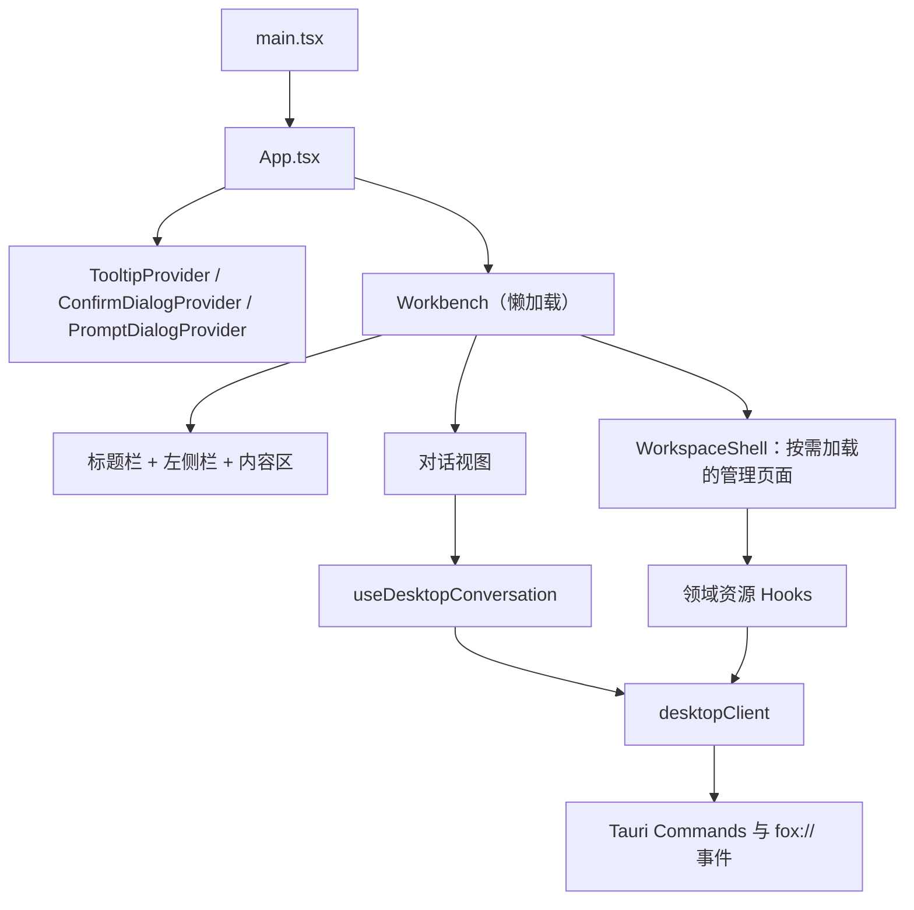
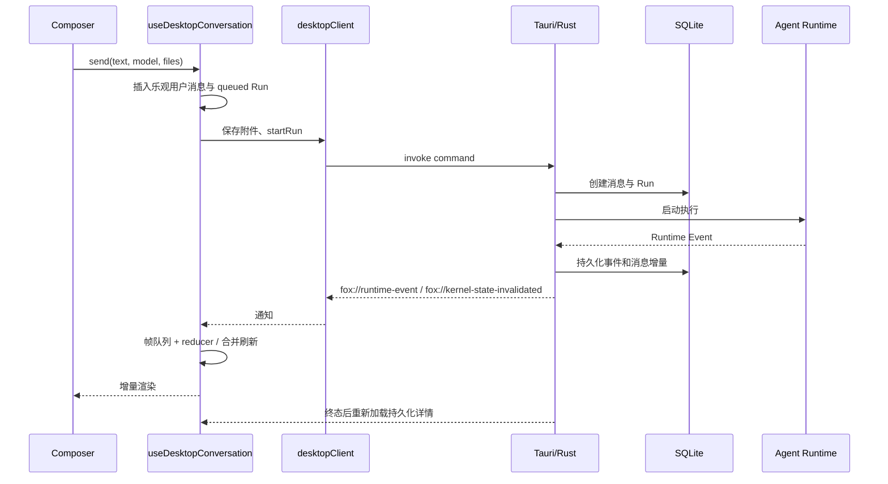

# 前端架构

> 状态：生效<br>
> 适用版本：Fox 0.1.x<br>
> 维护范围：`apps/desktop/src`<br>
> 最后更新：2026-10-28（单 Pi 分支同步；本轮未复跑产品测试）

## 结论

- 前端是 React 19 + TypeScript + Vite 6 的单页应用，运行在 Tauri 2 WebView 中，不使用 React Router；页面由 `Workbench` 维护的 `WorkspaceView` 决定。
- 入口很薄：`main.tsx` 应用文字大小和配色主题、屏蔽 WebView 右键菜单后挂载 `App`；`App` 懒加载 `Workbench`，并挂载 `TooltipProvider`、`ConfirmDialogProvider`、`PromptDialogProvider`。
- 所有宿主调用都经过 `desktopClient`（`features/conversations/api/desktop-client.ts`）；实时更新来自 8 个 `fox://` Tauri 事件，监听函数都定义在 `desktopClient` 中。
- 用户反馈统一走应用内通知 `notify`（`features/notifications.ts`），确认和输入用应用内对话框；不使用浏览器原生 `confirm` / `prompt` / `alert`。

## 目标与范围

面向桌面端前端、全栈和测试工程师，说明模块边界、页面装配、状态来源和与 Tauri 的通信方式。各页面的产品行为见同目录其他文档。

## 技术栈

依据 `apps/desktop/package.json`：

| 类别 | 当前实现 | 用途 |
| --- | --- | --- |
| UI 框架 | React 19、TypeScript 5.8 | 页面、交互和本地状态 |
| 构建 | Vite 6、`@vitejs/plugin-react` | 开发服务器、分包、生产构建 |
| 桌面桥接 | `@tauri-apps/api` 2 | Command 调用、事件监听、窗口控制 |
| 基础组件 | shadcn/ui（`radix-ui`、`@base-ui-components/react`） | Button、Dialog、AlertDialog、Sheet、Select、DropdownMenu 等，位于 `components/ui` |
| Agent UI | 项目内 `components/ai-elements`、`components/assistant-ui`、`@assistant-ui/react` | 消息、推理、工具、引用、附件、产物 |
| 其他组件来源 | `components/arc`、`components/animate-ui`、`components/corr`、`components/dotmatrix`、`components/fox-ui` | 滑杆、步进器、快捷键录制、文件管理器、加载动画、空状态等 |
| 样式 | Tailwind CSS 4 + 全局 CSS | Design Token 和业务样式 |
| 动画 | Motion、OGL、`components/effects` | 引导页背景、发送按钮、侧栏动效 |
| 文档预览 | `pdfjs-dist`、`docx-preview`、`@js-preview/excel`、`@aiden0z/pptx-renderer` | 资料只读预览 |
| 图谱 | `@antv/g6` | 远程资料库关系图 |
| 测试 | Bun test、`@testing-library/react` | `apps/desktop/tests` |

## 组件关系



### 目录职责

| 路径 | 职责 |
| --- | --- |
| `src/app` | 根组件 |
| `src/features/chat` | `Workbench`、对话布局、输入框（`composer/`）、侧栏和标题栏（`shell/`）、时间线（`thread/`、`timeline/`）、右侧栏（`right-panel/`） |
| `src/features/conversations` | 类型、`desktopClient`、事件归并 reducer、对话 Hooks |
| `src/features/agents` | 专家列表与详情、专家选择、数字同事管理 |
| `src/features/local-knowledge` | 本机资料库、本机文件夹、资料区侧栏、文件管理器 |
| `src/features/knowledge` | 远程资料库、资源树、预览器、引用定位、关系图 |
| `src/features/plugins` | 插件中心 |
| `src/features/settings` | 7 个设置页和设置相关 Hooks |
| `src/features/workspace` | 页面外壳、路由类型、管理区导航、导航历史 |
| `src/features/notifications*` | 应用内通知、通知中心、提示音 |
| `src/features/jobs` | 后台任务进度卡片 |
| `src/features/profile` | 本机用户资料 |
| `src/features/profiling` | 性能采集夹具，仅在 profile 构建中加载 |
| `src/components/*` | 通用组件（见上表） |
| `src/styles` | Token、工作台和页面样式 |

## 页面装配与路由

`Workbench` 用 `useState<WorkspaceView>` 保存当前页面，`navigate(view, entityId?, context?)` 切换。首次启动若 localStorage 没有 `fox.onboarding.status`，初始视图是 `onboarding`。

管理页面由 `features/workspace/workspace-shell.tsx` 用 `React.lazy` 加载（设置各页、专家、插件中心、资料区、远程资料库、登录等），避免进入首屏执行路径。旧设置路由在这里经 `settingsRouteRedirect` 落到新页面。

路由上下文：

- `entityId`：专家、资料库、项目或本机文件夹 ID；
- `documentId`：资料文档 ID、专家详情的二级栏目，或设置页的分组锚点；
- `sourceLocator`：引用定位用的页码、摘录、锚点和 chunk。

导航只在内存中，不写入 URL。标题栏的后退 / 前进由 `useNavigationHistory`（最多 100 条）提供，对话路由恢复时会重新加载对话。详见 [导航与页面布局](导航与页面布局.md)。

## 状态分层

### 组件与偏好状态

展开、筛选、弹窗、当前选项等短生命周期状态用 React State。主题、侧栏宽度、右侧栏页面、文字大小、配色、发送键、快捷键等偏好保存在 localStorage（键名见 [设置中心](设置中心.md#配置保存位置) 和 [导航与页面布局](导航与页面布局.md#布局持久化)）。

### 领域资源 Hooks

`useAgents`、`useKnowledgeBases`、`useModelProviders`、`useModelService`、`useSkills`、`useMcpServers`、`useLifecycleHooks`、`useYuxiService`、`useYuxiUser`、`useShortcutPreferences` 等负责：

1. 调用 `desktopClient`；
2. 维护 loading / error / data；
3. 局部刷新；
4. 向页面暴露操作函数。

它们不是缓存层，跨页面的事实以 SQLite 或知识库服务为准。资料区通过 `LocalKnowledgeGateway`（`tauri-gateway.ts`，测试用 `mock-gateway.ts`）访问宿主。

### 对话聚合状态

`useDesktopConversation`（约 1,700 行）聚合会话、消息、Run、事件、审批、附件、产物、资料库绑定、专家和 Runtime 状态。更新来源：

1. 发送时的乐观消息和临时 Run；
2. `useRuntimeEventStream`：订阅 `fox://runtime-event`，按动画帧批量归并（`runtime-event-queue.ts` + `runtime-event-reducer.ts`），Run 终态后重新加载持久化详情；
3. `useKernelStateStream`：订阅 `fox://kernel-state-invalidated` 和 `fox://kernel-model-preview`，合并刷新（`coalesced-refresh.ts`）后重新读取对话；
4. `fox://work-event`：只更新 Goal、Task、Evidence，不推进 Runtime 序号、不改写助手消息。

持久化详情与内存详情通过 `mergeConversationDetail` 合并，不能简单覆盖，否则会回退已收到的流式文本或审批状态。

### Tauri 事件

| 事件 | 用途 |
| --- | --- |
| `fox://runtime-event` | Runtime 事件流 |
| `fox://work-event` | 工作图（Goal / Task / Evidence） |
| `fox://kernel-state-invalidated` | Kernel 状态变化，前端重新读取 |
| `fox://kernel-model-preview` | 模型输出预览 |
| `fox://approval-requested`、`fox://approval-resolved` | 审批；也用于刷新通知中心（`notification-subscriptions.ts`） |
| `fox://child-run-updated` | 子 Agent 状态 |
| `fox://knowledge-download-progress` | 远程资料下载进度 |

## 数据流



历史外部 Agent（Codex / DeepSeek / Pi ACP）会话通过兼容数据结构展示历史；Host 拒绝其执行入口。新会话只创建 `agent_backend = fox`，本地引擎为 Pi（见 [单 Pi 主线状态](../01-项目概览/单Pi主线状态.md)）。

## 反馈与对话框

- `notify` / `notify.success` / `notify.error`：写入应用内通知中心（`features/notifications.ts`）。`components/ui/sonner.tsx` 存在，但应用没有挂载 `Toaster`。
- `confirmDialog(options)`：返回 `Promise<boolean>`，只有点确认才为 true；`destructive` 控制危险样式。
- `promptDialog(options)`：返回输入值或 null。
- 在下拉菜单里打开对话框时用 `runAfterMenuClose`。
- `apps/desktop/tests/no-native-confirm.test.ts` 扫描前端源码，禁止原生弹窗。

## 错误与边界

- 浏览器预览中没有 Tauri（`desktopRuntimeAvailable` 为 false），窗口操作无害，真实数据功能不可用；部分设置页退回默认值。
- 管理页面错误就地显示；短操作结果用 `notify`。
- 知识库服务离线时，本机专家继续可用，远程专家和远程资料库不可用。
- `Workbench`（约 1,550 行）仍承担路由、全局布局和大量对话 UI，是修改时最容易产生跨功能回归的文件。
- 多处偏好只存 localStorage，不在备份范围内。

## 测试与验证

```powershell
pnpm.cmd --dir apps/desktop build
bun test apps/desktop/tests
```

`apps/desktop/tests` 中有 reducer、事件流、导航、设置页 DOM、资料区、预览、确认框等测试。Windows CI 的桌面 job 运行这些测试（定向模式会跳过，见 `docs/02-架构/可观测性与测试架构.md`）。

人工验证建议覆盖：首次进入、新建对话、发送、流式回复、审批 / 补充问题、切换会话、后退 / 前进、服务离线、窄窗口、深浅主题和懒加载页面。

## 相关代码

- `apps/desktop/src/main.tsx`、`apps/desktop/src/app/App.tsx`
- `apps/desktop/src/features/chat/workbench.tsx`
- `apps/desktop/src/features/workspace/workspace-shell.tsx`、`types.ts`、`use-navigation-history.ts`
- `apps/desktop/src/features/conversations/hooks/use-desktop-conversation.ts`、`use-runtime-event-stream.ts`、`use-kernel-state-stream.ts`
- `apps/desktop/src/features/conversations/model/runtime-event-reducer.ts`、`runtime-event-queue.ts`
- `apps/desktop/src/features/conversations/api/desktop-client.ts`
- `apps/desktop/src/features/notifications.ts`
- `apps/desktop/src/components/ui/confirm-dialog.tsx`、`prompt-dialog.tsx`

## 已知限制

- 无 URL 路由和路由级错误边界。
- `Workbench` 和 `useDesktopConversation` 体积大、职责多。
- 端到端测试不足，组件交互主要靠 DOM 单测和人工复测。
- 文本、可访问性和响应式行为仍需在真实 Tauri WebView 中验证。
