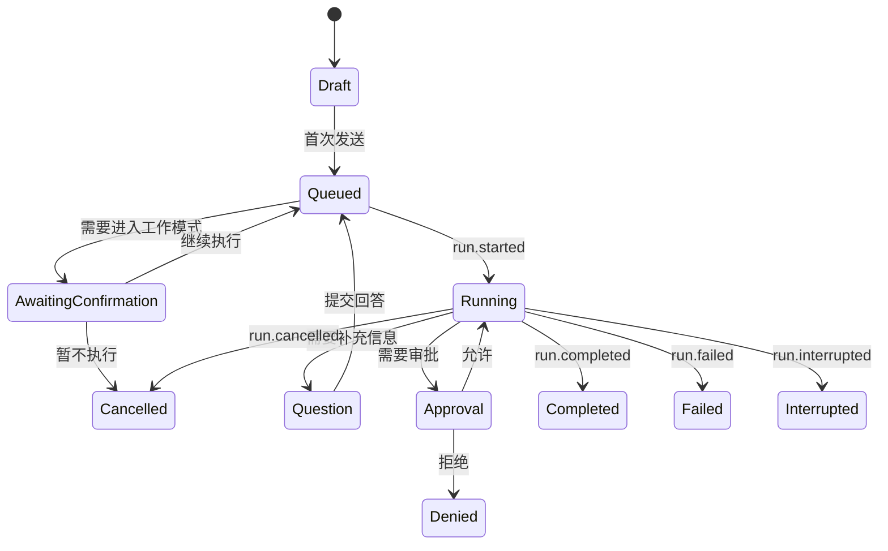

# 对话体验

> 状态：生效 
> 适用版本：Fox 0.1.x 
> 维护范围：`apps/desktop/src/features/chat`（输入框、时间线、右侧栏、审批与补充问题）、`apps/desktop/src/features/conversations` 
> 最后更新：2026-10-28（单 Pi 分支同步；本轮未复跑产品测试）

## 结论

- 新对话先是草稿，首次发送后才写入历史。本地统一使用 Pi，存储绑定为 `agent_backend = fox`；输入区不提供驱动选择器。
- 输入框的主要入口：「添加内容」（添加附件、添加资料库）、`/` 命令、`@` 引用项目文件、「执行方式」菜单、项目选择、模型选择、专家胶囊。
- 任务运行中发送的文字可以「加入当前任务」或「下一轮再处理」，与停止任务互不影响。
- 工具审批的决定是「拒绝」「本对话内允许」「只允许这一次」，宿主按请求类型限定可选项；工作模式确认是「继续执行」/「暂不执行」，两者是不同的边界。
- 用户消息乐观插入，模型输出按事件流增量渲染，终态后以 SQLite 持久化详情校正。

## 目标与范围

说明从新对话到 Run 完成的前端体验：输入框、时间线、工作过程、审批、补充问题、附件、资料库、引用、文件结果和右侧栏。执行链路见 `docs/02-架构/对话系统架构.md`。

## 产品原则

- 新对话首次发送后才进入历史。
- 一个会话绑定一个 Agent（创建时确定），可以另外绑定一个专家；更换专家沿用当前对话，聊天记录保留。
- 用户消息即时出现，模型输出实时渲染，并以持久化状态收敛。
- 展示可审计的工作过程、工具和证据，不渲染隐藏的模型内部思维。
- 需要审批或补充信息时，在输入框上方给出可继续的交互。

## 输入框

`composer/fox-composer.tsx`，占位文字「给 Fox 发消息，输入 / 查看命令，@ 引用文件…」。

| 入口 | 行为 | 代码 |
| --- | --- | --- |
| 添加内容 | 菜单：添加附件、添加资料库 | `fox-composer.tsx` |
| `/` 命令 | 目标（设置目标）、文件（添加文件）、资料库（选择资料库）、计划（制订计划）、总结 / 精简（精简对话） | `fox-slash-commands.tsx` |
| `@` | 引用项目文件；未选项目时提示「选择项目后可引用文件」 | `use-mention-files.ts` |
| 执行方式 | 执行前询问 / 自动执行 / 只读模式（对应项目权限 询问 / 允许 / 只读） | `fox-composer.tsx` |
| 项目 | 选择已有项目或添加项目 | `composer-project-bar.tsx` |
| 模型 | 选择模型；会切换默认模型，后续对话使用 | `composer-model-picker.tsx` |
| Agent 驱动 | 新对话不显示驱动选择器；本地执行统一使用 Pi | `composer-agent-picker.tsx`、`components/AgentBackendBar.tsx` |
| 专家胶囊 | 查看详情 / 更换专家 / 移除专家；运行中为只读 | `components/ExpertBindingChip.tsx` |

附件限制：单个不超过 5 MB，一次最多 8 个；支持 PDF、TXT、MD、DOCX、XLSX、PPTX、CSV、TSV，旧版 DOC、XLS、PPT 需先转换。发送或附件读取失败时，草稿和附件保留。

历史外部 Pi ACP、DeepSeek、Codex 会话保留原绑定和历史，只读，不能继续运行。新建、开始、取消、审批和恢复请求由 Host 拒绝，错误为 `agent_backend_retired`。本地 Pi 使用 Fox 项目权限；旧完全访问选项不能恢复退休驱动。

### 运行中补充

任务运行时继续输入，可以选择：

- 加入当前任务：在下一个安全边界交给模型，不停止当前任务，不新增工具授权；
- 排队，下一轮处理：当前任务结束、你发起下一轮时再处理。

已提交的补充显示在 `RunSteeringStrip` 中，可移除。补充要求只支持文字，附件不能进入运行中任务。

## 时间线

`thread/`、`timeline/` 下的组件渲染：

- 用户消息和附件；最后一条用户消息可编辑后重发，之后的回复会被截掉（`fox-edit-composer.tsx` → `rerunFromMessage`）；
- 助手消息：Markdown 回复、工作过程、引用来源；
- 消息操作：复制消息（`fox-message-actions.tsx`，当前没有点赞 / 点踩）；
- 专家启用卡片（宿主写入，不是用户消息，不进入模型历史）；
- 工作进度卡（`GoalProgress.tsx`）、交付验收卡（`DeliveryAcceptanceCard.tsx`）、运行状态条（`FoxRunStatusBar.tsx`）；
- 「本次文件结果」（`runtime-artifacts.tsx`）。

历史消息分页加载：对话打开时加载最近一批，「加载更早消息」按 `ordinal` 向前取（`loadEarlierMessages`）。

工作过程的显示详细程度由 设置 → 通用 →「过程详情」控制（`process-display-mode.ts`）。

## Run 状态

前端聊天状态 `ChatState`：`complete`、`running`、`question`、`approval`、`error`、`denied`（`fox-shared.tsx`）。持久化 Run 的 `status` 在前端类型中是字符串；`conversation-run-indicator.ts` 把 `awaiting_confirmation` 视为等待确认。

### 实时更新

发送时先插入乐观用户消息和临时 queued Run，`startRun` 返回后替换为真实记录。Runtime 事件经帧队列批量归并；`fox://kernel-state-invalidated` 仍可触发合并刷新（Kernel 执行循环已删除，只剩初始失效通知）；终态后重新读取持久化详情。两条通道都要保留，见 [前端架构](前端架构.md#对话聚合状态)。

## 审批

`components/RuntimeApprovalPrompt.tsx` 在输入框上方显示审批，同一时间只显示一条。可选决定由 `allowedApprovalDecisions`（`approval-decision-policy.ts`）按请求计算，标签来自 `permission-grant.tsx`：

| 决定 | 标签 | 说明 |
| --- | --- | --- |
| `deny` | 拒绝 | |
| `allow_once` | 只允许这一次 | |
| `allow_project_rule` | 本项目总是允许「前缀」 | 只出现在命令类工具上（A1）：写入一条按 token 前缀匹配的项目 allow 规则，前缀可编辑，可在 设置 → Agent → 项目权限 中撤销 |
| `allow_conversation` | 本对话内允许 | 只用于 MCP 等非 Fox 自有工具：授权当前对话中的该工具和此目标，可撤销；权限模式变化后失效。Fox 自有工具（含命令）不再提供这一项 |

命令审批卡还显示 `hostExecution`：命令在 Host 上以当前用户身份执行、不受沙箱限制，Fox 只负责超时、取消和清理整棵进程树。Run 详情里的审计列表（`PermissionAuditList.tsx`）列出每次自动放行的模式、原因和命中的规则。执行方式菜单有四档（`features/chat/access-mode.ts`）：只读 / 询问 / 自动 / 完全访问；首次开启完全访问用应用内确认框二次确认。

整文件替换类请求只能「拒绝」或「只允许这一次」（新建文件除外）；审批详情不完整时只能拒绝。审批卡会显示动作类型（新建文件、替换文件、写入文件、执行命令等）、目标和拟写入内容。前端先乐观更新，失败时恢复并提示「审批未处理成功，请重试。」

审批状态文字（`approval-labels.ts`）：等你处理、已批准、用户拒绝、已取消、已过期。审批不再自动过期，`expired` 只出现在旧版本写入的记录中。

审批只是界面，宿主会再次校验。

## 工作模式确认

复杂或高风险请求会先提示「Fox 将为这项工作跟踪任务、执行过程和证据。是否进入工作模式并继续执行？」，按钮为「暂不执行」/「继续执行」（`GoalProgress.tsx`）。专家工作流的阶段门禁在同一张卡里：「批准计划」/「退回修改」、「批准阶段」/「拒绝并停止」。

## 补充问题

Runtime 发出结构化问题后，输入框上方出现「需要你补充一点信息」：支持单选、多选（「可多选」）和自由文本，按钮「确认并继续」。提交后 Fox 继续刚才的任务。提交失败时保留输入。

## 附件、资料库与项目

- 附件先保存到 Fox 管理目录，再把附件 ID 交给 Runtime。
- 资料库绑定属于会话上下文，草稿阶段暂存，会话创建后写入；专家声明的资料库在启用专家时自动加入（`workbench.tsx` 的 `selectExpert`）。
- 项目与执行方式显示在输入框内，可随时修改。

## 引用、文件结果与右侧栏

- 引用保留资料库 ID、文档 ID、页码、摘录和内部定位。点击引用跳到资料预览，按页码或摘录定位；界面不显示内部 chunk ID。
- 每个 Run 结束后，该 Run 通过受管写入工具新建或修改的文件显示在回复底部「本次文件结果」，同一路径只保留最终一条。点击文件卡打开右侧栏「文件」页，每个文件一个标签。
- 文件的打开方式由宿主解析（`artifact_gateway.rs`），前端只提交会话内的相对路径、受控动作和应用 ID。HTML 不在应用内执行。
- `run_command` 等通用命令的隐式文件副作用不进入「本次文件结果」，仍在「更改」和命令详情中。

右侧栏页面：资料库、文件、更改、运行详情、网页与网络、协作助手，见 [导航与页面布局](导航与页面布局.md#对话右侧栏)。

## 异常与边界

- 事件可能早于 `startRun` 返回，监听器必须先就绪（`runtimeListenerReadyRef`）。
- 快速切换会话时只接受当前会话的 UI 更新，其他会话的终态只刷新列表和运行指示。
- 取消中的 Run 仍属活动状态，直到宿主确认终态。
- 只读会话不能发送（「此会话为只读，不能发送」）。

## 测试与验证

自动测试：

- `apps/desktop/tests/runtime-event-reducer.test.ts`：事件顺序、重复事件、终态归并；
- `apps/desktop/src/features/chat/composer/composer-agent-picker.test.mjs`：新对话 Agent 选择；
- `prompt-send-shortcut.test.ts`、`settings-send-shortcut-dom.test.tsx`：发送键；
- `apps/desktop/src/features/chat/components/DeliveryAcceptanceCard.test.tsx`：交付验收卡；
- Rust `artifact_gateway` 用例：会话范围、路径越界、非普通文件、大小 / 哈希变化。

以上只列出能直接找到的测试，未逐个核对覆盖范围。

人工回归：首次消息即时出现；长短回复连续流式；完成后无需刷新；切换会话不串消息；工具、审批、补充问题可继续 Run；运行中补充两种方式；重启后历史、附件、引用和文件结果仍在；加载更早消息时滚动稳定。

## 相关代码

- `apps/desktop/src/features/chat/workbench.tsx`
- `apps/desktop/src/features/chat/composer/`
- `apps/desktop/src/features/chat/thread/`、`timeline/`、`components/`
- `apps/desktop/src/features/chat/runtime-artifacts.tsx`
- `apps/desktop/src/features/conversations/hooks/use-desktop-conversation.ts`
- `apps/desktop/src/features/conversations/model/runtime-event-reducer.ts`、`approval-decision-policy.ts`、`approval-labels.ts`、`pending-interactions.ts`
- `apps/desktop/src/components/assistant-ui/upstream/elements/permission-grant.tsx`

## 已知限制

- 没有消息点赞 / 点踩和回合导航。
- 通用命令的文件副作用不会自动进入文件结果。
- 缺少覆盖真实 Tauri 事件时序的端到端测试。
- Plan、Attempt、Evidence、Reviewer、Acceptance 等事实分散在工作进度卡、交付验收卡、右侧栏和诊断中，没有统一的聚合视图。
