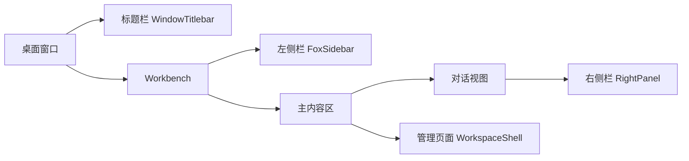
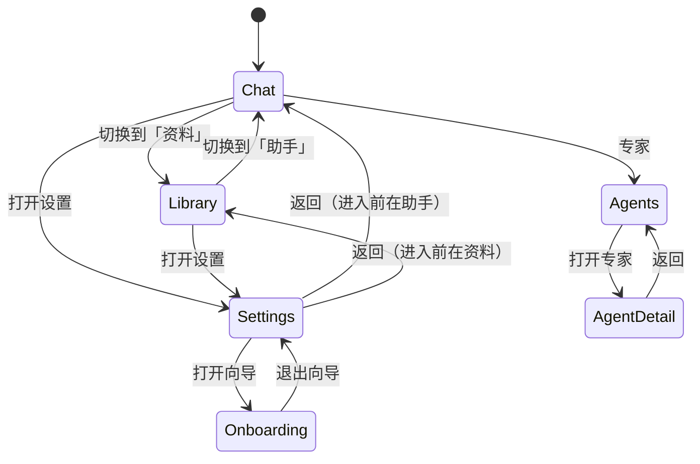

# 导航与页面布局

> 状态：生效 
> 适用版本：Fox 0.1.x 
> 维护范围：`apps/desktop/src/features/chat/workbench.tsx`、`apps/desktop/src/features/chat/shell/`、`apps/desktop/src/features/workspace/`、`apps/desktop/src/features/chat/right-panel/` 
> 最后更新：2026-10-25

## 结论

- Fox 是一个常驻的工作台外壳：标题栏 + 左侧栏 + 主内容区，对话视图另有右侧栏。
- 左侧栏顶部的模式切换是「助手 / 资料」两项。助手模式显示新建对话、专家、插件和对话列表；资料模式显示最近、资料库、向量模型、任务中心和资料库树。
- 设置、专家详情等管理页把左侧栏换成上下文导航，顶部「返回」回到进入管理区之前的位置（上下文返回）。
- 标题栏有「后退 / 前进」按钮，按应用内的导航历史恢复路由（`use-navigation-history.ts`，最多 100 条）。这不是浏览器历史，也没有 URL 深链接。
- `WorkspacePage` 现在只是滚动容器加悬浮动作区，不再渲染页面标题栏；页面标题由各页面内容自己渲染。

## 目标与范围

说明窗口框架、左侧栏各模式、主内容页外壳、对话右侧栏和响应式规则，以及新页面应如何接入。各设置页的内容见 [设置中心](设置中心.md)，资料区页面见 [本地知识库体验](本地知识库体验.md)。

## 组件关系

## 标题栏

`fox-window-titlebar.tsx` 同时是 Tauri 拖拽区、产品标识和窗口控制：

- 左侧：Fox 图标、「应用菜单」、展开 / 收起左侧边栏、后退、前进；
- 右侧：最小化、最大化 / 还原窗口（图标随真实窗口状态切换）、关闭。

应用菜单：

| 子菜单 | 项目 |
| --- | --- |
| 文件 | 新建对话、打开项目、设置、退出 |
| 编辑 | 撤销、重做、复制、粘贴（`document.execCommand`） |
| 视图 | 显示 / 隐藏侧栏、放大、缩小 |
| 帮助 | 关于 Fox |

新建对话、打开项目、设置、切换侧栏旁显示当前快捷键（来自「对话 → 快捷键」）。浏览器预览没有原生窗口时，窗口操作被 `try/catch` 吞掉，不会报错。

## 左侧栏模式

`fox-sidebar.tsx` 按 `activeView` 计算 `sidebarMode`：

| 模式 | 触发视图 | 内容 |
| --- | --- | --- |
| `chat` | `chat`、`agents`、`plugins` 等普通视图 | 「助手 / 资料」切换、搜索；新建对话、专家、插件；项目分组和对话列表；通知 |
| `local-knowledge` | 所有 `local-knowledge-*`、`local-files`，以及 `knowledge`、`knowledge-detail`、`knowledge-graph` | 「助手 / 资料」切换、搜索；最近、资料库、向量模型、任务中心；「本机」分组（本机资料库、本机文件夹，带「新建资料库」按钮）和「远程」分组 |
| `settings` | `SETTINGS_WORKSPACE_VIEWS` 中的视图 | 返回；偏好 / 能力 / 系统三组共 7 个入口 |
| `agent` | `agent-detail` | 返回；专家介绍、资料库、技能、连接器、工具、工作记录、记忆 |

`fox-sidebar.tsx` 中还有 `knowledge` 模式（文件详情、关系图、资源管理器），但由于 `knowledge-detail` / `knowledge-graph` 先被归入 `local-knowledge`，按当前判断顺序这一分支不会被走到（代码现状）。

管理模式下顶部是「返回」按钮：`agent` 模式回到专家列表，其余回到 `managementExitRoute` 记录的位置。设置和资料区各自记录进入前的路由（`captureManagementReturnRoutes`），在两个管理区之间切换不会覆盖最初的返回点。

### 助手模式的对话列表

- 「项目」分组：按规范化根路径把有项目的对话分组；置顶项目排前。分组标题可展开 / 收起，右侧有「在〈项目〉中新建对话」和菜单（新建对话、项目权限、置顶项目、删除项目）。分组头的菜单有添加项目、全部展开、全部收起、项目权限。
- 普通对话列表：没有项目的对话。
- 对话行菜单：置顶、重命名、归档对话、删除对话；已归档视图里是取消归档，回收站里是恢复对话、永久删除。
- 「项目权限」菜单项跳到 设置 → Agent → 项目权限。
- 项目分组只来自已有对话的 `projectRoot`，没有对话的项目不会出现在侧栏。

### 折叠状态

左侧栏折叠后变成图标条：助手 / 资料模式下有模式切换、搜索、通知，助手模式另有项目和对话的弹出菜单（`fox-sidebar-collapsed-menus.tsx`）；管理模式下只剩「返回」。

## 主内容页

管理页面由 `workspace-shell.tsx` 按 `WorkspaceView` 懒加载。`WorkspacePage`（`page-shell.tsx`）仍接受 `title`、`subtitle`、`onBack` 等参数，但这些参数被忽略，只渲染：

- 可选的悬浮动作区（`actions`）；
- 一个可滚动的内容区。

页面标题由页面内容自己渲染，例如设置页的 `SettingsPageLayout`、资料区的 `LocalKnowledgeHeader`。新增管理页应继续包在 `WorkspacePage` 里，以获得一致的滚动和动作位置。

## 路由

`WorkspaceView`（`features/workspace/types.ts`）是路由契约：

| 区域 | 视图 |
| --- | --- |
| 对话 | `chat` |
| 专家 | `agents`、`agent-detail` |
| 插件中心 | `plugins` |
| 资料（本机） | `local-knowledge-home`（最近）、`local-knowledge`（资料库）、`local-knowledge-detail`、`local-knowledge-documents`、`local-knowledge-import`、`local-knowledge-jobs`、`local-knowledge-models`、`local-knowledge-retrieval`、`local-knowledge-settings`、`local-files` |
| 资料（远程） | `knowledge`、`knowledge-detail`、`knowledge-graph` |
| 设置 | `settings`、`settings-conversation`、`settings-models`、`settings-ai`、`settings-extensions`、`settings-yuxi`、`settings-data` |
| 旧设置路由 | `settings-shortcuts`、`settings-projects`、`settings-usage`、`settings-about`、`maintenance`、`skills`、`mcp`（重定向，见设置中心） |
| 独立流程 | `model-service`、`service`、`login`、`onboarding` |

页面通过 `navigate(view, entityId?, context?)` 传递实体和文档上下文。资料区内部的路由名与 `WorkspaceView` 的互转在 `management-navigation.ts`（`localKnowledgeViewForWorkspace` / `workspaceViewForLocalKnowledge`）。首次向导用 `onboardingReturnRoute` 记录退出后回到哪里。

## 对话右侧栏

`fox-right-panel.tsx` 定义 6 种页面（`RightMode`）：

| 值 | 标签 | 内容 |
| --- | --- | --- |
| `knowledge` | 资料库 | 当前对话启用的资料库 |
| `files` | 文件 | 生成文件和打开的文件标签页 |
| `changes` | 更改 | 写入和命令类工具调用 |
| `activity` | 运行详情 | 工具调用和运行过程 |
| `browser` | 网页与网络 | 网页类工具调用 |
| `agents` | 协作助手 | 子 Agent（Child Run）列表和消息 |

右侧栏只在 `chat` 视图且对话已有内容时显示（`showConversationRightSidebar`）。右侧栏顶部是已打开的页面标签（每个打开的文件一页）和「＋」页面菜单，可最大化。宽度可调（280–760px，默认 360px），宽度、打开的页面和当前页面保存在 localStorage。紧凑布局下改为内容卡片内的抽屉。管理页不渲染右侧栏。

## 响应式规则

| 条件 | 行为 | 依据 |
| --- | --- | --- |
| `max-width: 1180px` | 紧凑布局：右侧栏改为抽屉，不与对话并排 | `workbench.tsx` 的 `matchMedia` |
| `max-width: 700px` | 左侧栏强制折叠为图标条 | `workbench.tsx` 的 `matchMedia` |
| 其他断点 | 各页面 CSS 自行收紧间距（如 900px、820px、520px） | `styles/*.css` |

左侧栏展开宽度 220–456px，默认 276px。

## 布局持久化

`layoutStorage`（`fox-shared.tsx`）：

| 键 | 内容 |
| --- | --- |
| `fox.layout.sidebarCollapsed` | 左侧栏是否手动折叠 |
| `fox.layout.sidebarWidth`、`fox.layout.sidebarWidthVersion` | 左侧栏宽度 |
| `fox.layout.rightMode`、`fox.layout.rightTabs` | 右侧栏当前页面和已打开页面 |
| `fox.layout.rightSidebarCollapsed`、`fox.layout.rightWidth` | 右侧栏折叠和宽度 |
| `fox.layout.seenChanges` | 「更改」已读计数 |
| `fox.theme` | 浅色 / 深色 |

## 交互状态

## 异常与边界

- 「返回」是上下文返回；「后退 / 前进」是应用内历史。两者并存，含义不同。
- 历史恢复失败（例如对话加载失败）时会尝试回到原路由并报错。
- 首次向导占满窗口，绕过普通工作台布局。
- 右侧栏「资料库」「协作助手」页已有实际内容，不再是占位。

## 测试与验证

人工回归至少覆盖：

1. 从对话和资料区分别进入设置，再「返回」回到原位置；
2. 后退 / 前进在对话、专家、资料、设置之间切换；
3. 专家详情二级栏目切换；
4. 左右侧栏折叠、调整宽度和重启恢复；
5. 1180px、700px 附近的布局；
6. 最大化 / 还原按钮图标；
7. 快捷键 `Ctrl+N` / `Ctrl+O` / `Ctrl+,` / `Ctrl+B` / `Ctrl+K`（默认值，可在设置中改）。

相关自动化测试（`apps/desktop/tests/`）：`management-navigation.test.ts`、`navigation-history.test.ts`、`workspace-navigation.test.ts`、`knowledge-navigation.test.ts`、`sidebar-model.test.ts`、`sidebar-project-groups.test.ts`、`right-panel-files-dom.test.mjs`、`window-titlebar-overlay-dom.test.tsx`（未逐个核对覆盖范围）。

## 相关代码

- `apps/desktop/src/features/chat/workbench.tsx`
- `apps/desktop/src/features/chat/shell/fox-sidebar.tsx`、`fox-window-titlebar.tsx`、`fox-sidebar-collapsed-menus.tsx`
- `apps/desktop/src/features/chat/right-panel/fox-right-panel.tsx`
- `apps/desktop/src/features/chat/fox-shared.tsx`（`layoutStorage`、`RightMode`）
- `apps/desktop/src/features/workspace/types.ts`、`page-shell.tsx`、`workspace-shell.tsx`、`management-navigation.ts`、`use-navigation-history.ts`
- `apps/desktop/src/features/local-knowledge/local-knowledge-sidebar.tsx`

## 已知限制

- 无 URL 深链接。
- 没有对话的项目不出现在侧栏。
- `fox-sidebar.tsx` 中的远程资料详情模式（`knowledge`）按当前判断顺序不可达。
- 窄窗口适配面向缩窄桌面窗口，不等同于移动端适配。
