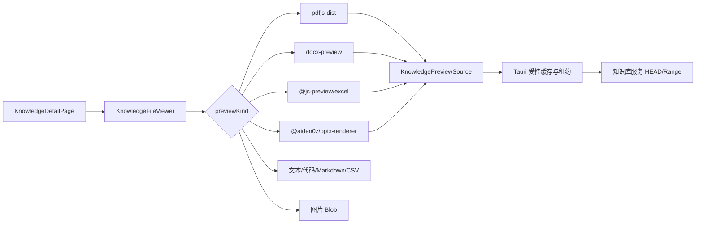

# 知识库体验

> 状态：生效 
> 适用版本：Fox 0.1.x 
> 维护范围：远程资料库（`apps/desktop/src/features/knowledge`）：列表、文件浏览、预览、引用导航、下载与关系图 
> 最后更新：2026-10-25

## 结论

- 远程资料库是知识库服务（代码中的 `yuxi`）的只读客户端，界面统一称「远程资料库」。Fox 负责浏览、预览、下载、检索授权和引用导航；上传、解析、分块、Embedding 和权限治理在知识库服务管理端完成。
- 入口在左上角「资料」模式：资料库页面底部的远程区（`LibraryRemoteSection`）和左侧栏「远程」分组；完整列表页 `knowledge` 标题为「远程资料库」。助手模式不再有远程知识库入口。
- 打开远程资料库后进入文件页（`knowledge-detail`），可切到「关系图」（`knowledge-graph`）。这两个视图在左侧栏上属于资料模式，不再切换为独立的「文件与详情 / 知识图谱」导航（见 [导航与页面布局](导航与页面布局.md#左侧栏模式)）。
- 可编辑的本机资料见 [本地知识库体验](本地知识库体验.md)。

## 访问前置条件

1. 已在 设置 → 资料库 →「资料库服务」连接服务；
2. 服务可用；
3. 已在 Fox 内登录资料库账户（设置 → 资料库 →「账户」→「登录账户」）；
4. 当前账户有对应资料库的权限。

浏览器中的登录态不会共享给 Fox。未连接时显示「先连接资料库服务，再登录账户」，带「配置服务」「登录账户」；无权限时显示「当前账户没有可查看的资料库」。资料区的远程区在未连接、未登录、连不上时分别提示「还没有连接 Yuxi」「登录 Yuxi 后查看远程资料库」「连不上 Yuxi」（`library-remote-section.tsx`，文案中仍出现 Yuxi 字样，代码现状）。

## 远程资料库列表

`KnowledgeListPage`（标题「远程资料库」）：

- 「搜索资料库」；
- 筛选：状态（全部状态 / 可使用 / 处理中 / 待处理）、类型（全部类型）、内容（全部内容 / 包含文件 / 空资料库）；
- 刷新；无匹配时「清空筛选」。

卡片显示名称、简介、文件数和处理进度。列表只读，不提供上传、删除、解析配置或管理后台入口。

## 文件页

`KnowledgeDetailPage`：顶部有「返回资料库」、路径面包屑、「搜索文件名」、刷新、「关系图」、「就此资料提问」。文件以文件管理器展示，选中文件后打开预览。

预览弹窗的操作：

- 就此资料提问：以当前资料库发起提问（`onAskKnowledge`）；
- 刷新预览；
- 复制文件信息；
- 本机打开；
- 下载原件 / 取消下载（下载中显示「正在下载所选文件」和「停止下载」）。

文档请求带代次编号，快速切换时迟到的响应不会覆盖当前文件。

## 核心模块与预览数据流

Fox 不使用 Office 服务端转换。预览器读取资料原件，经 Tauri 鉴权网关写入 Fox 受控缓存，再按文件类型调用成熟前端库。

### 格式策略

| 格式 | 当前查看方式 | 主要约束 |
| --- | --- | --- |
| PDF | PDF.js，单页 Canvas、翻页、缩放、搜索 | 完整缓存，界面只挂载当前页 |
| DOCX | docx-preview，按可识别 section 翻页 | 文件上限 64MB；连续文档可能只有一个渲染 section |
| XLS/XLSX/ODS | @js-preview/excel | 只读、禁用编辑器与右键菜单 |
| PPTX | @aiden0z/pptx-renderer | 只挂载当前页，支持前后翻页 |
| 图片 | Blob URL | 单图上限 64MB，支持缩放/适应 |
| 文本/代码/JSON/Markdown | 本地文本查看器 | 原件前 2MB，支持搜索和高亮（最多 500 个结果） |
| CSV/TSV | 受限表格 | 最多 500 行、100 列 |
| DOC/PPT 等旧二进制格式 | 不支持内嵌预览 | 下载后使用本机应用 |

Office ZIP 文件进入第三方解析器前会检查加密、条目数、展开体积、压缩比、ZIP64 和分卷，降低 ZIP bomb 风险。

## 缓存、打开与下载

- 预览缓存默认上限 500 MB（`maintenance.rs` 的 `KNOWLEDGE_PREVIEW_CACHE_LIMIT`），可在 设置 → 数据与关于 →「预览缓存」调整上限和清理（清理前用应用内确认框）。
- 缓存键由资料库 ID、文档 ID、服务端 `source_revision` 和预览规格构成。
- 写入使用随机 `.part`、长度校验和原子替换；活动查看器通过租约保护文件。
- WebView 只持有不透明缓存键，不接收本地绝对路径。
- 「本机打开」只允许常见文档和图片白名单，宏文档、脚本、可执行文件被拒绝；本机打开的文件大小上限 500 MB（`knowledge-pages.tsx` 的 `MAX_LOCAL_OPEN_BYTES`）。
- 下载使用系统另存为、分块写入、进度事件（`fox://knowledge-download-progress`）、取消，完成后可打开或定位。

## 引用导航

对话引用保留 `knowledgeBaseId`、`documentId` 和定位信息。点击后打开对应资料库与文件：

- PDF：优先跳到指定页；无页码时搜索摘录；
- DOCX：按页或 section 定位，再搜索并高亮摘录；
- 文本：搜索摘录并滚动到匹配；
- 内部 chunk ID：仅用于定位，不向普通用户显示。

页面切换、新会话和普通文件导航会清理旧定位，避免引用高亮错误残留。

## 关系图

`KnowledgeGraphPage` 使用 AntV G6：

- 「搜索实体、概念或文档」，按类别筛选；
- 查询深度 1–3；节点显示上限 50 / 100 / 200；
- 节点形状：矩形节点 / 圆形节点；
- 缩小、放大、显示全图；画布统计显示条目数和关系数；
- 节点详情和「关联关系」，可跳到来源文档。

节点与关系先在前端规范化，兼容服务端不同的字段包装。

## 异常与边界

- 服务必须提供稳定的 `source_revision`、鉴权 HEAD 和严格的 Range 响应，否则原件预览会失败或降级。
- 预览状态统一为 loading、ready、failed、unsupported，失败可重试。
- 切换文件时取消远端分块、缓存读取和第三方渲染任务。
- 解析内容与原件预览是两条数据链，解析内容不能冒充原始版式。
- DOCX 分页由文档结构和库输出决定，不是打印级复现。
- 图谱和远端文档都视为不可信数据，不能改变权限或工具白名单。

## 测试与验证

自动测试（`apps/desktop/tests/`）：

- `knowledge-preview-model.test.ts`：格式路由、表格和页码模型；
- `knowledge-preview-source.test.ts`：缓存 / Range 数据源、取消和租约；
- `document-activity.test.ts`：阅读位置与引用定位；
- `knowledge-navigation.test.ts`：资料区路由与返回；
- `settings-preview-cache-confirm-dom.test.tsx`：清理预览缓存前确认；
- `apps/desktop/src/features/knowledge/knowledge-graph-canvas.test.mjs`：图谱画布；
- Rust 侧缓存、下载、路径和网关测试。

人工回归：未连接、未登录、空资料库和服务离线；深层目录和快速切换；PDF 第二页以后、DOCX 图片、Excel 多表、PPTX 翻页；大文件取消、缓存清理后重新打开；下载完成动作和危险格式限制；从对话引用跳到正确位置；关系图节点多时的缩放和来源跳转。

## 相关代码

- `apps/desktop/src/features/knowledge/knowledge-pages.tsx`
- `apps/desktop/src/features/knowledge/use-knowledge.ts`
- `apps/desktop/src/features/knowledge/knowledge-resource-explorer.tsx`
- `apps/desktop/src/features/knowledge/knowledge-file-viewer.tsx`、`knowledge-pdf-viewer.tsx`、`knowledge-docx-viewer.tsx`、`knowledge-spreadsheet-viewer.tsx`、`knowledge-pptx-viewer.tsx`
- `apps/desktop/src/features/knowledge/knowledge-preview-source.ts`、`knowledge-preview-model.ts`
- `apps/desktop/src/features/knowledge/knowledge-graph-canvas.tsx`
- `apps/desktop/src/features/local-knowledge/library-remote-section.tsx`
- `apps/desktop/src-tauri/src/maintenance.rs`

## 已知限制

- Fox 不提供远程资料上传、解析配置和权限管理。
- 旧 Office 二进制格式没有内嵌预览。
- 引用支持页码和摘录定位，不展示 chunk 管理。
- 资料区远程区的部分提示文案仍含「Yuxi」，与「对外统一称知识库服务」的规范不一致。
