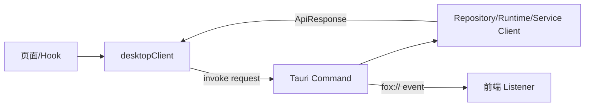

# Tauri 命令与事件参考

> 状态：生效<br>
> 适用版本：Fox 0.1.x<br>
> 维护范围：`apps/desktop/src-tauri/src/lib.rs` 的命令注册、`fox://` 窗口事件、`desktop-client.ts` 封装<br>
> 最后更新：2026-10-28（单 Pi 分支同步；本轮未复跑产品测试）

> 复核状态（2026-10-25）：命令表由脚本从 `main@763a019` 的 `lib.rs` `tauri::generate_handler![…]` 生成（253 个命令，全部列出）；事件表由 `app.emit("fox://…")` 调用与 `desktop-client.ts` 的 `listen(…)` 对照得出。命令下方的参数说明沿用原文，只修正了已改名的命令。

## 调用约定



前端 `desktop-client.ts` 将请求包装为 `{ request }`，后端返回：

```ts
type ApiResponse<T> =
  | { ok: true; data: T }
  | { ok: false; error: { code: string; message: string; retryable: boolean } }
```

二进制 Range/缓存读取直接返回 `ArrayBuffer`，不经过通用 JSON 包装。

## 命令分组

真实注册清单以 `apps/desktop/src-tauri/src/lib.rs` 为准；前端封装以 `apps/desktop/src/features/conversations/api/desktop-client.ts` 为准。「实现模块」中 `commands/` 指 `commands::*`（`commands/mod.rs` 及其子模块 `agent_backend_routing.rs`、`kernel_reconciliation.rs`、`kernel_continuation.rs`、`kernel_reliability.rs`、`plugin_center.rs`）。

| 分组 | 命令 | 实现模块 |
| --- | --- | --- |
| Runtime / 诊断 / 可观测性（10） | `runtime_initialize`、`runtime_status`、`runtime_diagnostics`、`diagnostics_export`、`diagnose_work_state`、`export_work_trace`、`usage_statistics`、`observability_statistics`、`run_ui_metric_record`、`offline_evaluation_run` | `commands/` |
| 维护与备份（3） | `backup_create`、`backup_restore`、`data_cleanup` | `commands/` |
| HTML 预览（2） | `html_preview_create`、`html_preview_release` | `html_preview.rs` |
| 历史外部驱动兼容命令（14） | `agent_backend_model_connection`、`agent_backends_status`、`agent_backend_capabilities`、`agent_backend_credentials`、`agent_backend_import_candidates`、`agent_backend_import_credentials`、`agent_backend_open_private_home`、`agent_backend_permission_status`、`agent_backend_revoke_full_access`、`agent_backend_native_permissions`、`agent_backend_native_permission_set`、`agent_backend_preferences_get`、`agent_backend_preferences_save`、`agent_backend_probe_codex_responses` | `commands::agent_backend_routing.rs`、`external_model.rs` |
| Agent / 专家能力包（9） | `agents_list`、`agent_save`、`agent_copy`、`agent_delete`、`expert_package_inspect`、`expert_package_install`、`expert_package_export`、`expert_package_versions`、`expert_package_rollback` | `commands/`、`expert_packages.rs` |
| 专家工作流 / 团队（6） | `expert_workflow_get`、`expert_workflow_start`、`expert_workflow_gate_resolve`、`expert_workflow_cancel`、`expert_team_get`、`expert_team_cancel` | `expert_teams.rs`、`expert_workflows.rs` |
| 数字同事（15） | `digital_colleagues_list`、`digital_colleague_create`、`digital_colleague_update`、`digital_colleague_set_paused`、`digital_colleague_revoke`、`digital_colleague_schedules_list`、`digital_colleague_schedule_save`、`digital_colleague_channels_list`、`digital_colleague_channel_create`、`digital_colleague_channel_revoke`、`digital_colleague_trigger_manual`、`digital_colleague_trigger_channel`、`digital_colleague_triggers_list`、`digital_colleague_audit_list`、`digital_colleague_run_detail` | `app_capabilities.rs`、`digital_colleagues.rs` |
| Skills / MCP / Hook / 插件中心（14） | `skills_list`、`skill_set_enabled`、`mcp_servers_list`、`mcp_server_save`、`mcp_server_test`、`mcp_server_set_enabled`、`mcp_server_delete`、`lifecycle_hooks_list`、`lifecycle_hook_save`、`lifecycle_hook_set_enabled`、`lifecycle_hook_delete`、`plugin_catalog_list`、`plugin_installations_list`、`plugin_set_activation` | `commands/`、`commands::plugin_center.rs` |
| 用户 / 记忆 / 通知 / 搜索 / 反馈（20） | `user_profile_get`、`user_profile_save`、`memories_list`、`memory_create`、`memory_confirm`、`memory_update`、`memory_set_enabled`、`memory_delete`、`memory_conflict_resolve`、`memory_revisions_list`、`memory_recalls_list`、`app_notifications_list`、`app_notification_read`、`app_notification_publish`、`app_notifications_mark_all_read`、`app_notifications_clear_read`、`notification_preferences_get`、`notification_preferences_save`、`message_feedback_save`、`app_global_search` | `app_capabilities.rs`、`commands/` |
| 项目与文件（16） | `projects_list`、`projects_set_pinned`、`projects_management_list`、`project_path_update`、`project_archive`、`project_root_open`、`project_delete`、`project_folder_pick`、`project_folder_open`、`external_url_open`、`project_files_list`、`project_file_read`、`project_file_action`、`artifact_inspect`、`artifact_action`、`project_permission_update` | `app_capabilities.rs`、`commands/` |
| 会话（21） | `conversations_list`、`conversations_archived_list`、`conversations_trashed_list`、`conversation_permission_state`、`conversation_permission_update`、`conversation_create`、`conversation_expert_bind`、`conversation_expert_remove`、`conversation_load`、`conversation_history`、`conversations_search`、`conversation_rename`、`conversation_pin`、`conversation_archive`、`conversation_unarchive`、`conversation_restore`、`conversation_fork`、`conversation_delete`、`conversation_purge`、`attachments_save`、`knowledge_bindings_set` | `commands/` |
| Run / 审批 / Steering / 交付（17） | `run_start`、`run_rewind`、`run_resume`、`run_cancel`、`child_run_cancel_by_user`、`approval_resolve`、`delivery_acceptance_resolve`、`delivery_acceptance_state`、`run_steering_enqueue`、`run_steering_list`、`run_steering_discard`、`managed_file_versions_list`、`managed_file_restore`、`plan_revision_resolve`、`work_mode_confirmation_resolve`、`goal_delete`、`goal_running_set` | `commands/` |
| Kernel 对账 / 续做 / 后台作业（16） | `kernel_reconciliation_load`、`kernel_reconciliation_options`、`kernel_reconciliation_query`、`kernel_reconciliation_confirm`、`kernel_reconciliation_resume`、`kernel_run_continuable`、`kernel_run_continuable_list`、`kernel_run_continue`、`kernel_reliability_snapshot`、`kernel_job_execute`、`kernel_job_start`、`kernel_job_status`、`kernel_job_list`、`kernel_job_cancel`、`kernel_job_resume`、`kernel_job_reconcile_orphans` | `commands/` |
| 知识库服务（yuxi）（7） | `yuxi_service_get`、`yuxi_service_save`、`yuxi_service_test`、`yuxi_login`、`yuxi_current_user`、`yuxi_agents_sync`、`yuxi_models_list` | `commands/` |
| 远程知识内容、预览缓存与下载（28） | `knowledge_preview_cache_statistics`、`knowledge_preview_cache_limit_set`、`knowledge_preview_cache_clear`、`knowledge_preview_cache_operation_register`、`knowledge_preview_cache_operation_finish`、`knowledge_preview_cache_cancel`、`knowledge_bases_list`、`knowledge_detail`、`knowledge_document_content`、`knowledge_document_activity_get`、`knowledge_document_reading_state_save`、`knowledge_document_bookmark_save`、`knowledge_document_bookmark_delete`、`knowledge_document_annotation_save`、`knowledge_document_annotation_delete`、`knowledge_document_source_metadata`、`knowledge_document_range`、`knowledge_preview_cache_acquire`、`knowledge_preview_cache_read`、`knowledge_preview_cache_release`、`knowledge_preview_cache_open`、`knowledge_document_download`、`knowledge_document_download_cancel`、`downloaded_file_open`、`knowledge_query`、`knowledge_graph`、`knowledge_graph_labels`、`knowledge_graph_stats` | `commands/` |
| 模型服务（6） | `model_service_get`、`model_service_save`、`model_service_test`、`model_providers_list`、`model_provider_save`、`model_provider_delete` | `commands/` |
| 本机资料库（31） | `local_knowledge_bases_list`、`local_knowledge_file_sources_list`、`local_knowledge_file_source_add`、`local_knowledge_file_source_rescan`、`local_knowledge_file_source_update`、`local_knowledge_file_source_remove`、`local_knowledge_local_files_list`、`local_knowledge_local_file_read`、`local_knowledge_local_file_open`、`local_knowledge_base_get`、`local_knowledge_base_create`、`local_knowledge_base_update`、`local_knowledge_base_delete`、`local_knowledge_documents_list`、`local_knowledge_folders_list`、`local_knowledge_folder_create`、`local_knowledge_document_file_read`、`local_knowledge_document_file_open`、`local_knowledge_documents_import_start`、`local_knowledge_import_files_pick`、`local_knowledge_import_folder_pick`、`local_knowledge_source_folder_pick`、`local_knowledge_jobs_list`、`local_knowledge_job_get`、`local_knowledge_job_cancel`、`local_knowledge_job_retry`、`local_knowledge_storage_status`、`local_knowledge_storage_path_reset`、`local_knowledge_storage_directory_pick`、`local_knowledge_storage_migrate_start`、`local_knowledge_storage_migration_get` | `local_knowledge.rs`、`local_knowledge_picker.rs`、`local_knowledge_storage.rs` |
| 本机向量与检索（18） | `local_embedding_models_list`、`local_embedding_model_install_start`、`local_embedding_model_download_cancel`、`local_embedding_model_download_retry`、`local_embedding_model_test`、`local_embedding_model_set_default`、`local_embedding_model_delete`、`local_embedding_model_import`、`local_vector_backend_health`、`local_knowledge_index_start`、`local_knowledge_retrieval_test`、`local_knowledge_retrieval_cases_list`、`local_knowledge_retrieval_case_save`、`local_knowledge_retrieval_case_delete`、`local_knowledge_retrieval_cases_export`、`local_knowledge_document_chunks`、`local_knowledge_document_delete`、`local_knowledge_document_reparse` | `local_knowledge_vector.rs` |

相比本文 2026-08-24 版的命令表，新增或改名的主要有：

- 历史外部 Agent 命令（`agent_backend_*`，14 个）仍有注册，用于兼容设置、状态、凭据、权限和协议探测。命令存在不代表后端可执行；当前准入以 `BackendSwitch` 的退休判定为准。
- 项目管理：`projects_set_pinned`、`projects_management_list`、`project_path_update`、`project_archive`、`project_root_open`、`project_delete`、`project_folder_open`、`project_file_action`。
- 会话：归档 / 回收站列表、置顶、归档 / 取消归档、恢复、分叉、彻底删除，以及会话级权限 `conversation_permission_state` / `conversation_permission_update`。
- Run：`run_rewind`、`child_run_cancel_by_user`、Steering（`run_steering_*`）、交付验收（`delivery_acceptance_*`）、受管文件版本与恢复、`plan_revision_resolve`、`goal_delete`、`goal_running_set`。
- Kernel：对账（`kernel_reconciliation_*`）、续做（`kernel_run_continuable*`、`kernel_run_continue`）、可靠性快照、后台作业（`kernel_job_*`）。
- 记忆、应用内通知、全局搜索、消息反馈、可观测性统计与离线评测。
- 本机资料库：删除资料库、目录、存储路径重置（`local_knowledge_storage_path_reset`）；本机向量模型与检索测试（`local_embedding_*`、`local_knowledge_index_start`、`local_knowledge_retrieval_*`）。
- 文档活动命令改名为 `knowledge_document_reading_state_save`、`knowledge_document_bookmark_save/delete`、`knowledge_document_annotation_save/delete`。

`conversation_create` 保留 `agentBackend` 参数，但当前只准入 `fox`；`pi` / `deepseek` / `codex` 返回 `agent_backend_retired`。历史行保持原值与冻结约束；`run_start`、`run_cancel`、`approval_resolve`、`run_resume` 对退休后端同样拒绝。旧 `externalPermissionMode`、HIDDEN 列表和管理员环境变量不能绕过退休判定。错误码见[错误与状态参考](错误与状态.md#外部-agent-后端)。

`mcp_server_save` 的 `transport` 为 `stdio|streamable_http|openapi`。stdio 使用 `command/args/credentials`；HTTP 使用 `endpointUrl/credentials`；OpenAPI 使用 `definition` 和可选 `endpointUrl` 覆盖。`credentials` 只写入 Keyring，不在读取结果中回传。

`lifecycle_hook_save` 接受 `event/matcher/action/reason/enabled/priority`。事件为 `before_run|before_tool|after_tool|after_run`，动作为 `block|require_approval|annotate`；非 `before_tool` 只能使用 `annotate`。命令层拒绝未知枚举、空 matcher/reason 和超长输入。


`approval_resolve` 接收 `{ approvalId, decision }`，其中 `decision` 为 `deny | allow_once | allow_conversation`。`allow_conversation` 会在同一事务中解决当前审批并写入当前会话的同名工具授权；后续调用仍需通过 Expert/Assistant allowlist、只读模式、路径边界和 Host 参数校验，只跳过该工具的交互式审批。

本地文件目录命令只接受 Host 文件夹选择器返回的绝对路径。`file_source_add/rescan` 在阻塞线程中扫描普通目录，跳过符号链接、Fox 受管知识目录、不支持格式和超过 256 MB 的文件；`file_source_remove` 只删除 `knowledge.db` 中的来源及目录缓存，不删除用户文件。

`local_knowledge_local_files_list` 支持 `offset + limit` 分页，前端通过滚动哨兵逐页追加。`local_knowledge_document_file_read/open` 只接受知识库与文档稳定 ID；Host 根据 `relative_path` 在受管知识库 `documents/` 目录下重新解析、规范化并校验路径。范围读取同样限制单次最大 4 MB，不能通过前端参数读取任意绝对路径。

`conversation_create` 可接受可选 `expertId`，但 `agentId` 必须为 Assistant，`expertId` 必须为 Expert。`conversation_expert_bind` 与 `conversation_expert_remove` 接收 `{ conversationId, expertId? }`；Repository 只把 `role=user/assistant` 的消息计入锁定条件，专家卡片和输入框草稿不计，活动 Run 或归档会话也会锁定。绑定错误使用 `conversation.expert_locked`、`conversation.expert_invalid_role`、`conversation.expert_remote_unavailable`、`expert.not_found` 等稳定错误码。`conversation_load` 通过 `expertBindings` 返回 active 与历史记录，其中展示快照负责卡片，执行快照及 Hash 负责 Runtime 版本冻结。

数字同事命令统一接受 `{ request }`。创建请求包含专家、目标、可选项目/知识和配额；Channel 创建只返回一次明文 `secret`，后续列表只返回前缀。`trigger_channel` 由 Connector/IM Bridge 提供 sender、Unix 秒级 timestamp、idempotency key、payload 和 `v1=` HMAC；签名、频控、幂等、非重叠、撤销和审计契约见[数字同事架构](../02-架构/数字同事架构.md)。

`yuxi_agents_sync` 使用 3 秒总超时。成功时写入最新远程专家并恢复服务端可用状态；失败、超时或未登录时保留缓存记录但将其标记为不可用，分别返回 `yuxi.agent_sync_failed`、`yuxi.agent_sync_timeout` 或 `yuxi.not_authenticated`。前端应先调用本地 `agents_list` 完成渲染，再在后台调用该命令，不能让远程连接阻塞专家中心首屏。

### A0 工作状态诊断

两个命令都接收 `{ conversationId }`：

- `diagnose_work_state` 返回 Schema 版本、Event Schema 版本、Goal/Task/Evidence/Work Event 计数及结构化 findings。`healthy=false` 只表示存在破坏不变量的 error；未校验或失效 Evidence、旧 Runtime 缺少 Trace 等以 warning 报告。
- `export_work_trace` 在 `<app-data>/exports/` 写入 `fox-work-trace-<conversation>-<timestamp>.json`，返回通用 `MaintenanceResult`。导出包含工作图、Work Event 以及 Run/Runtime Event/Tool Call 的脱敏 Trace 元数据；不包含 Goal/Task/Evidence 正文、Evidence refId、事件 data、工具输入/结果、消息正文、项目文件或凭证。

## 窗口事件

| 事件 | Payload | 用途 | 前端监听 |
| --- | --- | --- | --- |
| `fox://runtime-event` | `RuntimeEventNotification` | 文本、推理、工具、来源和 Run 状态；旧外部事件结构保留兼容，当前不启动退休驱动 | 是 |
| `fox://work-event` | `WorkEventRecord` | Goal、Task 和 Evidence 的实时投影；按 conversation sequence 去重 | 是 |
| `fox://child-run-updated` | `ChildRunNotification` | 按 `childRunId` 更新 Child Run 的 queued/running/terminal 状态、预算使用和有限结果 | 是 |
| `fox://approval-requested` | `ApprovalRecord` | 展示待审批交互；历史外部审批记录不恢复退休驱动的执行权 | 是 |
| `fox://approval-resolved` | `ApprovalRecord` | 同步审批终态 | 是 |
| `fox://kernel-state-invalidated` | `KernelStateInvalidation { schemaVersion: 1 }` | Kernel 事实变化后通知前端重新读取 Kernel 快照（`kernel_state_publisher.rs`） | 是 |
| `fox://kernel-model-preview` | `KernelModelPreview` | Kernel 模型请求的流式预览（`runtime_host/kernel_host.rs`） | 是 |
| `fox://knowledge-download-progress` | `KnowledgeDownloadProgress` | 下载进度与终态 | 是 |
| `fox://continuation-decision` | 续做对账决定 | 启动 / 后台续做对账扫描的决定（`runtime_host/mod.rs`） | 否（当前前端未监听） |
| `fox://continuation-diagnostic` | 续做诊断（含 `code`） | 续做对账失败诊断，如 `runtime.continuation.reconciliation_scan_failed` | 否 |
| `fox://graph-review-decision` | 节点评审决定 | 只读工作图独立评审结果 | 否 |
| `fox://graph-acceptance` | Graph 验收结果 | 只读工作图最终验收成功 | 否 |

标「否」的事件当前只由 Host 发出，`apps/desktop/src` 中没有对应 `listen`，界面依赖数据库重新加载获得这些状态。

## 前端使用规则

- 页面组件不直接 `invoke`；统一调用 `desktopClient`。
- Listener 必须在卸载时执行 `UnlistenFn`。
- 事件用于低延迟更新，数据库 reload/poll 用于恢复和最终一致性。
- 收到非当前 conversation 的事件可以缓存或忽略，但不能错误归入当前页面。唯一例外是当前父会话已知 `childConversationId` 的审批事件，它必须显示在父会话中。
- Run 以 `runId + seq` 去重，不能只按时间戳排序。
- Work Event 与 Runtime Event 使用独立 reducer；Work Event 不得修改 Runtime `lastSeq` 或消息正文。

## 新增命令检查表

1. 定义 serde Request/Response，验证空值、范围和路径。
2. 在 `commands/mod.rs` 实现并返回稳定错误码。
3. 在 `lib.rs` 注册。
4. 在 `desktop-client.ts` 增加 typed wrapper。
5. 增加后端单测以及前端状态/错误路径测试。
6. 若有事件，规定幂等键、顺序、恢复来源和取消语义。
