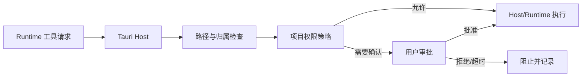

# 权限参考

> 状态：生效 
> 适用版本：Fox 0.1.x 
> 维护范围：Fox 会话权限模式、工具审批、审批状态、外部 Agent 权限 
> 最后更新：2026-10-25

> 复核状态（2026-10-25）：「工具目录」按 `packages/fox-engine-protocol/schema.json` 的 `toolContracts`（`RUNTIME_TOOL_CATALOG`，73 个工具）重写；「审批记录」中的未决审批结束规则、「外部 Agent 权限」按 `database/repositories.rs`、`crates/fox-agent-backend/src/{native_permission,host_routing,external_launch}.rs`、`commands/agent_backend_routing.rs` 复核。「权限模式」表和「路径判定」沿用 2026-09-22 的内容。

## 权限模式

| 模式 | 读项目 | 写/编辑 | 命令 | MCP 调用 |
|---|---|---|---|---|
| `read_only` | 允许受控只读工具 | 阻止 | 审批策略仍通常阻止/要求明确授权 | 总是审批 |
| `ask` | 允许受控只读工具 | 未获会话授权时审批 | 未获会话授权时审批 | 未获会话授权时审批 |
| `allow` | 允许受控只读工具 | 可按策略允许 | 未获会话授权时审批 | 未获会话授权时审批 |

`allow` 不是无限权限；Host 的路径范围、工具 allowlist、参数和危险操作规则继续生效。

以上三种模式只适用于 Fox 会话（`agent_backend = 'fox'`）。项目的执行方式在「设置 → Agent → 项目权限」修改（`project_permission_update`）；「新项目权限」保存在前端 localStorage `fox.preferences.defaultPermission`，默认「询问」。新会话创建时由触发器把项目当前模式**复制**进会话（v80 `execution_policy_new_conversation`），之后项目默认再变也不影响已有会话；会话内修改走 `conversation_permission_update`，并递增 `kernel_execution_policies.version`。外部 Agent 的权限见下文「外部 Agent 权限」。

## 工具目录

事实源：`packages/fox-engine-protocol/schema.json` 的 `toolContracts`（JS 侧 `RUNTIME_TOOL_CATALOG`）。Runtime 的 ready manifest 必须与它逐项一致（`services/agent-runtime/src/runtime-contract.mjs` 校验类别、执行位置和审批），Host 在 `runtime_host/mod.rs` 再按入口核对。审批取值：`none` 不审批；`preflight` 由 Host 预检路径后在 Runtime 执行；`policy` 按会话权限模式决定；`always` 未获当前会话同名工具授权（`allow_conversation`）时每次审批。

| 类别 | 执行位置 | 审批 | 工具 |
| --- | --- | --- | --- |
| project-read | runtime | preflight | `read`、`ls`、`find`、`grep`（新 Run 可用 `FOX_RESOURCE_GATEWAY_READS` 冻结为 Rust 执行，默认 Rust） |
| project-read | runtime | none | `graph_readonly_run` |
| project-read | host | none | `present_files`、`git_read`、`tabular_data` |
| project-read | host | always | `sqlite_read` |
| project-write | host | policy | `write_file`、`edit_file` |
| project-write | host | always | `format_code` |
| process | host | always | `run_command`（**当前生产构建无条件拒绝启动**，没有经过验证的隔离后端）、`test_run`、`code_check` |
| attachment | host | none | `read_attachment`、`attachment_compute`、`compute_job_start`、`compute_job_status`、`compute_job_cancel`、`compute_job_result`、`read_tool_result` |
| knowledge | host | none（受绑定范围限制） | `list_knowledge_bases`、`search_knowledge`、`read_knowledge_document`、`query_knowledge_graph` |
| mcp | host | none | `list_mcp_tools` |
| mcp | host | always | `call_mcp_tool` |
| skill | host | none | `skill_load`、`structured_data` |
| skill | host | always | `web_search`、`web_read`、`http_request`、`system_info` |
| memory | host | none | `memory_search`、`memory_propose` |
| delegation | host | none | `child_agent_list`、`child_run_start`、`child_run_collect`、`child_run_cancel`、`team_snapshot_get`、`team_start`、`team_member_start`、`team_collect`、`team_cancel` |
| work | host | always | `task_repair_escalate_start` |
| work | host | none | 工作图、工作流、Goal / Task / Evidence / 计划 / 评审 / 验收相关的 27 个工具（`work_snapshot_get`、`graph_readonly_*`、`workflow_*`、`goal_*`、`task_*`、`plan_revision_create`、`review_finding_*`、`acceptance_submit`） |

`git_read`、`test_run`、`code_check`、`format_code` 是固定能力工具：Host 生成固定程序和参数（不经 Shell），通过 `tool_host::run_contained_program` 启动，只有环境变量白名单、进程回收和资源限制，**不是**文件或网络隔离；它们也不经过 `run_command` 的命令门禁。

## 路径判定

1. 项目根必须存在且为目录。
2. 相对路径基于项目根拼接；绝对路径不因此获得额外权限。
3. 根和目标均 canonicalize。
4. 目标必须 `starts_with(canonical_root)`。
5. 空路径、NUL、不可解析路径和越界链接全部拒绝。

新建文件尚不存在时由 Host 对父目录做同等边界检查；不能仅用字符串前缀比较。

## 审批记录

审批等待按持久请求时间和 Run 冻结预算计算绝对截止时刻；数据库重开或重进等待不能重新获得完整时限。批准在写事务中再次检查截止时间，过期批准不能产生会话权限。受控 Kernel 的模型工具描述仅用于提议，不附带资源执行能力；每个后续批次仍由 Host 决策并在执行入口重新核验资源。

审批绑定 Tool Call，记录 requested_action、请求 JSON、决定、作用域、请求/解决时间。`allow_once` 只解决当前 Tool Call；`allow_conversation` 额外写入 `(conversation_id, tool_name)` 授权，同一会话后续同名工具不再弹出交互审批。该授权不绕过只读阻断、Expert/Assistant allowlist、路径边界、参数校验或未知工具拒绝；删除会话时级联删除。UI 必须展示实际目标、diff 或命令和 cwd；批准后执行参数不得被 Runtime 替换。

`approvals.status` 取值为 `pending`、`approved`、`denied`、`cancelled`、`expired`。Run 离开运行状态时，仍为 `pending` 的审批按下表结束（`database/repositories.rs`：`cancel_pending_approvals_for_run`、`expire_pending_approvals_for_run`、`approval_cancel_reason_for_interruption`）：

| 触发 | 结果 | reason |
| --- | --- | --- |
| 用户取消 Run；Run 以 `cancelled` 结束 | `cancelled` | `run_cancellation_requested` / `run_cancelled` |
| 中断码 `agent_backend_session_closed`（会话关闭、归档、移入回收站） | `cancelled` | `conversation_closed` |
| 中断码 `agent_backend_host_restarted` 或 `runtime.application_exit`（Fox 退出 / 重启） | `cancelled` | `app_restarted` |
| 其他中断（如 Runtime 崩溃） | `expired` | `run_interrupted` |
| Run 完成 / 失败 | `expired` | `run_completed` / `run_failed` |
| 启动修复 Legacy 路径遗留 Run | `expired` | `application_restarted` |
| 同会话开始新 Run | `expired` | `new_run_started` |
| Kernel Authoritative 路径所属工作已结算 | `expired` | `owner_settled` |

`cancelled` 与 `expired` 的审批都不能再被批准、领取执行或产生会话授权。

### 策略代次与审批失效（执行准入）

- 会话权限模式保存在 `kernel_execution_policies`，带单调递增 `version`；更新走请求 ID + 版本 CAS。
- 策略版本变化会**作废尚未派发 dispatch 的 pending 审批**；已经签发 dispatch 的意图不受重新授权影响，不能被重放。
- 一次 dispatch 只允许一次持久领取（`kernel_execution_attempts`，主键 `(run_id, dispatch_id)`）；拒绝、完成和不确定结果只可只读查询。
- `start_confirmed` 不得从 1 回退；`unknown` 状态不得自动重跑，须转对账或人工核对。
- 文件写入的版本前置条件来自 Host 实际读取（`kernel_host_observations`），模型自报版本无效。

表结构与触发器细节见[数据库结构](数据库结构.md)的迁移 74–81（v80 起会话权限变更只推进本会话，撤销会话授权也会递增策略版本）；行为级说明见[项目与权限架构](../02-架构/项目与权限架构.md)的「执行准入与原子文件提交」。

## 外部 Agent 权限

外部 Agent（pi、DeepSeek Harness、Codex）不使用上面的三种 Fox 项目模式，而是使用该 Agent 自己的原生权限：

1. **没有 Fox 外层 SRT**。pi / DSH / Codex 由 Fox 直接启动，Fox 不做 SRT 安装、预检、settings、ACP bridge、网络 broker 或代理环境注入；进程边界由该 Agent 自己的原生沙箱/审批决定。pi 没有系统级沙箱，边界由 Fox 的审批门禁和进程管理提供，不能宣称成系统级隔离。
2. **按 Agent 原生列出的权限**（`crates/fox-agent-backend/src/native_permission.rs`）：

| Agent | 选项 | 生效时机 |
| --- | --- | --- |
| pi | 只读、询问、自动、完全访问（pi 没有权限系统，由 Fox 审批拦截扩展把每个工具调用交给 Host 回答） | 下一个请求 |
| DeepSeek（dsh） | 只读、工作区可写（询问）、工作区可写（不询问）、完全访问 | 下一轮重启后端时 |
| Codex | 请求审批、帮我批准（只在 OpenAI 供应商下可用）、完全访问权限 | 会话中立即切换（`session/set_mode`） |

每个 Agent 的「完全访问」就是它自己的原生完全访问模式，不是 Fox 外层授权。新会话和会话中都可以切换；切换会中止当前轮、结清待处理审批，并按该 Agent 的原生方式重建会话，本轮不重放。`FOX_EXTERNAL_FULL_ACCESS_FORBIDDEN=1` 只禁用这个原生选项，不会让 Fox 重新套 SRT。会话级选择保存在 `app_settings` 的 `agent_backend.native_mode.conversation.<会话 id>`，最近一次选择在 `agent_backend.native_mode.last.<后端>`；新会话创建时把本次选择直接写为该会话的原生模式，不再创建 `agent_backend_full_access_grants` 外层授权。Host 对 `session/request_permission` 的自动回答只是失败关闭的兜底：Fox 从不替 Codex 或 dsh 自动批准。外部 Agent 的审计写入 `agent_backend_audit_log`。

Fox Agent 自己的 `run_command` 才使用 SRT（`apps/desktop/src-tauri/src/host_sandbox.rs`）：项目根可写、会话临时目录、私有 HOME、网络默认拒绝；初始化失败拒绝执行。`read_file` / `write_file` / `edit_file` 仍在 Host 进程内，依靠路径规范化、项目根检查、重解析点/UNC 拒绝和写准入，不经过 SRT。

## 知识权限

Agent 只能访问 `knowledge_bindings` 中 enabled 的知识库。知识库服务自身的用户 ACL 是第一层，Fox 会话绑定是第二层。两者取交集，不得因远端列表可见就自动授权给当前会话。

## 附件与图片

附件必须属于当前会话，状态 ready，路径位于受管附件根且与记录一致。图片输入还受数量、单文件大小、格式和模型 `supportsImageInput` 限制。

## MCP 与 Skills

MCP 环境变量对前端和 Runtime 不可见；MCP Tool Call 在未获得当前会话同名工具授权时审批。基础 Assistant 与当前 Expert 的 `allowedTools`、`mcpServers` 都是限权条件：有效范围取双方与 Host Capability 的交集。Skill 只可声明支持目录中的 required tools，不能通过 Prompt 获得新权限，也不能自行执行脚本。

## 默认拒绝场景

未知工具/权限模式/能力版本、缺失项目、失效路径、未绑定知识库、未知 MCP 工具、无效 Schema、审批超时、凭据缺失和用户取消均默认拒绝。

## 测试依据

`tool_guard.rs` 覆盖项目内路径与越界；`database/repositories/agent_backend.rs` 的测试覆盖外部 Run 重启后中断并取消未决审批；`native_permission.rs` 的测试覆盖各 Agent 的自动回答；`tool_host.rs` 覆盖写入和命令；`mcp.rs` 覆盖声明验证与超时；`runtime-contract` 测试保证权限元数据与实际工具一致。
