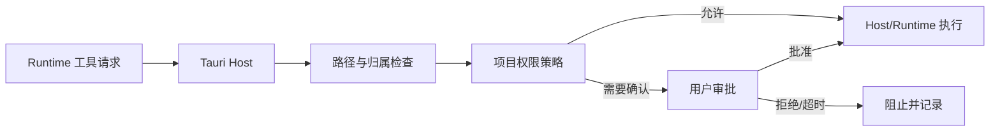

# 权限参考

> 状态：生效 
> 适用版本：Fox 0.1.x 
> 维护范围：Fox 会话权限模式、工具审批、审批状态、外部 Agent 权限 
> 最后更新：2026-10-31（B4c：四档模式、前缀规则、block 规则、审计；外部 Agent 计划恢复）

> 复核状态（2026-10-25）：「工具目录」按 `packages/fox-engine-protocol/schema.json` 的 `toolContracts`（`RUNTIME_TOOL_CATALOG`，73 个工具）重写；「审批记录」中的未决审批结束规则、「外部 Agent 权限」按 `database/repositories.rs`、`crates/fox-agent-backend/src/{native_permission,host_routing,external_launch}.rs`、`commands/agent_backend_routing.rs` 复核。「路径判定」沿用 2026-09-22 的内容。2026-10-31 按 `runtime_host/approval_policy.rs`、`database/repositories/permission_rules.rs` 与迁移 v104 重写「权限模式」和「审批记录」。

## 权限模式

Fox 会话有四档模式，判定顺序为 **block 规则 → 受保护路径 / 越出项目 → 当前模式 → allow / ask 规则 → 默认**：

| 工具类别 | 只读 `read_only` | 询问 `ask` | 自动 `auto` | 完全访问 `full_access` |
|---|---|---|---|---|
| 读（read/ls/find/grep/git_read/sqlite_read/tabular_data/read_tool_result 等） | 放行 | 放行 | 放行 | 放行 |
| 项目内写 / 编辑 | 拒绝 | 问 | 放行 | 放行 |
| 命令类（run_command、test_run、code_check、format_code） | 拒绝 | 问；allow 规则逐段覆盖时放行 | 低风险放行，高风险问；allow 规则逐段覆盖时放行 | 放行 |
| 联网（web_search、web_read、http_request、system_info） | 问 | 问 | 放行 | 放行 |
| 越出项目 / 受保护路径 | 拒绝 | 问 | 问 | 放行 |
| 其他（如 call_mcp_tool） | 问 | 问 | 问 | 放行 |
| block 规则命中 | 拒绝 | 拒绝 | 拒绝 | 拒绝 |

- 存储：`conversations.permission_mode` 仍为 `read_only / ask / allow`（`allow` 界面名「自动」）；`conversations.full_access = 1` 且模式为 `allow` 时才是完全访问（迁移 v104，只加列，不改带 CHECK 的旧列）。运行中切换从下一次工具调用起生效。
- 高风险判定、受保护路径和内置 block 规则的完整列表见[安全架构 · 审批引擎](../02-架构/安全架构.md#审批引擎四档)。要点：受保护路径为项目内 `.git`、`.fox` 和 shell 配置文件；内置 block 为删除或清空盘符 / 文件系统根、家目录、项目根，完全访问下也拒绝（`permission.blocked`）。
- 模型可在命令工具参数里附带 `risk`，只能调高风险。
- 完全访问每个项目首次开启要在应用内确认框里二次确认，确认后写 `projects.full_access_confirmed_at`，之后不再重复确认。
- Fox 不用沙箱：被放行的命令以当前用户身份在 Fox Job 中执行，可以联网。自动和完全访问模式下等同于用户本人执行。

### 前缀规则（`permission_rules`）

| 字段 | 含义 |
|---|---|
| `project_id` | 规则所属项目 |
| `effect` | `allow` / `ask` / `block` |
| `tool` | 具体命令工具名或 `*` |
| `pattern` | 命令前缀（一条普通命令，不含连接符、重定向、命令替换，≤500 字符） |
| `source` | `user` / `builtin` |
| `created_at` / `revoked_at` | 创建 / 撤销时间；撤销只写 `revoked_at`，不删行 |

- 按 token 前缀匹配：`npm test` 匹配 `npm test -- foo`，不匹配 `npm testx`。
- 复合命令（`&&`、`||`、`&`、`;`、`|`、换行）逐段检查：每一段都被 allow 规则覆盖才放行；任一段命中 ask 规则就问；任一段命中 block 规则就拒绝。
- 宽泛前缀不覆盖高风险段（`git` 不覆盖 `git push`）。
- 含命令替换或嵌套 shell 脚本的命令不能靠规则放行，审批卡也不提供「总是允许」。
- 审批卡「本项目总是允许此命令」显示将要写入的前缀，可编辑；设置页列出规则，可单独撤销。
- 已知局限：前缀规则可以被「先改脚本再执行」绕过（例如先改 `package.json` 的 test 脚本，再运行已允许的 `npm test`）。靠审计追溯。

### 审计（`permission_audit`）

每次自动放行（模式、完全访问或 allow 规则放行；纯读操作除外）写一条记录：`conversation_id`、`run_id`、`tool_call_id`、`tool`、`mode`、`class`、`risk`、`reason`、`rule_ids_json`、`findings_json`、`summary`（命令摘要，≤500 字符）、`created_at`。Run 详情通过 `permission_audit_list` 查看。

以上四档只适用于 Fox 会话（`agent_backend = 'fox'`）。项目的执行方式在「设置 → Agent → 项目权限」修改（`project_permission_update`）；「新项目权限」保存在前端 localStorage `fox.preferences.defaultPermission`，默认「询问」。新会话创建时由触发器把项目当前模式**复制**进会话（v80 `execution_policy_new_conversation`），之后项目默认再变也不影响已有会话；会话内修改走 `conversation_permission_update`，并递增 `kernel_execution_policies.version`。外部 Agent 的权限见下文「外部 Agent 权限」。

## 工具目录

事实源：`packages/fox-engine-protocol/schema.json` 的 `toolContracts`（JS 侧 `RUNTIME_TOOL_CATALOG`）。Runtime 的 ready manifest 必须与它逐项一致（`services/agent-runtime/src/runtime-contract.mjs` 校验类别、执行位置和审批），Host 在 `runtime_host/mod.rs` 再按入口核对。审批取值：`none` 不审批；`preflight` 由 Host 预检路径后在 Runtime 执行；`policy` 和 `always` 是协议元数据，Fox 自有工具实际是否询问由 Host 审批引擎按上表判定；MCP 工具（`call_mcp_tool`）在未获当前会话同名工具授权（`allow_conversation`）时每次审批。

| 类别 | 执行位置 | 审批 | 工具 |
| --- | --- | --- | --- |
| project-read | runtime | preflight | `read`、`ls`、`find`、`grep`（新 Run 可用 `FOX_RESOURCE_GATEWAY_READS` 冻结为 Rust 执行，默认 Rust） |
| project-read | runtime | none | `graph_readonly_run` |
| project-read | host | none | `present_files`、`git_read`、`tabular_data` |
| project-read | host | always | `sqlite_read` |
| project-write | host | policy | `write_file`、`edit_file` |
| project-write | host | always | `format_code` |
| process | host | always | `run_command`（在 Fox Job 中以当前用户身份执行，不用沙箱）、`test_run`、`code_check` |
| attachment | host | none | `read_attachment`、`attachment_compute`、`compute_job_start`、`compute_job_status`、`compute_job_cancel`、`compute_job_result`、`read_tool_result` |
| knowledge | host | none（受绑定范围限制） | `list_knowledge_bases`、`search_knowledge`、`read_knowledge_document`、`query_knowledge_graph` |
| mcp | host | none | `list_mcp_tools` |
| mcp | host | always | `call_mcp_tool` |
| skill | host | none | `skill_load`、`structured_data` |
| skill | host | always | `web_search`、`web_read`、`http_request`、`system_info` |
| memory | host | none | `memory_search`、`memory_propose` |
| delegation | host | none | `child_agent_list`、`child_run_start`、`child_run_collect`、`child_run_cancel`、`team_snapshot_get`、`team_start`、`team_member_start`、`team_collect`、`team_cancel` |
| work | host | always | `task_repair_escalate_start` |
| work | host | none | 工作图、工作流、Goal / Task / Evidence / 计划 / 评审 / 验收相关的 27 个工具（`work_snapshot_get`、`graph_readonly_*`、`workflow_*`、`goal_*`、`task_*`、`plan_revision_create`、`review_finding_*`、`acceptance_submit`） |

`git_read`、`test_run`、`code_check`、`format_code` 是固定能力工具：Host 生成固定程序和参数（不经 Shell），通过 `tool_host::run_contained_program` 启动，只有环境变量白名单、进程回收和资源限制，**不是**文件或网络隔离。它们与 `run_command` 一样按命令类进入审批引擎，判定对象是 Host 将要运行的确切程序行。

## 路径判定

1. 项目根必须存在且为目录。
2. 相对路径基于项目根拼接；绝对路径不因此获得额外权限。
3. 根和目标均 canonicalize。
4. 目标必须 `starts_with(canonical_root)`。
5. 空路径、NUL、不可解析路径和越界链接全部拒绝。

新建文件尚不存在时由 Host 对父目录做同等边界检查；不能仅用字符串前缀比较。

## 审批记录

审批等待按持久请求时间和 Run 冻结预算计算绝对截止时刻；数据库重开或重进等待不能重新获得完整时限。批准在写事务中再次检查截止时间，过期批准不能产生会话权限。模型的工具描述仅用于提议，不附带资源执行能力；每次调用仍由 Host 决策并在执行入口重新核验资源。

审批绑定 Tool Call，记录 requested_action、请求 JSON、决定、作用域、请求/解决时间。Fox 自有工具的审批卡只有三种决定：`allow_once` 只解决当前 Tool Call；`allow_project_rule` 解决当前 Tool Call 并写入一条项目 allow 规则（见上文「前缀规则」）；`deny`。按输入哈希的「本会话允许」已删除（TX-1），旧授权表只停用、不删。MCP 工具仍提供 `allow_conversation`：写入 `(conversation_id, tool_name)` 授权，同一会话后续同名 MCP 工具不再弹窗，不绕过只读阻断、Expert/Assistant allowlist、参数校验或未知工具拒绝；删除会话时级联删除。UI 必须展示实际目标、diff 或命令和 cwd；批准后执行参数不得被 Runtime 替换。

`approvals.status` 取值为 `pending`、`approved`、`denied`、`cancelled`、`expired`。Run 离开运行状态时，仍为 `pending` 的审批按下表结束（`database/repositories.rs`：`cancel_pending_approvals_for_run`、`expire_pending_approvals_for_run`、`approval_cancel_reason_for_interruption`）：

| 触发 | 结果 | reason |
| --- | --- | --- |
| 用户取消 Run；Run 以 `cancelled` 结束 | `cancelled` | `run_cancellation_requested` / `run_cancelled` |
| 中断码 `agent_backend_session_closed`（会话关闭、归档、移入回收站） | `cancelled` | `conversation_closed` |
| 中断码 `agent_backend_host_restarted` 或 `runtime.application_exit`（Fox 退出 / 重启） | `cancelled` | `app_restarted` |
| 其他中断（如 Runtime 崩溃） | `expired` | `run_interrupted` |
| Run 完成 / 失败 | `expired` | `run_completed` / `run_failed` |
| 启动修复 Legacy 路径遗留 Run | `expired` | `application_restarted` |
| 启动时退役的历史 Kernel Run（Run 标为 `interrupted` / `executor_route_retired`） | `expired` | 通用重启修复 |
| 同会话开始新 Run | `expired` | `new_run_started` |
| 所属工作已结算 | `expired` | `owner_settled` |

`cancelled` 与 `expired` 的审批都不能再被批准、领取执行或产生会话授权。

### 策略代次与审批失效（执行准入）

- 会话权限模式保存在 `kernel_execution_policies`，带单调递增 `version`；更新走请求 ID + 版本 CAS。
- 策略版本变化会**作废尚未派发 dispatch 的 pending 审批**；已经签发 dispatch 的意图不受重新授权影响，不能被重放。
- 一次 dispatch 只允许一次持久领取（`kernel_execution_attempts`，主键 `(run_id, dispatch_id)`）；拒绝、完成和不确定结果只可只读查询。
- `start_confirmed` 不得从 1 回退；`unknown` 状态不得自动重跑，须转对账或人工核对。
- 文件写入的版本前置条件来自 Host 实际读取（`kernel_host_observations`），模型自报版本无效。

表结构与触发器细节见[数据库结构](数据库结构.md)的迁移 74–81（v80 起会话权限变更只推进本会话，撤销会话授权也会递增策略版本）；行为级说明见[项目与权限架构](../02-架构/项目与权限架构.md)的「执行准入与原子文件提交」。

## 外部 Agent 权限

外部 Pi、Codex、dsh 目前处于退役状态：新建和运行入口都拒绝（`agent_backend_retired`），旧会话只读；历史权限值与凭据数据保留。它们**计划在阶段三恢复**为可选后端，届时的映射（计划，未实现）：

| Fox 档位 | Pi | Codex（codex-acp） | dsh |
|---|---|---|---|
| 只读 | Host 应答，读放行、其他拒绝 | read-only | ReadOnly |
| 询问 | Host 应答，规则同 PiNative | workspace-write，审批卡来自 request_permission | WorkspaceWriteAsk |
| 自动 | Host 应答，规则同 PiNative | 不提供（无对等档位） | WorkspaceWriteNever |
| 完全访问 | Host 全部放行（block 规则仍生效） | agent-full-access | DangerFullAccess |

外部 Pi 将与 PiNative 共用本页的审批引擎；Codex、dsh 由各自的原生沙箱和审批负责，Fox 只转审批卡。`native_permission.rs` 保留，用于这套映射。

内置 PiNative 使用本页的四档模式、Host 工具和审批规则。Yuxi 远程能力保留独立服务权限。详情见[单 Pi 主线状态](../01-项目概览/单Pi主线状态.md)。

## 知识权限

Agent 只能访问 `knowledge_bindings` 中 enabled 的知识库。知识库服务自身的用户 ACL 是第一层，Fox 会话绑定是第二层。两者取交集，不得因远端列表可见就自动授权给当前会话。

## 附件与图片

附件必须属于当前会话，状态 ready，路径位于受管附件根且与记录一致。图片输入还受数量、单文件大小、格式和模型 `supportsImageInput` 限制。

## MCP 与 Skills

MCP 环境变量对前端和 Runtime 不可见；MCP Tool Call 在未获得当前会话同名工具授权时审批。基础 Assistant 与当前 Expert 的 `allowedTools`、`mcpServers` 都是限权条件：有效范围取双方与 Host Capability 的交集。Skill 只可声明支持目录中的 required tools，不能通过 Prompt 获得新权限，也不能自行执行脚本。

## 默认拒绝场景

未知工具/权限模式/能力版本、缺失项目、失效路径、未绑定知识库、未知 MCP 工具、无效 Schema、审批超时、凭据缺失和用户取消均默认拒绝。

## 测试依据

`tool_guard.rs` 覆盖项目内路径与越界；`database/repositories/agent_backend.rs` 的测试覆盖外部 Run 重启后中断并取消未决审批；`native_permission.rs` 的测试覆盖各 Agent 的自动回答；`tool_host.rs` 覆盖写入和命令；`runtime_host/approval_policy.rs` 的测试覆盖四档判定表、前缀匹配、复合命令和完全访问下的 block 规则；`permission_rules.rs` 覆盖规则与审计读写；`mcp.rs` 覆盖声明验证与超时；`runtime-contract` 测试保证权限元数据与实际工具一致。
