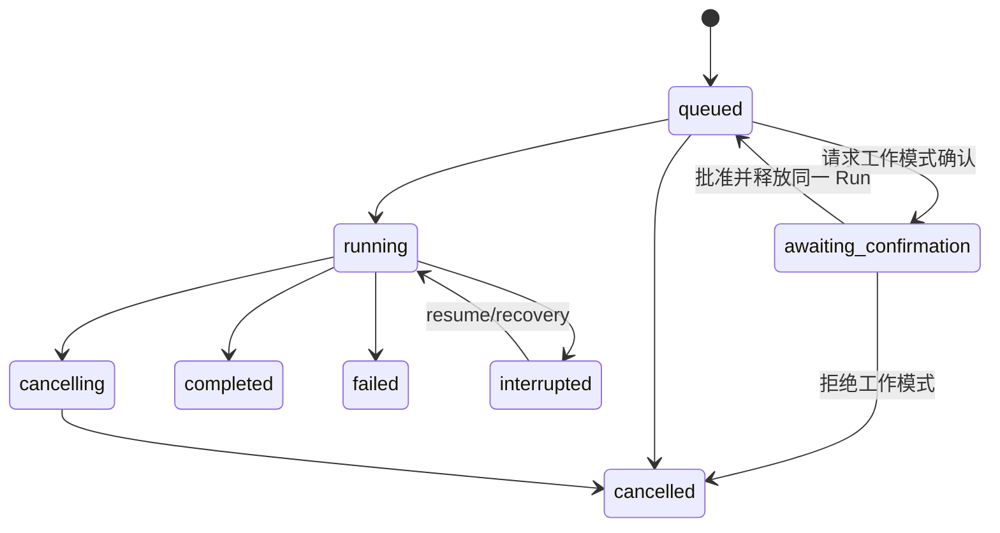

# 错误与状态参考

> 状态：生效<br>
> 适用版本：Fox 0.1.x<br>
> 维护范围：`ApiResponse` 错误格式、错误码、Run / 审批 / 外部 Agent 状态<br>
> 最后更新：2026-10-28（单 Pi 分支同步；本轮未复跑产品测试）

> 复核状态（2026-10-25）：错误码表由脚本对 `main@763a019` 的 `apps/desktop/src-tauri/src`、`crates/` 下 `.rs` 文件做**静态扫描**得到（取出现在 `ApiResponse::failure`、错误构造、`code`/`Err` 上下文中的 `前缀.名称` 字符串和 `agent_backend_*` 常量），再人工剔除事件类型、文件名和字段名。没有运行时验证每个码都能被触发；个别码可能只在测试或防御分支中出现。外部 Agent、审批状态、启动失败三节逐条对照了代码。

## 结论

- 普通 Tauri 命令失败时返回 `{ ok: false, error: { code, message, retryable } }`；前端按 `code` 决定交互，不要匹配 `message` 文本。
- Fox 自身的错误码是 `前缀.名称`（如 `conversation.run_active`）；外部 Agent 后端的错误码是 `agent_backend_*`，沙箱错误码是 `sandbox_*`，二者都没有点号。
- 错误码没有集中的编译期枚举，分散定义在各模块；新增错误必须复用已有前缀，避免同义码。
- 被中断的 Run 留下的未决审批：显式取消、会话关闭、Fox 退出 / 重启标为 `cancelled`；其他中断、Run 结束和启动修复标为 `expired`（详见「审批状态」）。

## API 错误格式

```ts
type ApiError = { code: string; message: string; retryable: boolean }
```

定义在 `apps/desktop/src-tauri/src/database/models.rs`（`ApiError`、`ApiResponse::failure`）。`message` 是给用户看的中文提示；`retryable=true` 只表示可以由用户重试，不表示 Host 会自动重放。

## 单 Pi 与阶段二错误

| 错误 / 状态 | 当前含义 | 处理 |
| --- | --- | --- |
| `agent_backend_retired` | 请求退休外部驱动，或试图执行其历史会话 | 保留历史，用户可另建受支持会话；不改绑旧行、不用环境变量重启旧驱动 |
| `kernel_engine_retired` | Kernel 配置的引擎不是受支持的 Pi | 核对配置与候选构建；不静默替换已冻结身份 |
| `session.native_*` | 原生会话路径、文件、身份、目录或打开状态错误 | 保留文件和数据库映射，记录具体码；Host 跨请求重建边界未闭合 |
| `runtime.process_crashed` / `runtime process closed stdout` | 既有 Legacy 桌面记录的进程失败 | C gap 未关闭，需定位并复测 |
| `provider.request_failed: 404 model route not found` | 既有恢复轮次的模型端点失败 | C gap 未关闭，核对请求与供应商路由，未确定根因 |

本轮仅核对源码和既有记录，未重新触发这些错误。[阶段二完整边界](../01-项目概览/单Pi主线状态.md#c-gap-与未验证项)。

## 外部 Agent 后端

当前路由只支持 `fox`。旧 `pi/codex/deepseek` 会话可读但执行拒绝。新错误码和历史码需分开；下表中的旧启动、权限和 ACP 错误保留供旧记录解读，不是启用退休后端的操作指南。事实源为 `host_routing.rs`、`kernel_model_config.rs`、`pi-runtime.mjs`。

| 错误码 | 含义 | 处理 |
| --- | --- | --- |
| `agent_backend_invalid` | 不支持的后端值，或会话记录的后端无法识别；也用于对 Fox 会话调用外部专用操作 | 修正请求；记录损坏时保留现场 |
| `agent_backend_hidden` | 旧隐藏策略的兼容码；当前退休列表决定是否可运行 | 不把 HIDDEN 为空理解为外部驱动可用 |
| `agent_backend_disabled` | 旧管理员禁用策略的兼容码；当前退休后端主要返回 `agent_backend_retired` | 不能通过改环境变量启用退休驱动 |
| `agent_backend_misrouted` | 请求指向的后端与会话冻结的 `agent_backend` 不一致（错投），拒绝而不改绑 | 前端按会话记录重发 |
| `agent_backend_entry_unsupported` | 该入口对外部后端无意义（如知识库 / Kernel 的 resume） | 不对外部会话调用该入口 |
| `agent_backend_not_yet_wired` | 历史码，当前代码不再产生，保留给旧界面识别 | — |
| `agent_backend_lookup_failed` | 旧兼容码；当前冻结值读取失败可进入 Fox fallback，显式退休请求仍拒绝 | 核对实际错误码与数据库现场，见路由源码 |
| `agent_backend_immutable` | 数据库触发器拒绝修改 `conversations.agent_backend`（v95） | 后端只能在创建时选择 |

### 历史启动与执行错误

下表只用于识别旧日志。当前不再执行这些后端，因此不再提供安装、重试、改环境变量或扩大权限的恢复步骤；保留原历史，在新会话使用内置 Pi。

| 历史错误码 | 当时含义 |
| --- | --- |
| `agent_backend_project_required` | 外部会话启动 Run 前必须绑定项目（在 `start_run` 检查） |
| `agent_backend_attachments_unsupported` | 外部后端暂不支持附件 |
| `agent_backend_not_installed` | 后端程序没有安装到受管运行时目录（Host 不经 `npx` 启动） |
| `agent_backend_launch_invalid` | 启动配置无效（如无法写入 DeepSeek Host patch） |
| `agent_backend_version_mismatch` | 受管运行时版本与期望不符 |
| `agent_backend_missing_credentials` | 后端缺少可用凭据 |
| `agent_backend_unified_login_failed` | 无法按模型服务为后端生成登录配置 / 私有 HOME |
| `agent_backend_import_invalid` / `agent_backend_import_failed` | 导入外部凭据或项目时没有可导入项 / 导入失败 |
| `agent_backend_open_failed` | 无法创建或打开私有 HOME |
| `agent_backend_session_failed` | 外部后端无法打开 ACP 会话 |
| `agent_backend_session_closing` / `agent_backend_session_closed` | 会话正在关闭 / 已关闭；`session_closed` 作为中断码时其未决审批标为 `cancelled` |
| `agent_backend_turn_busy` | 上一轮仍在进行 |
| `agent_backend_emit_failed` | 事件写回 Host 失败 |
| `agent_backend_exited` | 后端在开始本轮之前退出 |
| `agent_backend_prompt_failed` | 发送本轮输入失败 |
| `agent_backend_host_restarted` | Fox 重启时上次未结束的外部 Run 被标为中断；其未决审批标为 `cancelled` |
| `agent_backend_network_blocked` | 沙箱网络策略拦截了请求 |
| `agent_backend_loopback_requires_full_access` | 旧 SRT 策略下的回环网关拒绝码 |
| `agent_backend_full_access_forbidden` | 完全访问被禁止（`FOX_EXTERNAL_FULL_ACCESS_FORBIDDEN` 等） |
| `agent_backend_full_access_locked` | 完全访问只能在新建会话时选择；会话中只能撤销 |
| `agent_backend_full_access_engineering` | 完全访问来自工程开关 `FOX_EXTERNAL_FULL_ACCESS`，界面不能撤销 |
| `agent_backend_no_full_access` | 本会话没有完全访问授权（撤销时） |
| `agent_backend_full_access_revoked` | 完全访问已撤销，本轮结束 |
| `agent_backend_stop_unconfirmed` | 切换权限 / 撤销完全访问时原进程未确认全部结束，不会以新权限重建 |
| `agent_backend_permission_unavailable` | 该后端没有所选的原生权限选项 |
| `agent_backend_set_mode_failed` | 后端拒绝切换原生权限模式 |
| `agent_backend_stop_max_tokens` / `agent_backend_stop_max_turn_requests` | ACP 停止原因：达到上限，本轮提前结束（中断） |
| `agent_backend_refusal` | ACP 停止原因：后端拒绝继续（失败） |
| `agent_backend_unknown_stop_reason` | 未知停止原因，按失败处理，不显示为完成 |

沙箱错误码（`crates/fox-agent-backend/src/sandbox.rs` 的 `SandboxErrorCode`，旧外部 Agent 启动路径使用；当前共享 Host SRT 的错误须按 Host 日志单独判断）：`sandbox_unavailable`、`sandbox_not_installed`、`sandbox_dependency_missing`、`sandbox_policy_invalid`、`sandbox_path_not_owned`、`sandbox_path_exposed`、`sandbox_runtime_not_installed`、`sandbox_bridge_unavailable`、`delivered_file_rejected`。`sandbox_backend_not_installed` 对外统一报告为 `agent_backend_not_installed`，原码保留在 `detail.code`。Windows 上从 Low 完整性目录运行 Fox 也会表现为 `sandbox_unavailable`，见[诊断与故障排查](../06-运维指南/诊断与故障排查.md#运行环境完整性级别)。

## Fox 错误码

按前缀分组，前缀后的部分以反引号列出（例如 `conversation.` 行的 `run_active` 即 `conversation.run_active`）。

| 前缀 | 范围 | 错误码（去掉前缀后的部分） |
| --- | --- | --- |
| `acceptance.` | 工作图 Goal 验收（Acceptance）校验 | `check_not_passed`、`checks_required`、`criterion_duplicate`、`evidence_not_found`、`evidence_not_valid`、`evidence_required`、`method_unsupported`、`not_applicable_reason_required`、`plan_pending`、`plan_required`、`review_blocked`、`review_required`、`reviewer_not_independent`、`reviewer_run_required`、`task_coverage_required` |
| `agent.` | Agent 查询 | `not_found` |
| `approval.` | 审批决定与等待 | `denied`、`resolve_failed`、`wait_timeout` |
| `artifact.` | 产物（Artifact）查看与打开 | `action_unsupported`、`application_required`、`application_unavailable`、`copy_path_failed`、`copy_path_unsupported`、`database_error`、`file_missing`、`file_too_large`、`file_unavailable`、`integrity_mismatch`、`not_found`、`not_regular_file`、`open_failed`、`open_unsupported`、`open_with_failed`、`path_denied`、`reveal_failed`、`root_unavailable`、`status_unavailable` |
| `attachment.` | 附件保存与绑定 | `bind_failed`、`decode_failed`、`directory_failed`、`image_invalid`、`invalid_binding`、`invalid_data`、`too_large`、`write_failed` |
| `backup.` | 应用内备份与恢复 | `create_failed`、`not_found`、`restore_failed` |
| `child.` | Kernel 委派参数校验 | `correction_limit`、`invalid_arguments` |
| `child_run.` | 子 Agent / Child Run | `budget_exceeded`、`cancel_failed`、`duration_budget_exceeded`、`parent_mismatch`、`parent_tool_scope_denied`、`start_failed`、`tool_budget_exceeded`、`tool_failed` |
| `compute.` | 附件计算作业结算 | `settle_failed` |
| `conversation.` | 会话、专家绑定、分叉 | `assistant_required`、`create_failed`、`expert_invalid_role`、`expert_locked`、`expert_not_bound`、`expert_remote_unavailable`、`expert_snapshot_invalid`、`file_cleanup_failed`、`fork_failed`、`fork_point_not_found`、`fork_remote_unsupported`、`history_failed`、`invalid_permission_mode`、`invalid_project_root`、`invalid_title`、`not_found`、`purge_requires_trash`、`run_active`、`search_failed` |
| `delivery.` | 交付检查、交付验收与 v2 内容契约（`delivery.check.*`、`delivery.security.*`） | `acceptance_bad_decision`、`acceptance_no_subject`、`acceptance_read_failed`、`acceptance_run_terminal`、`acceptance_storage`、`check.budget_exceeded`、`check.candidate_hash_drift`、`check.checker_not_implemented`、`check.contract_unreadable`、`check.contract_version_unsupported`、`check.evidence_unavailable`、`check.failed`、`check.table.character_after_quote`、`check.table.dialect_unsupported`、`check.table.encoding_unsupported`、`check.table.header_duplicate`、`check.table.header_empty`、`check.table.unescaped_quote`、`check.table.unterminated_quote`、`check.table.width_mismatch`、`check.table.zero_records`、`check.text.content_mismatch`、`check.text.eof_mismatch`、`check.text.order_mismatch`、`check.text.separator_mismatch`、`check.text.source_missing`、`definite_failure`、`invalid`、`refused`、`security.approval_missing`、`security.lock_race_version_changed`、`security.path_outside_authorized_root`、`security.readonly_input_write`、`security.source_identity_mismatch`、`security.version_credential_invalid` |
| `diagnostics.` | 诊断导出 | `export_failed` |
| `digital_colleague.` | 数字同事、触发渠道与配额 | `budget_exceeded`、`channel_identity_mismatch`、`channel_invalid`、`channel_rate_limited`、`channel_revoked`、`channel_signature_invalid`、`channel_timestamp_invalid`、`daily_quota_exceeded`、`dispatch_failed`、`failed`、`not_active`、`overlap_skipped`、`payload_too_large`、`quota_invalid`、`remaining_output_budget_exhausted`、`run_detail_failed`、`run_not_found`、`schedule_invalid`、`start_failed`、`token_budget_exceeded`、`tool_budget_exceeded` |
| `evaluation.` | 离线评测 | `offline_failed` |
| `expert.` | 专家能力包 | `not_found`、`package_downgrade_forbidden`、`package_export_unsupported`、`package_identity_conflict`、`package_incompatible`、`package_invalid`、`package_not_found`、`package_resource_scan_failed`、`package_resources_missing`、`package_source_conflict`、`package_state_changed`、`package_storage`、`package_version_conflict`、`package_version_not_found` |
| `external_url.` | 打开外部链接 | `invalid`、`open_failed`、`unsupported` |
| `feedback.` | 消息反馈 | `invalid` |
| `goal.` | 工作图 Goal | `acceptance_required`、`not_active`、`not_found`、`resume_failed`、`run_active`、`status_update_failed`、`tasks_required`、`tasks_unfinished`、`valid_evidence_required` |
| `graph.` | 只读工作图（Graph）节点生命周期与验收 | `readonly_accept_invalid_input`、`readonly_accept_not_ready`、`readonly_accept_rejected`、`readonly_accept_source_invalid`、`readonly_accept_source_missing`、`readonly_activation_rejected`、`readonly_activation_source_invalid`、`readonly_activation_source_missing`、`readonly_child_dispatch_failed`、`readonly_child_not_completed`、`readonly_child_result_required`、`readonly_criterion_evidence_invalid`、`readonly_dedicated_accept_required`、`readonly_dedicated_cancel_required`、`readonly_dedicated_finish_required`、`readonly_dedicated_start_required`、`readonly_findings_open`、`readonly_goal_version_conflict`、`readonly_invalid_spec`、`readonly_lead_run_invalid`、`readonly_node_budget_invalid`、`readonly_node_cancel_invalid_input`、`readonly_node_cancel_rejected`、`readonly_node_cancel_source_invalid`、`readonly_node_cancel_source_missing`、`readonly_node_cancel_target_invalid`、`readonly_node_finish_invalid_input`、`readonly_node_finish_rejected`、`readonly_node_finish_source_invalid`、`readonly_node_finish_source_missing`、`readonly_node_not_active`、`readonly_node_not_found`、`readonly_node_not_reviewable`、`readonly_node_not_runnable`、`readonly_node_review_invalid_input`、`readonly_node_review_rejected`、`readonly_node_review_source_invalid`、`readonly_node_review_source_missing`、`readonly_node_start_invalid_input`、`readonly_node_start_rejected`、`readonly_node_start_source_invalid`、`readonly_node_start_source_missing`、`readonly_node_version_conflict`、`readonly_not_activated`、`readonly_plan_changed`、`readonly_plan_not_found`、`readonly_profile_invalid`、`readonly_profile_required`、`readonly_repository_busy`、`readonly_repository_failed`、`readonly_review_candidate_mismatch`、`readonly_review_in_progress`、`readonly_review_required`、`readonly_reviewer_dispatch_failed`、`readonly_validation_policy_invalid` |
| `hook.` | 生命周期 Hook 配置 | `invalid`、`invalid_action`、`invalid_event`、`not_found` |
| `job.` | Kernel 后台作业 | `attempt_conflict`、`cancel_requested`、`capacity`、`conversation_mismatch`、`deadline_exceeded`、`idempotency_conflict`、`invalid_request`、`start_failed`、`unknown` |
| `kernel.` | Kernel 执行、对账、续做与作业 | `child_arguments_exhausted`、`child_not_dispatched`、`compaction_clock_regressed`、`confirmation_failed`、`continuation_failed`、`continuation_interrupted`、`continuation_unavailable`、`existing_execution`、`job_notice_capacity_blockedness`、`job_notice_competition`、`job_operation_failed`、`job_reconcile_failed`、`job_scope`、`job_unknown`、`job_wait_deadline_reached`、`jobs_pending`、`model_incomplete`、`no_progress`、`not_started`、`policy_denied`、`preparation_failed`、`query_failed`、`query_unavailable`、`reconciliation_unavailable`、`recovery_failed`、`reliability_unavailable`、`resource_failed`、`tool_error_budget_exhausted`、`uncertain_execution` |
| `knowledge.` | 远程知识库内容、预览与下载 | `activity_load_failed`、`annotation_delete_failed`、`annotation_save_failed`、`bookmark_delete_failed`、`bookmark_save_failed`、`detail_failed`、`document_download_failed`、`document_failed`、`download_cancel_failed`、`download_directory_missing`、`download_not_registered`、`download_open_failed`、`graph_failed`、`graph_labels_failed`、`graph_stats_failed`、`invalid_download_id`、`invalid_download_path`、`invalid_query`、`list_failed`、`preview_cache_busy`、`preview_cache_clear_failed`、`preview_cache_dir_invalid`、`preview_cache_key_missing`、`preview_cache_limit_invalid`、`preview_cache_limit_save_failed`、`preview_cache_missing`、`preview_cache_open_failed`、`preview_cache_path_invalid`、`preview_cache_statistics_failed`、`preview_cache_type_blocked`、`preview_cache_write_failed`、`preview_cancel_failed`、`preview_cancelled`、`preview_file_too_large`、`preview_finish_failed`、`preview_invalid_identity`、`preview_invalid_operation`、`preview_operation_exists`、`preview_operation_not_registered`、`preview_register_failed`、`preview_release_failed`、`query_failed`、`reading_state_save_failed`、`save_dialog_failed`、`source_metadata_failed`、`tool_failed` |
| `local_embedding.` | 本机向量模型自检 | `smoke_diagnostics_launch_failed`、`smoke_diagnostics_unavailable`、`smoke_executable_missing`、`smoke_inference_failed`、`smoke_launch_failed`、`smoke_timeout`、`smoke_wait_failed` |
| `local_knowledge.` | 本机资料库、导入与存储迁移 | `file_picker_failed`、`file_picker_unsupported`、`file_scan_failed`、`graph_unavailable`、`import_cancelled`、`import_commit_failed`、`import_copy_failed`、`import_destination_exists`、`import_file_too_large`、`import_folder_invalid`、`import_folder_picker_failed`、`import_invalid_chunk_config`、`import_parse_failed`、`import_source_missing`、`import_source_not_file`、`import_source_unreadable`、`import_storage_failed`、`import_unsafe_path`、`import_unsupported_extension`、`import_worker_failed`、`invalid_request`、`job_conflict`、`not_found`、`retrieval_unavailable`、`source_folder_picker_failed`、`storage_directory_picker_failed`、`storage_failed`、`storage_migration_cleanup_failed`、`storage_migration_config_failed`、`storage_migration_copy_failed`、`storage_migration_dangerous_path`、`storage_migration_destination_exists`、`storage_migration_destination_invalid`、`storage_migration_destination_unreadable`、`storage_migration_failed`、`storage_migration_flush_failed`、`storage_migration_invalid_destination`、`storage_migration_lock_failed`、`storage_migration_path_conflict`、`storage_migration_quiesce_timeout`、`storage_migration_rollback_failed`、`storage_migration_source_unavailable`、`storage_migration_staging_exists`、`storage_migration_staging_failed`、`storage_migration_switch_failed`、`storage_migration_verify_failed`、`storage_migration_worker_failed`、`storage_path_unwritable` |
| `maintenance.` | 数据清理 | `cleanup_failed` |
| `managed_files.` | 受管文件版本与恢复 | `list_failed`、`restore_failed` |
| `mcp.` | MCP / OpenAPI 扩展源 | `connection_failed`、`credential_delete_failed`、`credential_save_failed`、`invalid_args`、`invalid_config`、`invalid_endpoint`、`invalid_environment`、`invalid_openapi`、`invalid_transport`、`not_found`、`remote_failure`、`timed_out` |
| `memory.` | 记忆（Memory） | `already_deleted`、`confirmed_key_collision`、`conflict_already_resolved`、`evidence_too_long`、`invalid_canonical_key`、`invalid_conflict_decision`、`invalid_content`、`invalid_kind`、`invalid_scope`、`kind_required`、`operation_failed`、`resolve_conflict_before_delete`、`resolve_conflict_first`、`scope_key_required`、`source_message_outside_conversation`、`stale_or_deleted`、`stale_or_invalid_transition`、`stale_or_not_confirmed`、`tool_failed` |
| `model.` | 模型服务与供应商 | `connection_failed`、`connection_required`、`credential_delete_failed`、`credential_save_failed`、`invalid_config`、`invalid_limits`、`invalid_model`、`invalid_protocol`、`invalid_provider`、`invalid_provider_icon`、`invalid_url`、`not_configured`、`request_timeout`、`runtime_busy`、`unsupported_api` |
| `notifications.` | 应用内通知 | `action_invalid`、`body_invalid`、`clear_failed`、`kind_invalid`、`list_failed`、`merge_key_invalid`、`preferences_failed`、`publish_failed`、`route_invalid`、`severity_invalid`、`source_invalid`、`status_invalid`、`sync_failed`、`title_invalid`、`update_failed` |
| `observability.` | 可观测性指标 | `ui_metric_rejected` |
| `office.` | Office 工具 | `reference_unavailable` |
| `permission.` | 会话权限变更 | `invalid_request`、`request_identity_conflict`、`untrusted_origin`、`untrusted_window`、`version_conflict` |
| `plan.` | 计划（Plan）与工作图结构校验 | `approval_required`、`goal_not_active`、`graph_cycle`、`graph_dependency_unknown`、`graph_depth_exceeded`、`graph_field_invalid`、`graph_field_required`、`graph_node_key_duplicate`、`graph_node_key_invalid`、`graph_self_dependency`、`graph_too_many_nodes`、`graph_value_duplicate`、`task_field_invalid`、`task_field_too_long`、`task_fields_unsupported`、`task_invalid`、`task_ordinal_invalid`、`task_ordinals_not_contiguous`、`tasks_required`、`too_many_tasks` |
| `plan_revision.` | 计划修订 | `resolve_failed` |
| `plugin.` | 插件中心 | `activation_not_applicable`、`activation_scope_mismatch`、`agent_not_found`、`agent_required`、`not_found`、`not_installed`、`storage_failed` |
| `profile.` | 用户资料 | `invalid_avatar`、`invalid_name` |
| `project.` | 项目与项目文件 | `application_required`、`archive_failed`、`binary_preview_unsupported`、`file_action_unsupported`、`file_open_failed`、`file_read_failed`、`file_reveal_failed`、`file_unavailable`、`files_failed`、`folder_open_failed`、`folder_picker_failed`、`folder_picker_unsupported`、`invalid_permission_mode`、`not_found`、`open_failed`、`path_denied`、`path_invalid`、`path_missing`、`path_update_failed`、`root_unavailable` |
| `projects.` | 项目管理列表 | `inspect_failed` |
| `provider.` | 模型供应商请求（Kernel） | `request_failed` |
| `remote_knowledge.` | 远程知识检索 | `retrieval_unavailable` |
| `retry.` | Run 重试调度 | `clock_rollback`、`resume_failed`、`schedule_missing` |
| `review.` | 独立评审 | `not_independent`、`plan_not_approved`、`plan_not_found`、`plan_pending`、`task_goal_mismatch` |
| `run.` | Run 生命周期与预算 | `approval_expired`、`budget_exhausted`、`budget_invalid`、`create_failed`、`rewind_active`、`rewind_failed` |
| `runtime.` | Runtime Host、续做与执行档案 | `application_exit`、`cancel_failed`、`cancel_not_active`、`cancelled_while_queued`、`capability.ingress_mismatch`、`capability.tool_not_declared`、`continuation.ingest_failed`、`continuation.invalid_proposal`、`continuation.reconciliation_failed`、`continuation.reconciliation_scan_failed`、`duration_budget_exceeded`、`execution_profile.run_mismatch`、`execution_profile.run_tool_blocked`、`execution_profile.tool_blocked`、`failed`、`identity.active_scope_mismatch`、`identity.run_conversation_mismatch`、`interrupted`、`process_crashed`、`recovered_terminal`、`reset_failed`、`resolve_failed`、`start_failed`、`stop_failed`、`tool_handler_capacity_exceeded`、`turn_retry_exhausted`、`validation_policy.invalid_snapshot` |
| `search.` | 全局搜索 | `failed` |
| `skills.` | Skills | `invalid`、`not_found`、`scan_failed` |
| `steering.` | 运行中补充输入（Steering） | `discard_failed`、`enqueue_failed`、`list_failed`、`lookup_failed`、`no_active_run`、`not_discardable`、`unknown_lane` |
| `storage.` | 存储与事件投影 | `operation_failed` |
| `task.` | 工作图 Task / Attempt | `attempt_required`、`independent_review_required`、`optimistic_lock_failed`、`repair_budget_exhausted`、`repair_override_approval_required`、`repair_override_invalid_input`、`review_blocked`、`skip_not_authorized`、`valid_evidence_required`、`validation_check_type_not_allowed`、`validation_checks_missing` |
| `team.` | 专家团队 | `already_active`、`expert_snapshot_tampered`、`failed`、`member_already_started`、`member_budget_exceeds_model_output`、`parent_run_mismatch`、`serial_member_still_active` |
| `tool.` | 工具执行 | `cancelled`、`child_failed`、`computation_failed`、`computation_runtime`、`computation_syntax`、`denied`、`error`、`execution_failed`、`execution_timeout`、`failed`、`file_conflict`、`invalid_input`、`nonzero_exit`、`path_denied`、`pdf_font_unavailable`、`permission_denied`、`read_only_input`、`resource_failed`、`sandbox_unavailable`、`start_failed`、`timed_out`、`unknown` |
| `tool_call.` | 工具调用重放 | `replay_rejected` |
| `vector_index.` | 向量索引 | `unavailable` |
| `work_mode.` | 工作模式确认 | `confirmation_failed`、`dispatch_restore_failed`、`gate_failed`、`reject_failed` |
| `work_state.` | 工作状态诊断 | `diagnosis_failed` |
| `work_tool.` | 工作工具 | `failed` |
| `work_trace.` | Work Trace 导出 | `export_failed` |
| `workflow.` | 专家工作流 | `active_goal_conflict`、`already_active`、`already_terminal`、`definition_empty`、`durable_attempt_required`、`expert_snapshot_tampered`、`failed`、`gate_decision_invalid`、`gate_not_pending`、`gate_stage_conflict`、`next_stage_state_conflict`、`not_runnable`、`output_only_allowed_on_final_stage`、`stage_definition_mismatch`、`stage_evidence_required`、`stage_not_current`、`stage_not_runnable`、`stage_not_running`、`task_state_conflict` |
| `yuxi.` | 知识库服务（兼容名 yuxi）登录、同步与远程 Run | `agent_mapping_missing`、`agent_sync_failed`、`agent_sync_timeout`、`connection_failed`、`connection_interrupted`、`credential_delete_failed`、`credential_save_failed`、`interrupted`、`invalid_name`、`invalid_url`、`login_failed`、`models_failed`、`not_authenticated`、`not_configured`、`old_credential_delete_failed`、`recovery_failed`、`resume_failed`、`resume_invalid`、`resume_missing_parent`、`run_failed`、`stream_error`、`thread_bind_failed`、`thread_create_failed`、`thread_delete_failed`、`thread_missing`、`thread_rename_failed`、`user_failed` |

Agent Runtime（`services/agent-runtime/src/*.mjs`）另外会返回：`kernel.invalid_input`、`kernel.request_failed`、`planner.failed`、`protocol.invalid_message`、`protocol.unknown_request`、`provider.request_failed`、`runtime.execution_profile.invalid`、`runtime.execution_profile.tool_blocked`、`runtime.request_failed`、`runtime.session_not_found`、`runtime.tool_not_registered`（只扫描了 `code: '…'` 形式）。

常用码的处理建议：

| 错误码 | 处理 |
| --- | --- |
| `conversation.run_active` | 等待或取消当前 Run |
| `conversation.expert_locked` | 会话已有消息、正在运行或已归档；新建对话 |
| `conversation.expert_snapshot_invalid` | 新建对话并重新选择专家；不得静默使用最新版 |
| `project.path_denied` / `project.root_unavailable` | 重新授权或迁移项目目录 |
| `model.not_configured` / `model.connection_failed` | 打开模型服务设置 |
| `model.runtime_busy` | Run 结束后再更换模型配置 |
| `yuxi.not_authenticated` / `yuxi.agent_sync_timeout` | 登录或检查知识库服务；同步失败时继续使用标为不可用的本地缓存 |
| `knowledge.preview_cache_dir_invalid` | 预览缓存目录被同名文件占用，见启动降级 |
| `local_knowledge.storage_path_unwritable` | 资料库路径不可写，修复权限或修改 / 恢复默认位置 |
| `run.approval_expired` | 审批等待超时，重新发起 |
| `runtime.application_exit` | Fox 退出导致中断，重新发送 |

## 启动失败

启动失败不经 `ApiResponse`，而是由 `apps/desktop/src-tauri/src/startup_failure.rs` 报告：日志行 `fox.startup error setup_failed message=…`，Windows 上弹出标题为「Fox 无法启动」的对话框，随后以退出码 1 结束。文案与处理见[诊断与故障排查 · Fox 无法启动](../06-运维指南/诊断与故障排查.md#fox-无法启动)。

## Run 状态

`runs.status` 没有数据库 CHECK，取值由 Repository 写入：



- 终态：`completed`、`failed`、`cancelled`、`interrupted`。远程知识库 Run 的 `interrupted` 可能被恢复。
- 活动判断包含 `queued`、`awaiting_confirmation`、`running`、`cancelling`。
- `awaiting_confirmation` 是实际持久化状态：`commands/mod.rs` 在工作模式需要确认时调用 `database/repositories.rs::save_pending_work_mode_dispatch`，执行 `UPDATE runs SET status = 'awaiting_confirmation'` 并写入 `pending_work_mode_dispatches`。批准后 `release_pending_work_mode_dispatch` 将同一 Run 恢复为 `queued`；拒绝后 `reject_pending_work_mode_dispatch` 将其改为 `cancelled`，错误码为 `work_mode.declined`。待确认期间不派发 Runtime，刷新或重启不会自动批准。
- 这条生命周期在 `pending_work_mode_dispatch_survives_restart_and_resolves_the_same_run` 等测试源码中有覆盖；2026-10-26 仅核对源码，未执行测试。
- 中断码（`runs.error_code`）常见值：`runtime.application_restarted`（启动修复 Legacy 路径遗留 Run）、`runtime.application_exit`（Fox 退出）、`runtime.process_crashed`、`agent_backend_host_restarted`、`agent_backend_session_closed`。

Kernel Authoritative 是默认执行路径（未设置 `FOX_KERNEL_MODE` 时）。Kernel 另有 `kernel_runs.state`（无 CHECK），包括 `waiting_approval`、`approval_expired`、`budget_exhausted`、`cancelling` 等，应按 Kernel Snapshot 读取，不从事件文案猜测。批次交付的 `leased` 表示外部请求可能已经发送，不等于模型响应已完成；失联或响应落库失败保留不确定事实，禁止自动重播。

## 审批状态

`approvals.status`：`pending`、`approved`、`denied`、`cancelled`、`expired`（迁移 1 的 CHECK）。只有 `pending` 可以转为其他状态。未决审批在 Run 离开运行状态时按下表结束（`database/repositories.rs`）：

| 触发 | 结果 | `decision_json.reason` |
| --- | --- | --- |
| 用户取消 Run（`mark_run_cancelling`） | `cancelled` | `run_cancellation_requested` |
| Run 以 `cancelled` 结束 | `cancelled` | `run_cancelled` |
| Run 中断，中断码为 `agent_backend_session_closed`（会话关闭、归档或移入回收站） | `cancelled` | `conversation_closed` |
| Run 中断，中断码为 `agent_backend_host_restarted` 或 `runtime.application_exit`（Fox 退出 / 重启） | `cancelled` | `app_restarted` |
| Run 以其他中断码中断（如 Runtime 崩溃） | `expired` | `run_interrupted` |
| Run 以 `completed` / `failed` 结束 | `expired` | `run_completed` / `run_failed` |
| 启动修复 Legacy 路径遗留 Run（`repair_interrupted_runs`） | `expired` | `application_restarted` |
| 同一会话开始新 Run | `expired` | `new_run_started` |
| Kernel Authoritative 路径：所属工作已结算或 Tool Call 已终结 | `expired` | `owner_settled`（`kernel_projection.rs`） |

依据：`approval_cancel_reason_for_interruption`、`end_pending_approvals_for_interrupted_run`、`cancel_pending_approvals_for_run`、`expire_pending_approvals_for_run`（`database/repositories.rs`），代码注释注明「会话关闭 / Fox 退出」改为 `cancelled` 是 2026-10-20 的用户决定。Kernel 侧的 `kernel_approvals.state` 另有 `expired`，在会话权限策略变更时由触发器写入。

审批等待使用已落库请求时间与冻结预算的绝对截止时刻，重新进入等待不会刷新时限；过期批准不得领取执行或新增会话授权。

## 消息与工具状态

消息从 `sending` / `streaming` 到 `completed`，Run 失败或中断时投影为 `failed` / `interrupted`。Tool Call 常见为 `pending`、`running`、`completed`、`failed`、`interrupted`、`cancelled`、`denied`、`expired`。

## Runtime Host 状态

`RuntimeStatus.state` 是诊断字符串，常见为未初始化、ready、busy、unavailable/error。业务判断优先使用 `available`、`activeRunId` 和数据库 Run 状态，不要把展示字符串写成强枚举。

## 重试规则

- 参数、权限、认证和不支持能力通常不可自动重试。
- 网络瞬断、远端 5xx、Runtime 进程崩溃可有限重试，并保留退避和次数（Kernel 默认供应商与轮次各最多 5 次）。
- 写入、命令、MCP 等有副作用操作不得盲目自动重放。
- 事件投影失败先从 Run 快照 / 数据库恢复，不能重复追加文本。

## 诊断要求

错误记录应包含 code、run/conversation/tool 标识、阶段和脱敏上下文。`runtime_diagnostics` 提供协议、版本、stderr tail（最多 80 行）、Session 数和恢复次数；`diagnostics_export` 导出支持包，禁止包含 API Key 和 Token。

## 相关代码与维护

- `apps/desktop/src-tauri/src/database/models.rs`（`ApiError`）
- `apps/desktop/src-tauri/src/commands/mod.rs`、`commands/agent_backend_routing.rs`、`external_backend.rs`
- `apps/desktop/src-tauri/src/database/repositories.rs`（Run / 审批状态转换）
- `apps/desktop/src-tauri/src/runtime_host/mod.rs`、`yuxi/runtime.rs`
- `crates/fox-agent-backend/src/{host_routing,external,external_launch,projection,sandbox}.rs`
- 前端 `apps/desktop/src/features/conversations/api/desktop-client.ts`

新增错误码时，在本页对应前缀行补上，并说明是否有测试覆盖。
