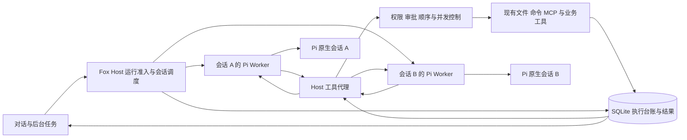

# Fox 单路径运行时收敛方案

日期：2026-10-28  
状态：待评审的实施方案；本轮只改文档。  
源码基线：`D:/python/projects/Fox/Fox`，`main @ daa799ffd22dcc1e5fd17815643ef4ba4b1247ff`。

建议以现有 Legacy/Pi 的持久原生会话为起点，形成一条 **Pi 推进 Agent 循环，Fox Host 管理会话并发、受管工具和持久结果** 的正式路径。保留 Kernel 已有的并发调度规则和必要恢复能力，逐步替换重复的模型轮次、历史重建、压缩及重试编排。

收敛对象是 Fox 本地 Pi 路径。Yuxi 和外部 Agent backend 仍按各自适配契约运行，不在此批删除。产品内多 Fox 协作也不是本次交付条件。

本方案细化[联系人并行方案](Fox联系人多Agent并行开发方案-20261028.md)中的 Kernel 收缩建议。它不代表默认入口已经切换。实施后只为新 Run 提供一条正式入口；旧 Run 的恢复和历史读取按原版本处理，不改写已有 authority。

## 一 当前基础与实际缺口

| 范围 | 当前源码或已有证据 | 对收敛的影响 |
| --- | --- | --- |
| Pi 原生会话 | `pi-runtime.mjs` 已用 `SessionManager.create/open`；原生会话不再注入 Fox 展示历史 | 直接复用，不在 Kernel Worker 内另做一套原生会话 |
| 生命周期 | 已有映射、代次台账、Run/session 绑定、恢复失败保护和重置 | 扩展可信归属及并发控制，不重建第二套会话表 |
| Legacy 多会话 | 普通对话所在的共享 `RuntimeHost` 只有一个 `worker`；`dispatch_next_queued_run` 用 `legacy_available` 控制派发 | 改成有上限的会话 Worker 集合；单纯设 `FOX_KERNEL_MODE=legacy` 不能完成目标 |
| Kernel 多会话 | 不同会话的 Kernel Run 可以独立派发 | 迁移准入、所有权、取消和事件路由，不能只复制派发循环 |
| 工具并行 | Pi 1.4.0 自身支持并行；Legacy Host 也有独立工具处理线程和容量限制 | 不能把并行全部归功于 Kernel；需保留 Kernel 对顺序、分类、持久结算的控制 |
| Kernel 只读调度 | 连续只读前缀最多 4 个；当前白名单为 `read/ls/find/grep/skill_load`；写入和未知工具形成串行屏障 | 将这套可验证规则迁入统一 Host 工具调度 |
| Kernel 会话 | `pi-kernel-worker.mjs` 仍创建内存会话，Host 装配模型历史 | 移除重复的会话与上下文编排是本次主要简化点 |
| 通信 | 两条路径都以 Rust Host、Node/Pi、stdio JSONL 为基础 | 保持现有通信方式；本次不引入共享内存、二进制协议或新服务 |
| 恢复 | Kernel 有执行领取、结果提交及不确定执行保护；Legacy 启动修复会将遗留活动 Run 标为 interrupted | 原生会话续聊不能代替工具副作用核对，恢复保障必须单独迁移 |
| 默认入口 | 无旧绑定且未设置环境变量时，当前代码选择 Authoritative | 本轮不修改默认值；后续按候选和门槛切换 |

已提交的 [10 月 28 日桌面矩阵](../../apps/desktop/tests/acceptance/single-pi-20261027/RUN-20261028-terra.md)支持若干 Legacy/Pi 场景，包括原生会话重启追问和重置。它跨多个修复版本，不是同一最终构建的完整验收；也未证明并发、压缩后重启和本方案的故障恢复已通过。

源码入口：[Host 派发与 Worker](../../apps/desktop/src-tauri/src/runtime_host/mod.rs)、[会话生命周期](../../apps/desktop/src-tauri/src/runtime_host/session_lifecycle.rs)、[Pi 正式运行时](../../services/agent-runtime/src/pi-runtime.mjs)、[Kernel 只读调度](../../apps/desktop/src-tauri/src/runtime_host/kernel_coordinator/live.rs)、[Kernel 执行与恢复](../../apps/desktop/src-tauri/src/runtime_host/kernel_host.rs)、[authority 选择](../../apps/desktop/src-tauri/src/runtime_host/kernel_authority.rs)。

## 二 目标路径与职责

| 职责 | 唯一负责人 | 约束 |
| --- | --- | --- |
| 模型请求、流式输出、工具调用循环、steering 和上下文压缩 | Pi SDK 及现有 Fox Pi adapter | Host 提供预算、取消和工具边界；不再逐模型轮次复制一个循环 |
| 原生上下文和压缩记录 | Pi `SessionManager` | 每个会话代次只有一个写入者；Fox 不直接拼写 JSONL |
| 联系人、私聊、展示历史、记忆、资料授权、凭据和业务状态 | Fox Host 与 SQLite | 原生上下文和产品状态各有明确职责；模型正文不能结算业务状态 |
| 多会话准入、Worker 生命周期、身份及代次隔离 | Fox Host | 同会话串行，不同会话受全局上限控制 |
| 工具权限、审批、撤销、资源冲突、执行和完整结果 | Fox Host | Pi 只调用受管代理，不能恢复默认文件或 Shell 执行器 |
| 模型传输重试 | Pi/provider 适配层 | Host 给出次数和时间上限；不得再套一层同类重试 |
| 工具重试与副作用恢复 | Fox Host | 先核对原执行事实；SDK 不重放工具副作用 |
| 总预算与最终交付状态 | Fox Host | 模型、压缩和重试消耗都计入；Pi 返回不直接等于业务完成 |

命名和执行权分开处理。建议新路径继续使用 Host 的 Authoritative 执行契约，而不是新增第三种 authority。[`RunControlBinding`](../../crates/fox-engine-protocol/src/control.rs) 已有 `schema_version`，先评估升级该契约版本能否明确区分新旧执行路径，再决定是否需要额外字段。版本及迁移编号在 S0 冻结：不能只沿用 `authoritative` 字符串，就把新 Run 交给旧 Kernel 恢复器。旧版本按旧语义解释；没有明确路由时拒绝恢复，不猜测。启动修复、恢复查询和正常派发必须使用同一版本判定，不能分别领取同一 Run。

开发期可保留仅作用于新 Run 的候选入口。正式交付后取消用户在 Legacy/Kernel 间选择的需要。旧恢复兼容分支只处理旧记录，不接收新工作，不继续扩展第二套功能。

## 三 多会话并发

将共享的 `worker: Option<Worker>` 改造为按可信会话归属管理的集合。建议逻辑键包含 `conversation_id + runtime_session_id + generation`；联系人接入后再绑定 `companion_id`，不能从模型参数或显示名字推导归属。

1. 每个会话同一时刻只允许一个活动 Run。新消息按当前产品规则进入 steering 或后续队列，不另开第二个写入原生文件的 Worker。
2. 不同会话使用独立 Worker 和原生会话。按需启动，闲置时回收；不要给每个历史联系人永久启动进程。
3. 设全局模型 Run 上限和 Host 工具上限。试验初值可用 2 个活动会话、每批最多 4 个只读工具，再测 2/4 会话配置；这些是候选参数，不是已验证容量。
4. 队列按会话公平派发。等待审批的会话不占住其他会话的模型派发机会；恢复执行前重新取得容量。后台任务和前台聊天使用同一准入规则。
5. Worker 句柄、请求响应表、取消令牌、退出回调和流式事件都绑定 Run、会话代次与 Worker 实例。不能从一个全局“当前会话”取值，也不能让 A 的崩溃清空 B 的请求。
6. 停止一个 Run 只终止它拥有的工作；Windows 子进程组按所有者管理。迟到结果可作为原执行证据记录，但不能继续推进已取消 Run 或新代次。

保留并扩展现有 `kernel_run_lock.rs` 的独占所有权语义。Run 锁不能代替原生会话锁：跨进程启动、重置、删除及恢复也必须协调同一会话代次。所有权丢失后，旧 Worker 无权提交新执行结果；租约过期本身不证明副作用未发生。

跨会话共享文件时，复用 Host 的文件写入协调与版本校验，资源键按可信规范路径计算。同一目标的写操作串行；无法确定影响范围的命令先按项目执行域保守互斥。纯读取跨会话不自动获得一致快照，后续写入仍需 `expectedVersion` 等校验。SQLite 事务内只做短读写，不在持锁期间等模型、审批或工具完成。

## 四 保留只读并行与写入顺序

目标规则保持简单。例如模型一次提出 `read A → grep B → write C → read C`，Host 允许前两个读取并行，等二者结算后执行写入，写入结算后再读取 C。单批最多 4 个独立只读调用；其余调用排队。结果返回模型时保持原始调用顺序。

首版沿用 Kernel 的五项白名单，但迁移时必须复核每个工具的实现和共享状态。`skill_load` 若会改变本轮共享工具或提示状态，就降为串行屏障。MCP 的只读声明、HTTP GET、Shell 命令文本以及未知名称都不能单独证明没有副作用；未审核工具默认形成屏障。

### Pi SDK 适配是首个验证点

仓库锁定并本地安装的 Pi 1.4.0 有 `executionMode`、`beforeToolCall` 和 `afterToolCall`。其 `executeToolCalls` 检测到任意 `sequential` 工具时，会串行执行整批；否则准备调用后并行执行，再按源顺序追加结果。因此，只给读取标 `parallel`、给写入标 `sequential`，不能保留 Kernel 的混合批次只读前缀并行。

建议所有资源工具通过统一 Host 代理提交调用。代理可以并发等待 Host，但真正资源执行仍由 Host 的顺序屏障控制。对代理标记可并行，只表示提交请求可以并行，不表示写入可并行。业务、MCP、文件和命令都必须经过同一入口；仍有直接执行器时不能启用这一模式。

适配层需要建立可等待的批次登记：保存模型调用列表、源顺序和输入摘要，Host 落盘并确认后，代理才请求执行。当前 `shadowToolBatch` 事件只能作观察基础，不能直接当作已持久登记或执行授权。优先使用 SDK 公共钩子和自定义工具，首版不 fork Pi、不修改 `node_modules`。

S0 必须验证以下边界：

- schema 校验失败、未知工具或钩子拒绝时，可能没有 `execute` 回调。适配层必须把对应调用登记为确定失败并关闭顺序位置，避免后续工具永久等待。
- `beforeToolCall` 不能等待本批工具执行完成；Pi 可能先逐个准备调用，再启动并行执行，等待会造成死锁。批次登记确认与执行结果等待分开。
- 乱序到达、重复提交和慢读取不能让后面的写入越过屏障。中途取消后，未开始的调用不再执行。
- 保留已有参数修复、schema、工具结果裁剪与引用；失败结果经 Pi 适配后仍为失败，不能被钩子覆盖为成功。
- Host 审批在真正执行前重验。对外事件订阅的返回不作为 Pi 原生文件已持久化的证明。

如果这些条件无法用已锁定 SDK 的公开接口满足，应先停止扩大迁移并修订适配方案。串行模式可以作为开发中间态，但不能据此宣布本方案的并行目标完成。

## 五 必须保留的持久保障

保留现有实现和表作为第一步，先抽取调用接口，再判断可删部分。以下是行为契约，不是要求另造一套通用框架或平行数据库。

| 边界 | 保留或补齐的契约 |
| --- | --- |
| 运行准入 | 冻结身份、会话代次、权限与预算；验证 engine 和执行契约版本；同会话互斥 |
| 审批 | 审批绑定具体操作、输入及可信作用域；撤销、过期、取消后不执行；不能用启动时快照绕过后续撤销 |
| 工具登记 | 批次和工具调用先落盘再执行；逻辑调用键含 Run、代次、批次、call ID；输入摘要用于检测同键异参 |
| 执行领取 | 唯一所有者和领取记录；重入、恢复与正常派发不能同时拥有同一调用 |
| 结果提交 | 先持久保存完整结果、状态和资源证据，再向 Pi 返回可见结果；结果引用只指向确实存在的数据 |
| 重复请求 | 同键同参数返回已保存结果或当前执行状态；同键异参拒绝。没有结果的已领取写操作不自动重做 |
| 预算 | Host 统一登记活动请求与消耗，含重试、压缩、子任务和后台调用；并发领取不能反复使用同一份剩余额度 |
| 最终状态 | 保留 Goal/Task/Review/Acceptance、交付核验和待用户处理状态；SDK 结束不能绕过验收或伪造完成 |

当前 Kernel 的 claim、outbox、完整结果和提交逻辑不能在改接原生会话时一并删去。统一路径的最小工具接口可按“登记、准入、领取、执行、提交、返回”组织；数据库字段优先复用现有台账。原生 SessionManager 只负责模型上下文，不承担 Host 执行台账职责。

业务交付校验、长期 Job、子任务等待和通知仍由现有 Host 服务负责。Pi 每次运行到可停点后提交候选结果，Host 判断结束、等待用户或后续工作；需要修正时向同一会话提交受预算约束的后续请求，不保留两套同时推进模型循环的控制器。没有迁移等价行为前，对应旧模块不能删除。

## 六 恢复分层与崩溃窗口

首版恢复目标是：原生上下文可继续，已保存结果可重取，审批可恢复显示，不确定副作用可识别，并保留当前已支持的安全后台恢复。不承诺任意网络请求或进程中断后都无感继续。

### 会话恢复

复用 `SessionLifecycle` 与 format 2 映射。`ready` 文件丢失、损坏、空文件或身份错配时拒绝恢复；不能静默创建空上下文。`allocated` 且尚未写入的会话继续按现有规则处理：精确匹配的活 Worker 可以复用；已登记文件完全不存在且符合 `adoption_is_safe` 时可在同代次重新分配。旧 format 1 保留明确的兼容规则。

重置与活动 Run 互斥，增加新代次并退休旧代次；保留联系人私有记忆。取消、重置、删除后到达的旧事件不得写进新上下文。固定私聊的 M1 重置禁令继续有效，M2 验收通过后再开放。

### 工具与原生文件的联合核对

SQLite 与 Pi JSONL 没有一个共同事务。建议记录 Host 结果提交位置，以及对应 Pi 会话、批次和消息条目的确认位置；具体字段在 S0 验证 SDK 可提供的身份后冻结，不能依赖一条 UI `message_end` 就宣布文件已安全落盘。

| 中断位置 | 恢复动作 |
| --- | --- |
| 工具已登记，但未领取或没有开始执行 | 重验权限、预算、取消和所有权后，才能按同一逻辑调用继续 |
| 调用已领取，无法证明是否开始或是否完成 | 标为结果不明并进入核对；尤其写入、命令和外部请求不得自动重放 |
| Host 结果已提交，返回 Pi 前连接中断 | 读取原结果；只补结果交付，不重新执行资源操作 |
| Host 已提交，Pi 文件缺对应结果 | 经验证的 SDK 公共恢复接口补入原结果，并按调用身份去重；接口未验证时停在可解释的中断态，不手改 JSONL |
| Pi 文件已有结果，Host 无对应提交事实 | 作为一致性错误处理；不能根据模型上下文反推执行成功 |
| 审批中退出 | 恢复待处理状态；重验授权是否仍有效，不把重启当作批准 |
| 长期 Job 或子任务等待中退出 | 复用既有 Job/子任务台账、领取和唤醒去重；不得再次启动已运行的外部任务 |
| Worker 崩溃或模型请求状态不明 | 结束或挂起对应 Run，保留已提交结果；原生会话恢复和下一次请求不等于自动重跑整个原回合 |

调用键只能防同一逻辑请求重放，不能防模型用新 call ID 重做同一副作用。出现不确定写入时，必须先完成核对或由用户明确选择后续操作，不能把整轮失败重试包装成新调用继续执行。对普通文件使用版本和结果证据，对外部系统优先使用它提供的幂等键；无法证明的外部副作用保持未知，不宣传全局 exactly-once。

## 七 实施顺序和文件责任

以下 S0–S5 是工作包和门槛，不是本轮启动开发的指令。`runtime_host/mod.rs`、数据库公共模型、协议和依赖锁文件始终由一位集成人员管理；实际开工前登记所有者，不覆盖新出现的 WIP。

| 阶段 | 工作与交付 | 主要范围 | 通过条件 |
| --- | --- | --- | --- |
| S0 冻结适配与恢复契约 | 用隔离夹具验证混合批次、失败回调、结果补交、原生持久确认；登记所有 Kernel 专有能力及保留位置；确定运行版本和迁移方案 | Pi adapter、Host 工具协议及独立验证目录；集成人员统一接口 | 无第二模型循环、无直接资源执行器；批次无死锁；恢复事实可区分 |
| S1 统一工具保障 | 将现有准入、审批、台账、资源执行和结算接到 Pi 原生会话的 Host 代理；先保持单会话 | `host-tools.mjs`、`read-only-tools.mjs`、`tool-adapter.mjs`、Host 网关及相关仓储 | 原生续聊、写入/拒绝/撤销、预算、取消、结果保存和故障窗口通过 |
| S2 多会话与只读并发 | 会话 Worker 集合、公平队列、按 Run 路由与取消；启用 Host 的只读分组及写入屏障 | `runtime_host/mod.rs`、进程/会话所有权、从 `kernel_coordinator/live.rs` 提取的调度规则 | 两会话互不阻塞；同会话不重入；混合批次顺序和跨会话资源冲突通过 |
| S3 完成恢复与业务接线 | 压缩重启、结果补交、审批/Job 恢复和交付核验；联系人交付时接入其代次隔离 | `session_lifecycle.rs`、Pi runtime、恢复入口、delivery/Job/业务服务 | 下节 U01–U12 中该候选已交付能力的项目通过；未迁能力无静默降级 |
| S4 切换正式入口 | 新 Run 只走统一路径，冻结候选与证据；旧 Run 由兼容恢复器处理 | authority/版本路由、启动修复、候选构建和发布配置 | 新旧记录不误路由；回退与升级数据副本验证通过 |
| S5 删除替代实现 | 移除不再被新 Run 使用的重复模型循环、历史重建、压缩和重复重试；清除第二正式入口 | 见下表，逐项按调用关系及数据依赖删除 | 新路径验收通过，旧活动记录已结清或有明确兼容方案；历史仍可读 |

先把保障接入，再开放并发和切换默认入口。S1 的单会话状态只是中间里程碑；本次收敛完成必须包含 S2 的两类并发和 S3 的恢复门槛。

### 保留与删除清单

| 现有部分 | 处理方式 | 删除或缩减条件 |
| --- | --- | --- |
| `pi-runtime.mjs`、`pi-adapter.mjs`、事件映射、原生会话生命周期 | 作为统一入口基础 | 保持已有修复；按契约修改，不另写平行实现 |
| `kernel_run_lock.rs`、准入、取消、审批、资源网关、结果与 Job 台账 | 保留行为并抽取接口 | 只能删除已证明重复的装配代码 |
| `kernel_coordinator/live.rs` | 提取只读调度与必要业务规则，逐步缩减循环控制 | 所有调用点、工具屏障、交付和等待状态已迁移 |
| `kernel_model_worker.rs`、`pi-kernel-worker.mjs`、`pi-kernel-loop.mjs` | 新 Run 不再通过另一套 Kernel 模型 Worker | 原生统一路径、旧 Run 恢复及错误语义替代完成 |
| `kernel_coordinator/compaction.rs`、`pi-kernel-compaction.mjs` | 压缩改由同一 Pi 原生会话负责 | 压缩计费、取消、失败和重启恢复均已验证 |
| Kernel 仓储、outbox、历史事件和投影 | 先复用，后按字段和用途审计 | 不因入口删除就删表；历史读取与待处理记录有归宿后才安排迁移 |
| Legacy 的共享单 Worker 与旧路径选择逻辑 | 被会话 Worker 调度和统一入口替代 | 新 Run 单入口已稳定；保留旧格式必要读兼容 |

## 八 验收与性能测量

每项记录源码提交、未提交补丁、实际桌面与 sidecar 文件哈希、运行 PID、SDK 版本、数据副本和执行契约。源码审查、夹具、真实模型、Windows 桌面与产品验收分开登记。没有执行的项标为待验证。

| 编号 | 场景与判定 | 所需证据 |
| --- | --- | --- |
| U01 | 单会话连续聊天、原生重启追问、重置、损坏拒绝；重复用户消息和旧代次事件不混入 | 生命周期/Runtime 定向测试及真实 Pi 桌面 |
| U02 | A 长请求期间 B 能运行；A 等审批、取消、崩溃不终止 B；同会话第二 Run 不能并发写入 | Host 并发夹具及两个真实会话 |
| U03 | 纯只读批次有实际重叠且不超过上限；混合批次按读取组、写入、后续读取执行；返回顺序稳定 | 执行开始/完成时间线、资源断言及 SDK 适配测试 |
| U04 | 两会话写同一文件、读取后版本变化、未知 MCP 和命令；不能越过资源冲突或扩大权限 | Host 资源与审批测试 |
| U05 | 失败校验、未知工具、重复 ID、同 ID 异参、回调缺失、乱序返回和取消；批次不死锁、不假成功 | SDK/Host 协议夹具 |
| U06 | 在登记、领取、资源执行后、提交后、回传后逐点中断；结果不明不自动重做，已提交结果只补交付 | 故障注入、真实子进程终止及数据库/原生文件对账 |
| U07 | 审批拒绝、撤销、过期、重启和批量工具等待；总预算包含压缩、重试和并发请求 | Host 状态与限额测试 |
| U08 | 实际触发 Pi 压缩后重启；保留压缩记录和所需上下文；失败不静默建空会话 | 原生文件证据及真实模型桌面 |
| U09 | Job、子任务、待用户处理、交付核验和通知；恢复不重复启动或通知，正文不能改业务结论 | 现有业务契约回归及受影响桌面场景 |
| U10 | 普通会话、项目与联系人归属隔离；M1 私聊禁止重置，M2 开放后旧事件不串代 | 身份/记忆隔离测试及联系人候选验收 |
| U11 | 新旧运行版本并存、旧 authority 冻结、迁移失败与候选回退；未知版本拒绝误恢复 | 用户数据副本迁移与恢复测试 |
| U12 | 同一最终构建完成所有受影响场景；安装包实际包含匹配的 sidecar 和 SDK | Windows 打包及实际进程核验 |

原有测试按责任迁移，不按文件名整批删除。优先复用会话重置、生命周期、Kernel 并发、approval、reconciliation、waiting_jobs 和工具结果测试，先建立覆盖映射再调整断言。验证子进程中断时使用隔离实例，不停止用户正在运行的 Fox。

U10 的普通会话和项目隔离属于运行时切换门槛；联系人专属条目随 M1/M2 候选验证，不能反向要求先完成所有联系人功能才能收敛运行时。尚未交付的联系人项标为该候选不适用，不能记为通过，也不能删除现有能力来规避回归。每次候选均验证实际交付范围，M2 仍须满足主方案的全部对应门槛。

性能采用同模型、同输入、同候选、同权限和相同并发上限比较。分别记录冷启动、热会话首字、整轮耗时、只读批次耗时、排队时间、峰值内存、Node 进程数和取消延迟。真实模型测试补充离线延迟夹具，避免把供应商波动当成本地收益。并发缩短多个任务的总等待，也可能增加内存和限流；本方案不预填提升比例。

## 九 与联系人计划和切换回退的关系

联系人 M0 的 scope、身份和数据副本验证继续进行；M1 的固定私聊、记忆与界面范围不变。运行时收敛与 M1 装配共享文件，需按窗口交接，不能将 `runtime_host/mod.rs` 同时分配给两组修改。

采用本方案后，C1/M2 的实现目标改为把 companion 接入统一 Pi 原生路径，并通过 A07–A12 与相关 U 项。**不再同时排期“给旧 Kernel Worker 补原生会话”和“建设统一 Pi 路径”两项实现。** 既有 G2 应改为统一正式路径的同候选验收；本轮未改当前运行入口，三份联系人文档中的 Authoritative/Kernel 仍描述现状与切换前基线。

切换按新 Run 生效。正在运行或待审批的旧 Run 不热切换；升级前可等待其结束，或由旧版本恢复器处理已有记录。为保护数据，不批量改写历史 authority、原生 session ID 或代次。

回退优先使用“新二进制停止准入新契约”的受控开关，并等待新 Run 结清或保留可识别的中断状态。旧二进制若不认识新数据库版本，必须拒绝直接打开；必要时使用已验证备份恢复方案，不能让它解释新台账或删除新数据。迁移保持可读历史；联系人已规划 v100，本方案不抢占版本号，S0 按实施顺序确定后续编号和版本守卫。

完成标准是：新 Run 只有一个正式入口；Pi 原生会话和 Agent 循环只有一套；多会话并发与只读工具并行通过验收；权限、业务状态和不确定副作用恢复仍由 Fox 保证；被替代的循环实现已移除，旧记录只有受控的兼容读取或恢复通道。

## 十 SDK 源码核对记录

依赖定义见 [Runtime package.json](../../services/agent-runtime/package.json) 和 [pnpm-lock.yaml](../../pnpm-lock.yaml)。本轮读取本地已安装的 1.4.0，以下是实现核对，不是运行测试。文件路径以 `services/agent-runtime/node_modules/@earendil-works/` 为根。

| 文件 | 核对点 | SHA256 |
| --- | --- | --- |
| `pi-agent-core/dist/agent.js` | 默认工具执行方式为 parallel | `f45ae001e2b14fced8ae151f0a00303b5fbdb5fc4b25418d45de6a5546f48a8c` |
| `pi-agent-core/dist/agent-loop.js` | 混合批次遇 sequential 时整批串行；并行分支先准备后执行，结果按源顺序追加；公共前后钩子 | `22ee81f9977e211044c1ad41a763876c793ca7fc1c5b39b9fa7f76f3cb281129` |
| `pi-coding-agent/dist/core/agent-session.js` | 对外事件通知与 SessionManager 追加记录有先后关系，收到事件不能代替持久确认 | `436e8be3bbab2db475ce30bb5d0bb30f0046b19a3476f8cd57b8133e68891162` |
