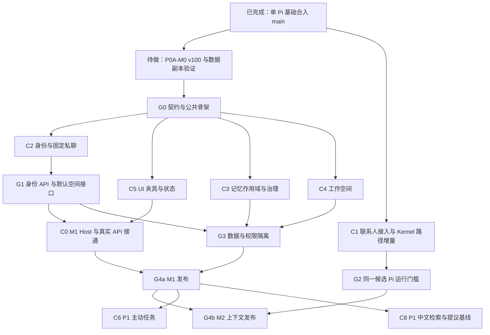

# Fox 联系人多 Agent 并行开发方案

日期：2026-10-28  
状态：联系人功能待实施；单 Pi 会话基础已合入 main。本轮只修订文档。

复核基线：`D:/python/projects/Fox/Fox`，分支 `main`，HEAD `daa799ffd22dcc1e5fd17815643ef4ba4b1247ff`。上一轮首次修订前工作区为空；本次全面自查开始时，仅这三份方案有未提交修改，产品代码与该 main 提交一致。旧分支和 `cbcd1947` 仅作历史定位，不再作为开发起点。

本次按 main 和 10 月 28 日桌面记录更新起点，保留做法 A：M1 只做 Fox 私有记忆，不引入共享作用域或授权。本文集中保存会变化的源码、提交和验证状态；主方案保存设计约束。

运行时收缩的具体提案集中在[单路径运行时收敛方案](Fox单路径运行时收敛方案-20261028.md)。该方案提出复用 Legacy/Pi 原生会话，迁移 Kernel 的受控并发和恢复保障。下文 Authoritative/Kernel 表述仍对应当前源码及切换前验收基线；采用新提案后，C1/G2 统一改验新正式路径，不同时建设两套原生会话接线。此提案不授权本轮修改产品代码。

目标是把已确认的[Fox 联系人产品方案](../03-产品与前端/Fox联系人改造方案与Pi衔接-20261028.md)拆成能独立交付的工作包。P0 复用现有候选确认、词法召回、执行路径与文件权限，先修身份和作用域隔离。[开源选型方案](../03-产品与前端/Fox开源复用调研与选型-20261028.md)的 P1 主线改为中文检索；先量现有运行中提议基线，按需移植 octop 抽取逻辑，LangMem 仅作设计参考。它们及 zvec 记忆索引均不是接口冻结或 M1/M2 发布前提。

**采用一位集成人员加三个并行执行者。** 工作包多于同时运行的 Agent 数量，按波次切换。能使用冻结接口和夹具的工作提前开始；共享文件、数据库迁移和最终集成由指定所有者串行处理。这里的“多 Agent”是开发分工，产品内多只 Fox 协作仍属于后续功能。

## 一 开发前先固定边界

M1/M2/P1 范围与 A01–A16 以主方案为准。新增 P0A-M0 迁移门槛必须先于接口冻结。M1 的重置判定扩展现有 availability/生命周期规则；不新增另一套 UI/Host 开关。

原先阻塞交接的 `database/repositories.rs`、`commands/mod.rs`、`runtime_host/mod.rs`、`session_lifecycle.rs` 及对应测试、前端接线已提交并合入 main。**旧 WIP 合入条件已满足，不再安排等待原负责人提交这一工作。** 当前前置工作是 M0 迁移/副本验证与本批文件所有权登记。后续若产生新 WIP，仍需协调重叠范围，不能覆盖或停止他人进程。

需要独立工作树时，从本轮确认的 main 基线建立；启动实施前复核 HEAD 和工作区。各工作树使用独立测试数据目录、运行端口和构建输出；测试不得指向用户正在使用的数据库、Pi 会话目录或 Fox 工作空间。

### Pi 已有进展如何计入

以下变化均已进入当前 main。本轮核对源码和已提交验收记录，没有重跑模型、Rust 测试或桌面场景：

| 提交 | 已有变化 | 在本计划中的处理 |
| --- | --- | --- |
| `e9c82ae4`、`cbcd1947` | SessionLifecycle、v98 原生映射、v99 代次台账、重置命令与自有原生文件删除 | 已有会话基础，不重建第二套映射；普通删除保护不能代替固定私聊删除禁令 |
| `e1f11e0d` | 代次不冲突、刚重置会话跨重启、Host 与 UI 重置可用性一致 | 复用 `context_reset_availability`、`reset_availability` 和台账；companion 条件尚待加入 |
| `fb0d3a94` | 每个 SDK Run 绑定所选 runtime session | 复用绑定事务，联系人接入后补身份/代次隔离回归 |
| `a68d61ab` | 原生恢复失败后拒绝 rewind，替换映射时退休旧代次 | 复用错误保护，不能把重试静默新建当成恢复 |
| `af58320b`、`315a50dd` | 被拒重试保留失败态；重新加载后重建持久失败投影 | 保留修复，新增联系人状态汇总时回归 |
| `4116efb5` | SDK 事件保留知识引用，界面能打开文档/原文 | 复用现有来源链，不声称条款级精确定位已验收 |
| `be29b174` | 提交 `RUN-20261028-terra.md` A–I 桌面矩阵及定向测试记录 | 是多个修复版本上的 Legacy/Pi 证据，不是同一最终构建或 Kernel 路径通过 |
| `daa799ff` | main 合入单 Pi 主线并协调文档 | 本轮共同起点；合并本身不增加运行验收证据 |

最新依据是 [`RUN-20261028-terra.md`](../../apps/desktop/tests/acceptance/single-pi-20261027/RUN-20261028-terra.md)：A–I 记录了连续重置、刚重置后重启首发、切换会话、编辑重跑、删除自有文件、同一 runtime session 重启追问、损坏文件两次被拒重试、引用导航和标签展示。F 的重启追问命中唯一标识，映射/JSONL 保持；G 保留中间失败，再记录最终拒绝重试结果。不能继续把旧首轮失败/404 当成当前已复现阻塞；[前一轮记录](../../apps/desktop/tests/acceptance/single-pi-20261027/RUN-20261027-desktop.md)中的“404 当前未复现、历史根因未定”仍作为历史边界保留。

证据必须保留以下限制：

- 成功 Run 为 `authority=legacy`、`engine_id=pi`；G 最终首次失败在打开会话前发生，authority/engine/session 为空，不补写成成功绑定。已有证据支持 Legacy/Pi 的对应场景，不能宣布 G2 整体通过。
- 不同场景使用不同修复版本，没有在同一个最终构建重跑完整矩阵。首次 D/E 未单独捕获实际 runtime 子进程，后续限定补测的 PID 不能回填；条款级精确定位未验。A–I 不等于每项都有同样完整的 PID 证据。
- 记录列出 `context_reset` 27/27、stage_two 15/15 等定向结果；当前源码也有 27 个 context_reset 测试定义。本轮没有执行这些测试，不能改写为本轮通过或完整套件通过。
- [`kernel_authority.rs`](../../apps/desktop/src-tauri/src/runtime_host/kernel_authority.rs) 在无已有绑定、未设置环境变量时默认 Authoritative。Kernel 尚未接入同一持久原生会话路径，属于实现缺口；压缩后重启、新 companion 隔离及同一候选完整回归还缺验收。C1 估算必须包含这条路径的实际接线，不能只估测试工作，也不重新估算已合入的 Legacy 重置和代次基础。

当前 `reset_availability` 的实现是：拒绝 `runtime_type == "yuxi"`；有映射且 `format_version < 2` 时拒绝；无映射或版本不低于 2 时通过该可用性判定。它不是 runtime 白名单，也不是必须先有 format 2 映射。Host 的 `context_reset_availability` 从可信会话读取类型和映射后调用它。联系人 M1 的禁止重置条件还需加入同一规则，运行中等执行准入继续保留。

`conversation_load` 同时返回 `contextReset`（能力/格式判定）和 `contextResetBlockedReason`（活动 Run 阻塞原因）。前端必须合并消费，不能只看 `supported`；执行端仍在锁内重验。现有能力判定没有核对 authority，也不能证明下一次 Kernel Run 会使用重置后的原生映射。M1 的 companion 禁令须在创建新会话或变更映射前拒绝；M2 再校验实际执行路径与映射一致。

### Kernel、Legacy 与 Pi：当前差异及收缩建议

Pi 是两条路径共用的引擎；Legacy/Authoritative 是执行控制模式。Legacy 名称也不等于旧 `format_version=1` Fox JSON 快照：本次成功原生场景使用的是 Legacy authority 与 format 2。当前源码不能归纳为“Legacy 全部通过、Kernel 整体失败”，也不能把差异只写成证据未补：

| 边界 | 当前 Legacy/Pi | 当前 Authoritative/Kernel |
| --- | --- | --- |
| Run 启动与原生映射 | `start_run_inner` 调用 `open_runtime_session`，关联该 Run 的原生会话 | 启动转入 Kernel；不走这次 `open_runtime_session` 调用 |
| Pi 会话 | 新原生会话/format 2 在 `pi-runtime.mjs` 用持久 SessionManager 创建/打开 JSONL，不回灌展示历史；旧 format 1 仍有快照兼容分支 | `pi-kernel-worker.mjs` 使用 `SessionManager.inMemory(cwd)`；由 Host 初始消息和持久 frame 装配上下文 |
| 模型循环 | Pi SDK 会话推进，工具经既有 Host 桥 | 同样由 Pi 推进多轮，但每轮提案、工具结果与继续指令受 Kernel/Host 控制；并非“Kernel 完全不用 Pi” |
| 压缩与重试 | SDK 自动压缩开启；重试按 Fox 的策略配置，不能推定所有重试都交给 Pi | Pi 自动压缩和自主重试关闭，Host 保留压缩请求与重试准入；已有 Host 压缩不能等同于原生 JSONL 续聊 |
| 最近桌面证据 | 10 月 28 日原生会话矩阵有分场景成功证据，跨多个构建 | 该矩阵未覆盖；当前原生会话接线也不同，不能继承这份通过结论 |

依据：[启动路由与共享记忆操作](../../apps/desktop/src-tauri/src/runtime_host/mod.rs)、[SDK 会话](../../services/agent-runtime/src/pi-runtime.mjs)、[Kernel worker](../../services/agent-runtime/src/pi-kernel-worker.mjs)、[受 Host 控制的 Pi 循环](../../services/agent-runtime/src/pi-kernel-loop.mjs)、[Kernel 控制与恢复接口](../../crates/fox-agent-kernel/src/lib.rs)、[资源与审批网关](../../apps/desktop/src-tauri/src/runtime_host/kernel_gateway.rs)。

生命周期还须区分 `allocated` 与 `ready`：映射可以先以 allocated 落库，不能因此声称文件已经持久化。`allocated_mapping_is_live` 允许精确匹配的活 worker 复用；`adoption_is_safe` 只允许原生 allocated、存在已登记路径且文件完全不存在的场景在同代次收养。ready 丢失、空文件、损坏或错配不适用。旧 format 1 另保留历史恢复/不可用回退语义，不能把新原生失败保护推广成所有旧会话行为已经改变。A10/A11 必须分别覆盖这些分支。

**建议收缩 Kernel，让 Pi 承担模型循环、原生会话与上下文压缩，Fox 保留必要的 Host 保障。此项是本轮架构建议，尚未实施，也未改写当前 M2 的目标路径。** 保留完整 Kernel 不是联系人产品的固定要求；直接删除 Kernel 或仅设置 legacy 也不等于完成收敛。

| 职责 | 建议归属与迁移边界 |
| --- | --- |
| 模型传输、流式输出、工具调用循环、原生上下文和压缩 | 优先复用 Pi SDK；减少 Fox 对这些能力的重复编排 |
| 联系人、私聊、私有记忆、资料授权、文件沙箱、凭据 | Fox Host 与产品存储；Pi 经自定义 Host 工具访问，不能接回未受管的默认文件/Shell 执行器 |
| 运行互斥、取消、审批与撤销、总预算、工具结果落盘、幂等和崩溃后核对 | 保留所需的现有 Host/Kernel 机制，或先迁移为更小接口并验证；原生会话恢复不能替代副作用恢复 |
| 模型传输重试、业务步骤重试 | 分别指定唯一负责人；Pi 与 Host 不能对同一失败各自重试，已执行或结果不明的写操作不得盲目重放 |
| Goal/Task/Review/Acceptance、定时任务与结果通知 | 继续由 Fox 的持久业务状态驱动；模型停止、SDK 返回或正文声称完成，都不是业务验收 |

若后续采纳收缩路线，按单路径方案的 S0–S5 实施。先验证 Pi SDK 的混合批次适配和结果补交，再迁移 Host 保障，开放多会话与只读并发；同一候选完成相关 U01–U12 后切换新 Run，最后删除重复编排。旧 Run 保持冻结 authority，未完成的审批、工具、outbox 和恢复记录按原语义处理。不另建第三套通用 authority 框架。

在路线明确变更前，本计划 G2 仍按当前默认 Authoritative/Kernel 路径要求验收；若正式选择 Pi 主导的新入口，应同步改主方案、C1 和 G2 的候选/路径定义，而不是为保留名称强行再造另一套 Kernel 原生会话。M1 不等待 G2，但其基本聊天和工具闭环仍须在所交付路径验证，不能把 Legacy 记录当作默认路径通过。

### 联系人仍待建设的部分

| 范围 | 当前源码 | 本计划新增 |
| --- | --- | --- |
| 身份与私聊 | 产品源码未发现 `companion_profiles`、`companion_id` | 联系人表、私聊绑定、原子创建与删除/Fork 守卫 |
| 未读 | 有 `messages.ordinal` 和 `before_ordinal` 分页；没有 `last_read_ordinal` | 已读字段、更新命令、未读查询和 UI 状态，不能把分页当成已读功能 |
| 侧栏 | `fox-sidebar.tsx` 组织项目和按日期的对话，另有归档/回收站视图 | 新增“我的 Fox”分组、跨私聊状态汇总与资料入口 |
| 私有记忆 | scope CHECK 仍为 global/agent/project，尚无 fox 归属 | v100 表重建、六处核心改动、Host 归属接线和回归用例 |

知识库的 zvec 由 Cargo `zvec` feature 控制，当前默认 feature 包含 zvec 与 local-embedding；特性关闭的构建不具备同一能力。现有向量入口用于知识库，记忆仍是词法召回。只读源码确认不等于当前安装包已启用或验收。

源码入口：[Host 入口](../../apps/desktop/src-tauri/src/runtime_host/mod.rs)、[生命周期](../../apps/desktop/src-tauri/src/runtime_host/session_lifecycle.rs)、[原生会话](../../services/agent-runtime/src/runtime-session.mjs)、[致命异常处理](../../services/agent-runtime/src/runtime-fatal.mjs)。产品状态、源码实现、本地测试和真实桌面验收分别登记。

## 二 工作包与独占文件

下表使用仓库相对路径。标为“拟新增”的文件是建议位置，尚未实施。已合入的 Pi 基础直接复用；按本表登记本批所有者，新增开发者只承接明确范围。

| 工作包 | 责任与交付 | 独占实现范围 | 输入与验收 |
| --- | --- | --- | --- |
| C0 集成与契约 | P0A-M0 v100 表重建、复制来源表、触发器、公共模型/注册、M1 Host 装配 | 下节共享文件；拟新增 `runtime_host/companion_context.rs` 及测试 | 旧 WIP 合入已完成；先交迁移与用户数据副本证据，再冻结 |
| C1 Pi 会话增量（M2） | companion 接入、Authoritative/Kernel 原生会话路径、压缩恢复、跨身份/代次事件验证及同一候选回归 | M2 窗口的 `runtime_host/mod.rs`；`session_lifecycle.rs` 及测试；必要的 Pi 运行时适配 | 已有恢复/重置/台账和 Run 绑定直接复用；只补 G2 缺口，M1 窗口让出重叠文件 |
| C2 身份与私聊 | 原子创建、默认小狐、模板快照、固定私聊、置顶/ordinal 已读、活动运行后的归档、Fork 禁令 | 拟新增 `database/repositories/companion_profiles.rs`、`commands/companion_profiles.rs` 及独立测试 | 身份/私聊/绑定同事务，不补偿删除；C0 接真实删除/Fork 入口与触发器 |
| C3 记忆隔离（P0） | normalize/validate、propose/recall、memory_score 显式 fox 分支、私有召回、旧 global 偏好复制与审计 | `database/repositories/memory.rs` 与独立测试 | 依赖 M0 新 CHECK；来源版本、目标归属与排序回归；无共享及自动同步 |
| C4 工作空间 | 受管目录、文件关联、创建失败状态、归档和路径验证适配 | 拟新增 `companion_workspace.rs`、联系人文件关联仓储和独立测试 | 复用 Host 文件工具与沙箱；不扩权限、不按名字移动目录 |
| C5 联系人 UI | 默认小狐、私聊、资料面板、旧偏好勾选复制、未读/置顶/归档与 Host 返回的操作可用性 | 拟新增 `features/companions/*`；侧栏及经确认的专家面板复用入口与测试 | 先完成 UI 理解与范围确认；明确一次性复制；M1 无重置/Fork/普通删除入口 |
| C6 主动任务 | 任务归属 Fox、结果回到私聊、暂停、归档、预算与通知；按需验证 croner-rust 4.0.2 | `digital_colleagues.rs`、对应任务仓储和任务 UI 专属文件 | 第二批启动；时间计算直接留在 Rust Host，复用领取、去重与重叠控制 |
| C7A 后端验收 | 隔离数据、契约测试、故障注入与后端证据 | 拟新增 `apps/desktop/tests/acceptance/fox-contacts-*/backend/` 与该目录专用夹具；不改产品实现 | 检查归属、并发、故障和恢复；不把脚本化 Runtime 结果写成真实模型验收 |
| C7B 桌面验收 | A06–A09、A13 和真实模型对话；Windows 打包、截图和操作记录 | 拟新增 `apps/desktop/tests/acceptance/fox-contacts-*/desktop/` 与专用脚本；不修改 C7A 夹具 | 分别按 M1/M2 候选验收；不要求人工重做全部 15 项 |
| C8 记忆增强（P1） | 中文二元切词 → trigram → 固定中文模型向量；现有提议基线、双通道去重与按需移植；随后测 500 条截断 | 隔离研究目录及拟新增中文检索/索引模块；需要后台抽取才新增 adapter；接入治理前从 C3 移交相关文件 | 不进入 P0 关键路径；优先验证 zvec 0.6.0 查询内过滤，不新增 Python；依赖与锁文件交 C0 |

后端相对根为 `apps/desktop/src-tauri/src/`；前端相对根为 `apps/desktop/src/`；运行时相对根为 `services/agent-runtime/src/`。

### 必须串行的共享文件

| 所有者 | 文件或接口 | 其他工作包的提交方式 |
| --- | --- | --- |
| C0 | `database/mod.rs` 的 Schema 版本、`database/migrations.rs`、`database/models.rs`、`database/repositories.rs` 的公共注册与共享方法 | 本轮 M0 使用 v100；其他工作包提交需求，不复用该版本号 |
| C0 | `commands/mod.rs`、`lib.rs`、命令注册与公共错误；`conversation_delete/purge/fork` 与直接仓储入口 | C2 提交守卫/事务用例，C0 接线；批量是前端循环，不新增虚构后端命令 |
| C0 | `features/conversations/api/desktop-client.ts`、`model/types.ts`、核心 conversation hook 的公共接入 | C5 只依赖冻结接口；需要调整时提交调用契约 |
| C0（M1） | `services/agent-runtime/src/host-tools.mjs` 的记忆 schema/说明、公共记忆请求类型与命令接线 | C3 提交私聊强制归属契约；C5 接联系人面板。该文件其他工具保持原归属；M2 若需修改再移交 C1 |
| C0 | Cargo/npm manifests、锁文件、sidecar 打包和安装资源注册；验收目录的共享 fixture manifest、证据索引与总报告 | P1 的 C8/C6 提交依赖与打包需求；C7A/C7B 各写独立目录，公共清单由 C0 更新 |
| 分窗口单一所有者 | `runtime_host/mod.rs`、`session_lifecycle.rs` 的装配与 reset 判定 | 旧 WIP 已合入；C0 从 main 接 M1，沿同一 availability 扩展，之后交 C1 做 M2 增量 |
| 原有所有者 | 文件工具、沙箱、资料库向量核心、已有 UI 变更范围 | 优先调用现有 API；确需修改时先记录新的独占范围，再移交 |

C8 的向量阶段优先验证 zvec-rust 0.6.0 已有的 `SearchQuery::set_filter`，补 Fox 请求/schema/写入映射中的 `companion_id`。小 top-k 场景须证明其他 Fox 的高分条目既不泄漏，也不挤占授权结果；过滤失败不得退回全库。只有该路线不满足时才比较独立集合，并测 1/10/50 Fox 的索引成本。索引分区与 Pi `context_generation` 分开管理。扩展 `SearchRequest` 前，C0 与向量模块所有者明确交接。

## 三 P0A：先验证记忆作用域重建，再冻结接口

### P0A-M0 迁移草案

这是 M1 最高数据风险，C0 独占实施，C3 提交调用侧需求。当前 `DATABASE_SCHEMA_VERSION=99`，v99 已由 `MIGRATION_99_RUNTIME_SESSION_GENERATIONS` 使用，**本轮 M0 指定 v100**。实施前若 main 又有迁移，C0 重新协调下一个版本，不能覆盖 v99 或与其他工作包争用。只把 `memory_entities.scope` 的 CHECK 从 `('global','agent','project')` 扩为 `('global','agent','project','fox')`；旧行的 scope、主键、版本及内容原样复制，不引入共享作用域或授权。

此处 v100 草案只承担记忆表重建和复制来源表。联系人实体、对话绑定/已读字段、初始化标记与保护触发器也需要 DDL，由 C0 在后续增量迁移中统一分配版本；不能把 M0 通过解释为这些表已存在，也不能向已合入或发布的 v100 追加修改。复制来源的 companion 归属须在联系人落地后接上校验，M0 阶段不能开放复制写入口。

基线中 `MIGRATION_25` 的四条级联引用须逐一保全：`memory_revisions.memory_id`、`memory_conflicts.existing_memory_id`、`memory_conflicts.competing_memory_id`、`memory_recalls.memory_id`。它们位于三个子表，不能只核对一个 conflicts 列。

重建步骤按 [SQLite 官方表结构变更流程](https://www.sqlite.org/lang_altertable.html#otheralter)组织，并复用现有 runner 的事务外关闭外键、事务内完整性检查和结束后恢复外键能力：

1. 在一致的数据副本上记录 Schema 版本、完整建表语句、索引/触发器/视图和四张记忆表的基线；停止副本上的并发写入。通过 SQLite backup API 或停写备份取得副本，不能只复制仍在 WAL 写入中的主文件。
2. 由 runner 在 `BEGIN IMMEDIATE` 前关闭该迁移连接的外键执行；确认关闭生效。不能在事务内临时切换，也不能向普通运行连接开放无外键写入。
3. 按最新完整结构创建 `memory_entities_new`，显式列出全部列复制旧数据；仅 CHECK 增加 fox。保留原有外键、默认值和约束，不用 `CREATE TABLE AS SELECT`。
4. 事务内核对复制内容后，删除旧表，把新表改回原名并重建索引等依赖。不要先把旧表重命名，以免引用随旧名改写；三个子表不清空、不重建、不重排 ID。
5. 建立下述复制来源表；在同一事务内校验主表和子表、执行外键检查，并写迁移版本记录。失败整体回滚，包括已发生的 DROP/RENAME。
6. 提交或回滚后恢复 `foreign_keys=ON` 并断言。关闭重开数据库，再检查版本、内容、引用和重复打开的幂等行为。

当前 runner 的 `check_foreign_keys_after_migration` 会特别处理历史缺失 agents 的引用。M0 报告仍须保留完整 `PRAGMA foreign_key_check` 原始结果，区分既存问题与本次新增问题；所有记忆关联必须完整，不得用该例外掩盖记忆数据损失。

数据库与仓储的作用域扩展有六处核心改动，不能只完成迁移和枚举校验；完整接入还包括表后所列跨层位置：

| 改动点 | P0 要求 | 所有者 |
| --- | --- | --- |
| SQL CHECK | v100 重建接受 fox，保留原三值，拒绝非法值 | C0 |
| `normalize_scope_key` | fox 要求非空且与可信 companion 一致 | C3 |
| `validate_memory_fields` | 接受 fox，保留 kind/内容/证据约束 | C3 |
| `propose_memory_for_run` | 从可信会话解析归属；私聊强制 fox，不接受模型扩大范围 | C3；Host 入口由 C0 接线 |
| `recall_memories` 的 WHERE | 私聊只选本 companion 的 confirmed/enabled/未删除条目，在 LIMIT 前过滤 | C3 |
| `memory_score` | 显式处理 fox，P0 保留当前回退加分 0.1；原三种 scope 不变，补排序回归 | C3 |

跨层接线也属于 P0 必需工作：

- `features/conversations/model/types.ts::MemoryScope` 当前只有三值；`desktop-client.ts::createMemory` 依赖它。C0 扩展类型和可信请求，C5 适配联系人记忆面板。现有 `agent-pages.tsx` 的编辑器可选择 global/agent/project，不能原样放入仅本 Fox 的面板。
- `services/agent-runtime/src/host-tools.mjs::memory_propose` 的可选 scope 也只有三值，目前没有 `scope_key` 或 `companion_id`。C0 同步说明和 schema 契约：私聊可省略 scope，显式旧 scope 仍由 Host 强制归一；如允许 fox 字面值，也不能让模型指定所有者。旧普通对话维持原契约。
- 两条执行路径共用 `runtime_host/mod.rs::execute_memory_operation`，Kernel 经 `kernel_gateway.rs` 调用；接线和验证须覆盖两边，不能只修一个路由。
- `list_memories` 当前按可选 agent/project 过滤，`get_memory` 及治理方法主要按条目 ID 操作，尚无可信 companion 参数。C3/C0 必须覆盖手工创建、列表、读取、确认、编辑、冲突、禁用、删除，以及修订/召回审计查询；普通接口不得成为绕过私聊归属的入口。`normalize_scope_key` 只做值规范化，不能独自承担数据库归属授权。

当前评分的 scope 加分为 project 0.3、agent 0.2、其余 0.1。显式 fox 分支是必须覆盖的契约，但 M1 候选只含本 Fox，所有候选得到同一常量；因此“新增 fox 会系统性压低私聊内部排序”不成立。本轮不借此调参，也不把修改加分当作中文检索改善证据。

M0 必须新增直接执行 SQL 的合法/非法 scope 回归，覆盖升级与空库；C3 再验证归属、召回和评分。不能声称新增作用域不会影响已有测试：`migrations.rs` 现有测试在当前基线 7994、8043 行断言当前版本为 99，15687 行还断言当前版本等于代次台账版本。升 v100 时应更新“当前版本”断言和新增迁移覆盖，保留 v98/v99 历史迁移常量及其原语义测试。

复制来源承载草案（属于同一记忆迁移，不是共享关系）：

| 字段/约束 | 含义 |
| --- | --- |
| `memory_copy_origins.memory_id`，主键，引用目标记忆 `ON DELETE CASCADE` | 副本的来源记录跟随副本自身；不影响源条目 |
| `companion_id` | 与目标记忆的 `scope_key` 一致，复制事务内校验；不是模型可选目标 |
| `source_memory_id`、`source_version` | 源条目的逻辑 ID 和确认时版本；不设指向源的级联外键 |
| `source_snapshot_json`、`copied_at` | 保存复制时 scope、kind、canonical_key、内容等来源快照和时间 |
| `UNIQUE(companion_id, source_memory_id, source_version)` | 同一目标重复确认返回已有副本；副本禁用/软删除也不因重试自动复活 |

Host 仅允许用户选中的旧 global identity/preference 进入复制事务，不向模型提供此工具；重验 confirmed/enabled/未删除、可读性和预期版本，源版本变化时返回待重新确认。副本、来源行和既有修订审计一起写入。目标 canonical_key 冲突使用既有冲突流程，不覆盖或静默跳过；复制后两边各自变化。此表不承载持续同步、权限授予或共享关系。

### M0 副本验证门槛

| 检查 | 必须保存的结果 |
| --- | --- |
| 来源与范围 | 源/副本标识、原 Schema 版本、候选提交、备份方式；不在用户活动库执行迁移 |
| 数据保全 | memory_entities、memory_recalls、memory_conflicts、memory_revisions 前后行数与主键集合一致；按 ID 比较字段内容及引用边，不只数行 |
| 约束与版本回归 | 空库及 v99 升级均接受原三种 scope 与 fox、拒绝非法值；索引/触发器和三个子表的四条引用保留，无新增外键问题。当前版本断言升到 v100，v98/v99 历史语义不变；Rust/Host 所有者校验单独验证 |
| 失败恢复 | 复制、DROP 后、重命名、索引重建、完整性检查/提交等失败点回滚；旧表、子表和迁移版本不变，外键恢复 ON |
| 重开与复制 | 关闭重开不重复迁移；源修改/删除不更新或删除副本；来源快照保留；重复复制、冲突、禁用与软删除行为正确 |
| 覆盖 | 同时包含候选/确认/禁用/软删除记忆、已解决与未解决冲突、多次修订和召回记录；空库与用户数据副本都验证 |

**当前结果：已形成设计草案；尚未编写或运行该迁移，尚无用户数据副本验证结果，M0 未通过，P0A 未冻结。** 自动生成的夹具结果只能作为补充，不能标为用户数据副本验证。

### 六组接口冻结清单

下列名称表示行为，不强制最终命令名。C0 提交可供编译的类型与最小接口骨架；临时实现必须返回明确未就绪状态，不返回伪造成功。

| 契约 | 必须确定的内容 | 所有者 |
| --- | --- | --- |
| Fox 身份 | 稳定 `companion_id`、模板/默认空间、联系人 `pinned_at`、`last_read_ordinal`；默认小狐只初始化一次 | C0 定义，C2 实现 |
| 固定私聊 | 身份/私聊/必要绑定同事务，无补偿删除；全行唯一；DELETE/trashed/解绑触发器；delete/purge/fork 命令与仓储拒绝；误删只修原 ID | C0/C2；C5 消费 |
| 可信运行上下文 | 从 conversation 解析 companion、run、有效能力、空间与授权；M1 不要求原生会话 ID；M2 再加有效代次与精确映射 | M1 C0、M2 C1；C3/C4 消费 |
| 记忆接口 | M0 先通过；六处核心改动及管理接口一致；只召回本 Fox，fox 评分分支显式；旧 global 可选一次性复制，来源版本/幂等/冲突明确 | C0/C3；M1 C0 装配，M2 C1 复用 |
| 生命周期与事件 | 在 `context_reset_availability` 与底层 `reset_availability` 同一规则中加入 companion 条件，load 返回和执行拒绝一致；归档等待运行终态 | M1 C0/C2，M2 C1；C5/C7 消费 |
| 文件与状态展示 | 空间准备失败、文件归属；已读游标、消息摘要、运行/审批/待回复状态、归档影响 | C0/C2/C4；C5 消费 |

数据库触发器不为创建失败开例外：联系人创建失败回滚整笔事务；普通对话继续原有创建回滚路径。当前 `commands/mod.rs` 的 `conversation_create` 有六处 `let _ = state.database.delete_conversation(...)` 补偿，联系人不可直接复用。DELETE 守卫之外，还要禁止已绑定行解除 companion 或更换类型，再通过身份外键限制删除，防止“先解绑再删”绕过。目录准备失败独立记录，不通过删除已绑定私聊清理。

M1 私聊无 project_id，排除 global/agent/project 召回；旧普通对话保持原语义。默认小狐不自动继承旧偏好，创建/首次进入时可勾选复制并跳过，文案必须说明副本各自变化。未选择项保持原样，既不共享，也不删除。

接口变更用一份记录收口：变更原因、调用者、数据兼容、受影响用例、所有者与切换批次。C0 合入后通知依赖包更新，不能让各组保留不同接口版本。

## 四 依赖关系与可并行范围

真正可以并行的是：身份数据与 UI 夹具；记忆 SQL/治理与工作空间；后端契约测试与前端状态测试。C1 可在独立文件或已移交的工作树推进 Pi，但仍占四槽之一；不能隐含启动第五个任务。C7A/C7B 可提前定义样例，实际执行在接口可用后开始。C7 是两类验收的统称，不是额外并发槽。

必须等待依赖的是：未有可信归属时不能正式写入私有记忆；未接真实 API 时不能验收固定私聊；未通过 G2 时不能声称联系人在正式路径完成原生上下文验收，但不阻塞 G4a。已有普通会话 Legacy/Pi 恢复证据保留；M1 的联系人重启只验身份关系、展示历史和现有路径。数据库迁移、共享文件编辑、候选构建及发布判定串行处理。

## 五 四个并发槽的执行安排

| 波次 | 集成槽 C0 | 执行槽 1 | 执行槽 2 | 执行槽 3 | 出口 |
| --- | --- | --- | --- | --- | --- |
| 前置 M0（旧交接已完成） | 从 main 实施 v100 草案并验证用户数据副本；登记本批所有者 | C3 六处 scope 改动设计；C1 只做 Kernel/companion 缺口核对并轮换此槽，不再等待旧 WIP | C7A 准备副本对账、故障和 scope/版本回归样例 | C5 UI 理解报告 | M0 通过后冻结公共接口；合入等待不再占用工期 |
| 0 P0A 与 M1 基础 | 冻结六组契约、类型与触发器，记录共同基线 | C2 原子创建、初始化、私聊/Fork | C3 normalize/validate、propose/recall、score 与旧偏好复制 | C5 范围确认后做夹具 | G0 通过；后续实现只用冻结接口 |
| 1 M1 数据与界面 | API 注册、真实 delete/purge/fork 守卫、空间接口 | C4 默认空间与文件关联 | C7A M1 数据、并发、作用域与触发器用例 | C5 接真实 API、复制文案和 Host reset 可用性 | G1/G3 可验证；C2/C3 修复通过槽位交接安排 |
| 2 M1 集成与发布 | 接手窄运行入口，装配身份/空间/记忆；产出 M1 候选 | C2/C3/C4 按失败项顺序修复，必要时交给 C5 | C7A 执行 M1 自动化与接口集成 | C7B A06/A13、真实模型和 Windows 验收 | G4a：A01–A06、A13–A15 通过，M1 可独立发布 |
| 3 M2 上下文增量 | 将运行入口交 C1，冻结单一 M2 候选与回归范围 | C1 补 companion、Authoritative/Kernel 接线、压缩恢复与代次隔离；复用已实现重置 | C7A A10/A11、A12 Host 及受影响生命周期回归 | C7B 在同一候选验证 A07–A09 与真实模型；Legacy 证据单列 | G2/G4b：目标路径 A07–A12 通过，开放联系人重置 |
| 4 P1 增强 | 按证据分批接接口和必要依赖 | C8 中文检索与现有提议基线，按需验证后台抽取/向量 | C6 主动任务与结果归属 | C5、C7A、C7B 在该槽依次完成界面、自动化、桌面验证 | 启用项和 A16 各自验收，不回填为 M1/M2 门槛 |

每槽同时只有一位执行者，C1 启动时也计入四槽。旧 WIP 已合入；C1 不再持续占槽重做该批工作。M1 前只做缺口核对，M2 窗口再实施增量。后续新 WIP 按所有者交接，独立设计和夹具可提前准备。

M1 窗口由 C0 从当前基线接身份/空间/记忆模块，并在现有 reset availability 规则加入 companion 条件。交付后记录提交和接口，将运行入口与生命周期文件交给 C1；M2 复用同一记忆装配和可用性判定。

默认空间在 C4 完成前可以用于夹具开发，但 mock 路径不能算无项目 Fox 可用。所有联合验收都在真实接入后执行。P1 也可在 M1 后利用空闲槽推进，不以 M2 完成为技术前提，不能挤占 M1 必需工作或突破四槽上限。

## 六 每个工作包的具体交付卡

### C1 Pi 会话增量

- 属于 M2。复用 main 已有 v98/v99、重置可用性、Run/session 绑定、拒绝错误 rewind 和失败投影，再接 M1 的身份、记忆与空间；不得把 C1 完工列为 M1 前置条件。
- 按第一节确认路线：当前 Kernel 为内存会话，持久会话接线尚缺，不能只补验收。若正式采纳 Pi 主导收缩路线，先同步目标路径与保障迁移清单；未决定前按当前 Authoritative/Kernel 计划实施。保留 Host 工具、审批、预算和持久状态，同一轮不得由 Kernel 与 Pi 同时推进工具批次。
- 把已有恢复/重置接口接到 companion 私聊，在同一 availability 规则中从 M1 禁止切换到 M2 可用。复用代次事务与失败回滚，不另建重置算法或台账。
- 对现有 27 项 context_reset 等相关用例做受影响回归，补 companion 跨身份、跨代次迟到事件、取消及压缩后重启场景；已有 Legacy/Pi 证据仅覆盖其原候选和数据。
- 固定一个最终候选，在 Authoritative/Kernel 路径完成 A07–A12；保存 authority、engine、runtime session、JSONL 与进程证据。分版本历史矩阵可定位问题，不能拼接成该候选通过。
- 不把 `agent_backend='fox'` 改成旧 ACP 路由值 `pi`，不复活历史退休驱动。

### C2 与 C4 身份和空间

- 从同模板创建两只 Fox，各有 `companion_id`、唯一私聊和独立目录。默认小狐一次性初始化；升级不自动迁入旧聊天/记忆，用户可选复制旧偏好；归档后不自动重建。
- 身份/私聊/必要绑定在同一事务中创建，故障直接回滚；不走 `conversation_create` 的补偿删除。唯一关系覆盖所有私聊行；重复打开只返回或修复原 ID。
- 向 C0 提交 delete/purge/fork 命令、仓储直接调用和前端批量循环的守卫用例；数据库触发器拒绝删行、入回收站和解绑，不能为回滚开例外。
- 新增 profile 的 `pinned_at` 和私聊 `last_read_ordinal` 的存储/更新接口，只复用现有消息 ordinal；当前归档会清零对话 pinned，不能借它保存联系人偏好。活动运行达到终态后才归档；归档与新运行准入互斥。
- 默认目录按稳定 ID 命名，目录不可用返回可修复状态，不退到更宽权限的根目录。
- 原有聊天、记忆和成果默认保留旧归属。新增关联不等于获准搬移或删除历史文件。

### C3 记忆隔离（P0）

- 同时修改 `propose_memory_for_run` 与 `recall_memories` 的可信会话解析 SQL 和作用域逻辑。私聊固定 `scope='fox'`、`scope_key=companion_id`；模型传入 global/agent/project 仍为当前 Fox 私有，其他所有者 ID 拒绝。
- 向 C0 提供 `runtime_host/mod.rs` 的 `memory_propose` 接线要求：当前缺省 scope 是 agent，私聊须使用可信解析结果强制 fox；不能只改默认字符串而保留模型显式扩大 scope 的路径。
- 同步扩展 `normalize_scope_key`、`validate_memory_fields`，要求 fox 的 scope_key 非空并对应可信 companion；依赖已验证的 M0 CHECK 迁移。
- 同步为 `memory_score` 加显式 fox 分支，P0 保持加分 0.1；验证原三种 scope 及同 Fox 内的相关性/并列排序。不能把统一 scope 常量解释成私聊内部质量下降或提升。
- 保留候选确认和词法召回，只查本 Fox 的 confirmed/enabled/未删除条目；global/agent/project 在私聊全部排除，普通旧对话不变。
- 提供创建/首次进入时的可选旧 global identity/preference 复制：版本与权限校验、来源快照、幂等去重、冲突处理；源与副本独立，无共享接口或自动同步。
- SQL 先过滤作用域与所有者再做 LIMIT 和排序；同步覆盖第三节的完整治理与审计接口、前端类型和工具契约。纯值规范化与可信归属授权分开，不能仅凭客户端传入的 companion ID 授权。归档恢复后同一私聊仍可读写记忆。
- 向 C0 提供 M1 装配接口，供 C1 在 M2 复用；不编辑共享运行入口。P0 不含新抽取库、向量索引或自动确认。

### C8 记忆增强（P1）

- 先登记中文固定样例、接受阈值与当前词法基线，按二元切词、trigram FTS、固定中文模型的向量召回推进。unicode61 不作为中文 FTS 的替代；trigram 的短于三字符 MATCH 查询走词法回退。
- 分开量现有运行中 `memory_propose` 的漏抽、误抽、重复率和成本。只有漏抽超出事先阈值才评估向 Node/Rust 移植 octop 的提示词、解析、来源校验与一次重试；LangMem 仅作设计参考，不捆绑 Python。
- 移植禁止调用默认持久化的 `extract_session`，不接原 runtime/bridge/promotion。供应商不支持 JSON 模式时，使用受约束文本输出、严格解析与预算内一次修复；失败记为失败，不能变成自动确认或静默换供应商。
- 两通道共用 Host 的所有者、对话、证据消息 ID/版本集合和规范键生成来源键，不把通道名/run ID 加进键。事务去重覆盖 candidate/conflict/confirmed、重叠批次；同键不同内容保留更正，已拒绝/删除内容不因同源重放复活。具体键、约束与审计字段先和 C3 冻结。
- 向量阶段优先复用知识库已推荐的 BGE Small 中文 v1.5（512 维、固定 revision/资源哈希），记录实际加载配置，按第二节的 0.6.0 查询内过滤方案实测，再决定是否需要独立集合。推荐不等于已安装或记忆已接入；未通过隔离门槛不能启用。
- 中文基础质量之后测 `updated_at DESC LIMIT 500`：同 Fox 超过 500 条且相关项较旧；旧普通对话另测公共条目。FTS/向量不能沿用先截断再检索而声称已解决遗漏。
- 外部结果仍受 C3 的私有 scope、所有者和用户确认约束；索引只作派生数据。覆盖版本、禁用、删除、失败重试与重建；依赖、Windows 包增量与锁文件交 C0，治理文件先从 C3 移交。

### C5 联系人 UI

- 先读取现有侧栏、聊天状态、专家详情和设计参考，提交 UI 理解报告与页面范围；遵守既有确认流程后开始界面实现。
- 复用头像、聊天、资料库、技能、连接器和记忆治理组件；专家库继续管理模板，资料面板管理具体 Fox。
- 夹具覆盖空列表、处理中、待审批、待回复、未读、空间准备失败、恢复失败和已归档状态。
- 固定私聊只进入“我的 Fox”；屏蔽普通删除/回收站、独立归档及 Fork。归档走 Fox 生命周期；重置消费 load 返回的 `contextReset` 和 `contextResetBlockedReason`，M1 不另加本地开关。
- 记忆界面只管理本 Fox 私有条目；创建时列旧 global identity/preference 供勾选复制，默认不选且可跳过，明确“一次性复制，之后各自变化”。不增加共享/项目记忆标签页。
- 通用类型与 conversation hook 的修改交给 C0；组件截图不替代桌面状态与数据持久化验证。

### C6 主动任务

- 复用数字同事记录和执行链，不新建第二套调度器。任务、运行、结果和通知都能定位所属 Fox。
- 需要 cron 时在 Rust Host 直接验证 croner-rust（crate `croner = "=4.0.2"`），配合 chrono/chrono-tz；覆盖夏令时、精确到期时刻、重启和去重，不增加 JS 桥接。不需要则继续使用现有 interval。
- 归档阻止新任务启动；恢复归档不自动恢复计划。暂停、预算和去重在 Host 生效。

## 七 集成顺序与交付约定

1. 旧 Pi WIP 合入已完成。C0 从 main 完成 v100 M0 数据副本验证后冻结契约与共同基线，公布本批所有者、待接接口和样例。
2. C2/C3 在冻结接口下分别交身份与记忆隔离；C5 用夹具开发。C1 按槽位做 Kernel/companion 缺口核对，不重做已有基础，也不成为 M1 完工前提。
3. C0 合入迁移、类型、普通删除保护与接口；C4 交付真实空间。未接通功能保持未就绪，不在 UI 标记完成。
4. M1 窗口 C0 接入身份、空间和记忆装配，C5 接真实状态；C7 按 M1 清单验证后形成可发布候选。
5. 入口交回 C1 完成 M2；C7 按 A07–A12 验证并回归受影响的 M1 项。失败交原所有者修复，只重跑受影响项及必要关联回归。
6. C8/C6 在 P1 分别完成记忆增强与主动任务验证。合并、发布和安装包交付沿既有流程执行，本计划不代表这些动作已完成。

每个交付必须包含：基线与最终提交或差异；修改文件；接口与迁移影响；测试命令、实际匹配数量和结果；未验证项；依赖许可证；需要其他所有者接入的窄范围请求。零匹配测试、跳过项、只有文件生成或没有输出，不能记录成通过。

交接前完成当前修改的审查与证据记录，再变更所有者。不得通过覆盖、reset、stash、clean 或拿走另一个 Agent 的文件来处理冲突。出现重叠先停重叠文件，继续独立范围。

### StaffDeck 与 Knowe 补充调研的分工输入

以下来自[开源选型文档中的专项分析](../03-产品与前端/Fox开源复用调研与选型-20261028.md)。保留原四槽排程，不额外启动新的引擎、SOP 或群聊开发任务。

| 工作包 | 补充内容 | 范围限制 |
| --- | --- | --- |
| C0/C1/C5 | 复用已有 `mergeKernelSnapshot`、Runtime 去重与按对话工作序号；Knowe 只借鉴乱序/重复用例。C5 补多私聊状态汇总，C1 在 M2 补代次隔离 | 不摘取投影函数，不另建事件合并器；正文展示不能改变 Host 状态权威 |
| C1/C5 | 借鉴 StaffDeck 对等待用户和等待外部任务的显式状态；已有异步接口应区分“请求已接收”与“结果已完成” | 细化当前状态契约；首版未接入的 SOP/外部任务能力保持后续范围 |
| C3/C7A | 增加 Knowe 项目内 DM 共享规则的反例：Fox 私聊内容不得自动写入项目记忆；检验复制、归档和未来项目关联 | 保留 Fox 私有记忆规则；不采用 Knowe 的默认项目共享行为 |
| C7A/C7B | 在已有事件/恢复场景中增加旧状态覆盖新正文、重复回放、跨上下文代次、同版本冲突的用例 | 后端和桌面各写原先独占目录；这些是现有验收的细化，不另设一套完成状态 |
| 后续 SOP/知识库负责人 | 评估 StaffDeck 的版本快照、SOP 节点授权、分层检索与引用；对照 Knowe 结果 outbox 补现有交付链缺口 | 主业务代码 AGPL-3.0，直接纳入前先确定许可适配；当前仅参考设计。不得因子目录 MIT 而误标整个项目，也不重写已有模块 |

这些补充只用于实际缺口。P1 以中文检索和现有提议基线为先；octop 按需移植，LangMem 不做对照实现。Knowe 完整 Python harness、StaffDeck 完整服务与其引擎均不纳入 P0，也不构成 M1 的额外门槛。

## 八 验收门槛

| 门槛 | 通过条件 | 主要责任 |
| --- | --- | --- |
| M0 迁移安全 | v100 表重建及复制来源草案、用户数据副本对账、四条级联引用、scope/版本回归、失败回滚与重开证据齐全 | C0/C7A；未通过不冻结 |
| G0 契约可用 | M0 通过；身份 DDL/后续迁移归属、原子创建/触发器/Fork、六处核心及跨层 scope 接线、复制、reset 两类返回值、置顶/已读的接口与用例已冻结，公共骨架可供调用。此门槛不声称 C2/C3/C5 实现已完成，避免依赖循环 | C0 |
| G1 身份 API 可用 | 默认小狐一次初始化；同模板两只 Fox 并发打开各自唯一私聊；回收站异常不建第二行，普通删除不破坏绑定；创建失败可恢复 | C2/C0 |
| G2 Pi 正式路径闭环 | 按当前计划在 Authoritative/Kernel 路径先补持久原生会话接线，再于同一候选完成精确恢复、压缩后重启、重置及 companion 隔离；取消/迟到事件不串代，恢复错误不静默新建，allocated 的安全收养另验。Legacy/Pi 分场景证据不替代此门槛；正式变更路线时按第一节同步定义 | C1/C7 |
| G3 数据与记忆隔离（M1） | 只召回本 Fox 私有条目；旧 global/agent/project 排除；复制来源可查且互不联动；删除、禁用、文件授权边界有效 | C2/C3/C4/C7 |
| G4a M1 可发布 | G0/G1/G3 与 A01–A06、A13–A15 在同一候选通过；明确交付路径并验证基本聊天、工具、真实 API 和 Windows 分发；私聊重置未开放。沿用当前默认时必须有 Kernel 证据，不能借 Legacy 结果替代 | C0/C5/C7；不依赖 G2 |
| G4b M2 可发布 | G2 与 A07–A12（含重置）通过；受影响 M1 项回归通过，才开放重置与原生恢复能力 | C0/C1/C7 |
| G5 主动任务 | A16 通过；计划不重叠、不重复；结果正确归属；归档、暂停和预算生效 | C6/C7 |
| G6 记忆增强 | 中文检索与现有提议基线有证据；按启用项验证短查询回退、双通道幂等/无隐式写入、固定中文模型与查询内隔离，再测 500 条截断、删除同步及 Windows 成本 | C8/C7；允许不加后台抽取或向量，不作为 G4a/G4b 门槛 |

证据分六层记录：源码检查、本地定向测试、浏览器或 UI 夹具、真实桌面、真实模型、业务验收。所有记录附候选 SHA、执行路径、数据目录、模型和结果。没有做的层级写未验证，不将其视为失败或通过。

自动化优先承担 A01、A02、A04、A05、A10、A11 和 A03/A12 的 Host 部分；A14/A15 分别走数据/组件与路由/远程 API 集成。C7B 人工集中 A06–A09、A13 和真实模型对话，具体按产品方案逐行记录证据。缺真实 Yuxi、桌面或模型证据时保持未验证，不用 mock 或零匹配测试代替。

M1 纵向场景：同模板创建两只 Fox，只给 A 勾选复制一个旧 global 偏好，B 跳过；A 可召回副本，B 不召回原 global。修改/删除源条目后副本仍独立存在。两只生成同名文件；归档恢复保留私聊、记忆、置顶和已读；delete/purge/fork 及直接 SQL 破坏绑定均拒绝，reset load 状态与直调一致。M2 再验原生恢复、压缩和重置。

## 九 本次交付与下一步

本次完成开源源码选型、现有模块复用核对、工作包与文件所有权、四槽排程、依赖和验收条件。没有创建开发工作树、安装新库、修改产品代码或执行上述验收。

全面自查追加修正：区分 Kernel 内存会话与 Legacy 原生会话的实现差异；补前端/工具 schema 和治理审计的归属接线；明确 reset 能力与活动 Run 阻塞是两个返回项；区分 allocated 安全收养、ready 恢复失败和旧 format 1 兼容；把数据库创建回滚与事务外目录失败分开；分开 M0 记忆迁移与后续身份迁移；将 G0 明确为契约冻结，防止工作包依赖循环。依赖、中文模型、向量请求、事件合并、数字同事调度及退休驱动边界均按当前源码复核。Kernel 收缩单列为建议，没有把它写成已执行决定。

下一批先交 P0A-M0 v100 可执行迁移、scope/版本回归和用户数据副本结果；旧 WIP 合入记录已由 main 提供，不再等待。并行准备 C2/C3 接口草案和 C5 UI 理解。C1 核对现有基础之外的 Kernel/companion 缺口与收缩路线；M0 通过，其余事务/触发器、Fork 和 reset 契约草案及用例评审完成后冻结 G0。C2/C3/C5 的实现与联合验证在后续 G1/G3/G4a 完成，不倒置为 G0 前置。
