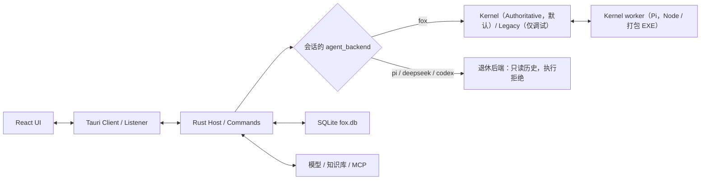

# 调试指南

> 状态：生效<br>
> 适用版本：Fox 0.1.x<br>
> 维护范围：前端、Tauri Host、Kernel、Agent Runtime、外部 Agent 后端、SQLite、知识库与文件预览<br>
> 最后更新：2026-10-28（单 Pi 分支同步；本轮未复跑产品测试）

## 目标与范围

本文给出从用户症状定位到具体层的路径。先判断故障在哪一层，再读那一层的状态，不要反复改 UI 去掩盖数据问题。

## 调试模型



排查顺序：UI 当前状态 → Tauri 调用和事件 → SQLite 事实 → 会话绑定和执行模式（Authoritative / Legacy；退休后端拒绝）→ Pi worker、模型或远程服务。

## 先确认会话走哪条路径

- 新会话 `agent_backend = fox`；旧 `pi`、`deepseek`、`codex` 原值保留，但执行入口返回 `agent_backend_retired`。
- 新 Run 和子 Run 一律冻结为 Authoritative + PiNative，没有路由开关（A0 删除了 `FOX_EXECUTOR_ROUTE`）。`FOX_KERNEL_MODE` 不再决定新 Run 路径。Run 按已冻结绑定处理，不直接改数据库绑定来试错：不认识的 route 报 `executor_route_unknown`；启动时未结束的历史 Kernel Run 以 `executor_route_retired`（「执行路径已退役」）中断，不再续跑。
- 已提交基线 `d0495a3a` 的 v98 原生会话映射在 Legacy 入口；默认 Authoritative 仍不是这套恢复流程。工作区并行实现与验收边界见[单 Pi 主线状态](../01-项目概览/单Pi主线状态.md)。
- 记录候选 SHA、工作区差异、模式、模型、会话 ID、Run ID 与 native 映射，避免把不同路径的结果合并为一次成功。

## Windows 人工测试必须以 Medium 完整性运行

- 测试打包出来的 exe 时，从普通目录运行，例如 `D:\fox-test\`。
- 不要从带 Low 完整性标签的目录（部分下载目录、解压目录）运行。Low 进程写不了 Medium 标签的 `%LOCALAPPDATA%\Fox\state`，会出现 os error 5 “拒绝访问”（SRT 时期还会报 `sandbox_unavailable`）。这和被测功能无关（`crates/fox-agent-backend/docs/sandbox.md` 13.25）。
- 用 GetTokenInformation 查看进程完整性级别，Medium 是 `S-1-16-8192`。
- 先排除这一点，再判断是不是回归。

## 隔离环境

### 独立数据目录

```powershell
$env:FOX_DATA_DIR = "$env:TEMP\fox-debug-$([DateTimeOffset]::Now.ToUnixTimeSeconds())"
pnpm.cmd tauri dev
```

能排除旧数据库、损坏缓存和历史配置的干扰。

### 指定 Runtime 脚本或 EXE

```powershell
$env:FOX_RUNTIME_SCRIPT = "D:\path\to\pi-runtime.mjs"
$env:FOX_RUNTIME_EXECUTABLE = "D:\path\to\fox-agent-runtime-x86_64-pc-windows-msvc.exe"
```

路径必须指向真实文件；EXE 优先于脚本。debug 构建下 `FOX_RUNTIME_MODE=fake` 会把默认脚本换成 `fake-runtime.mjs`；它对 Kernel worker 是否同样生效，本次未核实。

### Kernel worker 诊断

```powershell
$env:FOX_KERNEL_WORKER_STDERR = "inherit"
pnpm.cmd tauri dev
```

worker 的 stderr 会直接输出到终端。默认情况下 Host 只保留 stderr 尾部用于诊断。

### 退休驱动配置

`FOX_PI_ACP_PROGRAM`、`FOX_DSH_PROGRAM`、`FOX_CODEX_ACP_PROGRAM` 与 `FOX_EXTERNAL_BACKENDS` 不能恢复已退休驱动。看到 `agent_backend_retired` 时保留旧会话历史，在新会话使用内置 Pi；不通过改绑定或删除原生会话文件规避错误。

## 前端调试

- 在 Tauri 开发窗口打开 WebView DevTools，看 Console、Network 和 React 状态。
- 核对 `desktop-client.ts` 的 Command 响应，以及 `fox://runtime-event`、`fox://kernel-state-invalidated`、审批、下载进度的 listener。
- 记录 `conversationId`、`runId`、`seq`、事件类型和当前路由。
- 刷新后正常、实时不正常时，比较实时 Reducer 和 `conversation_load` 返回的 SQLite 快照。

关键入口：

- `apps/desktop/src/features/conversations/api/desktop-client.ts`
- `apps/desktop/src/features/conversations/hooks/use-desktop-conversation.ts`
- `apps/desktop/src/features/conversations/hooks/use-runtime-event-stream.ts`
- `apps/desktop/src/features/conversations/hooks/use-kernel-state-stream.ts`
- `apps/desktop/src/features/conversations/model/runtime-event-queue.ts`
- `apps/desktop/src/features/conversations/model/runtime-event-reducer.ts`
- `apps/desktop/src/features/conversations/model/agent-backend.ts`（外部后端错误码的前端镜像）

## Runtime 与 Kernel worker 调试

- Runtime 的 stdout 是 JSONL 协议通道，不能输出普通日志；调试信息写 stderr。
- 独立运行源码只适合协议开发：`pnpm.cmd --dir services/agent-runtime start`（假 Runtime：`start:fake`）。
- 工具错误按数据返回给模型；连续被拒绝有预算上限。重复出现同一个可纠正错误时，先看工具输入是否被模型反复复用（例如 `attemptId` 重名，见 Issue #25）。

## 驱动准入与原生会话调试

- 路由事实源为 `crates/fox-agent-backend/src/host_routing.rs`；当前外部驱动拒绝码为 `agent_backend_retired`，引擎拒绝码为 `kernel_engine_retired`。旧错误目录只用于历史诊断。
- Host 命令不用沙箱：命令问题查 `process_jobs.rs`（Fox Job）、`tool_host.rs` 和审批引擎 `runtime_host/approval_policy.rs`（被拒时看错误码 `permission.blocked` / `permission.read_only` 与 Run 详情里的审计）。不能把外部驱动的 `agent_backend_retired` 解释为需要重装外部运行时：它们计划在阶段三恢复。
- 阶段二记录过 `runtime.process_crashed` / `runtime process closed stdout`，恢复后记录过 `provider.request_failed: 404 model route not found`。两者根因与修复结果需要独立证据，本轮未复现。
- 原生 JSONL 承担模型上下文；SQLite 消息历史可见不代表原生恢复成功。保留文件、映射和脱敏日志；不得把删文件后空上下文新建视为恢复通过。
- 完整差距与验收项见[单 Pi 主线状态](../01-项目概览/单Pi主线状态.md)。

## SQLite 调试

数据库在应用数据目录下的 `fox.db`；开发时用 `FOX_DATA_DIR` 明确位置。

1. 关闭 App，或使用只读连接，避免和 WAL 写入竞争。
2. 先复制 `fox.db`、`fox.db-wal`、`fox.db-shm`。
3. 不要直接改生产数据验证猜测。

```sql
PRAGMA integrity_check;
SELECT MAX(version) FROM schema_migrations;
SELECT id, status, updated_at FROM runs ORDER BY updated_at DESC LIMIT 20;
```

当前 Schema 版本见[数据架构](../02-架构/数据架构.md)。启动时依次做迁移前备份、迁移、缺失 Agent 行修复、中断 Run 修复、资料库和预览缓存的启动恢复；主库失败会弹出“Fox 无法启动”（只在 Windows 上），资料库和缓存问题只降级不阻止启动。步骤顺序见 [Tauri 后端架构](../02-架构/Tauri后端架构.md)。

## 诊断包

设置 →「数据与关于」→「诊断」可以导出诊断包（命令 `diagnostics_export`），写到数据目录的 `exports/fox-diagnostics-<timestamp>.json`。它不包含对话正文、项目文件和凭据明文，但分享前仍应人工检查。

## 常见症状

### 用户消息出现，但回复刷新后才显示

1. 确认 listener 已就绪。
2. 比较事件的 `conversationId` 与当前会话。
3. 看 `seq` 是否停滞、乱序或被去重。
4. 查 SQLite 里 Run 和 Event 是否已完成。
5. 数据库完整，问题在前端队列或 Reducer；数据库也缺，继续查 Host 和 worker。

### 一直“思考中”

- 看 Run 是否已有终态，是否在等审批或用户补充。
- Fox 会话：看 Pi Sidecar 是否崩溃（Run 失败码 `runtime.process_crashed`）。历史 Kernel Run 不会再运行，启动时已标为中断（`executor_route_retired`）。
- 外部会话：目前不可运行（计划恢复）；应用重启时旧外部 Run 会被标为中断。

### “拒绝访问”

先确认 exe 是以 Medium 完整性运行的（见上文），再查代码。

### `Pi Runtime dependencies are missing`

在根目录执行 `pnpm.cmd install --frozen-lockfile`。

### 知识库预览第二页空白或 Range 失败

先运行 `pnpm.cmd knowledge:verify-preview`，检查服务端是否严格支持 HEAD、版本标识和 Range；再查前端缓存区间、PDF Worker、取消信号和旧请求覆盖。

### 白屏

- Vite Console 是否有模块加载错误。
- 1421 端口是否被其他项目的 Vite 占用（`start-desktop-dev.mjs` 会报错而不是复用）。
- 是否混用了包管理器导致 `node_modules` 损坏。
- 启动是否卡在迁移、备份或修复步骤。
- 是否把 Office、图谱、Mermaid、Shiki 等重型依赖改成了首屏静态导入。

## 验证方式

- 用全新 `FOX_DATA_DIR` 排除历史数据。
- 刷新和重启后状态与实时一致。
- 导出诊断包，确认没有敏感正文。
- 给修复点补对应的前端、Runtime、Host 或 backend crate 回归测试。

## 相关代码与文档

- `apps/desktop/src-tauri/src/lib.rs`、`apps/desktop/src-tauri/src/runtime_host/mod.rs`
- `apps/desktop/src-tauri/src/runtime_host/kernel_authority.rs`、`apps/desktop/src-tauri/src/runtime_host/kernel_model_worker.rs`
- `apps/desktop/src-tauri/src/maintenance.rs`、`apps/desktop/src-tauri/src/startup_failure.rs`
- `crates/fox-agent-backend/src/host_routing.rs`、`crates/fox-agent-backend/docs/sandbox.md`
- `services/agent-runtime/src/pi-runtime.mjs`、`services/agent-runtime/src/protocol.mjs`
- [诊断与故障排查](../06-运维指南/诊断与故障排查.md)、[测试指南](测试指南.md)、[Agent 运行时架构](../02-架构/Agent运行时架构.md)
