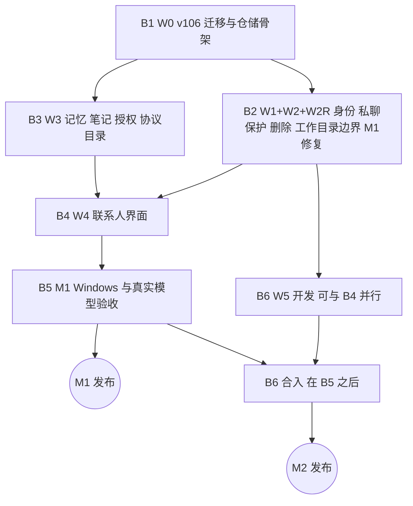

# Fox 联系人（小 Fox）开发方案 v3.1：DDL、命令、协议、分批与验收

- 版本：v3.1 · 日期：2026-11-06
- 基线：`Hry1729/Fox-Agent` main `81cc1b3c1bc27266102f0e3f836c0343ae8849d7`（v3.1 修订前再次 `git fetch && git reset --hard origin/main`，main 未前进；复审引用的源码按此提交逐个重读）
- 设计约束以《Fox联系人改造方案.md》v3.1 为准；本文的 F01–F12、R1–R9 都指那份文档。V1–V7 指《v3 复审意见》的六条问题和模板补充项（V7＝A24 补充），D1–D4 指四个默认决定，见《修订说明.md》第〇节。
- 取代 v3《Fox联系人开发方案.md》。逐条对应见《对照表.md》v3.1。
- 每项验收都标明由谁验证：**CI**（定向或全量）、**Win**（Windows 桌面实测）、**模型**（真实模型对话）。
- 本文中「sqlite3 已验证」「node 已验证」「git 已验证」只指在桩表或小脚本上的设计验证；「读过测试」只表示读了现有测试的代码，**不表示测试通过**。本轮没有编译 Fox，没有跑 CI。

---

## 一 开工前的固定事实

| 项 | 现状（已核实） | 对本方案的影响 |
| --- | --- | --- |
| 运行时 | 只有 PiNative，失败不回退 | 私聊走现有路径 |
| Schema | `DATABASE_SCHEMA_VERSION = 105`（`apps/desktop/src-tauri/src/database/mod.rs#L12`），v100 跳过 | 联系人迁移用 **v106**；合入时被占用就整体顺延到下一个空号，常量名不变；v100 注释改为「弃用」 |
| 工具目录 | 协议事实源 `crates/fox-engine-protocol/src/lib.rs#L245`（`TOOL_CONTRACTS`，73 项）；生成到 `packages/fox-engine-protocol/index.mjs#L2885`；运行时先整表比对 `services/agent-runtime/src/runtime-contract.mjs#L75`，再筛选 `services/agent-runtime/src/pi-runtime.mjs#L797`–`services/agent-runtime/src/pi-runtime.mjs#L822` | 新工具改协议源并重新生成；不能只在运行时增删（本轮 node 复现：替换、删除、追加任一项都抛出目录不匹配） |
| 审批 | 根外写入在询问 / 自动是「问」、完全访问放行（`apps/desktop/src-tauri/src/runtime_host/approval_policy.rs#L356`）；无项目时无项目规则（`apps/desktop/src-tauri/src/database/repositories/permission_rules.rs#L141`） | 私聊硬边界与禁用完全访问要单独实现 |
| 回退 | `run_rewind` 第一个副作用是关闭会话（`apps/desktop/src-tauri/src/commands/mod.rs#L3116`） | 私聊守卫必须放在函数开头 |
| 模型 | 实际模型来自全局 `modelService`（`apps/desktop/src-tauri/src/runtime_host/mod.rs#L2048`、`services/agent-runtime/src/pi-runtime.mjs#L536`） | 首版不建 `model_override` |
| 会话打开判定（V1） | `open_with_live_session` 把映射分为复用 / 恢复 / 接管 / 拒绝（`apps/desktop/src-tauri/src/runtime_host/session_lifecycle.rs#L394`、`apps/desktop/src-tauri/src/runtime_host/session_lifecycle.rs#L285`）。`allocated` 且文件存在但为零字节、旧运行进程已退出时，返回 `session.native_not_persisted`，映射**保持 `allocated`**（读过用例 `apps/desktop/src-tauri/src/runtime_host/context_reset_tests.rs#L1506`）；`reset_availability` 只看玉溪和旧快照（`apps/desktop/src-tauri/src/runtime_host/session_lifecycle.rs#L190`） | v3 只对 `unavailable` 开放修复，这种私聊会卡死；修复入口与修复命令改用同一个「确实无法恢复」判定（第七节） |
| 永久删除的磁盘清理（V2） | `conversation_purge` 在删库前收集附件和产物的 `storage_path`（`apps/desktop/src-tauri/src/commands/mod.rs#L2410`、`apps/desktop/src-tauri/src/database/repositories.rs#L2385`），删库后逐个 `remove_managed_file`，只要求路径在数据目录内（`apps/desktop/src-tauri/src/commands/mod.rs#L2469`）；路径只在内存里 | 联系人工作目录本身在数据目录内，产物表里根内的成果（`artifact_origin='project'`，`apps/desktop/src-tauri/src/runtime_host/artifact_store.rs#L1291`）不能照搬这套清理；路径必须先落库再删行（第六、七节） |
| `git_read`（V3） | 在根目录运行 `git`（`apps/desktop/src-tauri/src/runtime_host/capability_tools.rs#L814`、`apps/desktop/src-tauri/src/runtime_host/capability_tools.rs#L2352`），并解析 `.git` 指针、`commondir`、`include.path`（`apps/desktop/src-tauri/src/runtime_host/capability_tools.rs#L3133`）；没有设 `GIT_CEILING_DIRECTORIES` | 私聊去掉 `git_read`（D2，第八节）；普通项目不变 |
| 记忆单条校验（V5） | `validate_memory_fields` 只限单条 ≤4,000 字符（`apps/desktop/src-tauri/src/database/repositories/memory.rs#L834`）；旧记忆管理页可新增、编辑、启停、确认、采用冲突（`apps/desktop/src/features/agents/agent-pages.tsx#L118`） | 主笔记常驻总量由统一保存规则 + 触发器兜底（第五、九节）；通用入口不再处理联系人条目 |
| 专家技能（V7） | 每轮读专家**当前**启用的技能（`apps/desktop/src-tauri/src/runtime_host/mod.rs#L974`），再与快照声明的 `skills` 取交集（`apps/desktop/src-tauri/src/runtime_host/mod.rs#L658`、`apps/desktop/src-tauri/src/runtime_host/mod.rs#L692`） | 快照只是上限，全局禁用立即生效（第九节第 13 点） |
| 中文检索 | `memory_score` 按非字母数字切词（`apps/desktop/src-tauri/src/database/repositories/memory.rs#L843`），中文整句命中 0 | 专题检索 M1 用二元切词 |
| CI | `.github/workflows/windows-ci.yml`：`targeted=true` 只跑按 `rust_test_filter` 过滤的 Rust Host 测试和 Agent Runtime 构建；Desktop bun、Agent Runtime 全套、协议测试只在全量里跑 | 只改 Rust 的批次走定向；改到协议、`services/agent-runtime`、前端的批次合入前必须全量 |

本地只做 lib 级 check，不在本地编译测试。

## 二 合入流程（每批相同，沿用 v2）

1. 从最新 `origin/main` 建 `feat/fox-contacts-<批次>`。
2. 每完成一块推远端，WIP 提交加 `[skip ci]`。
3. 定向 CI；涉及协议、Agent Runtime 或前端时再跑全量。
4. CI 通过后 main 快进到分支（`force=false`），删分支。
5. main 已前进就在新 main 上重做，不强推、不改写历史。
6. 每批合入后 main 可用：新表可以没人用，新命令可以没入口，但不能有半截界面，也不能出现「后端已开放、守卫未到」的窗口（守卫先于能力合入）。

## 三 工作包与文件归属

路径相对仓库根，「新增」表示新建文件。

| 工作包 | 内容 | 独占文件 | 批次 |
| --- | --- | --- | --- |
| W0 契约与迁移 | v106 DDL、触发器、模型结构、仓储骨架 | `apps/desktop/src-tauri/src/database/mod.rs`（版本与注释）、`database/migrations.rs`（只加 v106 常量、链路、迁移测试）、`database/models.rs`（联系人结构体）、新增 `database/repositories/companions.rs`、新增 `database/repositories/companion_notes.rs`（骨架） | B1 |
| W1 身份、私聊、删除 | 原子创建、小狐、列表、资料、置顶、已读、归档恢复、命名冲突、**删除流程与续做（含内部副本路径落库，V2）**、**模板手动更新**、私聊保护守卫（含 `run_rewind`） | 新增 `src-tauri/src/commands/companions.rs`；`commands/mod.rs` 中 `conversation_delete/purge/archive/fork/change_project/rename`、`conversation_expert_bind/remove`、`conversation_permission_update`、`run_rewind`、`run_start`、`agent_delete`、`conversations_list` 的守卫与过滤；`lib.rs` 注册；`database/repositories.rs` 中 `rewind_run` 开头守卫、列表过滤、`delete_agent` 错误映射；启动流程的小狐初始化与删除续做 | B2 |
| W2 工作目录与文件边界 | 目录准备与修复、导入（复制）、导出、硬边界、私聊禁用完全访问、Host 侧工具准入 | `data_paths.rs`（`companion_workspace`、`companion_notes_dir`）、新增 `src-tauri/src/companion_workspace.rs`、`runtime_host/approval_policy.rs`（新增 `hard_root` 判定与测试，只加不改原表）、`apps/desktop/src-tauri/src/runtime_host/mod.rs#L2833` `ensure_runtime_tool_allowed` 的私聊分支 | B2 |
| W2R M1 修复 | `reset_availability` 加联系人与意图；抽出纯函数 `classify_open`，`context_irrecoverable` 与打开路径共用（V1）；`companion_context_repair` | `runtime_host/session_lifecycle.rs`（`reset_availability` 签名）、`apps/desktop/src-tauri/src/runtime_host/mod.rs#L2248`/`apps/desktop/src-tauri/src/runtime_host/mod.rs#L2312` 的调用、`context_reset_tests.rs` | B2 |
| W3 记忆、笔记、授权、协议 | 4 个新工具进协议目录并重新生成；运行时联系人上下文筛选；Host 执行与准入；写入结果；证据绑定；主笔记、专题文件与索引、整理、撤销、草稿；二元切词检索；读取授权判定；**主笔记统一保存规则 `companion_note_budget`（V5）**；**专题删除事务（V4）**；**共享写入闸门与语义冲突（V6）**；提示组装；OpenMausBot / Rakazo 移植 | `crates/fox-engine-protocol/src/lib.rs`（`TOOL_CONTRACTS` 追加）、`packages/fox-engine-protocol/*`（只由 `scripts/generate-engine-protocol.mjs` 生成）、`services/agent-runtime/src/host-tools.mjs`（只动记忆段）、新增 `services/agent-runtime/src/companion-tools.mjs`（上下文筛选）、`services/agent-runtime/src/pi-runtime.mjs`（只在 `services/agent-runtime/src/pi-runtime.mjs#L797`–`services/agent-runtime/src/pi-runtime.mjs#L822` 之间插入一步筛选）、新增 `services/agent-runtime/src/companion-memory-prompt.mjs`（移植 Rakazo）、`prompt-composer.mjs`（只接记忆区块）、`apps/desktop/src-tauri/src/runtime_host/protocol.rs#L21`、`apps/desktop/src-tauri/src/runtime_host/mod.rs#L5935`/`apps/desktop/src-tauri/src/runtime_host/mod.rs#L6053`（记忆执行）与 `apps/desktop/src-tauri/src/runtime_host/mod.rs#L1992`（召回装配）、`database/repositories/memory.rs`（自动确认参数、用户删除检查、私聊召回、通用记忆命令拒绝联系人条目）、`database/repositories/companion_notes.rs`、新增 `src-tauri/src/companion_notes_files.rs`（专题文件、原子写、切段、二元切词）、`apps/desktop/src-tauri/src/commands/plugin_center.rs#L632`/`apps/desktop/src-tauri/src/commands/plugin_center.rs#L679`（工具说明）、`database/repositories/kernel_host.rs`（审批挂起时允许的只读工具测试表）、新增 `third_party/openmausbot/`、`third_party/rakazo/` | B3 |
| W4 联系人界面 | 侧栏、私聊外观（隐藏编辑 / 重试）、资料面板、笔记页、专题编辑、写入卡片、确认卡片、授权入口（三处）、删除确认框、保留目录列表、修复横幅、导入导出卡片、模板更新提示 | 新增 `apps/desktop/src/features/companions/*`；`features/chat/shell/fox-sidebar.tsx`（只加分组）、`fox-chat-topbar.tsx`、`features/chat/workbench.tsx`（私聊时不传 `onEdit` / `onReload`）、`features/chat/right-panel/fox-right-panel.tsx`、`apps/desktop/src/features/chat/fox-shared.tsx#L83`（`RightMode` 加 `companion`）、`features/chat/composer/fox-composer.tsx`、`features/agents/agent-pages.tsx`（通用记忆页不显示、不处理联系人条目，V5）、`features/settings/settings-agent-page.tsx`（联系人组、项目面板授权分组）、`features/conversations/api/desktop-client.ts`、`model/types.ts`、样式 | B4 |
| W5 M2 会话闭环 | 私聊开放主动重置、完整代次验证 | `runtime_host/session_lifecycle.rs`（放开私聊主动重置）、`stage_two_session_lifecycle_tests.rs`、新增 `runtime_host/companion_session_tests.rs`、顶栏重置入口 | B6 |
| W6 验收 | CI 测试随各批；Windows 与真实模型清单和脚本 | 新增 `docs/windows-test/run-contacts-m1/`、`run-contacts-m2/` | B5、B6 |

### 3.1 共享文件的串行规则

| 文件 | 规则 |
| --- | --- |
| `database/migrations.rs`、`database/mod.rs` | 只有 B1 改；之后要加结构另开新版本号 |
| `commands/mod.rs`、`lib.rs` | B2 改守卫和注册；B3 只追加记忆 / 笔记命令注册；后合入的一批在新 main 上重做 |
| `runtime_host/mod.rs` | B2 只改工具准入私聊分支、重置调用；B3 只改记忆执行与召回装配；B6 只改主动重置；不并行改 |
| `runtime_host/session_lifecycle.rs` | B2 改签名（M1 关主动重置、开修复）；B6 放开主动重置 |
| `crates/fox-engine-protocol/src/lib.rs`、`packages/fox-engine-protocol/*` | 只有 B3；生成物不手改 |
| `services/agent-runtime/src/host-tools.mjs`、`pi-runtime.mjs` | 只有 B3，且只动记忆段和筛选插入点 |
| `features/conversations/api/desktop-client.ts`、`model/types.ts` | 只有 B4 |

## 四 依赖与并行



- B1 先合入。
- B2、B3 可并行开发：B2 管命令、守卫、审批、工作目录、生命周期；B3 管协议、运行时、记忆仓储。交界只有两处：① B2 的 Host 工具准入只按「工具类别」拒绝，B3 才把新工具加进目录——B2 先合入时新工具还不存在，不影响；② 删除流程（B2）删除笔记目录和笔记行，表在 B1 已存在，文件在 B3 才产生，B2 的删除测试用夹具文件覆盖。
- **守卫先于能力**：B2 必须在 B4 之前合入，保证界面出现时私聊保护、硬边界、删除流程都已在后端生效。
- B4 可用夹具先做，等 B2、B3 合入后接真接口。
- B6 在 B5 之后合入。

## 五 迁移 DDL（v106，若被占用则顺延）

常量建议 `COMPANIONS_SCHEMA_VERSION = 106` / `MIGRATION_106_COMPANIONS`，加在 `apply_migration(..., AGENT_BINDINGS_SCHEMA_VERSION, ...)` 之后，`DATABASE_SCHEMA_VERSION` 升到 106。只有新表、`ADD COLUMN` 和触发器，不重建、不删旧表旧列。

**v3 已用 sqlite3 3.46.1 在桩表上执行 DDL 并跑过 12 组用例**（A 私聊写 B 笔记被拒、回退删消息被拒、小狐拒删、删除流程放行等）。**v3.1 在同一份 DDL 上做了三组修改（V2 删除路径、V4 专题软删、V5 常驻上限）**（下文标「v3.1」），并重新验证：

- v3 的 12 组用例在 v3.1 DDL 上逐条结果相同（唯一调整：第 10 组改 `done` 前先写 `db_purged_at`，这是 v3.1 新守卫要求的）。
- V4：v3 DDL 下软删专题后片段仍为 1 段、仍能按独有报价号查到（复现复审结论）；v3.1 下为 0 段，整理记录变 `topic_deleted`，移入该专题的主笔记行被软删；已删专题不能再写片段、不能复活；事务回滚时片段一起回来。
- V5：常驻 3,400 + 500 + 100 = 4,000；移走 500 后用户补 400 到 3,900；此时撤销整理、重新启用 200 字、改写变长、采用冲突条目都被 `companion_note_budget_exceeded` 拒绝；候选确认在额度内成功；共享层、专家作用域不受影响。`length('中a😀')=3`，与 `chars().count()` 口径一致。
- V2：真实临时文件 + sqlite3 文件库：未保存路径就删私聊被拒；路径分类后删库；删第一个文件后中断，改 `done` 被拒；续做只依据删除记录里的路径完成；工作目录里的导入副本和根内成果都在，附件副本、Host 私有产物、计算工作区、笔记目录都不在。

脚本和输出在项目工作目录 `contacts-v31-repro/`（见《修订说明》第八节）。这些是设计审查证据，不代替 B1 的迁移测试。

```sql
-- v106 COMPANIONS_SCHEMA_VERSION（若被占用则整体顺延）· 方案 v3.1

-- 联系人 ID 前缀保留给联系人，专家与助手不得使用
CREATE TRIGGER agents_reserved_companion_prefix
BEFORE INSERT ON agents
WHEN substr(NEW.id, 1, 4) = 'cmp_'
BEGIN
    SELECT RAISE(ABORT, 'agent_id_reserved_prefix');
END;

CREATE TABLE companion_profiles (
    id TEXT PRIMARY KEY CHECK (substr(id, 1, 4) = 'cmp_' AND length(id) > 4),
    template_agent_id TEXT NOT NULL REFERENCES agents(id) ON DELETE RESTRICT,
    display_name TEXT NOT NULL CHECK (length(trim(display_name)) BETWEEN 1 AND 40),
    avatar_ref TEXT NOT NULL DEFAULT '',
    duty TEXT NOT NULL DEFAULT '',
    persona_override TEXT,
    workspace_dir TEXT NOT NULL,
    notes_dir TEXT NOT NULL,
    workspace_state TEXT NOT NULL DEFAULT 'pending'
        CHECK (workspace_state IN ('pending', 'ready', 'failed', 'missing')),
    workspace_error TEXT,
    is_default INTEGER NOT NULL DEFAULT 0 CHECK (is_default IN (0, 1)),
    pinned_at INTEGER,
    last_read_ordinal INTEGER NOT NULL DEFAULT 0 CHECK (last_read_ordinal >= 0),
    template_notice_dismissed_hash TEXT,
    archived_at INTEGER,
    deleting_at INTEGER,
    created_at INTEGER NOT NULL,
    updated_at INTEGER NOT NULL
);

CREATE UNIQUE INDEX idx_companion_profiles_template
    ON companion_profiles(template_agent_id);
CREATE UNIQUE INDEX idx_companion_profiles_active_name
    ON companion_profiles(lower(trim(display_name)))
    WHERE archived_at IS NULL AND deleting_at IS NULL;
CREATE UNIQUE INDEX idx_companion_profiles_single_default
    ON companion_profiles(is_default) WHERE is_default = 1;
CREATE INDEX idx_companion_profiles_sidebar
    ON companion_profiles(archived_at, pinned_at DESC, updated_at DESC);

-- 删除记录：删除流程的唯一放行凭证，也是“保留目录”入口的数据来源。不设外键，比联系人活得久
CREATE TABLE companion_deletions (
    companion_id TEXT PRIMARY KEY CHECK (substr(companion_id, 1, 4) = 'cmp_'),
    template_agent_id TEXT NOT NULL,
    display_name TEXT NOT NULL,
    retained_workspace_path TEXT,
    plan_json TEXT NOT NULL,
    plan_hash TEXT NOT NULL,
    state TEXT NOT NULL CHECK (state IN ('deleting', 'done')),
    error TEXT,
    files_collected_at INTEGER,
    db_purged_at INTEGER,
    started_at INTEGER NOT NULL,
    finished_at INTEGER,
    retained_dismissed_at INTEGER
);

-- v3.1：删除前保存的磁盘路径（续做依据）。只能在“已写删除记录、尚未删库”时写入
CREATE TABLE companion_deletion_files (
    companion_id TEXT NOT NULL REFERENCES companion_deletions(companion_id) ON DELETE CASCADE,
    path TEXT NOT NULL,
    kind TEXT NOT NULL CHECK (kind IN ('attachment', 'artifact', 'compute_dir')),
    disposition TEXT NOT NULL CHECK (disposition IN ('remove', 'retain')),
    state TEXT NOT NULL DEFAULT 'pending' CHECK (state IN ('pending', 'removed', 'kept')),
    error TEXT,
    PRIMARY KEY (companion_id, path)
);

CREATE TRIGGER companion_deletion_files_before_purge
BEFORE INSERT ON companion_deletion_files
WHEN NOT EXISTS (SELECT 1 FROM companion_deletions d
                 WHERE d.companion_id = NEW.companion_id AND d.state = 'deleting'
                   AND d.files_collected_at IS NULL AND d.db_purged_at IS NULL)
BEGIN
    SELECT RAISE(ABORT, 'companion_deletion_files_too_late');
END;

-- 删除记录只有在“已删库且所有待删文件都处理完”后才能改 done
CREATE TRIGGER companion_deletions_done_guard
BEFORE UPDATE OF state ON companion_deletions
WHEN NEW.state = 'done' AND (
       NEW.db_purged_at IS NULL
    OR EXISTS (SELECT 1 FROM companion_deletion_files f
               WHERE f.companion_id = NEW.companion_id
                 AND f.disposition = 'remove' AND f.state = 'pending'))
BEGIN
    SELECT RAISE(ABORT, 'companion_deletion_incomplete');
END;

-- 默认小狐不能进入删除流程
CREATE TRIGGER companion_deletions_default_guard
BEFORE INSERT ON companion_deletions
WHEN EXISTS (SELECT 1 FROM companion_profiles p
             WHERE p.id = NEW.companion_id AND p.is_default = 1)
BEGIN
    SELECT RAISE(ABORT, 'companion_default_not_deletable');
END;

CREATE TRIGGER companion_profiles_delete_guard
BEFORE DELETE ON companion_profiles
WHEN OLD.is_default = 1
  OR NOT EXISTS (SELECT 1 FROM companion_deletions d
                 WHERE d.companion_id = OLD.id AND d.state = 'deleting'
                   AND d.files_collected_at IS NOT NULL)
BEGIN
    SELECT RAISE(ABORT, 'companion_delete_requires_flow');
END;

CREATE TRIGGER companion_profiles_template_immutable
BEFORE UPDATE OF template_agent_id ON companion_profiles
WHEN NEW.template_agent_id IS NOT OLD.template_agent_id
BEGIN
    SELECT RAISE(ABORT, 'companion_template_immutable');
END;

CREATE TRIGGER companion_profiles_default_flag_immutable
BEFORE UPDATE OF is_default ON companion_profiles
WHEN NEW.is_default IS NOT OLD.is_default
BEGIN
    SELECT RAISE(ABORT, 'companion_default_flag_immutable');
END;

ALTER TABLE conversations ADD COLUMN companion_id TEXT
    REFERENCES companion_profiles(id) ON DELETE RESTRICT;
CREATE UNIQUE INDEX idx_conversations_companion
    ON conversations(companion_id) WHERE companion_id IS NOT NULL;

CREATE TRIGGER conversations_companion_insert_guard
BEFORE INSERT ON conversations
WHEN NEW.companion_id IS NOT NULL AND (
       NEW.agent_backend <> 'fox'
    OR NEW.conversation_kind <> 'primary'
    OR NEW.project_id IS NOT NULL
    OR NEW.parent_conversation_id IS NOT NULL
    OR NEW.trashed_at IS NOT NULL
    OR NEW.archived <> 0
    OR NEW.full_access <> 0
)
BEGIN
    SELECT RAISE(ABORT, 'companion_chat_invalid_shape');
END;

CREATE TRIGGER conversations_companion_immutable
BEFORE UPDATE OF companion_id ON conversations
WHEN NEW.companion_id IS NOT OLD.companion_id
BEGIN
    SELECT RAISE(ABORT, 'companion_binding_immutable');
END;

CREATE TRIGGER conversations_companion_lifecycle
BEFORE UPDATE OF trashed_at, archived ON conversations
WHEN OLD.companion_id IS NOT NULL
 AND (NEW.trashed_at IS NOT NULL OR NEW.archived <> 0)
BEGIN
    SELECT RAISE(ABORT, 'companion_chat_lifecycle');
END;

CREATE TRIGGER conversations_companion_project
BEFORE UPDATE OF project_id, project_root ON conversations
WHEN OLD.companion_id IS NOT NULL
 AND (NEW.project_id IS NOT NULL OR NEW.project_root IS NOT OLD.project_root)
BEGIN
    SELECT RAISE(ABORT, 'companion_chat_project_locked');
END;

CREATE TRIGGER conversations_companion_full_access
BEFORE UPDATE OF full_access ON conversations
WHEN OLD.companion_id IS NOT NULL AND NEW.full_access <> 0
BEGIN
    SELECT RAISE(ABORT, 'companion_chat_full_access_refused');
END;

CREATE TRIGGER conversations_companion_no_delete
BEFORE DELETE ON conversations
WHEN OLD.companion_id IS NOT NULL
 AND NOT EXISTS (SELECT 1 FROM companion_deletions d
                 WHERE d.companion_id = OLD.companion_id AND d.state = 'deleting'
                   AND d.files_collected_at IS NOT NULL)
BEGIN
    SELECT RAISE(ABORT, 'companion_chat_delete_refused');
END;

-- 回退（run_rewind）与任何删消息的路径：私聊消息只追加
CREATE TRIGGER messages_companion_append_only
BEFORE DELETE ON messages
WHEN EXISTS (SELECT 1 FROM conversations c
             WHERE c.id = OLD.conversation_id AND c.companion_id IS NOT NULL)
 AND NOT EXISTS (SELECT 1 FROM conversations c
                 JOIN companion_deletions d ON d.companion_id = c.companion_id
                 WHERE c.id = OLD.conversation_id AND d.state = 'deleting')
BEGIN
    SELECT RAISE(ABORT, 'companion_chat_append_only');
END;

-- 记忆：新增列（ADD COLUMN，不重建表）
ALTER TABLE memory_entities ADD COLUMN moved_at INTEGER;
ALTER TABLE memory_entities ADD COLUMN moved_topic_id TEXT;
ALTER TABLE memory_entities ADD COLUMN source_companion_id TEXT;
ALTER TABLE memory_entities ADD COLUMN source_label TEXT;
ALTER TABLE memory_entities ADD COLUMN evidence_basis TEXT
    CHECK (evidence_basis IS NULL OR evidence_basis IN ('user_stated', 'assistant_inferred', 'attachment'));

-- 主笔记归属：联系人必须存在且未在删除中；来源会话若有，必须是该联系人自己的私聊
CREATE TRIGGER memory_companion_notes_owner
BEFORE INSERT ON memory_entities
WHEN NEW.scope = 'agent' AND substr(NEW.scope_key, 1, 4) = 'cmp_' AND (
       NOT EXISTS (SELECT 1 FROM companion_profiles p
                   WHERE p.id = NEW.scope_key AND p.deleting_at IS NULL)
    OR (NEW.source_conversation_id IS NOT NULL AND NOT EXISTS (
            SELECT 1 FROM conversations c
            WHERE c.id = NEW.source_conversation_id AND c.companion_id = NEW.scope_key))
)
BEGIN
    SELECT RAISE(ABORT, 'memory_companion_owner_mismatch');
END;

CREATE TRIGGER memory_companion_notes_scope_immutable
BEFORE UPDATE OF scope, scope_key, source_conversation_id ON memory_entities
WHEN (substr(OLD.scope_key, 1, 4) = 'cmp_' OR substr(NEW.scope_key, 1, 4) = 'cmp_')
 AND (NEW.scope IS NOT OLD.scope OR NEW.scope_key IS NOT OLD.scope_key
      OR (NEW.source_conversation_id IS NOT NULL
          AND NEW.source_conversation_id IS NOT OLD.source_conversation_id))
BEGIN
    SELECT RAISE(ABORT, 'memory_companion_scope_immutable');
END;

CREATE TRIGGER memory_companion_notes_hard_delete
BEFORE DELETE ON memory_entities
WHEN OLD.scope = 'agent' AND substr(OLD.scope_key, 1, 4) = 'cmp_'
 AND NOT EXISTS (SELECT 1 FROM companion_deletions d
                 WHERE d.companion_id = OLD.scope_key AND d.state = 'deleting')
BEGIN
    SELECT RAISE(ABORT, 'memory_companion_hard_delete_refused');
END;

-- v3.1：主笔记常驻字数硬上限（所有入口的兜底；仓储按 note_chars 规范化后再存，length() 计 Unicode 码点）
CREATE TRIGGER memory_companion_notes_budget_insert
AFTER INSERT ON memory_entities
WHEN NEW.scope = 'agent' AND substr(NEW.scope_key, 1, 4) = 'cmp_'
 AND (SELECT COALESCE(SUM(length(m.content)), 0) FROM memory_entities m
      WHERE m.scope = 'agent' AND m.scope_key = NEW.scope_key
        AND m.state = 'confirmed' AND m.enabled = 1
        AND m.deleted_at IS NULL AND m.moved_at IS NULL) > 4000
BEGIN
    SELECT RAISE(ABORT, 'companion_note_budget_exceeded');
END;

CREATE TRIGGER memory_companion_notes_budget_update
AFTER UPDATE OF content, state, enabled, deleted_at, moved_at ON memory_entities
WHEN NEW.scope = 'agent' AND substr(NEW.scope_key, 1, 4) = 'cmp_'
 AND (SELECT COALESCE(SUM(length(m.content)), 0) FROM memory_entities m
      WHERE m.scope = 'agent' AND m.scope_key = NEW.scope_key
        AND m.state = 'confirmed' AND m.enabled = 1
        AND m.deleted_at IS NULL AND m.moved_at IS NULL) > 4000
BEGIN
    SELECT RAISE(ABORT, 'companion_note_budget_exceeded');
END;

CREATE INDEX idx_memory_entities_companion_notes
    ON memory_entities(scope_key, deleted_at, moved_at, state, enabled)
    WHERE scope = 'agent' AND substr(scope_key, 1, 4) = 'cmp_';

-- 专题：正文在 Markdown 文件，这里是索引
CREATE TABLE companion_note_topics (
    id TEXT PRIMARY KEY CHECK (substr(id, 1, 4) = 'ntp_'),
    companion_id TEXT NOT NULL REFERENCES companion_profiles(id) ON DELETE CASCADE,
    title TEXT NOT NULL CHECK (length(trim(title)) BETWEEN 1 AND 60),
    file_name TEXT NOT NULL,
    aliases_json TEXT NOT NULL DEFAULT '[]',
    created_by TEXT NOT NULL CHECK (created_by IN ('user', 'agent')),
    revision INTEGER NOT NULL DEFAULT 1,
    content_sha256 TEXT NOT NULL,
    char_count INTEGER NOT NULL DEFAULT 0,
    created_at INTEGER NOT NULL,
    updated_at INTEGER NOT NULL,
    deleted_at INTEGER,
    UNIQUE (companion_id, file_name)
);
CREATE UNIQUE INDEX idx_companion_note_topics_title
    ON companion_note_topics(companion_id, lower(trim(title))) WHERE deleted_at IS NULL;

-- 检索索引（可随时由文件重建）
CREATE TABLE companion_note_chunks (
    topic_id TEXT NOT NULL REFERENCES companion_note_topics(id) ON DELETE CASCADE,
    ordinal INTEGER NOT NULL,
    heading TEXT NOT NULL DEFAULT '',
    text TEXT NOT NULL,
    bigrams TEXT NOT NULL,
    topic_revision INTEGER NOT NULL,
    PRIMARY KEY (topic_id, ordinal)
);

-- 整理日志：一次“移入专题”一行，供资料页显示去向和撤销
CREATE TABLE companion_note_moves (
    id TEXT PRIMARY KEY,
    companion_id TEXT NOT NULL REFERENCES companion_profiles(id) ON DELETE CASCADE,
    topic_id TEXT NOT NULL REFERENCES companion_note_topics(id) ON DELETE CASCADE,
    run_id TEXT,
    memory_ids_json TEXT NOT NULL,
    topic_sha_before TEXT,
    topic_sha_after TEXT,
    state TEXT NOT NULL CHECK (state IN ('applied', 'failed', 'undone', 'topic_deleted')),
    error TEXT,
    created_at INTEGER NOT NULL,
    undone_at INTEGER
);

-- v3.1：专题软删在同一事务里清掉片段、作废整理记录、软删移入该专题的条目；不可复活；已删专题不得再写片段
CREATE TRIGGER companion_note_topics_soft_delete
AFTER UPDATE OF deleted_at ON companion_note_topics
WHEN OLD.deleted_at IS NULL AND NEW.deleted_at IS NOT NULL
BEGIN
    DELETE FROM companion_note_chunks WHERE topic_id = NEW.id;
    UPDATE companion_note_moves SET state = 'topic_deleted'
     WHERE topic_id = NEW.id AND state = 'applied';
    UPDATE memory_entities SET enabled = 0, deleted_at = NEW.deleted_at
     WHERE scope = 'agent' AND scope_key = NEW.companion_id
       AND moved_topic_id = NEW.id AND deleted_at IS NULL;
END;

CREATE TRIGGER companion_note_topics_no_undelete
BEFORE UPDATE OF deleted_at ON companion_note_topics
WHEN OLD.deleted_at IS NOT NULL AND NEW.deleted_at IS NOT OLD.deleted_at
BEGIN
    SELECT RAISE(ABORT, 'companion_topic_deleted_final');
END;

CREATE TRIGGER companion_note_chunks_live_topic
BEFORE INSERT ON companion_note_chunks
WHEN EXISTS (SELECT 1 FROM companion_note_topics t
             WHERE t.id = NEW.topic_id AND t.deleted_at IS NOT NULL)
BEGIN
    SELECT RAISE(ABORT, 'companion_topic_deleted');
END;

-- 待用户确认的笔记操作：改写、删除或移出“用户写过的”主笔记条目
CREATE TABLE companion_note_requests (
    id TEXT PRIMARY KEY,
    companion_id TEXT NOT NULL REFERENCES companion_profiles(id) ON DELETE CASCADE,
    memory_id TEXT NOT NULL REFERENCES memory_entities(id) ON DELETE CASCADE,
    expected_version INTEGER NOT NULL,
    action TEXT NOT NULL CHECK (action IN ('patch', 'remove', 'move')),
    payload_json TEXT NOT NULL DEFAULT '{}',
    run_id TEXT,
    status TEXT NOT NULL CHECK (status IN ('open', 'approved', 'rejected', 'stale')),
    created_at INTEGER NOT NULL,
    resolved_at INTEGER
);
CREATE INDEX idx_companion_note_requests_open
    ON companion_note_requests(companion_id, status) WHERE status = 'open';

-- 用户手写主笔记超限时保留的草稿
CREATE TABLE companion_note_drafts (
    companion_id TEXT PRIMARY KEY REFERENCES companion_profiles(id) ON DELETE CASCADE,
    content TEXT NOT NULL,
    char_count INTEGER NOT NULL,
    updated_at INTEGER NOT NULL
);

-- 项目授权：项目 × 具体联系人
CREATE TABLE companion_project_grants (
    id TEXT PRIMARY KEY,
    project_id TEXT NOT NULL REFERENCES projects(id) ON DELETE CASCADE,
    companion_id TEXT NOT NULL REFERENCES companion_profiles(id) ON DELETE CASCADE,
    granted_at INTEGER NOT NULL,
    revoked_at INTEGER
);
CREATE UNIQUE INDEX idx_companion_project_grants_live
    ON companion_project_grants(project_id, companion_id) WHERE revoked_at IS NULL;

CREATE TRIGGER companion_project_grants_guard
BEFORE INSERT ON companion_project_grants
WHEN NOT EXISTS (SELECT 1 FROM companion_profiles p
                 WHERE p.id = NEW.companion_id AND p.is_default = 0 AND p.deleting_at IS NULL)
BEGIN
    SELECT RAISE(ABORT, 'companion_grant_invalid_target');
END;
```

**说明**

- 删除流程靠 `companion_deletions.state='deleting'` 放行：普通删除入口、直接 SQL、回退都不会写这行，所以都被触发器拒绝。小狐有专门的触发器挡在删除记录插入之前。
- `memory_companion_notes_owner` 修正了交接单复现的问题：来源会话必须是本人私聊。笔记**正文的修改**无法由触发器判断调用者，主保障是仓储层的更新语句一律带 `AND scope = 'agent' AND scope_key = ?owner`，归属来自 Host 解析的会话；条目不属于当前联系人时影响 0 行，返回 `memory.not_found`。
- 专题正文不进数据库；`companion_note_chunks` 可由文件重建，**重建只针对 `deleted_at IS NULL` 的专题**（触发器 `companion_note_chunks_live_topic` 兜底）。
- **v3.1 · V4 专题软删**：`companion_note_topics_soft_delete` 在设置 `deleted_at` 的同一语句里删除片段、把 `applied` 整理记录改成 `topic_deleted`、软删 `moved_topic_id` 指向它的主笔记行；`companion_note_topics_no_undelete` 不许复活。ON DELETE CASCADE 只管物理删除（删除联系人时），软删不会触发它，这正是 v3 的漏洞。仓储在同一事务里另写 `memory_revisions`（actor `user`，原因 `topic_deleted`），所以这些条目同样受「用户删过不复活」保护。
- **v3.1 · V5 常驻上限兜底**：`memory_companion_notes_budget_insert` / `_update` 在任何让常驻条目（`confirmed`、`enabled=1`、未删除、未移走）合计超过 4,000 的写入后中止该语句。仓储按 `note_chars` 规范化（CRLF→LF、去首尾空白）后再存，SQLite `length()` 计 Unicode 码点，与 `chars().count()` 一致。正常路径由第九节的统一保存规则先算好并返回 `overBy`，触发器只是兜底，命中它说明有入口漏走了规则，应作缺陷处理。
- **v3.1 · V2 删除路径落库**：`companion_deletion_files` 只能在「已写删除记录、尚未标记已收集、尚未删库」时插入；私聊和身份的删除触发器改为要求 `files_collected_at IS NOT NULL`，即**先存路径再删行**；`companion_deletions_done_guard` 要求 `db_purged_at` 已写且没有待删文件，才能改为 `done`。
- 不建 `model_override`（F12；D1 默认沿用全局模型，待用户最终确认）。`persona_override`、`duty` 保留。
- 不需要新表的项：小狐初始化标记（`app_settings`）、模板快照（`conversation_expert_bindings`）、共享冲突（`memory_conflicts`）。

**迁移测试（B1）**：空库建到 v106；v105 库升级；上述所有触发器正反例（直接 SQL，含 v3.1 的专题软删、常驻上限、删除路径三组）；`check_foreign_keys_after_migration` 通过；当前版本断言改为 `COMPANIONS_SCHEMA_VERSION`；v98/v99/v105 历史常量与测试不变。

## 六 磁盘布局与文件归属

| 路径（相对数据目录） | 内容 | 谁写 | 删除联系人时 |
| --- | --- | --- | --- |
| `companions/<id>/workspace/` | 工作成果；`收到的文件/` 为导入副本 | 私聊文件工具（根内）、用户导入 | **保留** |
| `companions/<id>/notes/topics/<topic_id>.md` | 专题正文 | Host 笔记仓储（原子写），用户在资料页编辑 | 删除 |
| `runtime-sessions/...` | Pi 原生会话 JSONL（所有代次） | 运行时 | 删除（`purge_conversation_session_files`，`apps/desktop/src-tauri/src/runtime_host/mod.rs#L2292`） |
| `attachments/...` | 私聊附件的托管副本（`attachments.storage_path`） | Host | **删除**（v3.1，V2）：路径先写入 `companion_deletion_files` |
| `artifacts/...` | Host 私有产物，如预览、中间文件（`artifacts.artifact_origin='host_private'`） | Host | **删除**（v3.1，V2）：同上 |
| `runtime-sessions/attachment-compute/<sha256(私聊ID)>/` | `attachment_compute` 的计算工作区（`apps/desktop/src-tauri/src/runtime_host/attachment_compute.rs#L601`） | Host | **删除**（v3.1，V2）：整目录作为一条 `compute_dir` 记录；现有 `purge_owned_session_files` 是否已覆盖它，B2 核对后二选一，不重复删 |
| 数据库 | 见第五节 | Host | 按 F10 清单 |

笔记目录在工作目录之外，私聊文件工具的根不包含它。

**v3.1 · 内部副本的归属判定（V2）**：私聊的 `attachments` / `artifacts` 行全部算「该私聊拥有」。对每条 `storage_path` 先 `canonicalize`（文件已不存在时规范化最近的已存在上级）：

| 位置 | 处置 | 理由 |
| --- | --- | --- |
| 在本联系人 `workspace/` 内（含 `artifact_origin='project'` 的成果、`收到的文件/` 里的导入副本） | `retain`，不删 | 工作成果默认保留（Q9） |
| 在数据目录内、工作目录外（`attachments/`、`artifacts/`、计算工作区） | `remove` | 只有这个私聊用，联系人删除后没有入口能打开 |
| 在数据目录外 | 忽略，不删 | 与 `remove_managed_file` 一致：Host 不删自己不托管的文件 |
| 在**其他**联系人的工作目录内，或被其他会话的 `attachments` / `artifacts` 行引用 | `retain` 并在清单里列出 | 不删别人的东西；正常不会出现 |

不能直接复用 `conversation_purge` 的清理：它只判断「在数据目录内」，而联系人工作目录本身就在数据目录内，根内成果会被当作托管文件删掉（本轮脚本对照验证了这一点）。

## 七 Host 命令

错误码以 `companion.` / `memory.` 开头，附可直接展示的中文。

| 命令 | 批次 | 作用 | 拒绝条件 |
| --- | --- | --- | --- |
| `companions_list` | B2 | 侧栏与设置列表（含未读、运行状态、删除未完成） | — |
| `companion_add_from_expert` | B2 | 建身份 + 私聊 + 绑定，准备目录 | 非本机专家；正在删除 |
| `companion_open` / `companion_update_profile` / `companion_set_pinned` / `companion_mark_read` | B2 | 打开、改名头像职责、置顶、已读 | 改名重名 |
| `companion_archive` / `companion_restore` | B2 | 归档（关闭 worker 会话）、恢复 | 有活动 Run |
| `companion_ensure_default` | B2 | 启动时建小狐 | — |
| `companion_delete_preview` | B2 | 生成删除清单与哈希 | 小狐；有活动 Run |
| `companion_delete` | B2 | 按清单删除（F10 四步） | 小狐；清单哈希不符；有活动 Run；被数字同事或工作图引用 |
| `companion_delete_resume` | B2 | 续做 `deleting` 的删除（启动时自动调用一次） | — |
| `companion_retained_list` / `companion_retained_open` / `companion_retained_dismiss` | B2 | 已删除联系人留下的文件 | — |
| `companion_template_status` / `companion_template_update` | B2 | 比较快照哈希；采用新版（换绑定） | 有活动 Run；哈希已变 |
| `companion_workspace_repair` | B2 | 重新创建工作目录 | — |
| `companion_import_files` | B2 | 用户把文件复制进工作目录 | 源不可读；目标不可写 |
| `companion_export_file` | B2 | 用户另存为 | 源不在根内 |
| `companion_context_repair` | B2 | M1 修复后继续 | 非私聊；`context_irrecoverable` 为假（返回 `companion.repair_not_needed`，什么都不改）；有活动 Run；工作目录不可用 |
| `companion_notes_get` | B3 | 主笔记、用量、专题列表、整理记录、待确认卡片、草稿 | — |
| `companion_note_save_user` | B3 | 用户新增 / 修改主笔记条目 | 超限（返回 `overBy`，不写主笔记，手写内容存草稿） |
| `companion_note_set_enabled` | B3 | 用户停用 / 重新启用主笔记条目（v3.1，取代通用 `memory_set_enabled`） | 重新启用会超限（返回 `overBy`，条目保持停用） |
| `companion_note_draft_save` / `companion_note_draft_to_topic` | B3 | 草稿自动保存；转存为专题 | — |
| `companion_topic_read` / `companion_topic_save` / `companion_topic_delete` | B3 | 用户读写专题（带期望哈希，冲突返回当前文本、保留草稿）；删除按第九节第 14 点在一个事务里完成 | 哈希不符；专题已删除 |
| `companion_note_request_resolve` | B3 | 同意 / 拒绝待确认卡片 | 版本已变（标 `stale`）；同意一个会增加常驻字数的改写超限（返回 `overBy`，卡片保持 `open`） |
| `companion_shared_request_resolve` | B3 | 共享记忆确认卡片：以后都这样 / 只这次 / 不记（v3.1，V6） | 卡片已处理；所指旧条目版本已变 |
| `companion_memory_undo` | B3 | 撤销「本次新增」 | 不是本 Run 创建的第 1 版 |
| `companion_note_move_undo` | B3 | 撤销一次整理 | 专题哈希已变；整理记录不是 `applied`（含专题已删）；撤回后常驻超限（返回 `overBy`，什么都不改） |
| `companion_grant_project` / `companion_revoke_project` / `companion_grants_list` | B3 | 项目授权 | 小狐；联系人删除中；项目不存在 |
| `memories_list` 增加 `companionId` 过滤 | B3 | 笔记页 | — |
| 通用 `memory_create` / `memory_update` / `memory_set_enabled` / `memory_confirm` / `memory_conflict_resolve` / `memory_delete`（`apps/desktop/src-tauri/src/commands/mod.rs#L626`–`apps/desktop/src-tauri/src/commands/mod.rs#L686`） | B3 | 遇到 `scope='agent'` 且 `scope_key` 以 `cmp_` 开头的条目或请求（v3.1，V5） | 一律返回 `companion.notes_dedicated_entry`：「请在 XX 的资料页管理笔记」，不做任何修改 |

**私聊守卫（B2）**：`conversation_delete`、`conversation_purge`、`conversation_archive`、`conversation_fork`、`conversation_change_project`、`conversation_rename`、`conversation_expert_bind` / `remove`、`conversation_permission_update`（开完全访问）、**`run_rewind`** 遇到私聊，在函数第一段（读取 runtime 之前、`remove_conversation` 之前）返回 `companion.chat_protected` / `companion.chat_append_only`；`rewind_run`（`apps/desktop/src-tauri/src/database/repositories.rs#L5637`）事务开头再查。`run_start` 遇到已归档或删除中的联系人返回 `companion.archived` / `companion.deleting`。列表类命令排除私聊。

**删除流程（B2，v3.1 改写，V2）**：

1. `companion_delete_preview`：统计消息数、主笔记条数、专题数、授权（项目名）、会话代次数、工作目录路径 / 文件数 / 大小、由它记下的共享条目数；**列出该私聊拥有、位于工作目录外的内部副本**（附件副本、Host 私有产物、计算工作区：个数与大小），以及工作目录内被产物表记录的成果（保留）；检查数字同事（`apps/desktop/src-tauri/src/database/migrations.rs#L1128`）和工作图（`apps/desktop/src-tauri/src/database/migrations.rs#L4130`）对私聊的引用；生成 `plan_json` 和哈希。
2. `companion_delete(planHash)`：在运行转换锁内确认无活动 Run，重算清单比对哈希。**一个事务**：写 `companion_deletions(state='deleting')`；置 `deleting_at`；给由它记下的共享条目补 `source_label`；按第六节规则对私聊的每条 `attachments` / `artifacts` 路径和计算工作区写一行 `companion_deletion_files(disposition=remove|retain)`；最后写 `files_collected_at`。**路径在这一步落库，早于任何删除。**
3. 关闭会话并清除会话文件；删除 `notes/` 目录。
4. 一个事务：物理删除笔记行（级联修订、冲突、召回审计、待确认卡片）→ 删除私聊（级联消息、Run、映射、绑定、`attachments`、`artifacts` 等）→ 删除身份（级联专题索引、片段、整理记录、草稿、授权）→ 写 `db_purged_at`、`retained_workspace_path`。触发器保证没有 `files_collected_at` 时这一步不能执行。
5. 逐条处理 `companion_deletion_files` 中 `remove` 且 `pending` 的路径：删除前再规范化一次，若落在任何联系人的工作目录内或数据目录外就改为 `kept` 并记原因；文件已不存在视为完成；每删一条立即改 `removed`。
6. 全部处理完后改 `state='done'`（触发器拒绝过早改 `done`），返回实际删除计数，与清单逐项比对写入交付记录（A04 的断言依据）。
7. **续做**（`companion_delete_resume`，启动时自动一次，也可从设置里点）：读 `companion_deletions` 当前进度决定从哪一步接着做——`files_collected_at` 为空：重做第 2 步的路径收集（此时库行都还在）；`db_purged_at` 为空：从第 3 步起；否则从第 5 步起。第 5 步只依据已落库的路径，不再查已删除的 `attachments` / `artifacts` 表。每一步都幂等。任一步失败：保持 `deleting`、记 `error`，设置里显示「删除未完成 · 继续删除」。

**M1 修复（B2，v3.1 改写，V1）**：

- **同一判定**：把 `open_with_live_session`（`apps/desktop/src-tauri/src/runtime_host/session_lifecycle.rs#L394`）里决定「复用 / 恢复 / 接管 / 拒绝」的那段抽成无副作用的纯函数 `classify_open(mapping, persisted, recorded_file_exists, live_runtime_session_id) -> OpenDecision`。打开路径照旧调用它（`promote_if_persisted` 的提升动作仍在打开路径里做，不放进纯函数）。新增 `context_irrecoverable(...)`：映射是 Pi 原生，且 `classify_open` 结果为 `Refuse`（`session.native_unavailable` 或 `session.native_not_persisted`）时为真。
- **各状态的结果**（这张表就是 A20 / A17 的断言表）：

| 映射与磁盘 | `classify_open` | 可修复 |
| --- | --- | --- |
| `ready`，文件正常 | 恢复 | 否 |
| `ready`，文件丢失 / 损坏 / 错配 | 先恢复，失败后映射改 `unavailable` | 改为 `unavailable` 之后是 |
| `unavailable` | 拒绝（`native_unavailable`） | **是** |
| `allocated`，运行中的 worker 持有同一会话 | 复用（`ReuseLive`） | 否 |
| `allocated`，文件不存在，worker 已退出 | 接管（`Adopt`，同一代次） | 否 |
| `allocated`，文件非空 | 恢复（并提升为 `ready`） | 否 |
| **`allocated`，文件存在但为零字节，worker 已退出** | 拒绝（`native_not_persisted`），映射保持 `allocated` | **是**（v3 漏掉的情形） |
| `allocated`，映射没有文件路径 | 拒绝 | 是 |

- **界面与命令同源**：`conversation_load` 的 `contextRepair { available, reason }` 和 `companion_context_repair` 都调用 `context_irrecoverable`。命令在运行转换锁内、调用 `reset_conversation_context` 之前再判定一次；此时若已不需要修复（例如文件已被写入、worker 重新持有），返回 `companion.repair_not_needed`，不动任何数据。
- `session_lifecycle::reset_availability(runtime_type, mapping, companion: Option<CompanionResetFacts>)`，`CompanionResetFacts { intent: Normal | Repair, irrecoverable: bool }`：私聊 + `Normal` → `RESET_UNSUPPORTED_COMPANION`（M1）；私聊 + `Repair` → 仅当 `irrecoverable` 为真时可用。普通对话不传 `companion`，行为不变。
- 确认后走现有 `reset_conversation_context`：零字节文件所在的旧代次被退休但仍归该会话所有（删除时照常清理），新代次 = 现有最大代次 + 1。

## 八 协议目录与工具筛选（B3，R2）

**新增目录项**（追加在 `memory_propose` 之后，`crates/fox-engine-protocol/src/lib.rs#L326` 下方，保持「记忆类工具相邻」）：

| 名称 | category | execution | approval |
| --- | --- | --- | --- |
| `memory_write` | memory | host | none |
| `note_organize` | memory | host | none |
| `note_search` | memory | host | none |
| `note_read` | memory | host | none |

**落地顺序**（同一批完成）：

1. 改 `TOOL_CONTRACTS`，跑 `node scripts/generate-engine-protocol.mjs` 重新生成 `packages/fox-engine-protocol`（协议测试 `packages/fox-engine-protocol/test/*` 随之更新）。
2. `services/agent-runtime/src/host-tools.mjs#L165` `createHostTools` 里，在 `memory_propose` 定义之后按同样顺序定义 4 个工具。**所有会话都注册完整目录**，`assertRegisteredToolsMatchCatalog` 保持不变。
3. 新增 `services/agent-runtime/src/companion-tools.mjs`：`selectToolsForCompanionContext(tools, companionContext)`，在 `services/agent-runtime/src/pi-runtime.mjs` 中放在 `assertRegisteredToolsMatchCatalog(catalogTools)`（`services/agent-runtime/src/pi-runtime.mjs#L797`）之后、`diagnoseToolsForAgentContext`（`services/agent-runtime/src/pi-runtime.mjs#L804`）之前：
   - 把 4 个笔记工具从目录里拿出来，其余工具照常交给助手 / 专家白名单筛选；
   - 白名单筛选后，再按 `companionContext.role` 把允许的笔记工具按目录顺序放回；
   - `role='owner'`（私聊）：放回全部 4 个；同时移除 `memory_propose` 和第 6 点禁用的工具类；
   - `role='reader'`（获准项目对话）：只放回 `note_search`、`note_read`；
   - `role='none'`：一个都不放回。
   - 这样**不扩大专家权限**：专家白名单对其他工具照常生效（例如白名单只有 `read`、`grep` 的专家，私聊里也只多出笔记工具，不会多出 `write_file`）；笔记工具只由 Host 给出的上下文授予。
4. Host 在 `prompt` 负载里增加 `companionContext { role, displayName, notesUsage }`（不含可被信任的 ID，ID 只用于展示）。
5. Host 准入：`apps/desktop/src-tauri/src/runtime_host/protocol.rs#L21` `host_tool_is_supported` 与 `apps/desktop/src-tauri/src/runtime_host/mod.rs#L5935` `is_memory_tool` 加 4 个名字；`ensure_runtime_tool_allowed`（`apps/desktop/src-tauri/src/runtime_host/mod.rs#L2833`）在执行前用 `companion_note_access(conversation_id)` 重新判定，模型即使绕过运行时筛选直接调用，也返回 `companion.tool_not_available`。私聊里禁用工具类同样在这里拒绝（B2 先合入的那部分）。
6. `apps/desktop/src-tauri/src/commands/plugin_center.rs#L632`/`apps/desktop/src-tauri/src/commands/plugin_center.rs#L679` 补工具说明；`database/repositories/kernel_host.rs` 审批挂起时允许的只读工具表加 `note_search`、`note_read`。

**私聊禁用工具（D2：默认按建议，待用户最终确认）**：`git_read`（v3.1 新增，V3）、`run_command`、`test_run`、`code_check`、`format_code`、`list_mcp_tools`、`call_mcp_tool`、`http_request`、`child_agent_list`、`child_run_*`、`team_*`、`work_snapshot_get`、`graph_readonly_*`（含 `graph_readonly_run`）、`workflow_*`、`goal_*`、`task_*`、`plan_revision_create`、`review_finding_*`、`acceptance_submit`、`memory_propose`。作为常量放在 `companion-tools.mjs` 和 Rust 准入两处，并有一条测试断言两处一致。

**为什么去掉 `git_read`（V3）**：它不走四种普通读工具的路径检查，而是在根目录直接运行 `git`；Git 会跟随根内 `.git` 文件里的 `gitdir:` 指针、`commondir` 和 `include.path`，读到根外仓库的历史和配置。`.git` 文件不需要符号链接，模型用根内 `write_file` 就能写出来，用户导入的文件夹里也可能自带。本轮用 git 2.47.3 验证：工作目录里只有一个指向外部仓库的 `.git` 文件，按 `git_read` 的环境变量和 `-c` 参数运行 `git log`，读到了外部仓库的提交号；工作目录里没有 `.git`、但数据目录处在某个仓库里时，Git 会向上找到那个仓库（`git_read` 没设 `GIT_CEILING_DIRECTORIES`）；设了 ceiling 也挡不住 `.git` 指针。这是 Git 行为验证，没有跑 Fox 的工具调用。

- **首版最小改法**：私聊允许清单里没有 `git_read`；运行时不放出，Host 准入也拒绝（`companion.tool_not_available`）。普通项目对话不变。
- **以后若要恢复**：需要同时做到 `GIT_DIR` / `GIT_WORK_TREE` 显式指向根内、`GIT_CEILING_DIRECTORIES` 设为根的上级、拒绝根内 `.git` 为文件或指向根外、`commondir` 与 `include.path` 解析后必须在根内，并用真实工具调用验证打开的仓库、配置和对象都在根内。不在 M1 范围。
- **其余开放的工具同样要过 A13**（D2「只开放已证实能守住边界的工具」）：`read`、`ls`、`find`、`grep`、`present_files`、`tabular_data`、`sqlite_read`、`write_file`、`edit_file`、附件与计算类，每个都要在 A13 里用真实工具调用做越界尝试；哪个在 B5 前没有通过，就从允许清单移出，而不是带着例外发布。`sqlite_read` 已读源码：路径经 `resolve_project_path` 限制在根内、只读打开、拒绝非只读语句（`apps/desktop/src-tauri/src/runtime_host/capability_tools.rs#L678`）；`ATTACH` 在 SQLite 里也算只读语句，现实现每次调用新开连接、只执行一条语句，按此推断无法借 `ATTACH` 读根外文件，但没有实测，列入 A13。

**各场景模型可见工具（A07 的断言表）**

| 场景 | 笔记工具 | `memory_propose` | 通用命令等禁用类 | 其他工具 |
| --- | --- | --- | --- | --- |
| 小狐私聊（助手包有显式白名单） | 4 个 | 无 | 无（含 `git_read`） | 助手白名单 ∩ 私聊允许类 |
| 专家联系人私聊（显式白名单，如 `["read","grep","git_read"]`） | 4 个 | 无 | 无（含 `git_read`） | 只有 `read`、`grep`（白名单里的 `git_read` 也被私聊清单去掉） |
| 普通对话（无项目） | 无 | 按原规则 | 按原规则 | 不变 |
| 项目对话：已授权 + 已引入专家 | `note_search`、`note_read` | 按原规则 | 按原规则（`git_read` 照常可用） | 不变 |
| 项目对话：缺任一条件 | 无 | 按原规则 | 按原规则 | 不变 |

## 九 记忆与笔记实现要点（B3）

1. **访问判定**：`companion_note_access(conversation_id) -> Owner(cid) | Reader(cid) | None`。Owner：`conversations.companion_id` 非空且联系人未归档、未删除中。Reader：改造方案 F04 的 SQL 条件（项目、有效授权、`active` 绑定的专家等于模板、联系人未归档未删除中、对话本身不是私聊）。**归档期间 Reader 一律为 None，授权行不动；恢复后同一授权自动继续生效**（D3：默认按建议，待用户最终确认）。主笔记注入、片段召回、`note_search`、`note_read`、`memory_write`、`note_organize`、撤销、卡片处理都只调这一处。
2. **写入结果**：仓储返回 `created | existing | updated | removed | conflict | pending | refused`。`insert_memory`（`apps/desktop/src-tauri/src/database/repositories/memory.rs#L160`）增加 `auto_confirm` 参数，命中同 key 同内容（`apps/desktop/src-tauri/src/database/repositories/memory.rs#L193`）时返回 `existing` 而不是当作新增。
3. **用户删除不复活**：写入前查 `memory_revisions` 中同 scope、同 scope_key、同 key（NOCASE）、规范化后同内容，且有 `actor='user'` 的 `deleted` / `undone` 修订，命中返回 `memory.user_deleted`。原因：现有去重只看未删除的已确认条目（`apps/desktop/src-tauri/src/database/repositories/memory.rs#L186`），不加这一步会新插一条，等于复活。
4. **撤销**：`companion_memory_undo(memoryId, runId)` 校验 `source_run_id=runId`、`version=1`、`created_by='agent'`、只有一条 `auto_confirmed` 修订、属于当前联系人；软删并写 `undone` 修订（actor `user`）。
5. **用户写过的条目**：判定 `created_by='user'` 或存在 actor `user` 的 `created` / `updated` 修订。对这类条目的 `patch` / `remove` / 移出，写 `companion_note_requests(open)`，返回 `pending`；同意时按 `memory_id + expected_version` 执行，不一致标 `stale`。`patch` 也可沿用现有冲突表（竞争条目），二选一在 B3 定，但卡片语义不变。
6. **共享写入：证据、直接写入闸门、语义冲突（v3.1 改写，V6）**。
   - **证据绑定**：`memory_write(target=shared)` 必填 `basis`（只接受 `user_stated`）、`statement`（`self_stable` | `self_this_time` | `reported` | `unsure`，由模型如实填写）、`evidenceExcerpt`；`sourceMessageId` 可选。Host 选证据消息：**给了 `sourceMessageId` 就只核对那一条**（`WHERE id = ?指定 AND conversation_id = ?私聊 AND role = 'user'`）；没给才取当前 Run 的用户消息（`WHERE run_id = ?当前Run AND conversation_id = ?私聊 AND role = 'user'`）。两种来源**不用 `OR` 混选**：v3 的 `id=? OR run_id=?` 会让「指定旧消息、摘录却来自本轮消息」也通过（本轮 node 脚本复现）。摘录须是该消息空白归一后的子串且 ≥4 字符；助手消息、工具结果、附件不参与。每 Run ≤3 条、单条 ≤1,000 字符、`kind` 白名单（`identity` / `preference` / `fact` / `other`）照旧。
   - **直接写入闸门**（Host 确定性检查，只会把「直接写入」降为「出确认卡」，不会反过来放行）：以下全部满足才 `created`——`statement='self_stable'`；摘录所在分句（按 `，。；！？,.;!?` 和换行切）以第一人称开头（可带「但 / 不过 / 其实」等连接词）；摘录之前没有第三方主语（客户、老板、同事、他 / 她、对方等）；分句里没有否定词（不、没、别、不要、不想、讨厌等）；整条消息里没有只限本次的词（这次、本次、今天、这周、这份、暂时、临时等）；语义冲突检查（下一条）没有命中。任何一条不满足：不写共享层；模型可以在本次任务里照做；若模型认为值得长期保存，就生成共享确认卡（`pending`），卡片上写原话、建议写入的内容和「以后都这样 / 只这次 / 不记」。
   - **语义冲突**（不只看 key）：Host 在写入前取同一 `kind` 的已确认共享条目，满足任一即视为「可能改变旧偏好」：key 相同（NOCASE）；或新旧内容去掉「我 / 喜欢 / 习惯 / 希望 / 偏好」等通用二元组后，仍有共同的中文二元组或英文词（「长报告」与「简短的报告」共有「报告」）。命中就出确认卡，卡片列出旧条目，用户选「以后都这样」时启用新条目并停用旧条目（沿用 `memory_conflicts` 的「启用竞争条目」），选「只这次」时什么都不写。另外模型可以在参数里声明 `changesExisting: true`，Host 同样出卡；但模型说「不冲突」不能免掉 Host 的检查。这一检查宁可多出卡，误判的代价是用户多点一次，不是错误写入。
   - **这些检查的边界**：分句、否定词和第三方词表是保守的启发式，覆盖不了所有中文说法；它们只决定「能否免确认直接写」，不决定内容是否正确。真实模型验收（A06）专门看漏判：凡是被直接写入的条目，原话都应是本人对长期偏好的明确自述。
7. **字符计数**：`fn note_chars(s) = s.replace("\r\n", "\n").trim().chars().count()`；前端 `Array.from(s.replace(/\r\n/g,'\n').trim()).length`。双端用同一组样例测试（中文、英文、emoji、组合字符、CRLF）。
8. **整理**：`note_organize { memoryIds[], topic, aliases[] }`。整理只会减少常驻字数；**撤销整理**按第 15 点的统一保存规则，撤回后会超限就拒绝、返回 `overBy`，不做部分撤回。分出「小 Fox 自己写的」和「用户写过的」；前者：读专题文件 → 追加带标记的原文 → 原子写（临时文件 + `rename`）→ 更新索引与片段 → 事务内置 `moved_at` / `moved_topic_id`、写 `companion_note_moves(applied)`；文件写失败时不动数据库、写 `failed` 记录并返回原因。后者：生成 `move` 卡片。上限每次 20 条（同 OpenMausBot `MAX_MOVES`）。
9. **专题文件**：头部 YAML（`title`、`aliases`），正文每段 `<!-- fox-note id=<memory_id> at=<日期> by=agent|user -->`。读取前比对 `content_sha256`；不一致（用户在外部编辑过）以文件为准重建索引、修订号 +1。
10. **检索**：`companion_note_chunks` 按标题和空行切段（每段 ≤800 字符），存 CJK 二元组和小写英文词；`note_search` 与片段召回按「命中二元组数 + 英文词命中 + 标题 / 别名加权」打分；只在 Owner / Reader 判定通过的联系人范围内查。**所有读取都 `JOIN companion_note_topics` 并要求 `deleted_at IS NULL`**：提示里的专题目录、自动片段召回、`note_search`、`note_read`（按 ID、标题或文件名）、资料页列表。`note_read` 按文件名只在未删专题的 `file_name` 里解析，不直接拼路径读磁盘。
11. **提示组装**：`companion-memory-prompt.mjs` 移植 Rakazo `buildAgentMemoryPrompt` 的前言、用量和「哪些文档进入提示」报告；区块顺序：主笔记（含 `x/4,000`）→ 专题目录（≤40 个 / 2,000 字符）→ 相关片段（≤3 段 / 1,500 字符）→ 共享召回。Reader 场景标题为「来自联系人 XX 的笔记（只读）」。
12. **私聊召回**：`recall_memories`（`apps/desktop/src-tauri/src/database/repositories/memory.rs#L567`）对私聊改为只取 `global` 候选，笔记另走快照；普通会话 SQL 不变，Reader 场景在其后附加只读笔记。召回审计照常写 `memory_recalls`。
13. **模板与人设进提示（v3.1 补充，V7）**：私聊每轮用当前 `active` 绑定的快照，加上 `duty` / `persona_override`；`companion_template_update` 后的下一轮生效。两类来源分开：

| 属于用户手动采用的模板版本（快照，冻结） | 属于立即生效的全局开关（每轮现读，不随快照） |
| --- | --- |
| 专家人设与系统提示文字、说明、示例 | 专家当前启用的技能（`agent_runtime_config` 的 `skills.enabled`，`apps/desktop/src-tauri/src/runtime_host/mod.rs#L974`） |
| 快照声明的技能清单 `packageManifest.skills`（**只是上限**） | 技能是否仍安装在技能目录（`scan_skills` 扫不到的直接不出现） |
| 快照声明的工具白名单 `allowedTools`（上限） | 私聊工具清单（D2）、执行档、Host 准入 |
| 快照声明的知识库、能力包元数据、`package_hash` | MCP 是否全局启用（私聊首版本就禁用 MCP） |
| — | 联系人的 `duty` / `persona_override`（用户改了下一轮就生效，不需要「采用新版」） |

   - 实际生效的技能 = 快照声明 ∩ 专家当前启用 ∩ 已安装（现有 `runtime_expert_package` 已是这个交集，`apps/desktop/src-tauri/src/runtime_host/mod.rs#L692`）。联系人实现**必须走同一函数**，不能直接用快照里的 `enabledSkills`。所以：用户在专家页关掉某技能，所有沿用旧快照的联系人下一轮就看不到它；旧快照不能把已关的技能重新打开。反过来，新版模板新增的技能，在用户「采用新版」之前不出现，即使专家已启用它。
   - 小狐没有专家绑定，技能来自助手 `fox-general` 当前启用的技能；内置小狐的模板随 Fox 版本更新，用户写的 `duty` / `persona_override` 保留（D4：默认按建议，待用户最终确认）。
   - 模型来自全局 `modelService`，不进快照（D1：默认按建议，待用户最终确认）。
14. **删除专题（v3.1，V4）**：`companion_topic_delete(topicId, expectedSha)` 一个事务内：校验归属与哈希 → 设 `deleted_at`（触发器同时删片段、作废整理记录、软删移入该专题的主笔记行）→ 为这些主笔记行写 `memory_revisions`（actor `user`，`deleted`，原因 `topic_deleted`）→ 提交。提交后删除专题文件；文件删除失败不回滚，启动时清理 `notes/topics/` 下没有未删索引行的文件。已经进入过某轮提示或项目聊天历史的文字不追溯删除。
15. **主笔记统一保存规则（v3.1，V5）**：Rust 模块 `companion_note_budget::admit(tx, companion_id, change) -> Ok | OverBy(n)`，在写库的同一事务里按 F11 的口径计算「改动后的常驻字数」。**所有能增加常驻字数的入口都只调它**：
   - 用户新增、修改主笔记（`companion_note_save_user`）；
   - 小狐 / 小 Fox 的 `memory_write(target=notes)` 新增、改写；
   - 重新启用（`companion_note_set_enabled`）；
   - 撤销整理（`companion_note_move_undo`）；
   - 同意一张会增加字数的改写卡（`companion_note_request_resolve`）；
   - 「转存为专题」的反向操作不存在；草稿本身不计入。
   超限时：**不移动、不截断、不部分写入**；返回 `overBy`（还需腾出多少字）和当前常驻条目清单；用户手写的内容（新增或修改的全文）存进 `companion_note_drafts`，原条目保持原样。小 Fox 写入超限返回 `refused`，由它先整理。
   - **通用入口转专用入口**（两种做法里选这个，理由：通用记忆页没有草稿、`overBy`、用户手写标记和归属判定，硬塞规则进去要改通用页的交互；联系人条目在通用页本来就被 `scopeKey !== agent.id` 过滤掉，`apps/desktop/src/features/agents/agent-pages.tsx#L132`，但命令层没有拦）：第七节列出的通用记忆命令遇到联系人条目一律拒绝，通用页也不显示「当前专家」以外的 `cmp_` 条目。联系人笔记只能从资料页的专用入口改。
   - **兜底**：第五节的两个预算触发器。单元测试要逐个入口断言「走的是 `admit`」，触发器命中计为缺陷。
16. **许可**：`third_party/openmausbot/{LICENSE,NOTICE-excerpt.md,FOX-PORT.md}`、`third_party/rakazo/{LICENSE,FOX-PORT.md}`；移植文件头：「Portions derived from milind-soni/OpenMausBot `server/memory-organize.ts` @58378e85, Apache-2.0；由 Fox 修改」等。

## 十 分批计划与交付卡

| 批次 | 内容 | 合入后 main | CI |
| --- | --- | --- | --- |
| B1 | v106 DDL、触发器、模型、仓储骨架 | 表存在没人用 | 定向 `"database::migrations companions companion_notes"` |
| B2 | 身份、小狐、私聊保护（含回退）、删除流程、保留目录、模板更新、工作目录、导入导出、硬边界、私聊禁完全访问、Host 侧禁用工具、M1 修复 | 小狐在后台建好，无入口；守卫全部生效 | 定向 `"companions commands:: conversation_ context_reset session_lifecycle approval_policy tool_guard"` |
| B3 | 协议目录 4 项与生成物、运行时筛选、Host 执行与准入、写入结果、证据、主笔记、专题、整理、撤销、草稿、二元切词、授权判定、提示组装、移植与许可 | 私聊后端具备两层记忆与多文件笔记；普通对话不变 | 定向 `"memory native_isolation companion_notes runtime_host::tests protocol"`；**合入前全量**（协议与 Agent Runtime） |
| B4 | 全部界面 | M1 功能完整 | 全量 |
| B5 | M1 Windows 与真实模型验收、修复 | M1 可发布 | 按修复走定向或全量，最后一次全量 |
| B6 | 私聊主动重置、M2 测试与实测 | M2 可发布 | 定向 `"context_reset stage_two_session_lifecycle companion_session"`，最后全量 |

每批交付卡：基线 sha、最终 sha、修改文件、接口与迁移影响、CI run id 与**实际匹配的测试数**、未验证项、移植来源与许可、需他批接手事项。零匹配、跳过、只构建不测试都不算通过。

- **B1** 验收：A01（只建一次的存储部分、拒删触发器）、A02（唯一性、事务）、A03（触发器）、A04（删除放行触发器、**删除路径先落库、过早 `done` 被拒**）、A05、A08/A09（授权表与归属触发器）、A10（存储）、**A22（常驻上限触发器）、A23（专题软删触发器）**。
- **B2** 验收：A01–A05、A10、A12、A13、A20、A24 的后端部分；A07 的 Host 侧拒绝部分（含 `git_read`）。**A20 的零字节 `allocated` 用例与对照组、A04 的内部副本与中断续做、A13 的 `.git` 指针用例必须在 B2 合入前通过。**
- **B3** 验收：A06–A09、A21–A23 的后端部分（含 A06 反例、A22 的 3,900 + 500、A23 的专题删除）；A07 全部 CI 部分；A24 的提示与技能断言。
- **B4** 验收：A11 及 A04、A06、A08、A13、A20–A24 的界面部分。
- **B5**：第十二节 Win / 模型列。
- **B6**：A14–A19，回归 A03、A04、A06、A08、A20。

## 十一 界面入口（B4）

| 界面 | 落点 | 说明 |
| --- | --- | --- |
| 侧栏「联系人」分组 | 新增 `features/companions/companion-sidebar-section.tsx`，`fox-sidebar.tsx` 插在「项目」前 | 行菜单含「删除…」（小狐无） |
| 添加联系人 | 新增 `features/companions/add-companion-dialog.tsx` | 复用专家选择卡片 |
| 私聊消息操作 | `apps/desktop/src/features/chat/workbench.tsx#L1681` 私聊时不传 `onEdit`、`onReload`；错误条文案改为「发送下一条消息继续」 | Q18 |
| 私聊顶栏 | `fox-chat-topbar.tsx` | 隐藏更换项目、Fork、删除；M1 隐藏重置 |
| 修复横幅 | 新增 `features/companions/context-repair-banner.tsx` | 只读 `contextRepair.available`，不自行判断映射状态（V1） |
| 资料面板 | 新增 `features/companions/companion-profile-panel.tsx`，`RightMode` 加 `companion` | 分组见改造方案 F09 |
| 笔记页 | 新增 `features/companions/companion-notes.tsx`、`topic-editor.tsx`、`note-moves-log.tsx` | 用量条、用户写标记、草稿、专题编辑带哈希；超限提示「还需腾出 N 字」（新增、修改、重新启用、撤销整理、同意改写卡都用同一提示组件）；删除专题的确认框写明「这个专题和移进来的条目都会删除，已经说过的话不会撤回」 |
| 通用记忆页 | `apps/desktop/src/features/agents/agent-pages.tsx` | 不显示、不处理 `cmp_` 条目；若命令返回 `companion.notes_dedicated_entry`，提示「请在 XX 的资料页管理笔记」并给跳转（V5） |
| 写入与确认卡片 | 新增 `features/companions/memory-write-card.tsx` | 按七种结果渲染；只有 `created` 有撤销；共享确认卡显示原话、建议内容、可能被改变的旧条目，按钮「以后都这样 / 只这次 / 不记」（V6） |
| 导入 / 导出 / 建议加入卡片 | 新增 `features/companions/workspace-file-cards.tsx` | 用户点击才复制 |
| 删除确认框 | 新增 `features/companions/delete-companion-dialog.tsx` | 逐项展示清单（含「对话里的附件副本和内部文件 N 个，删除」与「工作目录里的成果 N 个，保留」），确认带哈希 |
| 项目授权 | 资料面板「项目授权」；`apps/desktop/src/features/settings/settings-agent-page.tsx#L356` 项目面板新增分组；项目对话顶部一次性提示 | 三处调同一命令 |
| 设置「联系人」组 | `settings-agent-page.tsx` | 已归档、已删除留下的文件、删除未完成 |
| 模板更新提示 | 资料面板「模板」分组 | 查看变化 / 采用新版 / 暂不 |
| 模型 | 资料面板只读行「使用全局模型：xxx」 | D1：默认按建议，待用户最终确认 |

非开发者模式组件测试：关闭开发者模式时页面不出现 `cmp_`、`ntp_`、`scope`、代次、错误码、字节数。

## 十二 验收矩阵

验证列：**CI**＝Rust / bun / 协议测试（标定向或全量）；**Win**＝Windows 桌面实测；**模型**＝真实模型。R 编号是交接单第二节问题的复审用例；V 编号是 v3 复审意见的问题（V7＝A24 模板补充），D 编号是默认决定。

| 编号 | 阶段 | 断言 | CI | Win | 模型 | 复审 |
| --- | --- | --- | --- | --- | --- | --- |
| A01 | M1 | 默认小狐只建一次（新库、v105 升级、归档后重启）；**小狐拒删**：命令、直接 SQL、插入删除记录均被拒 | ✅ 定向 | 新装、覆盖升级各一次；菜单无删除 | — | R7 |
| A02 | M1 | 加为联系人：一个专家一个；已有就打开；并发只建一个；事务失败回滚；目录失败可重试；**删除后再加同一专家**＝新 `companion_id`、空私聊、空笔记、新工作目录、无任何旧授权 | ✅ 定向 | 删除后再加并核对 | — | R7 |
| A03 | M1 | 私聊保护：delete / purge / archive / fork / change_project / rename / 绑定变更 / 开完全访问全部拒绝；直接 SQL 删除私聊、删除私聊消息、入回收站被触发器拒绝；**正常私聊请求回退或重试**：Host 在关闭会话前拒绝，之后历史条数与内容、`context_generation`、`last_read_ordinal`、工作目录文件哈希全部不变 | ✅ 定向（命令 + 直接 SQL + 文件快照） | 私聊里没有编辑和重试按钮 | — | R1 |
| A04 | M1 | 归档恢复：有活动 Run 拒绝；归档后侧栏不显示、`run_start` 拒绝；恢复后私聊、笔记、已读、置顶、授权不变。**删除联系人**：确认框清单与实际删除计数逐项一致；身份、私聊、主笔记、专题目录、会话文件、授权被删；工作目录保留且「打开文件夹」可用；由它记下的共享记忆保留并显示来源；专家在普通对话仍可选；清单变化时确认被拒。**v3.1 内部副本（V2）**：同一次私聊既产生工作成果（根内 `write_file` 产物、导入副本）又产生内部副本（附件托管副本、Host 私有预览 / 中间文件、计算工作区）；删除后前者全部可打开、哈希不变，后者全部不存在。**中断续做**：分别在「已存路径未删库」「已删库、删了一个文件」两处注入故障，重启后续做成功，最终磁盘状态与不中断时相同；未存路径时直接删私聊被触发器拒绝；有待删文件时改 `done` 被拒 | ✅ 定向（含故障注入、真实临时文件） | 删除一个用过附件和预览的联系人，逐项核对 | — | R7、V2 |
| A05 | M1 | 命名冲突：活跃不重名；创建与恢复自动加后缀；改名冲突拒绝；删除中的不占名 | ✅ | — | — | — |
| A06 | M1 | 写入结果：`created` 有撤销且撤销生效；**重复保存旧记忆返回 `existing`，无撤销按钮，原条目不受影响**；小 Fox 改写 / 删除用户写的条目生成卡片，**拒绝保留原文，同意才删除卡片所指条目**，版本变化标过期；用户删过（含撤销）的同内容不复活；每 Run ≤3 条；助手推测或附件里的一句话不能写入共享层。**v3.1 共享闸门（V6）**——正例保留：无旧偏好时「我喜欢先看结论」直接 `created`；有无关旧偏好时同样 `created`。反例：①「客户喜欢长报告，我不喜欢」，摘录「喜欢长报告」（原话里确有此短语）→ 不写共享层，出确认卡或只在本次照做；同句摘录「我不喜欢」→ 同样不直接写；② 已有「我喜欢详细的长报告」（key `report_length`），新写「我喜欢简短的报告」（key `report_style`）→ 识别为可能改变旧偏好，出确认卡；同义换名「我希望结论放在最前面」对「我喜欢先看结论」同样出卡；③「这次周报我喜欢用三段文字」→ 只改本次，不写共享层；④「我老板说我喜欢先看结论」→ 不直接写。**证据来源**：指定历史消息 ID 而摘录只出现在当前 Run 的消息里 → 拒绝（不得用 `OR` 混选）；不指定时只核对当前 Run 的用户消息 | ✅ 定向（含以上全部正反例） | 卡片外观与按钮 | 说「我喜欢先看结论」→ 共享记忆出现、证据是这句话；说「客户喜欢长报告，我不喜欢」→ 共享层不出现「喜欢长报告」；说「这次用三段」→ 下一轮新私聊不按三段；附件里的「客户喜欢长报告」被拒或只进笔记 | R5、R6、V6 |
| A07 | M1 | **模型实际可见、可调用的工具**按第八节表断言四类场景：默认小狐私聊、带显式白名单的专家联系人私聊、普通对话、项目只读（含缺条件对照）；注册目录与协议目录一致；运行时绕过筛选直接调用被 Host 拒绝；私聊禁用工具类不可见且调用被拒；`memory_propose` 私聊不可见；**`git_read` 在私聊不可见、直接调用被拒，即使专家白名单里有它；同一专家在普通项目对话里 `git_read` 仍可用（V3）** | ✅ 全量（协议 + Agent Runtime + Rust） | — | 私聊里问「你有哪些工具」并尝试执行命令，被如实拒绝 | R2、V3 |
| A08 | M1 | 召回与授权四组合：项目授权 × 对话引入专家，只有两者都满足才可读（主笔记注入、片段召回、`note_search`、按 ID 和文件名 `note_read` 四个入口分别断言）；普通无项目对话、其他联系人私聊读不到。**v3.1（V4）**：先授权项目，在专题里存一段独有报价（如「XQ-7731」），确认联系人私聊和获准项目都能查到；删除该专题后，**下一轮**两边的主笔记注入、专题目录、片段召回、`note_search`、按 ID / 标题 / 文件名 `note_read` 都取不到；以前已写进聊天历史的文字照旧保留 | ✅ 定向 | 项目设置开关授权 | A 记下的笔记：B 和主 Fox 答不出；获准项目里引入 A 后答得出；删专题后再问独有报价，答不出 | R4、V4 |
| A09 | M1 | A 拿到 B 的条目 ID / 专题 ID，`memory_write`、`note_organize`、撤销、卡片处理都返回「不存在」；获准项目能读到授权之后新增和修改的内容，不能回写；撤销授权下一轮生效；**删除再加后原项目须重新授权**；旧项目不因历史绑定自动获权；**归档期间不注入、授权行不变，恢复后不需要重新授权即可读（D3）**；已写进项目历史的内容保留 | ✅ 定向 | — | 项目里问最新笔记内容 | R4、D3 |
| A10 | M1 | 未读游标持久、只增不减、只计已完成助手消息 | ✅ | 后台回复后角标、重启后角标 | — | — |
| A11 | M1 | 界面：侧栏、资料面板、专家按钮、设置组、项目授权分组、空私聊托盘；非开发者模式无调试信息 | ✅ 全量 bun | 浅色 / 深色截图；切开发者模式对比 | — | — |
| A12 | M1 | 外部 Agent 不受影响；私聊 `agent_backend='fox'` | ✅ | 启用 Codex 后新建普通对话仍可选 | — | — |
| A13 | M1 | 文件边界：同一文件导入 A、B 后，A 修改不影响原件和 B（哈希比对）；在「只读 / 询问 / 自动」三档下，A 通过绝对路径、`../`、符号链接 / 目录联接读写 B 的文件全部被拒（写入在所有档位拒绝，不出审批弹窗）；**根内 `.git` 指向根外**：A 的工作目录里放一个 `gitdir:` 指向根外仓库的 `.git` 文件（用户导入或模型 `write_file` 写出两种来源），私聊里任何开放工具都读不到该仓库的提交、配置和对象（`git_read` 不可见且调用被拒），同一专家在普通项目对话里的 `git_read` 行为不变（V3）；**其余开放的读写工具逐个用真实调用做越界尝试，不通过的从允许清单移出（D2）**；`run_command` 等不可见且调用被拒；完全访问不可选；看到外部路径时出现「加入文件」卡片，点击才复制；工作目录被删后报错、不退到更宽路径、有「重新创建」入口；导出另存为不改原件 | ✅ 定向（`approval_policy`、`tool_guard`、导入导出、`.git` 指针夹具） | 拖同一文件给两只小 Fox；Windows 目录联接越界尝试；放置 `.git` 指针文件后让小 Fox 查提交记录 | 让 A 去读 `D:\...\B 的文件`，观察拒绝与提示 | R3、V3 |
| A14 | M2 | 完全退出再启动，私聊恢复同一原生会话（ID、JSONL 不变） | 部分 ✅（Windows CI） | 退出前后追问 | ✅ | — |
| A15 | M2 | 压缩后重启上下文保留 | — | 长对话压缩后重启 | ✅ | — |
| A16 | M2 | 私聊**主动**重置：代次 +1；历史、笔记、共享、工作目录、授权保留；新代次首轮带笔记 | ✅ | 重置后追问笔记 | ✅ | — |
| A17 | M2 | 恢复失败完整矩阵：`ready` 丢失 / 损坏 / 错配持续拒绝；`allocated` 只按既有条件复用或接管；第七节「M1 修复」表的每一行都有用例，`contextRepair.available` 与命令结果一致 | ✅ 故障注入 | 手工损坏 JSONL | — | R8、V1 |
| A18 | M2 | 迟到事件不跨代、不跨联系人 | ✅ | — | — | — |
| A19 | M2 | 归档关闭 worker 会话，恢复后能续聊 | ✅ | 归档 / 恢复后追问 | — | — |
| A20 | **M1** | **修复后继续**（A16/A17 的故障修复子集提前）：损坏私聊原生会话文件后，发送消息明确报错、显示修复横幅；用户确认前不新建会话、不新增代次；确认后代次 +1，能续聊，能答出原有主笔记和专题内容、能读原工作目录文件；历史条数不变；正常「重置上下文」在 M1 仍不可用。**v3.1 零字节用例（V1）**：私聊映射 `allocated`、记录的会话文件存在但为零字节、旧运行进程已退出（同现有回归用例 `apps/desktop/src-tauri/src/runtime_host/context_reset_tests.rs#L1506` 的状态）→ 发送报 `session.native_not_persisted`，`contextRepair.available=true`，横幅出现；确认前消息条数、`context_generation`、映射状态（仍为 `allocated`）、零字节文件都不变；确认后代次 +1、下一条消息成功、旧零字节文件作为退休代次仍归该会话。**对照组**（不得出现修复）：`allocated` 且 worker 持有同一会话 → 直接复用；`allocated` 且文件不存在、worker 已退出 → 同代次接管；`ready` 正常 → 恢复；这三种情况下直接调用 `companion_context_repair` 返回 `companion.repair_not_needed`，什么都不改 | ✅ 定向（故障注入） | 手工损坏 JSONL → 修复 → 续聊；手工清空 JSONL 并重启 → 修复 | ✅ | R8、V1 |
| A21 | M1 | 笔记场景 1：灌入三个月供应商报价（主笔记超 4,000 字符前触发整理）；小 Fox 把自己写的明细原文移入《供应商报价》，主笔记保留常用规则，用量回落；下一轮问「上次甲供应商免运费的条件是什么」，回答引用专题原文 | ✅（整理、切段、二元切词检索） | 资料页看去向 | ✅ | 第三节 |
| A22 | M1 | 笔记场景 2：用户手写「报价绝不能低于 85 折」；整理后仍在主笔记、每轮带入；小 Fox 提出移动时出确认卡片，同意后才移走；用户再写一段超限：显示超出多少字符，草稿完整保留（重启后仍在），可转存专题。**v3.1 · 3,900 + 500（V5）**：常驻到 4,000 → 小 Fox 整理移走自己写的 500 字 → 用户手写补到 3,900 → 依次尝试：撤销那次整理、重新启用一条已停用的 200 字条目、把一条手写条目改长 101 字、同意一张会增加字数的改写卡、采用一条冲突中的竞争条目——全部被拒，返回「还需腾出 N 字」（撤销整理 N=400），**不移动、不截断、不部分写入**，被撤销的 500 字仍在专题里、整理记录仍为 `applied`；手写改动的全文进入草稿，原条目不变；候选确认在额度内成功。另断言：通用记忆命令对联系人条目返回 `companion.notes_dedicated_entry`；直接 SQL 越过统一保存规则写入时被预算触发器拒绝 | ✅ | 编辑器超限与草稿；在资料页逐个尝试上述操作看提示 | ✅ | 第三节、V5 |
| A23 | M1 | 笔记场景 3：注入专题写入失败（目录只读或磁盘错误），原条目仍在主笔记、整理记录为失败；成功后资料页显示条目去了哪个专题，可撤销（专题未再改且撤回后不超限时）；获准项目只读查到专题最新内容。**v3.1 删除专题（V4）**：删除后同一事务内片段为 0、整理记录变 `topic_deleted`（不能再撤销）、移入该专题的主笔记行软删并有用户删除修订（小 Fox 再写同内容被拒）；专题文件被删，若文件删除失败，启动清理补删；同名专题可新建且不继承旧片段 | ✅ 故障注入 | 资料页核对 | 项目里提问 | 第三节、V4 |
| A24 | M1 | 模板手动更新：修改专家后，资料页提示有新版；采用后**下一轮实际提示**含新版内容（抓取发送给运行时的 `expertPackage` 与提示文本）；用户自定义职责、人设覆盖、主笔记、专题、授权不变；普通「换专家」对私聊仍被拒；新加联系人直接用新版。**v3.1 技能（V7）**：准备旧快照声明技能 S1、S2，新版声明 S1、S3；专家当前启用 S1、S2、S3。① 采用前：实际提示与 `enabledSkills` 只有 S1、S2；② 在专家页关掉 S2：下一轮只有 S1（全局禁用立即生效，旧快照不能重新打开 S2）；③ 采用新版后：S1、S3，S2 仍不出现；④ 卸载 S1 的技能目录：下一轮不出现 S1。每一步都抓真实提示文本和运行时收到的包，不只看资料页 | ✅ 定向 | 采用新版前后各提问一次 | ✅ | R9、V7 |
| A25 | M1 | 模型来源：资料页显示的模型等于实际请求的模型（核对运行时收到的 `modelService.modelId`）；首版无按联系人换模型入口（D1） | ✅ | — | ✅ | R9、D1 |
| A26 | M1 | 定时任务如实说明：私聊收到「每周一发给我」时回答当前不能定时，不创建数字同事、不声称已安排 | — | — | ✅ | Q14 |

- **M1 门槛**：A01–A13、A20–A26 在同一候选上通过。
- **M2 门槛**：A14–A19 通过，回归 A03、A04、A06、A08、A20。
- 证据分层记录：源码检查、CI、组件测试、Windows 桌面、真实模型；没做的写「未验证」。「读过测试」不等于「测试通过」，交付卡只认 CI run id 里实际匹配并通过的测试。

## 十三 下一期及以后（不进 M1/M2）

| 项 | 要点 |
| --- | --- |
| 定时任务挂到小 Fox | 复用 `digital_colleagues`，结果投到私聊；联系人归档或删除时停止；删除前要先解除（现在的删除清单已把它列为阻断项） |
| 按联系人换模型 | 若决定做：模型服务按会话选择、预算冻结、资料页可编辑、A25 改为核对实际请求 |
| 夜间整理、去重、矛盾检查 | 参照 OpenMausBot 夜间整理，需后台任务 |
| 向量检索 | 在二元切词之上 |
| 任务结论回写笔记 | 由用户确认 |
| 后续 | 同一专家多个联系人、多 Fox 协作、共享目录、群聊 |
