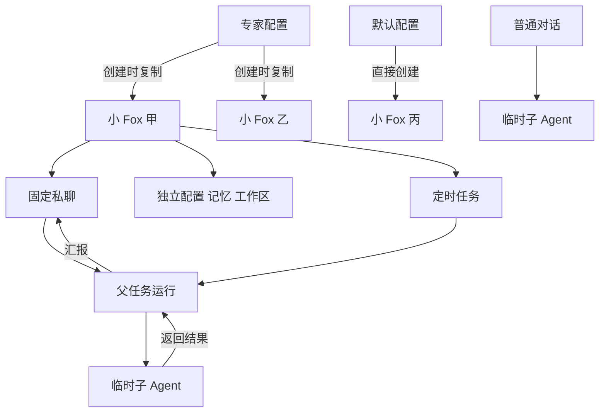

# 小 Fox 独立智能体改造方案

> 状态：草案
> 适用版本：Fox 当前桌面端，实施基线待开工时固定
> 维护范围：联系人、专家、定时任务、Agent Runtime 与子 Agent
> 最后更新：2026-11-11

小 Fox 与数字同事合并，统一称为“小 Fox”。每个小 Fox 是长期存在的独立智能体，有自己的配置、固定私聊、记忆和工作区。用户从联系人列表的加号直接创建，通过对话逐步完善它；现有右侧栏用于查看和修改配置、资料及任务。

本文记录已经确认的产品方向，并提出实施细节和验收条件。产品方向已在讨论中确认，技术契约仍需在实施时结合源码评审；本文不表示功能已经完成。源码核对基线为 `792c0684`。核对时右侧栏改动已提交（`2f89d2f7`、`792c0684`），工作区只有文档存在未提交修改。第 3、4、6、7、8 节列出的现状缺口已按该基线逐项核对，文中引用的行号以该基线为准；开工时只需确认基线是否变化。

## 1 目标与范围

### 1.1 本期目标

1. 创建入口仅保留在联系人列表“小 Fox”标题右侧的加号中。
2. 支持直接新建，以及从专家创建。同一专家可以创建多个小 Fox。
3. 新建时不要求填写配置表；使用默认配置，立即进入聊天。
4. 每个小 Fox 独立保存配置，创建后不随来源专家自动变化。
5. 支持用户通过对话修改小 Fox 的名称、职责和沟通偏好，并在侧栏查看结果。
6. 复用联系人右侧栏，保留已有功能，补齐定时任务管理。
7. 小 Fox 在私聊和定时任务中均可调用现有子 Agent。
8. 删除数字同事独立产品入口，将定时执行能力归入小 Fox。

### 1.2 本期不增加的内容

不新增小 Fox 管理中心、创建向导、聊天旁三个快捷入口、子 Agent 配置页、小 Fox 群聊、跨小 Fox 委派、云电脑或新的调度服务。不建立专家与小 Fox 的持续同步和版本升级机制。

用户已明确没有使用旧数字同事，本期不设计旧独立数字同事向新小 Fox 的业务迁移。现有联系人及其聊天、记忆、文件、授权必须保留。已经被联系人任务复用的调度记录不能随旧页面一起删除。

## 2 产品对象与职责

| 对象 | 含义 | 生命周期 |
| --- | --- | --- |
| 普通对话 | 围绕一件事开展工作，可使用专家及子 Agent | 按会话管理 |
| 专家 | 可复用的专业工作要求与能力配置 | 在专家库中管理 |
| 小 Fox | 具体的长期协作者 | 创建后持续存在，具有独立数据 |
| 定时任务 | 某个小 Fox 承担的周期或一次性工作 | 由所属小 Fox 管理 |
| 子 Agent | 为父任务执行一项工作的临时协作者 | 属于本次运行，不加入联系人列表 |

应用名称为 Fox，长期协作者统一使用“小 Fox”。旧界面的“联系人”文案按语境调整为“小 Fox”；源代码中的 `companion` 不因文案变化而进行全仓重命名。

## 3 创建流程

### 3.1 唯一入口

点击现有“小 Fox”标题右侧的加号，出现“新建小 Fox”和“从专家创建”两个操作。专家页面不再提供创建联系人或创建数字同事的按钮，避免出现额外入口。

选择“新建小 Fox”后，系统直接分配唯一身份、默认名称和头像，创建独立工作区及固定私聊，再打开聊天。默认名称为“小 Fox”，与现有活动名称重复时自动编号为“小 Fox 2”“小 Fox 3”，不要求用户先命名。模型未配置时仍允许建立小 Fox，发送消息时沿用现有模型连接提示。

现有 `create_companion(None)` 专用于播种默认小狐，会写入 `is_default = 1`（`database/repositories/companions.rs:806-829`）；“只能有一个默认”的唯一索引会让第二次空白创建失败。直接新建必须走独立的创建路径：`is_default = 0`，不写来源专家，不建专家绑定。

选择“从专家创建”后，仅展示可用专家选择。选中并确认后直接创建、进入聊天；专家选择不是多步骤设置向导。只展示当前运行时能够承接的专家，不将不支持的远程专家伪装成可复制配置。

连续从同一专家创建两次必须得到两个小 Fox。打开已有小 Fox 通过列表完成，创建操作不再恢复或打开同来源的旧对象。重复点击的处理沿用现有按钮忙碌态，不新增复杂创建队列。

### 3.2 默认配置

| 项目 | 新建时的行为 |
| --- | --- |
| 身份 | 新 ID、新名称和默认头像 |
| 工作要求 | 内置通用助手要求（与默认小狐使用同一内置助手包，随 Fox 版本更新），能够直接接收任务；不建专家绑定 |
| 职责与沟通偏好 | 初始为空，通过对话或侧栏补充 |
| 模型 | 默认跟随全局可用配置；手动选择后保存为自身选择 |
| 能力 | 沿用 Fox 现有默认能力及权限规则 |
| 记忆 | 空白个人记忆，保留现有显式共享机制 |
| 文件 | 新建独立工作目录，不复制其他小 Fox 的文件 |
| 聊天 | 新建固定私聊，无历史消息 |
| 定时任务 | 初始为空 |

默认配置是一份创建起点，不是当前默认小狐的完整副本。它不得包含默认小狐已经积累的职责、个人笔记、对话和文件。

### 3.3 从专家创建

复制专家的工作要求、技能选择及可用资源配置，作为小 Fox 自有配置。工具和资料引用仍受当前安装状态和授权约束；复制引用不等于扩大访问权限。不存在或未连接的资源按现有能力页面显示状态。

不复制专家的对话、运行记录、个人记忆、任务和工作目录。来源名称、专家 ID 与版本仅用于说明创建来源。修改、升级或删除专家，不得改变或破坏已经创建的小 Fox。

专家配置的载体是固定私聊的专家绑定快照（`conversation_expert_bindings.package_snapshot`）。现状中工作要求已经冻结，但技能列表仍在每次运行时按 `binding.expert_id` 实时读取专家的启用技能（`runtime_host/mod.rs:992-996`），专家开关技能会立即影响已有联系人。本期在创建时把技能选择写入快照，运行时只读快照，再与已安装、有效的技能取交集。

第一版不提供“采用专家新版”。用户如需使用专家最新配置，可再次从该专家创建。用户主动调整当前小 Fox 时，只修改当前对象。

## 4 通过对话完善配置

### 4.1 用户可观察的行为

| 用户表达 | 持久化结果 |
| --- | --- |
| 以后你叫小周 | 保存当前小 Fox 名称，刷新列表和侧栏 |
| 以后主要帮我准备党群汇报 | 保存长期职责 |
| 回答先给结论，尽量简短 | 保存为当前小 Fox 的沟通偏好 |
| 记住，我习惯用公制 | 用户本人的跨小 Fox 习惯，按现有规则写入共享记忆，不写入当前小 Fox 配置 |
| 这次用表格回答 | 只作用于本次任务，不写入长期配置 |
| 记住，这个项目的负责人是王老师 | 按已有笔记规则保存事实 |
| 每周五下午三点整理本周材料 | 建立当前小 Fox 的定时任务 |
| 把每周整理改到周四 | 修改对应任务；多个任务无法确定时再询问 |

明确要求直接执行，成功后简短告知变更；不再要求用户到设置页重复填写。表达含糊时只问缺失的关键信息，不开展固定的新手问卷。

### 4.2 配置与记忆的分工

长期职责和沟通要求进入自身配置，事实及资料进入现有笔记。临时任务要求只进入当前对话。不得将每条聊天追加为系统提示词，也不得只回复“记住了”而不落库。

沟通偏好与共享记忆的边界：只针对当前小 Fox 的说话方式（如“你回答先给结论”）写入当前小 Fox 的沟通偏好；用户本人对所有小 Fox 都成立的习惯（如“我习惯用公制”）继续按现有提示写入共享记忆（`services/agent-runtime/src/companion-memory-prompt.mjs:11`）。提示中写明这条边界，无法判断时询问用户“只对我生效还是对所有小 Fox 生效”。改写提示时保留共享记忆现有的确认规则：`memory_write` 返回 `pending` 时请用户确认，只有返回 `created` 或 `existing` 才能告知“已记住”。

提示组装顺序固定为：基础工作要求（专家快照或内置助手）→ 长期职责 → 沟通偏好 → 笔记资料。现状中职责和表达风格已按此顺序位于笔记块之前（`companion-memory-prompt.mjs:14-15`），保持即可。当前消息中的临时要求只对本轮生效，与长期配置冲突时以当前消息为准。

右侧栏使用同一数据源。用户在侧栏修改后，下轮对话使用新值；模型在对话中修改后，列表及侧栏刷新。正在执行的一轮保持启动时的配置，后续轮次和任务使用新配置，避免中途切换职责。

权限、账号、外部目录访问仍通过 Fox 现有授权机制。模型可根据要求调用已有授权入口，不能把人设修改工具当作权限开关。子 Agent 本期不直接修改小 Fox 的身份、职责或长期记忆，由父任务处理需要长期保留的结果。

### 4.3 实现建议

新增一个面向当前小 Fox 的配置更新工具，候选名为 `companion_profile_update`，最终名称遵循现有协议命名规则。工具只允许以下字段：

| 字段 | 存储 | 说明 |
| --- | --- | --- |
| 名称 | `display_name` | 受活动名称唯一约束（`migrations.rs:8124`），重名时返回错误，不自动改名 |
| 长期职责 | `duty` | 已有列 |
| 沟通偏好 | `persona_override` | 已有列，不新增字段 |

`persona_override` 在运行时并不替换人设，只作为“用户指定的表达风格”追加在职责之后（`companion-memory-prompt.mjs:15`），实际含义就是沟通偏好。本期直接把它作为沟通偏好使用，对话工具和侧栏写同一字段。侧栏现有“自定义人设”标签和“留空时使用模板人设”提示（`contact-side-card.tsx:279`）与实际行为不符，改为“沟通偏好”。本期不提供替换整份人设的能力。

更名只改展示文案，已有的 `persona_override` 内容原样保留，迁移和界面都不清空或自动改写。对话工具修改沟通偏好时，在现有内容上增改，保留用户没有要求删除的偏好；用户明确要求清空或整体替换时才覆盖。

工具不接受模型任意指定其他小 Fox 的 ID，目标由运行所属身份解析。开放条件是：当前运行属于某个小 Fox，且不是子 Run。即固定私聊和该小 Fox 的后台任务可以调用；子 Run、通过项目授权读取笔记的运行和普通对话都不提供。不能只用 `role == "owner"` 判断：后台任务已经得到 owner 身份（`companion_notes.rs:59-60`、`:496`），子 Run 接通归属后也可能如此。Runtime 筛选工具和 Host 执行工具时使用同一个判断条件，直接请求该工具的子 Run 也在 Host 处被拒绝。该工具加入 `companion_workspace::allows_tool` 白名单，但白名单只是必要条件。

UI 编辑与工具调用共用一个保存服务。输入在 Tauri 命令或 Host 工具入口校验一次，内部传递确定类型的数据。返回实际保存值和变更字段，模型据此报告结果；失败必须返回错误，不生成成功回执。

提示中说明什么时候持久化、什么时候仅用于本轮。验证必须覆盖工具真正落库及下一轮提示读取，而不只测试模型输出了一句确认。

## 5 复用现有右侧栏

现有 `ContactSideCard` 已有“详情、资料库、工作目录”三个分页，顶部设置入口，以及模型、权限、提醒、能力、笔记、收藏等内容。本期保持这些位置和功能，不新增独立资料页，不重复增加聊天旁入口。

| 位置 | 调整 |
| --- | --- |
| 详情 | 保留现有内容，增加定时任务入口及简短数量或待处理状态 |
| 资料库 | 保留附件、产物及来源定位，支持定位定时任务产物 |
| 工作目录 | 保留打开目录、导入、导出和修复能力 |
| 顶部设置 | 保留头像、名称；“自定义人设”改为“沟通偏好”，与职责合并为易读的“职责与偏好” |
| 设置中的专家模板 | 移除版本更新操作，来源信息可简短展示 |
| 定时任务子页面 | 列表、添加、编辑、启停、立即执行、删除、运行记录 |

对话是主要配置入口，侧栏是可检查和可手动修改的入口。创建后不自动展开完整设置页，也不要求用户填满字段才开始工作。

## 6 定时任务归入小 Fox

### 6.1 创建和编辑

优先通过对话创建，也允许在现有侧栏添加。用户只需指定做什么、何时执行和必要的资料范围。任务属于当前小 Fox，默认使用它的模型、能力、笔记和工作区，不再选择专家或部署数字同事。

任务记录至少包含所属小 Fox、任务名称、执行要求、计划、启用状态、下次执行时间和最近结果。

数据对应关系：一个任务对应一行 `digital_colleagues` 和一行计划。执行要求存在 `objective`，每个任务独占一个执行会话（`conversation_id` 唯一），并写入 `companion_id`、`report_conversation_id` 和 `companion_bound = 1`。同一小 Fox 的多个任务是多行，不共用执行会话。现有表的 `max_runs_per_day`、`max_tokens_per_day`、`max_duration_ms`、`max_output_tokens`、`max_tool_calls` 为必填列（`migrations.rs:1137-1141`）。用户不填写这些字段，沿用现有数字同事创建命令的默认值（`digital_colleagues.rs:138-155`）：每天 8 次、128,000 tokens；单次 5 分钟、4,096 输出 tokens、16 次工具调用；补跑窗口 3,600 秒。16 次工具调用是否够父子任务合计使用，由 A17 实测后决定是否调整。

`digital_colleagues` 的 `expert_id`、`expert_binding_id`、`package_hash`、`package_snapshot_json` 目前都是必填（`migrations.rs:1127-1130`）。创建任务时，若没传专家，会退回用 `template_agent_id` 并绑定专家（`database/repositories/digital_colleagues.rs:31-54`）。直接新建的小 Fox 没有专家，按现状无法建任务，解绑方式见第 8.3 节。

现有私聊提示明确告诉模型“当前私聊不支持定时任务”（`companion-memory-prompt.mjs:12`）。本期删除这条，改为说明如何为当前小 Fox 创建和修改定时任务。

现有调度只支持固定间隔：`digital_colleague_schedules.schedule_kind` 被约束为 `'interval'`（`migrations.rs:1153`），保存时下次执行时间取当前时间加间隔（`digital_colleagues.rs:308`），没有一次性计划、日历规则和时区。本期计划支持范围固定为：

| 类型 | 用户表达示例 | 存储 |
| --- | --- | --- |
| 一次性 | 明天上午九点整理材料 | 执行时刻 + 时区 |
| 间隔 | 每两小时检查一次 | 间隔秒数，沿用现有范围 |
| 每天或每周 | 每周五下午三点 | 星期集合 + 本地时刻 + 时区 |

每月、工作日调休、节假日规则本期不支持。模型收到这类要求时说明不支持，并建议改用上述类型，不得近似保存；不得把“每周五下午三点”保存成从当前时间起每隔七天。一次性计划执行后自动停用，不删除记录。

计划表按仓库现有模式重建，放宽 `schedule_kind` 约束并增加时区等列，已有间隔计划原样迁移。下次执行时间按计划时区的本地时刻计算，用固定时钟测试跨日、跨周和夏令时切换。

保存后在聊天回执中展示任务内容、时区和下次执行时间。时区取用户设置或设备本地时区并持久化到计划；本地设备时区改变，不得悄悄改变已有计划含义。时间缺失或存在歧义时先询问。

### 6.2 执行和回报

到期后创建后台运行，保留独立执行会话及已有排队机制。后台运行解析为同一个小 Fox 身份，读取其有效配置，使用其工作区，并将结果或需要处理的审批回报固定私聊。

同一小 Fox 的私聊与后台任务共用一个执行位置（`runtime_host/mod.rs:1679-1686`）。任务到期时如果用户正在私聊，任务进入排队，侧栏任务状态显示“排队中”，不打断私聊。同一任务的上一次运行尚未结束时，本次按现有规则跳过并记录原因。

每日次数和用量上限现在按 UTC 零点切日（`digital_colleagues.rs:1131`），对北京时间用户是早上 8 点重置。本期改为按计划时区的本地零点切日。

聊天展示结果摘要和产物入口，详细过程进入任务运行记录。后台执行会话和子会话不重复出现在普通对话列表。资料库中的任务文件保留来源，能够跳回任务或回报消息。

定时任务可以调用子 Agent，规则见第 7 节。运行限制沿用现有规则，默认不让用户填写 token、工具次数等技术字段。子任务的 token 和工具调用必须计入所属任务的当日用量和单次上限，不能通过委派绕过。现状没有计入：工具次数只统计当前 Run（`database/repositories/digital_colleagues.rs:974`），用量只汇总触发记录本身（`:1007-1027`）。本期补齐按根 Run 汇总父子任务的统计，并由 A17 断言。现有 `usage.updated` 处理用累计值覆盖触发记录（`database/repositories/digital_colleagues.rs:1459-1477`），汇总时取每个父子 Run 的最新累计用量再求和，不能把多次 `usage.updated` 累加，也不能重复计入已经汇总过的子任务。

### 6.3 生命周期

| 操作 | 行为 |
| --- | --- |
| 暂停任务 | 停止后续触发，聊天仍可用；当前执行通过“停止”处理 |
| 立即执行 | 新建一次运行，不改变原计划 |
| 修改任务 | 后续运行使用新要求；已开始的运行不被静默改写 |
| 停止当前运行 | 停止该运行及其子任务，保留结果和终止记录 |
| 归档小 Fox | 停用其自动触发；活动运行按现有归档约束处理 |
| 恢复小 Fox | 恢复聊天，不自动重新开启已停用任务 |
| 删除任务 | 停止未来触发；历史产物不随计划删除 |
| 删除小 Fox | 先停止关联工作，再沿用现有删除预览和文件保留规则 |

计划由本机运行服务执行。界面应根据真实服务状态说明能否后台执行；不得暗示关机后仍可执行。离线错过的计划沿用现有补跑窗口，并显示错过或补跑结果，不集中执行全部历史次数。

## 7 子 Agent 规则

复用普通对话已有委派能力，将小 Fox 私聊与后台任务接入同一执行链。无需建立新的子 Agent 管理系统。

父任务分配目标、必要材料和可用工作范围。子 Agent 使用独立上下文，不复制完整聊天或其他小 Fox 的记忆；完成后向父任务返回结果和产物引用。父任务负责综合并向用户交付。

必须保留以下关系：父 Run、根 Run、所属小 Fox、实际执行会话、回报私聊。

### 7.1 现状缺口

普通对话的委派链可以复用，但小 Fox 的运行目前接不上，原因有三：

1. 小 Fox 运行只拿到固定白名单内的工具（`companion_workspace.rs:112-128`），不含 `child_run_start`、`child_run_collect`、`child_run_cancel`，私聊和后台任务都无法委派。
2. 子 Run 新建的子会话没有 `companion_id`（`database/repositories/child_runs.rs:209-226`）。所属关系解析只认固定私聊的 `companion_id` 和 `digital_colleagues`，不沿 `parent_conversation_id` 查找（`database/repositories/companion_ownership.rs:89-116`）。子会话因此被判为普通对话，走不受限的路径，会绕开工作目录写入限制、能力授权和笔记归属。
3. 同一小 Fox 同时只允许一个运行占用执行位置（`runtime_host/mod.rs:1679-1686`）。如果子 Run 简单继承父 Run 的位置，父 Run 等待子任务结果时一直占着位置，子 Run 永远排不上，形成死锁。

### 7.2 本期规则

以下是对现有所属关系解析服务的扩展，不新建子 Agent 管理系统：

- 所属关系解析沿父子链查找：子会话解析为根 Run 所属的小 Fox，并标记为子运行。解析失败时停止执行，不回落到普通对话路径。
- 子 Run 继承所属小 Fox 的工作目录写入限制和父 Run 冻结的能力集合，不因运行中新增的授权扩大能力，也不得超出父 Run 的工具集合。每次工具执行仍经过现有 Host 授权检查，已撤销的能力立即不可用（与父 Run 现有规则一致，见 `runtime_host/mod.rs:2062-2065`）。
- 子 Run 是父任务内的执行，不单独占用小 Fox 的执行位置，也不占用固定私聊唯一绑定。父任务结束或停止时，其子 Run 必须先停止，不能留下子任务继续工作，同时让下一个顶层任务进入同一工作区。
- 子 Run 沿用当前执行器的调度行为，以及已有的深度、时长和预算约束。现有代码不对子任务总数和同时活动数设单独上限（`child_runs.rs:160-162`），本期也不新增并发配额。
- 子 Run 不提供配置更新工具和笔记写入工具（判断条件见第 4.3 节）；笔记只读权限不超过父 Run，需要长期保留的结果由父任务处理。
- 归档、删除小 Fox 时的停止流程（`drain_companion_runs`）把子 Run 计入活动运行。
- 上述规则落地并通过 A23 后，才把委派工具加入小 Fox 白名单。不允许先开放工具、后补归属。

工具集合遵守父任务与当前授权，实际执行仍经过 Host。不能只在提示词中要求分工，却未将委派工具交给运行时。运行时已有的深度限制、取消、预算和排队规则继续使用，本期不新增另一套限制。

普通对话停止、小 Fox 私聊停止、后台任务停止三个场景都需要验证子任务停止传播。错误及部分结果返回父任务，父任务不得将失败子任务当作成功结论。

外部产品的行为参考见第 12 节，不作为本节的技术依据。

## 8 数据改造

### 8.1 独立配置

保留 `companion_profiles` 作为小 Fox 身份。自有配置全部使用已有存储，不新增配置字段，不另建通用配置框架：

| 配置 | 存储 |
| --- | --- |
| 工作要求与技能选择 | 从专家创建：固定私聊的专家绑定快照，技能列表写入快照；直接新建：内置通用助手，不建绑定 |
| 名称、头像、职责 | `companion_profiles` 已有列 |
| 沟通偏好 | `companion_profiles.persona_override` |
| 模型 | `model_provider_id`、`model_ref` |
| 能力授权 | `companion_tool_grants` |

来源专家降为可选来源字段；空白创建不需要用户可见的专家记录。

当前 `template_agent_id` 为必填外键（`ON DELETE RESTRICT`），并有唯一索引和不可修改触发器（`migrations.rs:8102`、`:8122`、`:8196`），有联系人的专家目前无法删除。新的迁移需要处理这些约束：去掉按模板唯一的限制；来源引用允许缺省，删除来源不阻断小 Fox；保留来源名称及版本快照用于展示。SQLite 表重建按仓库现有迁移模式实施。

专家绑定同样需要解绑。`conversation_expert_bindings.expert_id` 是必填外键，引用 `agents(id)`，没有删除规则（`migrations.rs:5616`），有绑定的专家同样无法删除。本期改为：来源专家被删除时，绑定保留快照并把来源引用置空，运行时只读绑定快照。这张表也被普通对话的专家功能使用，改动后普通对话选择、切换和移除专家的行为不得回归（A19）。

所有“按专家找唯一联系人”的假设都要改为按小 Fox ID。已核对到的位置：

- `add_companion` 按专家查到已有对象就恢复它（`companions.rs:434-443`）；改为每次新建。
- 按 `companion_deletions.template_agent_id` 判断“删除中”，会阻止从同一专家新建（`companions.rs:424-432`）；改为只影响正在删除的那个小 Fox。
- 项目授权读笔记按 `b.expert_id = p.template_agent_id` 关联（`companion_notes.rs:67`），同一专家的两个小 Fox 被授权到一个项目时会串读。改为项目对话记录引用的是哪个小 Fox，按授权记录中的小 Fox ID 读取；未明确引用时不读取任何小 Fox 的笔记。
- 模板版本查询与更新（`companion_template_status`、`apply_companion_template`）随侧栏模板更新一并删除。

实施时再用 `rg template_agent_id` 全量核对，不能任取第一条记录或隐式读取全部人的笔记。

固定私聊唯一绑定、默认小狐唯一标记、活动名称约束和现有文件删除规则继续保留。默认小狐可继续保留既有不可删除规则，但其用户定制配置同样不得被专家模板更新覆盖。

### 8.2 已有联系人升级

将已有联系人当前实际生效的模板快照、职责覆盖、技能资源和模型选择物化为自有配置。技能列表按升级当刻来源专家的启用技能写入绑定快照。保留 ID、私聊、笔记、专题、授权及工作目录。迁移后运行时不再需要读取来源专家才能组装提示。

通过升级前后有效配置对照验证行为保持。删除或改名某个来源专家后，已有小 Fox 仍可正常聊天和运行任务。

### 8.3 任务底层存储

`digital_colleagues` 已承担联系人后台运行归属、执行会话和回报关系，不能删除整张表后再接任务。第一步将其服务接口收敛为“小 Fox 任务”，新建记录必须有所属小 Fox，不再允许独立部署入口，也不再依赖冻结专家绑定。

任务必须能脱离专家创建。`expert_id`、`expert_binding_id`、`package_hash`、`package_snapshot_json` 目前都是必填（`migrations.rs:1127-1130`），需要重建表改为可缺省。小 Fox 任务的运行配置在执行时从所属小 Fox 解析，不再复制专家快照到任务行。现状中任务执行会话在创建时绑定了自己的专家（`database/repositories/digital_colleagues.rs:54`），提示组装读取的是这份绑定；本期改为读取所属小 Fox 固定私聊的绑定快照，已有任务执行会话上的旧绑定不再参与组装。直接新建的小 Fox 没有专家，其任务的这四列为空；从专家创建的小 Fox 的任务同样不写这四列。删除来源专家不影响任何任务。

本期允许底层表暂时保留旧名字，避免仅为命名重写全部外键和历史运行关系。前端、业务命令和用户文案使用小 Fox 任务语义。只保留确实仍被任务使用的字段及代码，旧独立数字同事与签名 Channel 的专用路径完成引用核查后删除。

没有旧独立数字同事数据时不做业务转换。删除旧表或字段的迁移前，区分未绑定的旧记录与已绑定联系人任务记录，不误删后者。遵守现有数据库升级和备份流程，不提供未经验证的降级承诺。

## 9 接口与执行链

下表为拟定契约，名称在实施时与现有命令统一；优先扩展已有接口，不维护两套同义 API。

| 能力 | 输入与输出 | 归属规则 |
| --- | --- | --- |
| 创建小 Fox | 可选来源专家，返回新身份与固定私聊 | 每次创建新对象 |
| 读取及修改配置 | UI 使用小 Fox ID；返回实际保存配置 | UI 与对话工具共用保存逻辑 |
| 对话修改自身 | 允许修改字段，不接受任意目标 ID | 从当前 Run 解析小 Fox |
| 创建及修改计划 | 任务要求、计划类型及参数、时区、启用状态 | 必须归属小 Fox |
| 任务列表与记录 | 小 Fox ID、任务 ID、分页 | 不混入其他小 Fox |
| 手动执行与停止 | 任务 ID 或 Run ID | 沿用现有运行状态和取消链 |
| 子 Agent 委派 | 目标、上下文和现有委派参数 | 从父 Run 继承所属关系 |

对话修改路径：用户消息 → Runtime 选择工具 → Host 解析当前小 Fox → 共用服务保存 → 返回实际变更 → 刷新侧栏 → 后续轮次读取新配置。

定时执行路径：计划到期 → 现有调度器领取 → 解析所属小 Fox → 建立后台 Run → 读取有效配置与授权 → 执行或委派 → 保存记录与产物 → 回报固定私聊。

新增工具定义从 `crates/fox-engine-protocol/src/lib.rs` 的事实源修改，并通过仓库现有脚本重新生成 TypeScript 契约。禁止手改生成文件。模型工具参数、数据库存储和界面展示使用同一业务字段含义。

## 10 代码工作包

| 工作包 | 主要位置 | 完成要求 |
| --- | --- | --- |
| 身份与配置 | `database/repositories/companions.rs`、迁移、`commands/companions.rs` | 空白创建、专家一对多、独立配置、旧联系人保留、专家绑定解绑、项目对话明确引用小 Fox |
| 创建与侧栏 | `features/companions`、`features/agents/agent-pages.tsx` | 加号唯一入口、复用侧栏、移除模板升级和数字同事按钮 |
| 对话配置工具 | 协议源、`services/agent-runtime/src`（含 `companion-memory-prompt.mjs`）、`runtime_host` | 真正落库、实际回执、下一轮生效；开放条件在 Runtime 与 Host 一致；共享记忆边界写入提示 |
| 计划能力 | 迁移、`database/repositories/digital_colleagues.rs` | 一次性、间隔、每天或每周三类计划；时区持久化；按本地零点切日；任务脱离专家字段；删除“不支持定时任务”提示 |
| 定时任务 | `digital_colleagues.rs`、同名 repository、`companion_ownership.rs` | 任务强制归属小 Fox、使用当前配置、结果回报、与私聊排队 |
| 子 Agent | `companion_ownership.rs`、`database/repositories/child_runs.rs`、`companion_workspace.rs`、Host 委派和工具筛选 | 沿父子链解析所属、不单独占执行位置、能力上限继承且撤权即时生效、父任务结束先停子任务、按根 Run 汇总预算 |
| 清理与文档 | 旧管理页、命令注册、专用类型及文案 | 删除无用路径，保留仍被小 Fox 使用的底层能力 |

按依赖顺序实施：

1. 独立身份与配置：载体、技能物化、按小 Fox ID 查询、拆除按模板的约束。
2. 创建流程与对话配置工具。
3. 计划能力与任务归并。
4. 子 Run 归属扩展；通过 A23 后再开放委派工具。
5. 删除旧独立入口和无用代码。

每个阶段先完成针对性验证，再进行整条桌面流程验收。

开工前查看当前未提交修改，保留现有右侧栏和聊天改动。本期确认需要的扩展包括：配置更新工具、计划表重建与日历计算、所属关系解析沿父子链查找、专家绑定和任务表的专家字段解绑、项目对话明确引用小 Fox、父子任务预算归集、私聊提示中定时任务与偏好边界的改写。不新建调度服务，不做全仓重构。若再发现必须增加的机制，先写明实际失败场景及增加的范围，再评审。

## 11 验收清单

| 编号 | 场景 | 通过条件 |
| --- | --- | --- |
| A01 | 加号新建 | 无配置表阻挡，立即出现新对象并进入固定私聊 |
| A02 | 同专家创建两次 | 两个 ID、两份配置、两个工作区，均可使用 |
| A03 | 默认配置隔离 | 新对象不带默认小狐的聊天、笔记和文件 |
| A04 | 来源专家变化 | 改名、修改工作要求、开关技能、删除专家，都不影响已创建小 Fox |
| A05 | 对话改名与职责 | 数据落库，侧栏同步，重启后保留 |
| A06 | 临时要求与共享记忆 | “这次用表格”不污染长期配置；“你回答先给结论”只写入当前小 Fox；“我习惯用公制”写入共享记忆而不是当前小 Fox 配置 |
| A07 | 手动修改 | 侧栏保存后，下一轮真实请求使用新值 |
| A08 | 工具失败 | 保存失败或名称重复时不回复已保存，不改变其他对象 |
| A09 | 入口与布局 | 仅加号创建；保留现有右侧栏功能，无新增重复面板 |
| A10 | 专家一对多授权 | 项目读取按授权的小 Fox 区分，不取第一条或串读 |
| A11 | 对话创建定时任务 | 一次性、间隔、每天或每周三类计划的时区和下次时间正确；不支持的规则被明确拒绝；归属当前小 Fox；直接新建、没有来源专家的小 Fox 也能创建 |
| A12 | 后台执行 | 使用所属小 Fox 配置与工作区，结果进入固定私聊 |
| A13 | 编辑与立即执行 | 编辑影响后续运行，立即执行不改变计划 |
| A14 | 暂停归档恢复 | 暂停无后续触发；归档停用；恢复不静默开启 |
| A15 | 调度恢复 | 重启后计划可继续，领取和补跑不重复产生业务执行；每日上限按计划时区本地零点切日 |
| A16 | 私聊委派 | 子任务成功返回，结果由小 Fox 汇总，不新增联系人 |
| A17 | 定时任务委派 | 子任务归属、工作区、权限和结果均正确；子任务的 token 和工具调用按根 Run 计入任务上限；同一 Run 重复收到 `usage.updated` 时不重复计数；父子合计超额时停止执行并记录原因；实测默认 16 次工具调用是否够父子合计使用 |
| A18 | 停止传播 | 停止父任务，或归档、删除小 Fox 后，关联子任务停止，状态和部分结果可查看 |
| A19 | 原普通对话 | 普通对话使用专家与子 Agent 的能力没有回归；专家绑定表改动后，选择、切换、移除专家行为不变 |
| A20 | 老数据库升级 | 联系人 ID、聊天、笔记、授权、文件及绑定任务保留 |
| A21 | 旧功能清理 | 数字同事独立入口和创建链消失，定时任务仍正常 |
| A22 | 产物与历史 | 任务产物可打开并定位来源，内部会话不污染普通列表 |
| A23 | 子 Run 隔离 | 小 Fox 的子 Run 不能写出所属工作目录，不能使用父 Run 没有的工具；工具列表中没有配置更新工具，直接请求也在 Host 处被拒绝；运行期间撤销某项工具授权后，后续调用被拒绝；父 Run 等待子 Run 时不死锁；父任务结束或停止后没有残留子任务，下一个顶层任务才进入工作区；所属解析失败时停止执行，不回落到普通对话 |
| A24 | 任务与私聊并发 | 私聊进行中任务到期时排队并显示状态，私聊不被打断；私聊结束后任务正常执行 |

测试优先调用真实 repository、命令与 Host 链；调度时间可以注入固定时钟，不把调度算法复制进测试。运行仓库现有类型检查及相关测试，最后使用真实桌面和已配置模型验证 A05、A11、A16、A17、A23。若缺少模型凭据，明确标注真实模型验收未完成，不以模拟回执替代。

交付条件是上述必需场景完成并有结果记录；文档检查、单元测试通过不等于桌面和真实模型验收通过。

## 12 来源与旧方案关系

现状依据为本仓库联系人侧栏、创建 repository、迁移、后台所属关系和子 Run 实现。图索引未覆盖部分新符号时，以当前文件内容为准。

外部参考只用于以下行为：

- [OpenMausBot 预设说明](https://github.com/milind-soni/OpenMausBot/blob/main/docs/presets.md)：直接新建不要求配置审核，预设提供可选起点。
- [OpenMausBot 协作接口](https://github.com/milind-soni/OpenMausBot/blob/main/docs/mcp-server.md)：任务对话、等待、中断与已有 bot 协作。
- [Hermes Bot Mode](https://hermes-agent.nousresearch.com/docs/user-guide/bot-mode)：固定聊天及任务归属。
- [Hermes 委派指南](https://hermes-agent.nousresearch.com/docs/guides/delegation-patterns)：临时子任务上下文与父任务汇总。
- [Grok Bot 官方说明](https://grok.com/release-notes/sep-19-2026)：侧栏联系人式使用和持续对话。未据此推断内部实现。

在本方案进入实施后，旧方案中的“一专家一联系人”“专家模板升级”“数字同事独立部署”和额外管理入口由本文对应条款取代。既有聊天、笔记、文件保留、授权、审批和运行恢复规则继续有效。旧方案与新规则的交叉引用在实现合入时同步更新，不将历史验证记录改写成新功能验证。

当前没有必须等待用户回答的产品问题。现状缺口已在第 3、4、6、7、8 节按基线核对并定出范围；接口最终命名和 SQLite 迁移写法在实施时按仓库现有规则确定；预算默认值按第 6.1 节执行，结合 A17 验证调整。不另增用户配置负担。
