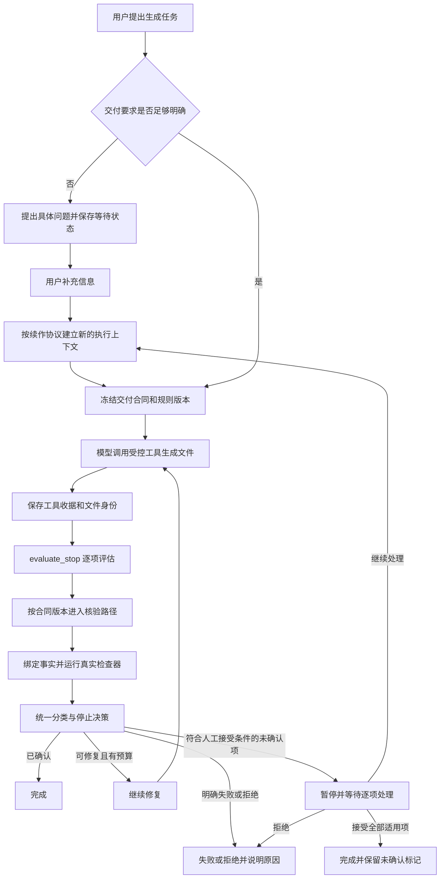

# Fox 交付核验改造全流程与提问卡设计

> 整理日期：2026 年 10 月 18 日。  
> 改动记录范围：2026 年 10 月 9 日至 2026 年 10 月 18 日。这个区间是本文覆盖的记录范围，不是整个项目已经完成的声明。  
> 本文分开记录：已实现行为、已有验证、尚未验收的问题、建议设计。问题卡设计和 UI 集成顺序属于建议，本文不授权合并、启用或发布。

## 1. 这轮改造究竟在解决什么

这轮工作围绕“生成物是否满足用户要求，以及无法自动确认时怎样结束任务”展开。它不是单独添加一个页面，也不是单独修改聊天输入框。

用户要求生成文件时，系统需要回答四个不同的问题：

1. 用户要什么：目标文件、来源文件、合并或转换规则是否明确。
2. 实际生成了什么：工具是否真的写出了文件，文件内容和身份是什么。
3. 结果是否符合要求：哪些条件通过，哪些明确失败，哪些无法自动确认。
4. 接下来做什么：继续修复、停止失败、等待用户补充，或等待用户接受尚未确认的交付项。

这四个问题原来容易混在模型回复、工具结果、任务结束判断和前端状态中。此次改造把它们拆成可保存、可核查的规则、事实和动作，并接入 Host、Kernel、数据库、桌面命令与 UI。

截图顶部的问题区域来自这条交付链，但它处理的是“系统还无法识别完整的交付要求”。它与“文件已经生成，但机器无法确认全部要求”不是同一种情况。当前 UI 把这两种情况放进相近的交付审查区域，因此出现了长说明、重复原因和不明确的操作入口。

## 2. 日期、范围与证据口径

### 2.1 为什么写 10 月 9 日至 10 月 18 日

可核查的最早相关提交是 `6e0bb5d`，提交时间为 **2026-10-09 10:23:35 +08:00**，内容是冻结 r16 C0 的 `delivery_checks_v2` 合同骨架。协调文档在 10 月 10 日开始记录相关阶段，因此文档阶段日期与最早 Git 提交日期存在一天差异。

本文用 10 月 9 日作为代码记录起点，用 10 月 18 日作为本次整理截止日期。10 月 17 日集中提交的一批改动，包含前几天形成和验证的工作，不能据提交日期认定这些内容都只在 10 月 17 日完成。

### 2.2 本次查看的工作树

| 工作树 | 本次检查到的 HEAD | 用途与限制 |
| --- | --- | --- |
| `D:/python/projects/Fox/Fox` | `0df9162` | 主工作树参考点；不是本文声称已发布的新版本 |
| `D:/python/projects/Fox/worktrees/r16-a-20261010` | `1124f7f` | r16 候选工作树；另有未提交修改 |
| `D:/python/projects/Fox/worktrees/merge-candidate` | `048dff0` | 本次合并前候选；另有 Cargo、schema 和本地驱动等工作区内容 |
| `D:/python/projects/Fox/worktrees/ui-improvements-20261009` | `59c31ff` | 正在准备接入的 UI 分支；不能视为已包含在上述候选中 |

本次检查时，UI 提交 `59c31ff` 不是合并候选 `048dff0` 的祖先。后续 HEAD 和工作区内容可能变化，实际集成前必须重新检查。

从主工作树参考提交到合并候选 HEAD 的已提交差异为 **94 个文件，增加 37,658 行，删除 127 行**。这个数字包含驱动、测试和记录，不能直接解释为生产功能代码规模，也不包含未提交修改。

### 2.3 本文怎样使用“通过”

| 证据 | 能支持什么 | 不能直接支持什么 |
| --- | --- | --- |
| 源码审查 | 分支、状态和接口如何实现 | 当前运行程序一定使用该代码 |
| 单元或合成测试 | 指定输入下的局部行为 | 真实模型和业务流程全部通过 |
| 隔离构建与 UI 调用 | 指定构建能运行指定路径 | 用户当前实例已经启用 |
| 真实模型业务测试 | 指定模型、输入、构建和场景的实际结果 | 其他版本和未执行场景也通过 |
| 人工业务验收 | 用户确认具体场景满足要求 | 自动核验事实可以被改写为通过 |

本文引用既有报告中的验证结果；没有在本次文档整理中重新运行全部测试。10 月 18 日的问题识别和输入框改动，本文确认到源码及提交层面，不把它们写成已经完成整轮业务验收。

## 3. 整体流程



图中的“用户补充后续作”描述产品方向。当前实现不能被概括为“在原 Run 中原地恢复”：已有修复允许等待时发送补充信息，后续可以建立新 Run；旧 Run 的冻结合同不会因此被直接改写。

### 3.1 输入与合同冻结

系统先识别交付目标和规则。合同需要明确目标、输入来源、适用的核验方法和规则版本。冻结以后，核验要针对当时约定的要求执行，不能在模型输出不符合要求时悄悄改规则。

需要区分以下两类缺失：

- **目标不明确**：不知道生成哪个文件，或需要用户选择文件类型、名称等。
- **内容不明确**：文件名已经明确，但不知道文件里应写什么。

如果用户已经说明 `report.md`，界面却继续要求补充文件名，可能是旧 Run、识别结果或前端映射问题。仅凭截图不能确认是哪一层。应绑定具体 Run、输入和冻结记录后检查，不能直接断言模型没有理解用户。

### 3.2 生成与真实工具收据

模型说明“已生成”不等于文件已经生成。受控工具执行完成后，需要记录真实产物及其身份，并把它与当前 Run、交付项和冻结规则绑定。

关键身份包括 Run、交付项、规则哈希、候选文件路径、文件哈希、字节数和来源文件身份。受控读取前后的身份检查用于识别核验过程中发生的文件变化。

空文件也有实际字节数和哈希。真实写出零字节文件，与根本没有文件、没有工具收据是不同情况。不能把这三种情况统一当成“生成成功”或“未确认”。

### 3.3 核验执行

停止评估进入 `evaluate_stop` 后，逐项按版本解析合同。旧版保持旧版行为，新版进入带身份绑定的核验链。真实检查器产生事实，再由决策层汇总。

`p2c2_execution` 等内部执行结构用于把规则、受控文件读取和核验事实连接起来。不能拿模型生成的说明替代真实检查器，也不能让 UI 自己推断核验结果。

### 3.4 结果保存与调度

消费者按允许的类型保存 v2 结果。Host 和 Kernel 根据结果决定完成、修复、失败或暂停。数据库保存必要的接受记录与审计信息，UI 读取这些状态并提供相应动作。

等待交付审查时，Run 进入 `awaiting_delivery_review`。它不是已经完成，也不是继续后台生成。**当前处于这个等待状态的 Run 不再派发模型或工具调用。**

## 4. 各阶段改了哪些内容

### 4.1 C0 与早期文本、表格规则：10 月 9 日起

这一阶段先固定 `delivery_checks_v2` 合同结构，再实现文本合并等价性和统一表格解析，并收紧边界情况。

具体包括：

- 按声明的文本约束核验，不能把明确失败降级为无法确认。
- 严格文本比较已经能给出结论时，保留该结论。
- 合同冲突不能吞掉已经查明的失败。
- 明确尾部 LF 的要求与允许差异，并在原始字节上作判断。
- 冻结选择为空时，报告合同错误。
- 零记录表格按表头策略和声明的容差处理。

这部分解决“检查器应怎样判断”，尚不等于真实产品链路已启用，也不等于用户已经能够在 UI 中处理无法确认项。

### 4.2 事实、分类与消费者边界

后续工作把核验事实与动作判断分开。内部包含文本、表格、预算等检查能力，以及类型化指标和来源关系结构。存在结构或叶子检查器，不代表所有业务入口都已启用相应能力。例如 PDF 渲染核验不应写成已经支持。

统一分类按以下优先级处理：

| 顺序 | 类别 | 含义与动作约束 |
| --- | --- | --- |
| 1 | `Refused` | 命中拒绝条件，不能用用户接受绕过 |
| 2 | `Invalid` | 合同或核验结构无效，不能冒充旧版成功 |
| 3 | `RepairNeeded` | 存在需修复的阻塞失败，且仍符合预算等修复条件 |
| 4 | `DefiniteFailure` | 已知条件失败，且不能走上述修复路径 |
| 5 | `Unconfirmed` | 有无法确认事实，或没有足够事实得出确认结论 |
| 6 | `Confirmed` | 所需事实支持确认 |

这不是把所有非成功情况改名为“未确认”。已知失败必须保留失败事实。用户也不能通过点击接受，把安全拒绝或明确不合格改成核验通过。

### 4.3 2-C2：真实核验与身份绑定，10 月 13 日收口

协调记录第 86 节记录这一阶段收口。重点是让核验从结构和局部测试进入真实的受控文件执行链：

1. 按冻结合同确定检查目标。
2. 将目标绑定到 Run、交付项和工具生成的产物。
3. 读取真实文件，检查读取前后的身份。
4. 执行检查器，产生与本次输入绑定的事实。
5. 通过受控消费者输出和保存结果。

这样，之前某个文件或某次 Run 的通过结果不能直接挪到新的文件和任务上使用。

### 4.4 2-D / U1：人工接受流程，10 月 14 日收口

协调记录第 96 节记录 2-D 收口。它解决“机器确实无法确认，但用户愿意接受这个具体交付项”时的产品行为。

主要改动涉及 Kernel 暂停状态、Host 处理动作、数据库 migration 93、桌面命令和逐项接受 UI。

必须分开的四条状态轴如下：

| 状态轴 | 例子 | 不等同于什么 |
| --- | --- | --- |
| 核验结果 | Confirmed、Unconfirmed、Failed | 用户是否满意 |
| 用户接受 | 已接受、拒绝、撤销接受 | 检查器是否通过 |
| 执行状态 | 运行、等待、完成、失败 | 工具权限是否已授予 |
| 工具权限 | 某个工具动作获准或未获准 | 用户接受生成物 |

具体动作规则：

- **接受**：仅处理符合条件的未确认交付项；执行时再次验证身份和有效性。
- **全部适用项已接受**：满足其余结束条件后可以完成，但保留“未确认、用户已接受”的事实。
- **拒绝**：按对应流程结束为失败，不继续假装等待。
- **撤销接受**：移除当前有效接受记录；已经发生的历史终态不被改写，也不自动启动模型。
- **继续处理**：建立后续执行上下文或子 Run；不继承成无条件有效的交付接受或工具授权。

已有独立复核记录包含撤销 UI、真实继续处理和真实 WebView 命令调用。这些证据对应当时的隔离构建和测试，不代表用户当前实例已经启用新版链路。

### 4.5 2-E：正常生产调用链接线，10 月 16 日收口

协调记录第 101 节记录最终收口。此前各层可单独工作，2-E 将正常输入、合同冻结、核验、决策、消费者和 U1 接成一条真实调用链。

启用边界：

- `FOX_DELIVERY_V2` 默认关闭；非法值按关闭处理。
- 首批正常生产入口只为新建的 Concat 类交付合同生成 v2。
- 其他类型继续走原有 v1 语义。
- 已冻结的 v2 合同继续按其版本处理，即使后续关闭开关或重启。
- 无法解析或不合法的 v2 不能静默回退为旧版结果。
- 混合 Run 按交付项保留各自版本，不能把整轮任务统一升级成 v2。

混合版本中，v1 项不伪造 v2 结果封装，也不伪造可人工接受的 v2 待处理项。既有复核认为 v1 未通过项可按原有修复路径处理；不能把早期提出的混合版本死锁疑问继续写成已经确认存在的当前缺陷。

此阶段还发现等待状态被后续准备失败覆盖的问题。修复在 Host 取得相关锁后检查已提交的等待状态，并保留取消等真实失败路径。这个修复的目的，是避免已正确暂停的 Run 被旧的失败收尾误写成失败；不是吞掉所有准备错误。

### 4.6 2-F：真实业务验收，10 月 16 日及后续修复

这阶段使用真实模型 `sensenova-6.8-flash-lite` 和隔离环境运行正常业务路径。结果不是全部通过：

| 用例 | 当时报告结果 | 本文采用的结论 |
| --- | --- | --- |
| B1、B2、B3、B6、B7 自然路径 | 通过 | 仅对报告绑定的构建和输入成立 |
| B5a：关闭开关后新 Run 使用 v1 | 通过 | 支持新 Run 的关闭边界 |
| B4：文本合并 | 失败 | 暴露模型输出和字节规则问题，需修复后复验 |
| B5b：既有 v2 等待状态相关场景 | `UNVERIFIED` | 未取得符合前提的等待样本，不能标为通过或失败 |
| B7 拒绝故障注入路径 | 通过 | 与自然路径分开记录 |

因此，“2-E 独立复核收口”与“所有真实业务验收完成”不是同一句话。阶段收口不能覆盖 B4 和 B5b 的具体状态。

### 4.7 文本分隔规则修复：10 月 17 日至 18 日

B4 最初出现模型输出不合要求、重试耗尽。后续复验又发现独立的检查器规则问题：产物为 44 字节，符合文字说明；旧期望却是 46 字节。差异来自空正文条目参与合并时，多算了换行。

早期独立期望值也复制了同一错误，因此“与测试期望一致”没有及时暴露缺陷。后续应以独立构造的 44 字节预期和明确规则复核，而不是仅复用生产实现计算期望。

相关修复分两层：

1. `b893ba7` 调整合并行为，确保条目之间按约定保留一个空行。
2. `77bb2a0` 等提交将分隔规则随合同冻结，避免新算法改变旧合同含义。

这里的 `mergeRule` 与 `schemaVersion` 不相同。缺少新分隔规则标识的历史合同采用旧的 `separator-v1` 兼容含义，新合同采用 `separator-v2`。检查器说明也应报告实际执行的规则。

代码修复已存在，不等于 B4 在当前构建上已重新获得真实业务通过结论。

### 4.8 识别未完成与输入框修复：10 月 18 日

`d14692e` 增加识别尚未完成时的等待处理，并避免把 `recognition:` 类行作为普通交付审查项继承。`73ca350` 增加对应问题面板。

当前面板实现位于桌面聊天工作台的交付区域。它识别 `recognition:` 前缀的行，与普通待接受交付项区分；存在相应行时，也可能在已完成或失败的相关状态中展示。它不是专门受性能测试开关控制的调试画面，普通运行满足条件时也可能出现。

面板当前的问题包括：大标题占据过多空间、面向实现的 Host 说明进入产品界面、原始原因直接展示、原因重复，以及缺少卡片内的输入入口。

`048dff0` 另外修复了一个行为问题：原来等待中的 Run 仍被 UI 计为运行，输入框呈现停止动作，用户无法正常提交补充信息。修复区分“Run 仍存在”和“当前正在执行”，使等待时输入框可以发送，同时保留活动专家等必要约束。

该修复允许提交补充信息，但不等于已经实现完整的问题卡、问题身份协议和同一 Run 原地恢复。作者报告的续作路径可以创建新 Run，并保留旧合同；本文没有重新做实时业务复验。

## 5. 顶部面板应设计为什么

### 5.1 产品定位

建议使用类似审批卡的紧凑卡片外观，但命名为**补充信息**或直接使用问题标题。它的业务动作是回答问题，不是批准工具，也不是接受交付物。

| 卡片类型 | 用户在决定什么 | 主动作 | 后端含义 |
| --- | --- | --- | --- |
| 问题卡 | 提供缺失的信息或选择 | 发送回答 | 补充任务上下文并建立后续执行条件 |
| 工具审批卡 | 是否允许执行一个动作 | 允许、拒绝 | 处理工具权限 |
| 交付接受卡 | 是否接受无法自动确认的具体产物 | 接受此项、继续处理 | 记录交付接受或发起续作 |

可以复用布局、边框、按钮和状态展示组件，不能复用成同一个业务事件。

### 5.2 推荐卡片内容

当文件名已经明确、缺少内容要求时：

```text
补充信息
report.md 需要包含哪些内容？
例如：本周进展、遇到的问题和下周计划。

[输入你的要求……                             ]

等待你的回答后继续生成             [发送回答]
```

当缺少目标文件名时：

```text
补充信息
你希望生成什么文件？

[例如：sales-report.md                       ]

                                  [发送回答]
```

界面只问当前真正缺少的内容。不要把模型的全部解释、Host 术语、内部状态码和重复诊断作为默认正文。

### 5.3 输入与交互

- 问题正文应是完整、可直接回答的一句话。
- 输入框放在问题卡内；如果底部输入框也支持回答，必须指向同一问题身份。
- 必填答案为空时不发送，提供就地提示。
- 发送中显示进度并避免重复提交。
- 成功后保留问题和已发送答案，折叠为简洁记录。
- 失败时保留输入，显示可重试操作。
- 若问题已经失效，说明原因，避免提交到另一个活动任务。
- 多个真正独立的问题可以在同一卡片中展示；不要机械地为每条重复诊断生成卡片。
- 中文输入法确认候选词时不能误发送。发送快捷键应沿用新 UI 的输入框约定。
- 需要有可访问名称、清晰焦点状态，以及不依赖颜色的等待和错误说明。

### 5.4 建议状态

| 卡片状态 | 展示 | 允许动作 |
| --- | --- | --- |
| 待回答 | 问题、原因、输入框 | 输入并发送 |
| 发送中 | 保留答案，显示进度 | 防止重复发送 |
| 已回答 | 问题与答案摘要 | 查看记录 |
| 提交失败 | 输入不清空，显示错误 | 重试 |
| 已失效 | 任务或问题已变化的说明 | 查看最新任务 |
| 可跳过 | 明示默认值或跳过结果 | 跳过或回答 |

“可跳过”只能用于后端明确支持默认行为的可选问题。必要信息不能靠前端添加跳过按钮绕过。

## 6. 提问是否应该影响任务执行

答案取决于缺失信息是否是执行前提。

| 情况 | 推荐行为 | 当前实现边界 |
| --- | --- | --- |
| 不知道要生成什么，无法确定下一步 | 等待回答，暂停相关执行 | 当前等待 Run 会停止派发模型和工具 |
| 用户只需选择可选标题或风格，有已授权默认值 | 可以按默认值执行，问题不阻塞 | 需要明确默认值和非阻塞协议，不能默认声称已有 |
| 缺失信息只影响后续步骤，前面有独立且已授权工作 | 可以继续独立步骤，到依赖点等待 | 当前整轮暂停机制不代表已有步骤级依赖调度 |
| 产物已完成，只剩人工接受未确认项 | 等待用户作出交付决定 | 不应继续无目的调用模型 |
| 等待工具权限 | 按工具权限机制处理 | 问题回答不能代替工具授权 |

用户感知上应保持同一个任务连续：回答后继续处理、上下文完整、历史可追踪。但执行层可以使用新的 Run。产品连续性与 Run 身份不必完全相同。

因此，“弹出问题卡后任务仍然可以继续做不受影响的工作”是合理目标；“无论缺什么信息都不影响执行”不成立。对当前代码，准确说法是：等待中的 Run 暂停执行，用户仍应能够回答；回答后的续作必须遵守明确协议。

## 7. 问题回答协议：建议实施要求

以下为后续设计要求，不是已完成字段清单。

### 7.1 必须解决的身份与幂等问题

一次回答至少需要可关联的问题身份、原 Run、交付项或识别上下文、答案和提交身份。后端必须能验证：

1. 该问题仍属于用户正在回答的任务。
2. 问题当前仍可回答，没有被新一轮识别替代。
3. 同一提交重复到达时，不创建重复续作。
4. 回答已经保存后，再建立后续执行；失败时能恢复或重试。
5. 前端重新进入页面后，能够读回已回答、等待或失败状态。

实际字段名称应在实施时结合现有协议确定，不能只增加前端组件而绕过 Host。

### 7.2 合同与续作

用户回答可能改变目标、来源或内容要求。新执行应根据补充后的要求生成新的冻结上下文，并保留与旧 Run 的关系。不能覆盖旧合同以制造“旧 Run 本来就知道这些信息”的历史。

旧产物可以作为后续任务的输入，但不能无条件沿用旧核验通过结果或用户接受记录。是否复用必须重新绑定身份和规则。

### 7.3 和底部输入框的关系

问题卡与底部输入框应调用同一业务提交入口。问题卡负责清晰显示“正在回答什么”，底部输入框仍可承接正常聊天。

如果当前页面有多个待处理问题，不能把任意一条聊天消息自动提交给所有问题。发送前应有明确的问题关联；普通聊天消息与回答消息也应能在事件记录中区分。

## 8. 先修复还是先合并 UI

建议顺序是：**保留已完成的必要行为修复 → 在隔离候选中接入 UI 分支 → 在新 UI 组件中实现问题卡 → 联合回归 → 合入主线。**

这里的“先接入 UI”指可检查、可回退的候选集成，不是跳过验证直接合入主线或发布。

### 8.1 为什么采用这个顺序

UI 分支已经拆分输入框和决策卡组件，例如 `composer/fox-composer.tsx`、`thread/composer/fox-decision-card.tsx`。如果先在旧 `workbench.tsx` 中实现完整问题卡，接入 UI 后还要重新迁移状态、输入和布局，容易重复工作，并再次引入等待状态错误。

但不能丢掉现有行为修复。文本规则版本、识别等待和等待时可发送等改动，应作为集成必须保留的约束。

### 8.2 建议的实施步骤

| 步骤 | 工作内容 | 完成条件 |
| --- | --- | --- |
| 1. 固定基线 | 记录两侧 HEAD、未提交修改和当前运行构建 | 能说明每份改动来自哪里，保留其他任务 WIP |
| 2. 保留行为修复 | 核对分隔规则、识别等待、输入框发送修复 | 新 UI 接入时这些行为不丢失 |
| 3. 隔离接入 UI | 处理输入框、聊天状态、交付区域和命令映射冲突 | 编译通过，基础聊天可用 |
| 4. 实现问题卡 | 在新组件结构中实现输入、发送和状态展示 | 明确区分问题、审批、交付接受 |
| 5. 验证续作协议 | 验证回答身份、重复提交、重启恢复和新 Run 关系 | 不篡改旧合同，不重复启动任务 |
| 6. 联合回归 | 同时验证核验、等待、交付接受与 UI | 关键业务场景有当前构建证据 |
| 7. 主线合并 | 审查候选差异和剩余风险 | 按实际授权合并；发布和启用另行记录 |

不建议在旧 UI 上投入完整视觉重做后再整体迁移，也不建议为了合 UI 而暂时删掉交付和等待状态判断。

## 9. 联合回归验收清单

### 9.1 问题识别与输入

| 场景 | 应有结果 |
| --- | --- |
| 已有文件名，仅缺内容 | 问内容，不再问文件名 |
| 缺少必要目标 | 显示具体问题，等待相关执行 |
| 可选偏好且有默认值 | 明示默认行为，按协议继续 |
| 等待时使用卡片输入 | 可以发送，问题身份正确 |
| 等待时使用底部输入 | 不误显示为只能停止，不误关联问题 |
| 双击发送或网络重试 | 一次有效回答和一次续作 |
| 中文输入法确认候选 | 不误触发发送 |
| 发送失败 | 答案保留，可以重试 |
| 页面切换或重启 | 从持久状态恢复问题与答案 |
| 旧问题已失效 | 禁止错误提交，给出可理解提示 |

### 9.2 交付核验与接受

| 场景 | 应有结果 |
| --- | --- |
| 新分隔规则正常合并 | 字节符合独立构造的预期 |
| 空正文条目 | 无额外空行，B4 有当前构建复验 |
| 历史合同缺少新规则字段 | 保持旧规则，不静默改变语义 |
| 合同格式无效 | 明确报错，不回退伪装成功 |
| 文件在核验或接受前变化 | 身份校验发现变化并按规则处理 |
| 已知失败或安全拒绝 | 不能通过人工接受绕过 |
| 合法未确认项逐项接受 | 保存接受记录，保留未确认事实 |
| 全部适用项已接受 | 仅在其他条件满足后完成 |
| 完成后撤销接受 | 更新有效接受，不改历史终态、不自动运行 |
| 拒绝或继续处理 | 动作和状态一致，续作身份正确 |
| 混合 v1/v2 | 分项保持语义，旧项不伪造 v2 接受能力 |
| 开关关闭后新 Run | 走声明的旧版入口 |
| 关闭或重启后的旧 v2 Run | 按冻结版本恢复，补齐 B5b 所需样本 |

### 9.3 UI 集成

- 普通聊天、停止、专家切换和等待时发送均按各自状态工作。
- 问题卡、工具审批卡和交付接受卡有不同文案及动作。
- 默认视图不展示 Host 等实现说明，不重复展示同一原因。
- 展开、错误、发送中、窄窗口和长文本状态都有实际检查。
- 以当前构建的真实 UI 截图和操作记录确认，不仅以编译通过或源码推断代替。

## 10. 目前完成与未完成的边界

### 已有实现或阶段记录

- v2 合同骨架、文本与表格相关核验基础。
- 真实核验与产物身份绑定。
- 分类、消费者、Host 与 Kernel 的处理链。
- 逐项交付接受、撤销、拒绝与续作相关流程。
- migration 93 及对应桌面命令和 UI。
- 默认关闭、首批 Concat 的正常调用链接线。
- 文本空正文分隔修复及冻结规则兼容处理。
- 识别未完成时的等待面板，以及等待时输入框可发送修复。

### 仍需当前集成和业务证据确认

- UI 分支接入后，上述行为是否完整保留。
- 问题卡完整设计和提交协议是否落实。
- 回答后的实际续作链是否满足身份、恢复和幂等要求。
- B4 修复后的真实业务复验。
- B5b 获得有效前提后的实际验证。
- 当前用户运行实例与候选源码、构建、开关是否一致。

这轮工作持续多天，主要因为它横跨合同、检查器、调度、存储、桌面接口和真实业务验证。当前页面问题也说明 UI 集成收尾仍然需要独立检查，不能因为底层阶段已收口就忽略可用性问题。

## 11. 关键提交时间表

以下为本次读取的 Git 提交时间，时区为 +08:00。它不等于每项工作的全部开发时段。

| 日期与时间 | 提交 | 内容 |
| --- | --- | --- |
| 10-09 10:23 | `6e0bb5d` | 冻结 C0 v2 合同骨架 |
| 10-09 10:50 | `07c2657` | 文本合并等价性与统一表格解析 |
| 10-09 13:14 | `f61a288` | 文本约束和已知失败处理 |
| 10-09 14:03 | `8b4b063` | 严格比较与合同冲突优先关系 |
| 10-09 14:19 | `05a92a5` | 必须尾部 LF 的判定 |
| 10-09 14:34 | `b01de0e` | 原始字节上的授权 EOF 差异 |
| 10-09 16:45 | `bec156a` | 空冻结选择报告合同错误 |
| 10-09 16:46 | `e7055d3` | 零记录表格处理 |
| 10-09 16:55 | `95c704b` | 对应复核记录 |
| 10-17 08:37 | `52d90a5` | Kernel 交付审查暂停，与工具批准分离 |
| 10-17 08:39 | `9cbdb6d` | 预算核验与表格解析失败分类 |
| 10-17 08:40 | `13ed725` | migration 93，逐项接受持久化 |
| 10-17 08:41 | `75e4771` | Host 暂停、审查和继续处理 |
| 10-17 08:41 | `392bdf7` | 桌面接受命令，与审批分离 |
| 10-17 08:41 | `8773e0f` | UI 逐项接受未确认交付 |
| 10-17 08:42 | `1124f7f` | 隔离验收驱动及运行说明 |
| 10-17 11:08 | `b893ba7` | 文本条目之间一个空行 |
| 10-18 12:36 | `77bb2a0` | 合同冻结分隔规则 |
| 10-18 12:37 | `8c6dd86` | 报告检查器实际采用的规则 |
| 10-18 12:39 | `6a9b76a` | 规则归属记录的测试 |
| 10-18 12:44 | `d14692e` | 识别未完成时等待补充 |
| 10-18 12:44 | `73ca350` | 桌面显示识别问题面板 |
| 10-18 12:54 | `c6a7a84` | 合并合同收尾修复到候选 |
| 10-18 13:29 | `048dff0` | 等待审查时输入框仍可回答 |

同期还包含多笔复核记录提交，例如 `1a6c3ba`、`7de178d`、`1e53f97`、`f016cea`。上表将其对应的行为改动列为主条目，不将文档提交误算成新生产功能。

## 12. 主要依据与后续使用方式

阶段边界以协调章程与对应独立复核为主，真实业务结论以绑定具体构建和输入的验收报告为主。报告之间存在修订时，应保留修订关系，不把旧结论与新结论拼成一次完整通过。

- [协调章程 CHARTER：重点第 86、96、97—102 节](D:/python/projects/Fox/worktrees/r16-coordination/CHARTER.md)
- [2-C2 实现结果](D:/python/projects/Fox/worktrees/r16-coordination/G-P2C2-sync-binding-checker-implementation-result.md)
- [2-C2 独立复核](D:/python/projects/Fox/worktrees/r16-coordination/H-P2C2-independent-review-result.md)
- [2-D / U1 实现结果](D:/python/projects/Fox/worktrees/r16-coordination/G-P2D-U1-implementation-result.md)
- [2-D 最终独立复核](D:/python/projects/Fox/worktrees/r16-coordination/H-P2D-U1-final-closeout-review-result.md)
- [2-E 生产调用链接线结果](D:/python/projects/Fox/worktrees/r16-coordination/G-P2E-production-wiring-result.md)
- [2-E 最终收口独立复核](D:/python/projects/Fox/worktrees/r16-coordination/H-P2E-final-closeout-review-result.md)
- [2-F 真实业务用例](D:/python/projects/Fox/worktrees/r16-coordination/T-P2F-real-business-acceptance-cases.md)
- [2-F 真实业务结果](D:/python/projects/Fox/worktrees/r16-coordination/T-P2F-real-business-acceptance-result.md)

本文件是改动说明与后续设计建议，不替代原始验收报告。后续执行时，应追加当前构建身份、UI 集成结果、B4/B5b 复验结果和问题卡验收证据，再作最终交付判断。

## 13. 10 月 18 日补充：另一个窗口的真实闭环证据与集成约束

本节补充并更新第 4.8、10 节关于澄清闭环的证据口径。已读取本地真实澄清闭环报告，未在本次整理中重新执行模型或 UI 测试。该场景已有真实测试通过记录，不再仅归为源码层面的推断；这不覆盖 B4、B5b 或新 UI 的验收。

### 13.1 已核对的提交拓扑

本地 Git 显示，`0df9162..b893ba7` 共 21 个提交；`6a9b76a...73ca350` 两侧分别有 3 和 2 个提交。因此最终候选 28 个提交的分类应为：21 个前置提交 + 5 个本轮修复提交 + 1 个合并提交 `c6a7a84` + 1 个输入框修复 `048dff0`。

main 先到达 `6a9b76a`，不会消除它与 `73ca350` 的分叉，后者仍不能直接快进合入。若后续决定采用完整候选，可在重新核对 main 祖先关系、候选内容与验证身份后，考虑直接快进到完整候选，而不是重复整合两个分支。本文不执行或授权该合并。

### 13.2 真实澄清闭环已有报告

证据位于 [CLARIFICATION-LOOP.md](D:/python/projects/Fox/output/_mc-clarify/evidence/CLARIFICATION-LOOP.md)，同目录包含 final_runs、final_checklist、final_events、final_messages 四份 JSON。

报告记录会话 `7b378dcc`：模糊请求产生 Run `af77d0bf`，进入非终态的 `awaiting_delivery_review`；输入框修复后，用户经真实 UI 提交补充；后继 Run `d2be69af` 识别 `file:summary.md` 并完成。报告中的 checkedHash 与磁盘文件一致，旧 Run 及其 recognition 行保留，后继不继承旧 recognition 行，先前文件未被覆盖。

构建身份必须分层记录：报告给出的后端运行提交是 `c6a7a84`，exe SHA256 为 `6D373C1DC4609B60E035EFF8C71814702442F3AB54DE76AD091673787FE95CBF`；前端通过独立 1422 地址提供，闭环通过依赖后来提交为 `048dff0` 的前端修复。因此不能只用 exe 哈希证明前端修复已包含，也不能把未包含该修复的版本宣称为已通过版本。下一步需补齐受测前端源码或构建产物与最终候选的对应记录。

### 13.3 UI 集成的已报告缺口

另一个窗口报告：UI HEAD `59c31ff` 与候选在 workbench.tsx 和 workbench.css 有内容冲突；新 UI 中不再包含 DeliveryReviewPanel 和 awaiting_delivery_review 的原有处理。此项作为具体迁移检查输入，需准备 agent 对当前 HEAD 复核，不应再泛化为未知风险。

迁移必须覆盖普通交付接受入口、识别问题入口以及等待时可发送行为。不能仅迁移问题卡外观，遗漏逐项接受、拒绝、撤销和继续处理。`048dff0` 对应行为是已通过澄清闭环的必要条件，任何中间可运行版本也不得丢失。

### 13.4 第一阶段任务收窄

沿用原顺序，不要求重复开发已经完成的后端修复。准备 agent 重点完成：纠正提交范围；绑定后端与受测前端身份；复核新 UI 的缺失入口；给出旧逻辑到新组件的迁移表和回归范围。已有真实闭环作为迁移前基准，新 UI 集成后需要再次验证同一闭环。

报告同时记录了识别对措辞敏感的既有问题，以及定向测试 16 项、TypeScript 检查通过和一个已有测试失败。未跑全量测试，措辞敏感问题未纳入本轮通过范围；不得据此扩大为全量通过或自动扩大修复范围。

## 14. 10 月 18 日准备阶段完成：进入隔离 UI 集成

已读取 [UI-MIGRATION-PREP.md](D:/python/projects/Fox/output/_mc-clarify/evidence/UI-MIGRATION-PREP.md)。以下为该准备报告的核对结论，本次没有重新运行其全部命令或业务测试。

- 提交分类确认采用 21 + 5 + 1 + 1 = 28。
- 主样本发生在 048dff0 提交之后；报告用提交、workbench.tsx blob、源码树和时间线绑定受测前端。此前 HMR 中间态不作为通过证据。后端与前端仍分别记录身份，不声称存在前端 dist 产物。
- UI 分支本身缺少交付代码，但自动合并会保留接受卡、客户端方法和 wire 类型。主要风险是冲突解决丢弃面板定义或挂载，让卡片成为孤儿文件。准备报告的合并树和行号仅对所记基线有效。
- 候选的 kernel 继续处理通过发送新消息创建新 Run 实现，没有独立继续按钮。不得把仅服务 yuxi 的 run_resume 接到此流程。
- Run 完成后仍需保留适用的接受状态和撤销入口，不能仅在 parked 时渲染面板。
- 41 个 delivery_u1_tests 测试函数是已有逻辑测试的规模信息，不代表新 UI 已验证。接受、拒绝、撤销应安排适用的不同样本：接受后完成再撤销；拒绝走独立样本，不能要求同一项依次接受、拒绝、撤销。

据此，准备阶段可结束，下一步是在独立集成工作树接入 UI 并迁移已有行为。此阶段先恢复新 UI 中的等价入口与状态绑定，再进入完整问题卡交互设计。主线合并、推送与正式启用尚未执行。B4、B5b 和全量测试状态不变。

用户报告候选仅剩换行符差异。后续操作仍需记录其路径和差异，不将其表述为 Git 工作区完全干净，也不为开始集成而擅自重置原工作树。

## 15. 10 月 18 日集成结果与剩余验收

已读取 [UI-INTEGRATION-RESULT.md](D:/python/projects/Fox/output/_mc-clarify/evidence/UI-INTEGRATION-RESULT.md)。报告记录隔离工作树 ui-integration、分支 integration/ui-delivery-review、合并提交 9cecdea（父 59c31ff、048dff0）。本次文档更新未重新运行其测试。

报告中的新 UI 真实澄清闭环已通过：f722681e 等待，用户真实提交后，181252d4 以新合同 file:q3-summary.md 完成；旧 recognition 保留且未被继承，文件哈希一致。14 项已迁移，但接受、拒绝、完成后撤销以及加载/错误状态仍未获得新 UI 实测证据。main 未合入、未推送；用户报告隔离实例和相关端口已关闭释放。

两项结论需要修正：

1. 问题回答不等于交付接受，不必共用同一业务动作或落库协议。A/B 缺口阻塞交付审查迁移的完整验收，但不是问题卡设计的逻辑前提。顺序上仍建议先短程补齐 A/B，避免遗漏已有行为。
2. 有写回执不保证核验通过。历史 G-P2E-production-wiring-result.md 第 4.1 节记录：合法真实空写入具有实际 checkedHash，仍可因能力或覆盖边界形成 Unconfirmed。它可作为当前版本复验的场景线索，不能直接当作当前版本已复现。v2 默认关闭且本轮输入未命中适用合同，不足以证明未确认只能由缺失回执产生。

下一轮仅在独立验收实例临时启用 FOX_DELIVERY_V2，先验证正常入口确实冻结适用 v2 合同，再使用合法输入取得未确认样本。不得修改生产默认开关、用户实例环境、数据库状态或核验规则来制造样本。样本 A 验证接受完成后撤销；独立样本 B 验证拒绝。完整问题卡设计与主线合并仍分阶段处理。

## 16. A/B 补测完成，进入问题卡设计

已读取 [UI-ACCEPTANCE-AB-RESULT.md](D:/python/projects/Fox/output/_mc-clarify/evidence/UI-ACCEPTANCE-AB-RESULT.md)，证据目录为 output/_ui-acc-ab/evidence。本次整理未重新操作 UI。报告绑定源码 9cecdea，本轮后端重建哈希 EE75057EC78D05C9D63DE6917FF9C50EFC258D40AFD95A3BA8633035FCBC0552；它与上一轮构建分别记录。

报告记录 A（4e5f5fd2）接受后完成，完成后可撤销，撤销记录与审计保留，终态仍 completed 且无新 Run；B（5817e43b）拒绝后 failed，重新打开仍显示已拒绝。两者均来自真实受管空写入，具有实际空摘要，无文件漂移，核验语义保留 unconfirmed。v2 仅在隔离验收进程启用。

据此，新 UI 澄清闭环与 A/B 关键行为的迁移验收范围可收口，进入完整问题卡设计。加载、提交错误等未单独实测状态不因 A/B 通过而自动通过；B4、B5b、全量测试状态不变，不授权合主线或推送。

设计阶段需要处理或明确记录：

- 当前清单由 lastRun 投影；后继 Run 出现后，旧 Run 的接受记录失去当前面板入口。设计历史入口时必须绑定原 Run，不能把旧决定作用于最新 Run。若需新增后端读取接口，单独列出范围。
- 已拒绝、已撤销、从未决定和仍有有效接受需要不同状态文案。撤销后不能写成从未接受，已拒绝不能提示仍可撤销接受。
- 问题卡的回答动作与交付接受、工具批准保持独立。沿用新消息创建后继 Run 的已验证语义，不虚构原 Run 原地恢复。
- freeze_concat 措辞敏感性保留为独立识别问题，不在 UI 中伪装成已解决。

构建目录 output/_ui-integration-target 暂保留。本轮未执行清理；后续若清理，须先确认无活动引用并保留需追溯的受测产物和证据。
